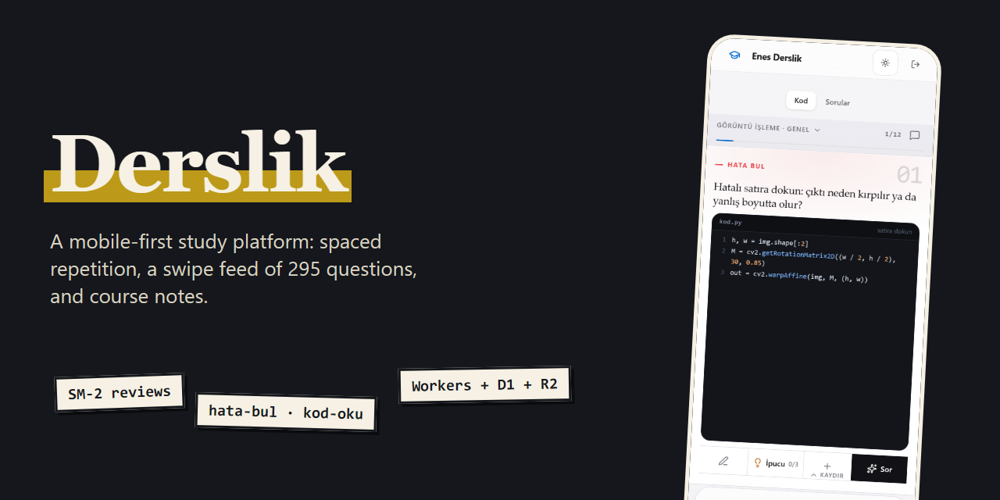
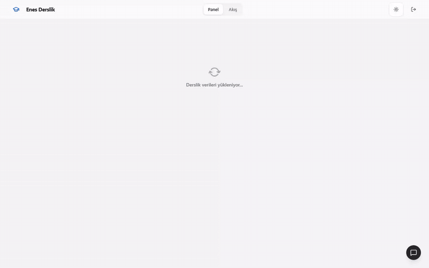
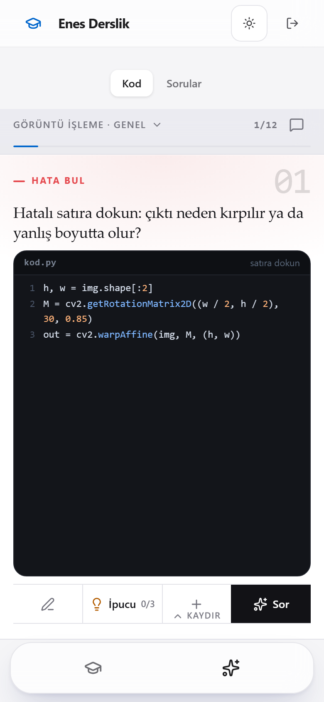
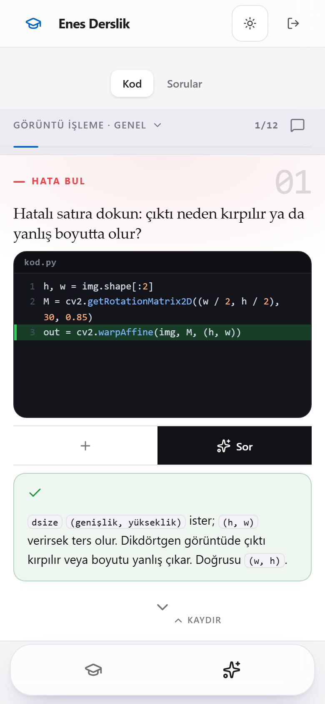
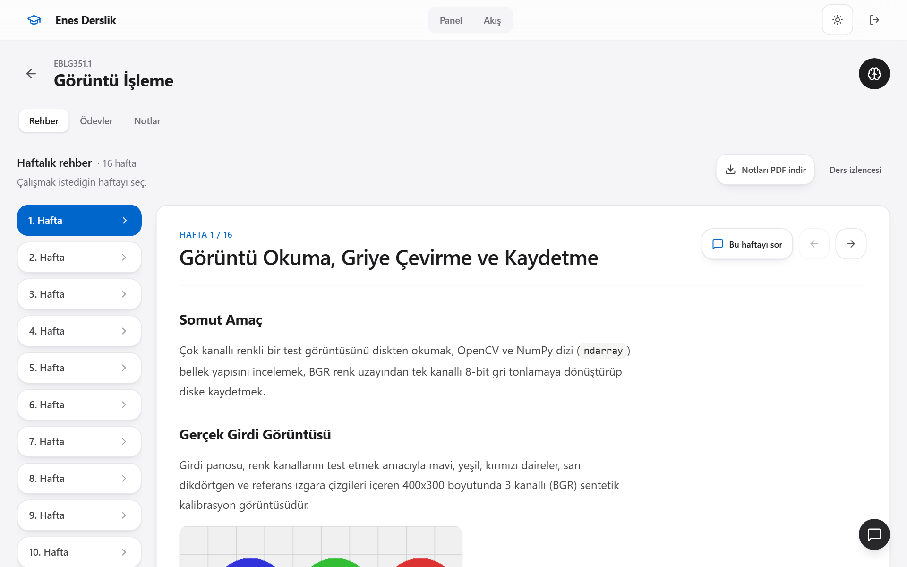
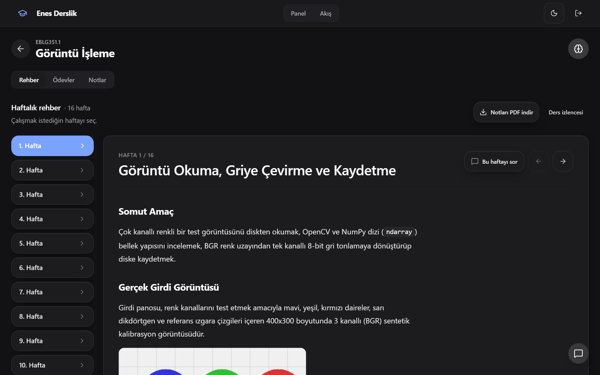
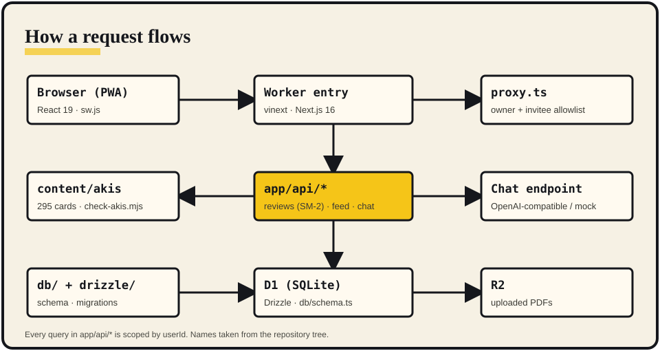
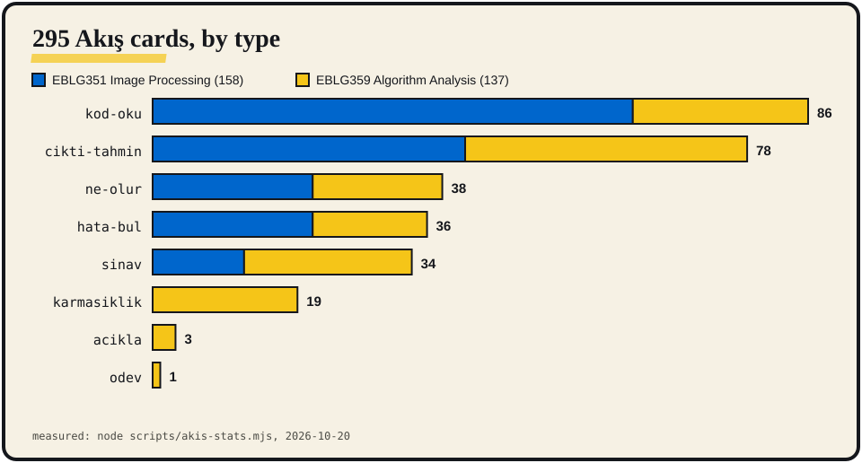

<p align="center"></p>
<p align="center"><a href="README.md">English</a> · <b>Türkçe</b></p>

Derslik, bir dönemlik üniversite slaytlarını ve PDF'lerini küçük, cevaplanabilir kartlara çevirir, SM-2 aralıklı tekrarla zamanlar ve telefonda kaydırabileceğin TikTok tarzı bir akışta sunar. Tek öğrenci ve kısa bir davet listesi için yapılmış kişisel bir projedir.

<p align="center">
&nbsp;&nbsp;
</p>

## Ne yapar

**Akış, kaydırmalı soru akışı.** Tam ekran, kaydırınca oturan kartlar: kod oku, çıktıyı tahmin et, hatayı bul, sınav tarzı soruları cevapla. EBLG351 (görüntü işleme) ve EBLG359 (algoritma analizi) için 295 kart; kapsam seçici ve anında cevap gösterimi var.

<p align="center">

</p>

**Aralıklı tekrar.** Hatırlamayı 1 ile 4 arası puanla. `app/api/reviews/route.ts` her kartın aralığını ve kolaylık katsayısını günceller; zamanı gelen kartlar panoda görünür.

**Ders alanı ve çalışma sohbeti.** Üniteler, notlar ve PDF kaynakları (R2'de), KaTeX ve Mermaid destekli Markdown. Sohbet OpenAI uyumlu herhangi bir uç noktayla çalışır; anahtar yoksa yerel sahte cevaba düşer.

<p align="center">
</p>

Dört tema (Açık, Koyu, Sage, Alacakaranlık), kurulabilir PWA kabuğu, sahip ve davetli izin listesi ile kullanıcıya özel veri yalıtımı ([SECURITY.md](SECURITY.md)).

## Nasıl çalışır

<p align="center"></p>

- Uygulama, vinext (Vite 8 üzerinde Next.js 16) ile Cloudflare Workers'ta çalışır.
- `proxy.ts` erişim kapısıdır (`OWNER_EMAIL`, `ALLOWED_EMAILS`); sahip tanımlı değilse site 503 döner.
- `app/api/*` içindeki rota işleyicileri her sorguyu `userId` ile sınırlar. Çalışma verisi Drizzle ile D1'de (`db/schema.ts`), yüklenen PDF'ler R2'dedir.
- Akış bankası `content/akis/` altında düz JSON'dur ve `scripts/check-akis.mjs` ile doğrulanır.

## Sayılar

<p align="center"></p>

2026-10-20'de ölçüldü (Windows 11, Node v24.18.0). Ham veri [`docs/media/data/`](docs/media/data/) altında.

| Komut | Çıkış kodu | Sonuç |
|---|---|---|
| `node scripts/check-akis.mjs` | 0 | 15 paket, 295 kart, 0 hata |
| `node --test lib/*.test.ts` | 0 | 48 test, 48 geçti, 0 kaldı (yaklaşık 0,4 sn) |
| `npm run lint` | 0 | 0 hata, 6 uyarı |
| `npm run build` | 0 | Worker ve istemci paketi derlendi |
| `node scripts/akis-stats.mjs` | 0 | Yukarıdaki grafiğin kaynağı |

## Hızlı başlangıç

```bash
node -v                          # >= 22.13
npm run install:ci
cp .dev.vars.example .dev.vars   # OWNER_EMAIL gir; CHAT_API_KEY isteğe bağlı
npm run dev                      # http://localhost:5173
```

Yerel sahte giriş için `/signin-with-chatgpt?return_to=/` adresini aç. Worker'ı derleyip yerelde denemek için: `npm run build && npm start`. Başlangıç şablonu notları ve eski teknik README [docs/NOTES.md](docs/NOTES.md) ile [docs/STARTER-NOTES.md](docs/STARTER-NOTES.md) içinde.

## Kullanım

Giriş yap, panodan bir ders seç ve **Akış**'ı aç. Sonraki kart için yukarı kaydır, cevaplamak için bir satıra ya da seçeneğe dokun, kartın doğru zamanda geri gelmesi için hatırlamanı puanla.

| Değişken | Amaç |
|---|---|
| `OWNER_EMAIL` | İçeri alınan hesap |
| `ALLOWED_EMAILS` | İsteğe bağlı, virgülle ayrılmış davetliler |
| `CHAT_API_KEY` | İsteğe bağlı; yoksa sohbet yerel sahte cevap kullanır |
| `CHAT_API_BASE` / `CHAT_MODEL` | OpenAI uyumlu uç nokta ve model |
| `CHAT_REASONING_EFFORT(_URET)` | `low`, `medium` veya `high` |

## Sınırlar

- Kişisel proje: herkese açık canlı demo ve kayıt yok. Kaynak yalnız incelemek için açık.
- Akış bankası yalnız iki dersi kapsıyor (EBLG351, EBLG359). Diğer dört dersin notları var ama Akış kartı yok.
- `scripts/check-curriculum.mjs` şu an başarısız: EBLG351.1 notları 0 müfredat sorusu üretiyor; EBLG351 Akış bankasından sunuluyor.
- Henüz `npm test` betiği yok; birim testler `node --test lib/*.test.ts` ile koşar.
- Gerçek sohbet cevapları ve canlıya dağıtım kendi API anahtarını ve Cloudflare hesabını ister; bu README için ikisi de denenmedi.

## Lisans

Tüm hakları saklıdır. Bkz. [LICENSE](LICENSE).

Eski teknik notlar: [docs/NOTES.md](docs/NOTES.md)
