## Hafta 1 — İşletim Sistemlerine Giriş (Bölüm 1)

### Öğrenme Hedefleri
Bu bölümü tamamladığınızda şunları yapabileceksiniz:
1. İşletim sisteminin iki temel varoluş amacını (**Soyutlama / Sanallaştırma** ve **Kaynak Yöneticisi / Hakem**) teknik temelleriyle açıklayabilmek.
2. Tarihsel gelişimdeki **Tek Programlı Yığın (Uniprogrammed Batch)**, **Çoklu Programlama (Multiprogramming)** ve **Zaman Paylaşımlı (Time-Sharing)** mimarilerin verimlilik ve yanıt süresi ödünleşimlerini karşılaştırabilmek.
3. Donanım korumasının temel taşı olan **Çift Modlu Çalışma (Dual-Mode: User Mode ve Kernel Mode)** mekanizmasını ve mod geçiş adımlarını izah edebilmek.
4. Asenkron **Donanım Kesmesi (Interrupt)** ile senkron **Yazılım Kesmesi / Tuzak (Trap / Exception)** arasındaki farkı ayırt edebilmek.

### Kavram Anlatımı ve Temel Teori

İşletim sistemi (OS - Operating System), doğrudan donanım üzerinde koşan ve kullanıcı programlarının güvenli, verimli ve donanımdan bağımsız bir şekilde çalışmasını sağlayan en temel yazılım katmanıdır.

#### 1. İşletim Sisteminin İki Asli Rolü
- **Soyutlama Katmanı (Virtual Machine / Abstraction):** Çıplak donanım son derece karmaşık, üreticiye bağımlı ve düşük seviyelidir (örneğin bir NVMe diskin LBA sektörleri veya ağ kartının PCIe tamponları). İşletim sistemi bu ham donanımı zarif, soyut mantıksal yapılara dönüştürür:
  - İşlemci (CPU) $\to$ **Süreç (Process)** ve **İş Parçacığı (Thread)**
  - Fiziksel Bellek (RAM) $\to$ **Sanal Adres Alanı (Virtual Address Space)**
  - Kalıcı Depolama (Disk/SSD) $\to$ **Dosya (File)** ve **Dizin (Directory)**
  - Ağ Arabirimi $\to$ **Soket (Socket)**
- **Kaynak Yöneticisi ve Hakem (Resource Manager / Arbitrator):** Birden fazla süreç aynı anda sınırlı donanım kaynaklarını talep ettiğinde; işletim sistemi adaleti (fairness), verimliliği (efficiency) ve izolasyonu (protection) sağlar. Bir sürecin diğerinin belleğine yazmasını veya CPU'yu sonsuza kadar tekeline almasını engeller.

#### 2. Tarihsel Sistem Mimarileri ve Evrim
- **Tek Programlı Yığın Sistemleri (Uniprogramming):** Bellekte aynı anda yalnızca bir program bulunur. Program bir G/Ç (Giriş/Çıkış - I/O) işlemi başlattığında CPU donanımı hiçbir iş yapmadan boşta bekler (*idle*). CPU kullanım oranı (% utilization) çok düşüktür.
- **Çoklu Programlama (Multiprogramming):** Ana bellekte birden çok program eşzamanlı tutulur. Çalışan program bir G/Ç işlemi başlattığında CPU boşa düşürülmez; işletim sistemi CPU'yu hazır bekleyen diğer programa devreder. **Temel hedef: CPU kullanım oranını maksimize etmektir.**
- **Zaman Paylaşımı (Time-Sharing / Multitasking):** CPU, zaman dilimlerine (*time slice / quantum*) bölünerek süreçler arasında hızla el değiştirir. Bu geçiş insan algısından hızlı gerçekleştiği için her kullanıcı bilgisayarı tek başına kullanıyormuş izlenimine kapılır. **Temel hedef: Kullanıcı yanıt süresini (response time) minimize etmektir.**

#### 3. Çift Modlu Çalışma ve Donanım Koruması
Kullanıcı süreçlerinin işletim sistemi çekirdeğini çökertmesini veya doğrudan donanıma yetkisiz erişmesini engellemek için işlemci donanımı en az iki çalışma modunu destekler:
- **Kullanıcı Modu (User Mode - Mod Biti = 1):** Uygulama kodları bu modda çalışır. Ayrıcalıklı komutlar (*privileged instructions*) doğrudan çalıştırılamaz.
- **Çekirdek Modu (Kernel / Supervisor Mode - Mod Biti = 0):** İşletim sistemi çekirdeği bu modda çalışır. Tüm donanım kaydedicilerine, bellek yönetim birimine (MMU) ve G/Ç portlarına tam erişim yetkisi vardır.

Bir kullanıcı programı donanıma erişmek istediğinde (örneğin ekrana yazı yazmak veya dosyadan okumak), bir **Sistem Çağrısı (System Call)** yapar. Bu işlem yazılımsal bir **Trap** komutu tetikleyerek işlemciyi çekirdek moduna geçirir.

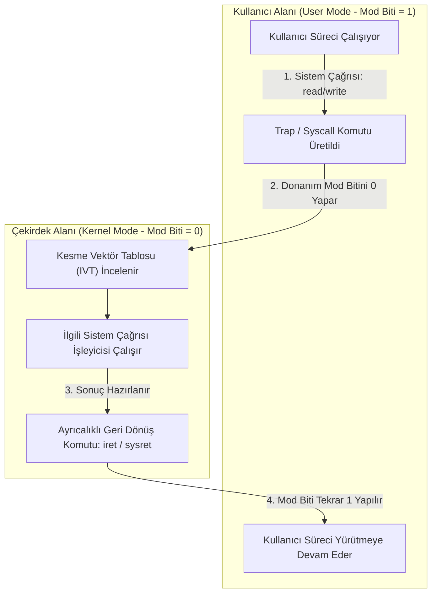

### Adım Adım Çözümlü Örnek / Vaka

**Senaryo:** Bir bilgisayar sisteminde $P_1$ ve $P_2$ adında iki bağımsız iş çalışacaktır:
- $P_1$: 3 ms CPU hesaplaması $\to$ 4 ms Disk G/Ç beklemesi $\to$ 2 ms CPU hesaplaması ile sonlanır (Toplam: 5 ms CPU, 4 ms G/Ç).
- $P_2$: 2 ms CPU hesaplaması $\to$ 2 ms Disk G/Ç beklemesi $\to$ 2 ms CPU hesaplaması ile sonlanır (Toplam: 4 ms CPU, 2 ms G/Ç).

$t=0$ anında her iki süreç de hazırdır ve öncelik $P_1$'dedir. Bağlam değiştirme (*context switch*) maliyetini ihmal ederek:
1. **Tek Programlı (Uniprogrammed)** sistemdeki toplam çalışma süresini ve CPU kullanım oranını bulunuz.
2. **Çoklu Programlamalı (Multiprogrammed)** sistemdeki toplam çalışma süresini ve CPU kullanım oranını adım adım zaman çizelgesiyle hesaplayınız.

**Çözüm Adımları:**

**1. Tek Programlı Sistem:**
İşler art arda yürütülür; $P_1$ tamamen bitmeden $P_2$ başlayamaz:
- $t=0 \dots 3$: $P_1$ CPU kullanır (3 ms).
- $t=3 \dots 7$: $P_1$ G/Ç bekler (4 ms). **CPU tamamen boştadır (idle).**
- $t=7 \dots 9$: $P_1$ CPU kullanır (2 ms) ve $t=9$'da biter.
- $t=9 \dots 11$: $P_2$ CPU kullanır (2 ms).
- $t=11 \dots 13$: $P_2$ G/Ç bekler (2 ms). **CPU boştadır.**
- $t=13 \dots 15$: $P_2$ CPU kullanır (2 ms) ve $t=15$'te biter.
- **Toplam Süre:** $15\text{ ms}$.
- **Toplam Harcanan CPU Süresi:** $(3 + 2) + (2 + 2) = 9\text{ ms}$.
- **CPU Verimliliği:** $(9 / 15) \times 100 = \%60.0$.

**2. Çoklu Programlamalı Sistem:**
$P_1$ G/Ç beklemeye geçtiği anda CPU $P_2$'ye devredilir:
- $t=0 \dots 3$: $P_1$ CPU kullanır (3 ms).
- $t=3$: $P_1$ G/Ç'ye başlar (bitiş zamanı: $3+4=7$). Boşalan CPU'yu $P_2$ alır.
- $t=3 \dots 5$: $P_2$ CPU kullanır (2 ms).
- $t=5$: $P_2$ kendi G/Ç'sine başlar (bitiş zamanı: $5+2=7$). Şu anda her iki süreç de G/Ç'dedir. CPU $t=5 \dots 7$ arasında (2 ms) boştadır.
- $t=7$: Hem $P_1$'in hem de $P_2$'nin G/Ç'si biter. Öncelikli olan $P_1$ CPU'yu alır.
- $t=7 \dots 9$: $P_1$ son 2 ms CPU patlamasını icra eder ve $t=9$'da başarıyla sonlanır.
- $t=9 \dots 11$: $P_2$ son 2 ms CPU patlamasını icra eder ve $t=11$'de sonlanır.
- **Toplam Süre:** $11\text{ ms}$ (Tek programlıya kıyasla $4\text{ ms}$ kazanç!).
- **Toplam Harcanan CPU Süresi:** $9\text{ ms}$.
- **CPU Verimliliği:** $(9 / 11) \times 100 = \%81.82$.

### Sık Karıştırılan Nokta
Donanım Kesmesi (*Hardware Interrupt*) ile Yazılım Kesmesi / Tuzak (*Trap / Software Interrupt / Exception*) sıklıkla karıştırılır:
- **Kesme (Interrupt):** Harici donanım birimleri (klavye, disk, zamanlayıcı) tarafından üretilir; CPU saatinden ve yürütülmekte olan koddan tamamen **asenkrondur**. CPU mevcut komutu bitirir bitirmez kesme sinyalini yakalar.
- **Trap / Exception:** Yürütülmekte olan program komutunun doğrudan sonucudur; tamamen **senkrondur** (örneğin sıfıra bölme hatası, geçersiz bellek erişimi veya bilinçli sistem çağrısı komutu). Aynı komut aynı girdilerle tekrar çalıştırılırsa aynı noktada tekrar trap oluşur.

### Kaynak Kartı
- **Ders Kitabı:** Silberschatz, Galvin, Gagne — *Operating System Concepts (10th Ed.)*, Bölüm 1: Introduction.
- **Video Ders (Doğrulanmış Kaynak):** Prof. Mythili Vutukuru (IIT Bombay), Lecture 1: Introduction to operating systems  
  URL: https://www.youtube.com/watch?v=aCJ3YgoolHQ  
  *Gerekçe:* İşletim sisteminin iki ana rolünü (sanallaştırma ve kaynak yöneticisi) berrak şemalarla açıklamakta ve uniprogramming/multiprogramming farkını donanım seviyesinde ele almaktadır.
- **Ders Portalı:** https://www.cse.iitb.ac.in/~mythili/os/

### Aktif Hatırlama Soruları ve Cevapları

**Soru 1:** Kullanıcı modunda çalışan bir program doğrudan `CLI` (Clear Interrupts - Kesmeleri Kapat) makine komutunu çalıştırırsa donanım seviyesinde ne gerçekleşir ve neden?
<details>
<summary>Cevap ve Açıklama</summary>
Kesmeleri kapatmak ayrıcalıklı bir komuttur (privileged instruction). Kullanıcı modunda (mod biti 1) bu komut yürütülmeye çalışıldığında işlemci donanımı işlemi derhal engeller ve bir "Genel Koruma Hatası" (General Protection Fault / Trap) üreterek kontrolü işletim sistemi çekirdeğine devreder. Çekirdek, kural dışı işlem yapan süreci varsayılan olarak sonlandırır (Segmentation fault / Core dumped). Aksi halde kötü niyetli bir program kesmeleri kapatarak CPU zamanlayıcısını (timer interrupt) devre dışı bırakabilir ve bilgisayarı kilitleyebilirdi.
</details>

**Soru 2:** Çoklu programlama (Multiprogramming) ile Zaman Paylaşımı (Time-Sharing) sistemlerinin birincil optimizasyon hedefleri arasındaki fark nedir?
<details>
<summary>Cevap ve Açıklama</summary>
Çoklu programlamanın birincil hedefi **kaynak verimliliği ve CPU kullanım oranını (% utilization) maksimize etmektir**; CPU'nun G/Ç beklemelerinde boş kalmasını önler. Zaman paylaşımının birincil hedefi ise insan-bilgisayar etkileşimini sağlamak üzere **yanıt süresini (response time) minimize etmektir**; CPU zamanı küçük dilimlere bölünerek süreçler arasında hızla paylaştırılır.
</details>

**Soru 3:** Sistem çağrısı sırasında işletim sisteminin hangi kod bloğunun çalıştırılacağını kullanıcı programının doğrudan bir bellek adresi vererek belirlemesine neden izin verilmez?
<details>
<summary>Cevap ve Açıklama</summary>
Eğer kullanıcı programı çekirdek moduna geçerken atlayacağı bellek adresini kendisi seçebilseydi, çekirdek kodunun güvenlik denetimlerini atlayıp doğrudan hassas veri yapılarını değiştiren talimatlara sıçrayabilirdi. Bu nedenle donanım seviyesinde **Kesme Vektör Tablosu (Interrupt Vector Table - IVT)** kullanılır. Kullanıcı programı yalnızca bir sistem çağrısı indeksi (örneğin Linux x86_64'te `RAX` yazmacına sistem çağrı numarası) iletir; işletim sistemi önceden belirlenmiş güvenli giriş noktasına dallanır.
</details>

---
## Hafta 2 — İşletim Sistemi Yapıları (Bölüm 2)

### Öğrenme Hedefleri
Bu bölümü tamamladığınızda şunları yapabileceksiniz:
1. Bir işletim sistemi çekirdeğinin sunduğu temel hizmetleri (süreç yürütme, G/Ç işlemleri, dosya yönetimi, iletişim, hata algılama) listelemek.
2. Uygulama Programlama Arayüzü (**API - POSIX, Win32**) ile doğrudan **Sistem Çağrısı (System Call)** arasındaki ilişkiyi ve parametre aktarım yöntemlerini açıklayabilmek.
3. **Monolitik (Monolithic)**, **Mikroçekirdek (Microkernel)** ve **Hibrit (Hybrid)** çekirdek mimarilerini performans, genişletilebilirlik ve hata toleransı yönünden karşılaştırabilmek.
4. Bir sistem çağrısının kullanıcı alanından donanıma uzanan yürütüm basamaklarını adım adım analiz edebilmek.

### Kavram Anlatımı ve Temel Teori

#### 1. Sistem Çağrıları ve Arayüz Katmanları
Kullanıcı uygulamaları doğrudan donanımla konuşamaz. İşletim sistemi çekirdeğinin sunduğu korumalı servislere erişmek için **Sistem Çağrıları (System Calls)** kullanılır. Geliştiriciler genellikle doğrudan ham sistem çağrısı yazmak yerine standart **API** (Application Programming Interface) fonksiyonlarını (örneğin C standart kütüphanesindeki `printf()`, `fopen()` veya POSIX standartlarındaki `write()`, `open()`) kullanırlar.

API kullanımı şu avantajları sağlar:
- **Taşınabilirlik (Portability):** Program kaynak kodu farklı işletim sistemlerinde aynı API ile yeniden derlenebilir.
- **Kullanım Kolaylığı:** Ham sistem çağrılarının karmaşık register protokolleri ve veri hizalama detayları kütüphane fonksiyonu tarafından gizlenir.

#### 2. Parametre Aktarma Mekanizmaları
Kullanıcı programı sistem çağrısına veri iletirken işletim sistemine parametre aktarmanın üç temel yolu vardır:
1. **İşlemci Kaydedicileri (Registers):** Parametreler doğrudan CPU kaydedicilerine (örneğin `RDI`, `RSI`, `RDX`) yazılır. En hızlı yöntemdir ancak aktarılabilecek parametre sayısı ve boyutu kaydedici sayısıyla sınırlıdır.
2. **Bellek Bloğu / Tablosu (Block / Table):** Parametreler ana bellekte bir blokta saklanır ve bu bloğun başlangıç bellek adresi bir kaydedici aracılığıyla çekirdeğe iletilir (Linux ve çoğu modern mimari büyük parametrelerde bu yöntemi uygular).
3. **Sistem Yığını (Stack):** Parametreler kullanıcı yığınına (`push`) atılır; çekirdek bu parametreleri yığından çeker (`pop`).

#### 3. Çekirdek Mimarilerinin Karşılaştırılması
Çekirdek mimarisi, işletim sistemi bileşenlerinin çekirdek modunda mı yoksa kullanıcı modunda mı konumlandırıldığını belirler:

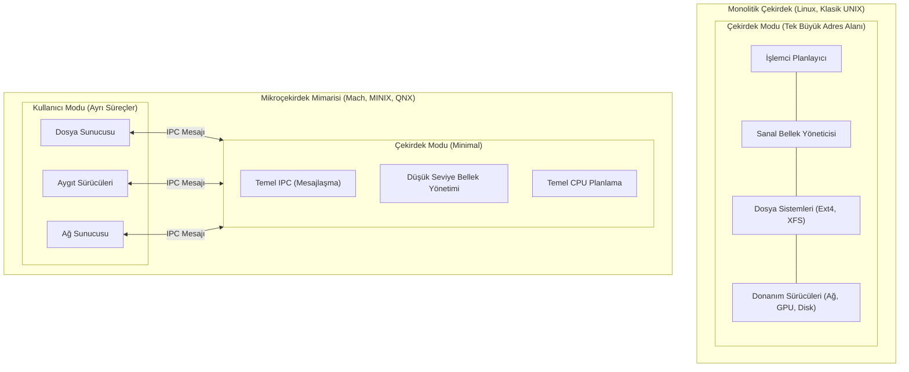

| Mimari Özelliği | Monolitik Çekirdek (Monolithic) | Mikroçekirdek (Microkernel) |
| :--- | :--- | :--- |
| **Bileşen Konumu** | Sürücüler, dosya sistemleri, bellek yönetimi tek bir büyük çekirdek adres alanındadır. | Çekirdekte yalnızca en temel işlevler (IPC, temel bellek, planlama) bulunur; sürücüler kullanıcı alanındadır. |
| **Performans** | **Çok Yüksek:** Bileşenler arası iletişim doğrudan fonksiyon çağrısıdır, bağlam değişimi gerekmez. | **Daha Düşük:** Kullanıcı sunucuları arasındaki her iletişim çekirdek üzerinden IPC mesajlaşması ve mod değişimi gerektirir. |
| **Güvenilirlik & İzolasyon** | Bir aygıt sürücüsündeki çökme veya bellek hatası tüm işletim sistemini çökertir (Kernel Panic). | Bir aygıt sürücüsü çökerse yalnızca o kullanıcı süreci çöker; çekirdek etkilenmez ve sürücü yeniden başlatılabilir. |
| **Genişletilebilirlik** | Yeni özellikler çekirdeğin yeniden derlenmesini veya modül yüklenmesini gerektirir. | Yeni servisler sıradan kullanıcı süreçleri olarak sisteme kolayca eklenebilir. |

### Adım Adım Çözümlü Örnek / Vaka

**Senaryo:** Standart bir C programında yer alan aşağıdaki satırın Linux x86_64 mimarisinde icra edildiğini varsayalım:
```c
write(1, "Sistem
", 7);
```
Bu komutun donanım seviyesinde icra ediliş basamaklarını ve kullanıcı modu ile çekirdek modu arasındaki sınır geçişlerini adım adım açıklayınız.

**Çözüm Adımları:**
1. **Parametrelerin Hazırlanması (Kullanıcı Alanı):** C kütüphanesi sarmalayıcısı (`glibc wrapper`), parametreleri ABI (Application Binary Interface) kuralına göre işlemci kaydedicilerine yazar:
   - `RAX = 1` (`sys_write` sistem çağrısının benzersiz numarası).
   - `RDI = 1` (Dosya tanıtıcısı / *File Descriptor*: 1 standart çıktıyı - `stdout` temsil eder).
   - `RSI = &"Sistem
"` (Metin katarının bellekteki başlangıç adresi).
   - `RDX = 7` (Yazılacak bayt sayısı).
2. **Trap / Geçiş Komutu:** Program x86_64 mimarisinde `syscall` makine komutunu yürütür.
   - Donanım, mevcut kullanıcı program sayacını (`RIP`) ve bayrak kaydedicisini (`RFLAGS`) özel MSR (*Model Specific Registers*) kaydedicilerine yedekler.
   - Donanım mod bitini 0 (Kernel Mode) yapar ve CPU'yu çekirdeğin önceden kaydettiği sistem çağrısı giriş adresine (`system_call_entry`) dallandırır.
3. **Çekirdek İçi Doğrulama ve Yönlendirme:**
   - Çekirdek, çağıran sürecin çekirdek yığınına (*kernel stack*) diğer kaydedicileri kaydeder.
   - `RAX` içindeki değeri sistem çağrı tablosunda (*sys_call_table*) kontrol eder. Değer geçerli aralıktaysa `sys_write()` fonksiyonuna yönlendirir.
   - İletilen işaretçinin (`RSI`) geçerli bir kullanıcı bellek alanı olup olmadığını denetler.
4. **Hizmetin Yürütülmesi:** Çekirdeğin sanal dosya sistemi (VFS) ve terminal sürücüsü 7 baytlık veriyi ekrana basılmak üzere ilgili konsol donanımının tamponuna yazar.
5. **Kullanıcı Moduna Dönüş:**
   - Fonksiyon dönüş değeri (yazılan bayt sayısı olan 7) `RAX` kaydedicisine yazılır.
   - Çekirdek `sysretq` komutunu çalıştırır. Donanım mod bitini tekrar 1 yapar, kaydedicileri geri yükler ve kullanıcı programı kaldığı yerden devam eder.

### Sık Karıştırılan Nokta
Kütüphane çağrısı (*Library Call - örneğin C'deki `printf`*) ile sistem çağrısı (*System Call - örneğin `write`*) aynı şey değildir. `printf()` kullanıcı alanında çalışan bir fonksiyondur; tamponlama (*buffering*) ve biçimlendirme yapar. `printf()` her çağrıldığında çekirdeğe geçilmez; tampon dolduğunda veya satır sonu karakteri geldiğinde arka planda tek bir `write()` sistem çağrısı tetiklenir. Bu sayede mod geçişi maliyeti dramatik biçimde azaltılır.

### Kaynak Kartı
- **Ders Kitabı:** Silberschatz, Galvin, Gagne — *Operating System Concepts (10th Ed.)*, Bölüm 2: Operating-System Structures.
- **Video Ders (Doğrulanmış Kaynak):** Prof. Mythili Vutukuru (IIT Bombay), Lecture 3: System calls for process management  
  URL: https://youtu.be/8ad4DzlZwgI  
  *Gerekçe:* Sistem çağrısı arabirimini, parametre geçirme yöntemlerini ve çekirdek giriş mekanizmasını kod seviyesinde ele almaktadır.
- **Tamamlayıcı Video:** Prof. Mythili Vutukuru, Lecture 4: Process execution mechanisms  
  URL: https://youtu.be/RxLJvh-nzQ8

### Aktif Hatırlama Soruları ve Cevapları

**Soru 1:** Mikroçekirdek mimarisinde bir dosya yazma işlemi gerçekleştirilirken, monolitik mimariye kıyasla neden daha fazla mod değiştirme (mode switch) ve bağlam değiştirme (context switch) gerçekleşir?
<details>
<summary>Cevap ve Açıklama</summary>
Monolitik çekirdekte dosya sistemi ve aygıt sürücüsü zaten çekirdek alanında yer alır; tek bir sistem çağrısı ile çekirdeğe girilir ve doğrudan donanıma yazılır (2 mod geçişi: User $	o$ Kernel $	o$ User). Mikroçekirdekte ise dosya sunucusu ve disk sürücüsü ayrı kullanıcı süreçleridir. Uygulama önce çekirdeğe IPC isteği atar, çekirdek dosya sunucusuna bağlam değiştirir; dosya sunucusu disk sürücüsüyle konuşmak için tekrar çekirdek üzerinden IPC yapar. Bu durum zincirleme bağlam ve mod geçişlerine yol açarak IPC ek yükünü (overhead) artırır.
</details>

**Soru 2:** Sistem çağrısı yapılırken parametre aktarımında işlemci yazmaçları yerine bellek tablosu (block table) yönteminin tercih edilmesinin temel nedeni nedir?
<details>
<summary>Cevap ve Açıklama</summary>
İşlemci kaydedicilerinin (registers) sayısı fiziksel olarak sınırlıdır (örneğin x86_64 mimarisinde genel amaçlı yazmaç sayısı kısıtlıdır). Çok sayıda parametre alan veya büyük boyutlu veri yapıları (örneğin ağ soket yapılandırmaları, karmaşık dosya nitelikleri) ileten sistem çağrılarında parametrelerin tümü yazmaçlara sığmaz. Bu durumda parametreler bellekte bitişik bir blokta toplanır ve çekirdeğe yalnızca bu bloğun bellek adresi iletilir.
</details>

**Soru 3:** Katmanlı işletim sistemi mimarisinin (Layered Approach) en büyük tasarım zorluğu ve dezavantajı nedir?
<details>
<summary>Cevap ve Açıklama</summary>
En büyük tasarım zorluğu **katmanların hiyerarşik bağımlılıklarını doğru tanımlamaktır**. Örneğin, yedekleme belleği (backing store) sürücüsü sanal bellek katmanına ihtiyaç duyarken, sanal bellek yöneticisi de sayfaları diske yazmak için disk sürücüsü katmanına ihtiyaç duyar. Ayrıca her katmandan geçerken parametrelerin dönüştürülmesi ve ek fonksiyon çağrıları yapılması sistem başarımını (performansı) düşürür.
</details>

---
## Hafta 3 — Süreçler (Bölüm 3)

### Öğrenme Hedefleri
Bu bölümü tamamladığınızda şunları yapabileceksiniz:
1. Bir program (pasif varlık) ile **Süreç (Process - aktif varlık)** arasındaki farkı ve sürecin bellek yerleşimini (**Text, Data, BSS, Heap, Stack**) açıklayabilmek.
2. Beş durumlu süreç modelini (**New, Ready, Running, Waiting/Blocked, Terminated**) ve durum geçiş tetikleyicilerini tanımlayabilmek.
3. **Süreç Denetim Bloğu (PCB - Process Control Block)** veri yapısının bileşenlerini ve **Bağlam Değiştirme (Context Switch)** mekanizmasını analiz edebilmek.
4. UNIX süreç oluşturma hiyerarşisini (`fork()`, `exec()`, `wait()`, `exit()`) ve Süreçler Arası İletişim (**IPC: Shared Memory ve Message Passing**) modellerini karşılaştırabilmek.

### Kavram Anlatımı ve Temel Teori

#### 1. Sürecin Bellek Anatomisi
Program diskte saklanan çalıştırılabilir bir dosya iken (pasif); süreç belleğe yüklenmiş ve Program Sayacı (PC) ilerleyen yaşayan bir varlıktır (aktif). Tipik bir sürecin sanal adres alanındaki katmanları şunlardır:

```
+-------------------------------------------------------+ Yüksek Adresler (0xFFFFFFFF)
|                      STACK (Yığın)                    |
|   (Yerel değişkenler, fonksiyon dönüş adresleri,      |
|    çerçeve işaretçileri - aşağı doğru büyür \/ )      |
+-------------------------------------------------------+
|                          |                            |
|                          v                            |
|                                                       |
|                          ^                            |
|                          |                            |
+-------------------------------------------------------+
|                      HEAP (Öbek)                      |
|   (Dinamik bellek: malloc/new - yukarı doğru büyür /\)|
+-------------------------------------------------------+
|                      BSS Segmenti                     |
|   (Başlatılmamış global ve statik değişkenler)        |
+-------------------------------------------------------+
|                      DATA Segmenti                    |
|   (İlk değer atanmış global ve statik değişkenler)    |
+-------------------------------------------------------+
|                      TEXT Segmenti                    |
|   (Çalıştırılabilir makine kodu - salt okunur)        |
+-------------------------------------------------------+ Düşük Adresler (0x00000000)
```

#### 2. Beş Durumlu Süreç Yaşam Döngüsü
Bir süreç yaşamı boyunca farklı durumlara girer:

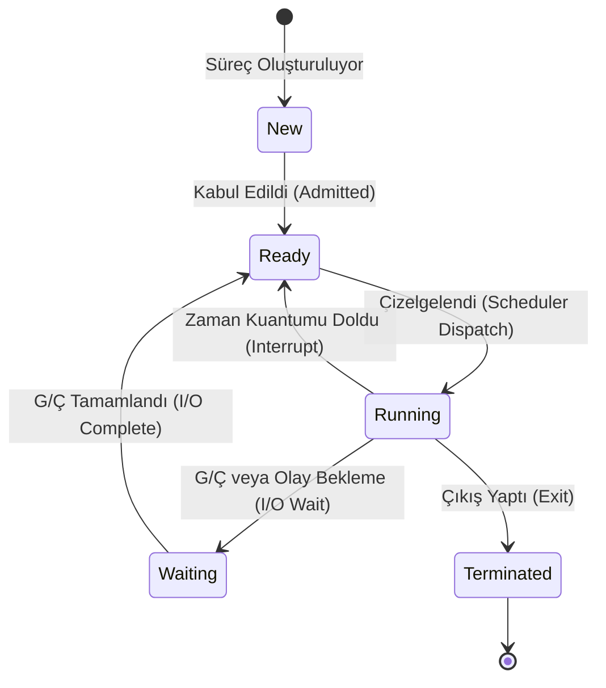

- **New:** Süreç oluşturulmaktadır.
- **Ready (Hazır):** Süreç çalışmak için tüm kaynaklara sahiptir; yalnızca CPU'nun kendisine tahsis edilmesini bekler.
- **Running (Çalışıyor):** Komutlar CPU üzerinde bizzat yürütülmektedir.
- **Waiting / Blocked (Bekliyor):** Süreç bir G/Ç işleminin tamamlanması veya bir sinyalin gelmesi gibi harici bir olayı beklemektedir. CPU boşalsa dahi çalışamaz.
- **Terminated (Sonlandı):** Süreç çalışmasını bitirmiştir; kaynakları işletim sistemi tarafından toplanmayı bekler.

#### 3. PCB ve Bağlam Değiştirme (Context Switch)
İşletim sistemi her süreç için çekirdekte bir **Süreç Denetim Bloğu (PCB - Process Control Block)** tutar. PCB şunları içerir:
- **Süreç Kimliği (PID):** Benzersiz süreç numarası.
- **Süreç Durumu:** Ready, Running, Waiting vb.
- **Program Sayacı (PC):** Yürütülecek bir sonraki komutun adresi.
- **CPU Kaydedicileri:** Akümülatörler, dizin yazmaçları, yığın işaretçisi (`SP`).
- **CPU Planlama Bilgileri:** Öncelik değeri, çizelgeleme kuyruk işaretçileri.
- **Bellek Yönetim Bilgileri:** Sayfa tabloları veya segment tabloları.
- **Hesap Bilgileri ve Açık Dosya Listesi:** Kullanılan CPU süresi, açık dosya tanıtıcıları.

**Bağlam Değiştirme (Context Switch):** CPU bir süreçten diğerine geçtiğinde, eski sürecin durumu (kaydediciler, PC, PCB) kaydedilmeli ve yeni sürecin durumu yüklenmelidir. Bağlam değiştirme süresince **faydalı hiçbir iş yapılmaz**; bu süre saf donanımsal ve yazılımsal ek yüktür (*overhead*). Ayrıca CPU önbellekleri (*L1/L2/L3 cache*) ve TLB temizlendiği için sistem bir süre soğuk önbellek (*cold cache*) ile yavaş çalışır.

#### 4. Süreç Kontrolü ve IPC Modelleri
UNIX sistemlerinde yeni bir süreç `fork()` sistem çağrısı ile oluşturulur. `fork()` var olan sürecin (ata - parent) tam bir kopyasını (çocuk - child) oluşturur. Çocuk süreç `exec()` ailesi çağrılarla bellek alanını yeni bir ikili programla değiştirir. Ata süreç ise çocuğun sonlanmasını `wait()` ile bekler.

**Süreçler Arası İletişim (IPC):**
1. **Paylaşılan Bellek (Shared Memory):** Süreçler ortak bir bellek bölgesini adres alanlarına bağlarlar. Çekirdek müdahalesi olmadan doğrudan bellek hızında iletişim kurulur; en hızlı IPC yoludur ancak eşzamanlama (senkronizasyon) sorumluluğu tamamen programcıya aittir.
2. **Mesajlaşma (Message Passing):** Süreçler `send()` ve `receive()` sistem çağrılarıyla mesaj paketleri alıp verirler. Çekirdek hakemliğinde yürütülür; dağıtık sistemlere uygundur ancak her mesajda sistem çağrısı ve tampon kopyalama maliyeti vardır.

### Adım Adım Çözümlü Örnek / Vaka

**Senaryo:** Aşağıdaki C program parçasının çalıştırıldığını varsayalım:
```c
#include <stdio.h>
#include <unistd.h>
#include <sys/wait.h>

int main() {
    int val = 10;
    pid_t pid1 = fork();
    
    if (pid1 == 0) { // Çocuk süreç
        val += 5;
        fork();
        val += 2;
        printf("C: %d ", val);
    } else { // Ata süreç
        wait(NULL);
        val -= 3;
        printf("P: %d ", val);
    }
    return 0;
}
```
1. Bu kod parçası toplam kaç süreç oluşturur?
2. Ekrana basılabilecek `printf` çıktılarını ve süreçlerin bellek izolasyonunu adım adım açıklayınız.

**Çözüm Adımları:**
1. **Süreç Sayısı Analizi:**
   - Başlangıçta 1 ata süreç ($P_{ata}$) vardır. `val = 10`.
   - İlk `fork()` çalışır: $P_{ata}$ çocuğu oluşturur ($P_{cocuk1}$). Artık 2 süreç vardır.
   - $P_{ata}$, `else` bloğuna girer ve `wait(NULL)` çağrısıyla çocuğunun bitmesini beklemeye başlar. Başka `fork` çalıştırmaz.
   - $P_{cocuk1}$, `if` bloğuna girer. $P_{cocuk1}$ için `val` başlangıçta 10 idi; `val += 5` ile `val = 15` olur.
   - Ardından $P_{cocuk1}$ ikinci bir `fork()` çalıştırır: Kendisine ait bir torun süreç ($P_{torun}$) doğar! Artık toplam **3 süreç** vardır.
   - Hem $P_{cocuk1}$ hem de $P_{torun}$, ikinci `fork` noktasından itibaren çalışmaya devam eder. Her ikisinde de `val` değeri 15'tir.
   - Her ikisi de `val += 2` yapar: `val = 17` olur.
   - Her iki çocuk süreç de `printf("C: %d ", val);` çalıştırır. Dolayısıyla ekrana iki kez `C: 17` basılır.
2. **Ata Sürecin Çalışması ve Bellek İzolasyonu:**
   - Çocuklar sonlandığında $P_{ata}$ `wait()` fonksiyonundan uyanır.
   - **Kritik İlke:** Süreçler bağımsız adres alanlarına sahiptir. Çocukların `val` değişkeninde yaptığı değişiklikler atanın belleğini etkilemez! Atanın `val` değeri hala 10'dur.
   - Ata süreç `val -= 3` yapar: `val = 7` olur.
   - Ekrana `P: 7 ` basılır.
- **Konsol Çıktısı (Süreç çizelgeleme sırasına bağlı olarak):** `C: 17 C: 17 P: 7 ` (veya çocukların sırası değişebilir, ancak `P: 7` daima `wait` nedeniyle en sonda yer alır).

### Sık Karıştırılan Nokta
"Ready" (Hazır) durumu ile "Waiting/Blocked" (Bekleyen) durumu sıklıkla birbirine karıştırılır:
- **Ready:** Sürecin çalışması için hiçbir engel yoktur; değişkenleri bellektedir, G/Ç tamamlanmıştır, sadece CPU planlayıcısının kendisine işlemci tahsis etmesini beklemektedir.
- **Waiting/Blocked:** Süreç istese de CPU üzerinde koşamaz. Bir donanım kesmesi, disk okuması, ağ paketi veya kilit açılması gibi dışsal bir olayı beklemektedir. CPU boşta kalsa dahi waiting durumundaki bir süreç çalıştırılamaz.

### Kaynak Kartı
- **Ders Kitabı:** Silberschatz, Galvin, Gagne — *Operating System Concepts (10th Ed.)*, Bölüm 3: Processes.
- **Video Ders (Doğrulanmış Kaynak):** Prof. Mythili Vutukuru (IIT Bombay), Lecture 2: Process abstraction  
  URL: https://youtu.be/lIZN6UgoxOc  
  *Gerekçe:* Süreç adres alanının mantıksal yapısını ve PCB bileşenlerini detaylı olarak inceler.
- **Tamamlayıcı Video:** Prof. Mythili Vutukuru, Lecture 6: Inter-process communication  
  URL: https://youtu.be/UbXGJDWNK9c

### Aktif Hatırlama Soruları ve Cevapları

**Soru 1:** `fork()` çağrıldığında ata sürecin belleği çocuğa kopyalanırken modern işletim sistemleri neden doğrudan tüm belleği kopyalamak yerine "Copy-on-Write (CoW)" tekniğini kullanır?
<details>
<summary>Cevap ve Açıklama</summary>
Geleneksel kopyalamada atanın tüm sayfaları (bazen gigabaytlarca) fiziksel olarak yeni çerçevelere kopyalanır. Oysa süreçlerin çoğu `fork()` çağrısından hemen sonra `exec()` çalıştırarak adres alanını tamamen yeni bir programla ezer. Bu durumda yapılan tüm bellek kopyalama işlemi boşa gitmiş olur. Copy-on-Write tekniğinde ata ve çocuk başlangıçta aynı fiziksel sayfaları salt-okunur (read-only) paylaşır. Yalnızca süreçlerden biri herhangi bir sayfaya yazma yapmaya çalıştığında bir sayfa hatası tetiklenir ve sadece değiştirilmek istenen o tek sayfa kopyalanarak sürecin özel kullanımına verilir. Bu muazzam bir bellek ve zaman tasarrufu sağlar.
</details>

**Soru 2:** Bir işletim sisteminde "Zombi Süreç (Zombie Process)" ve "Yetim Süreç (Orphan Process)" nasıl oluşur ve sistem bunları nasıl temizler?
<details>
<summary>Cevap ve Açıklama</summary>
- **Zombie Process:** Çocuk süreç çalışmasını bitirip `exit()` ile sonlanmıştır ancak ata süreç henüz `wait()` çağrısı yaparak çocuğun çıkış durumunu okumamıştır. Sürecin bellek alanları boşaltılmış olsa da çıkış kodu ve PID'si PCB tablosunda kalır. Ata `wait()` çağırdığında zombi tamamen silinir.
- **Orphan Process:** Ata süreç, çocuğu henüz çalışırken `wait()` çağırmadan aniden sonlanmıştır. Çocuk sahipsiz kalır. Modern işletim sistemlerinde bu yetim süreçler doğrudan kök sürece (Linux'ta `systemd` veya `init`, PID=1) evlatlık verilir (*re-parenting*). `init` süreci periyodik olarak `wait()` çağırarak yetimler bittiğinde onları temizler.
</details>

**Soru 3:** Bağlam değiştirme (Context Switch) süresinin saf ek yük (overhead) olmasının nedeni nedir ve donanım mimarisinde bunu hızlandırmak için hangi teknikler kullanılır?
<details>
<summary>Cevap ve Açıklama</summary>
Bağlam değişimi sırasında işletim sistemi kullanıcı kodunu ilerletmez; yalnızca bir sürecin yazmaçlarını kaydedip diğerininkini yükler. Bu esnada faydalı hesaplama yapılmadığı için geçen süre saf maliyettir. Ayrıca CPU önbellekleri (Cache) ve TLB geçersiz kaldığı için başarım düşer. Donanım seviyesinde bu süreci hızlandırmak için işlemcilerde birden fazla yazmaç kümesi (multiple register sets - örneğin Sun UltraSPARC veya modern ARM mimarilerinde) kullanılır; böylece yazmaçları belleğe kaydetmek yerine yalnızca bir işaretçi kaydırılarak anında bağlam değiştirilebilir.
</details>

---
## Hafta 4 — Eşzamanlılık ve İş Parçacıkları (Bölüm 4)

### Öğrenme Hedefleri
Bu bölümü tamamladığınızda şunları yapabileceksiniz:
1. **Süreç (Process)** ile **İş Parçacığı (Thread - Hafif Süreç / LWP)** arasındaki yapısal farkları; paylaşılan ve bireysel kaynakları ayırt edebilmek.
2. **Kullanıcı Düzeyi İş Parçacıkları (User-Level Threads - ULT)** ile **Çekirdek Düzeyi İş Parçacıkları (Kernel-Level Threads - KLT)** mimarilerini avantaj ve kısıtlarıyla değerlendirebilmek.
3. Çoklu iş parçacığı modellerini (**Many-to-One**, **One-to-One**, **Many-to-Many**) karşılaştırabilmek.
4. **Eşzamanlılık (Concurrency)** ile **Paralellik (Parallelism)** arasındaki farkı kavramak ve **Amdahl Kanunu (Amdahl's Law)** ile teorik hızlanma sınırlarını hesaplayabilmek.

### Kavram Anlatımı ve Temel Teori

#### 1. İş Parçacığı Nedir? Neden İhtiyaç Duyulur?
Geleneksel bir süreç, tek bir kontrol akışına (single thread of control) sahip ağır bir yapıdır. Bir süreç içinde birden fazla görevi aynı anda yürütmek istediğimizde (örneğin bir web tarayıcısında bir sekmenin sayfa verisini indirirken diğerinin kullanıcı tıklamalarını dinlemesi), yeni bir süreç oluşturmak (`fork`) yüksek bellek ve bağlam değiştirme maliyetine yol açar.

**İş Parçacığı (Thread)**, CPU kullanımının en temel birimidir ve "hafif süreç" (*Lightweight Process*) olarak adlandırılır. Bir süreç içindeki tüm iş parçacıkları şu kaynakları **ortak paylaşır**:
- **Kod Bölümü (Text Segment)**
- **Veri Bölümü (Data & BSS Segments)**
- **Öbek Alanı (Heap - Dinamik bellek)**
- **Açık Dosyalar ve İşletim Sistemi Kaynakları (Dosya tanıtıcıları, sinyaller)**

Buna karşılık, her iş parçacığının bağımsız yürütüm sağlayabilmesi için **kendisine özel (private)** olması gereken alanlar vardır:
- **İş Parçacığı Kimliği (Thread ID - TID)**
- **Program Sayacı (PC - Hangi komutta olduğu)**
- **İşlemci Kaydedici Kümesi (Register Set)**
- **Yığın Alanı (Stack - Yerel değişkenleri ve fonksiyon çağrı çerçeveleri)**

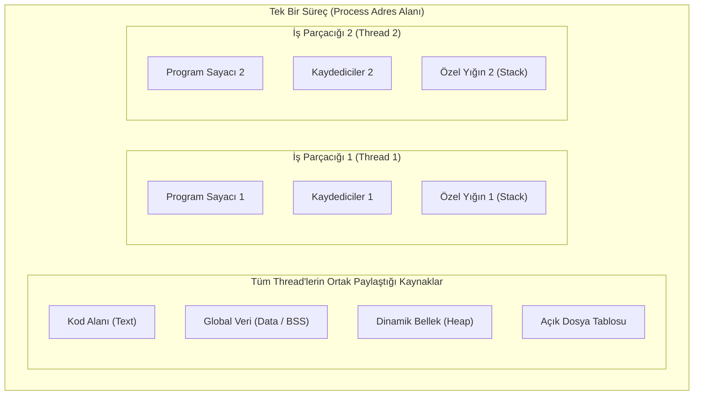

#### 2. Kullanıcı Seviyesi (ULT) vs Çekirdek Seviyesi (KLT)
- **Kullanıcı Seviyesi İş Parçacıkları (ULT):** Thread yönetimi tamamen kullanıcı alanında bir kütüphane (*örneğin eski GNU Portable Threads*) tarafından yapılır. Çekirdeğin thread'lerden haberi yoktur; çekirdek tüm süreci tek bir iş parçacığı olarak görür.
  - *Avantajı:* Thread oluşturma ve bağlam değiştirme tamamen kullanıcı alanındadır, sistem çağrısı gerekmez, son derece hızlıdır.
  - *Dezavantajı:* Eğer bir thread bloklayıcı bir sistem çağrısı (örneğin disk okuma) yaparsa, çekirdek tüm süreci uyutur; diğer thread'ler çalışmaya devam edemez. Çok çekirdekli işlemcilerde birden fazla CPU'ya dağıtılamaz.
- **Çekirdek Seviyesi İş Parçacıkları (KLT):** Thread'ler doğrudan işletim sistemi çekirdeği tarafından yönetilir ve çizelgelenir (Linux `clone()`, Windows threads).
  - *Avantajı:* Bir thread bloklandığında çekirdek aynı sürecin diğer thread'ini başka bir CPU çekirdeğinde çalıştırabilir. Gerçek donanımsal paralellik sağlanır.
  - *Dezavantajı:* Thread işlemleri sistem çağrısı gerektirdiğinden ULT'ye kıyasla daha yavaştır.

#### 3. Çoklu İş Parçacığı Modelleri
- **Many-to-One:** Çok sayıda kullanıcı thread'i tek bir çekirdek thread'ine eşlenir (ULT yaklaşımı). Çok çekirdek desteği yoktur.
- **One-to-One:** Her kullanıcı thread'i doğrudan bir çekirdek thread'ine eşlenir (Linux ve Windows bu modeli kullanır). En yüksek eşzamanlılığı sağlar.
- **Many-to-Many:** Çok sayıda kullanıcı thread'i eşit veya daha az sayıda çekirdek thread'i havuzuna çoklanır.

#### 4. Eşzamanlılık, Paralellik ve Amdahl Kanunu
- **Eşzamanlılık (Concurrency):** Birden fazla görevin zaman içinde iç içe geçerek (*interleaved*) ilerlemesidir. Tek bir CPU çekirdeğinde de zaman paylaşımı ile mümkündür.
- **Paralellik (Parallelism):** Birden fazla görevin aynı fiziksel zaman anında birden çok CPU çekirdeği üzerinde kelimenin tam anlamıyla aynı anda yürütülmesidir.

**Amdahl Kanunu (Amdahl's Law):** Bir uygulamanın seri çalışmak zorunda olan (paralelleştirilemeyen) kısmının oranını $S$ (veya paralel kısmı $p = 1 - S$), işlemci çekirdek sayısını $N$ kabul edersek, elde edilebilecek maksimum teorik hızlanma (*Speedup*):

$$\text{Speedup} = \frac{1}{S + \frac{1 - S}{N}} = \frac{1}{(1 - p) + \frac{p}{N}}$$

Çekirdek sayısı sonsuza gitse dahi ($N \to \infty$), hızlanma sınırı $\frac{1}{S} = \frac{1}{1-p}$ değerini aşamaz!

### Adım Adım Çözümlü Örnek / Vaka

**Senaryo:** Bir görüntü işleme algoritmasının hesaplama adımları incelenmiş ve kodun $\%75$'inin bağımsız pikseller üzerinde paralel olarak çalıştırılabileceği, kalan $\%25$'lik kısmın ise dosya okuma ve sonuçları birleştirme gibi zorunlu seri adımlardan oluştuğu belirlenmiştir.
1. Sistem tek çekirdekli bir işlemciden 4 çekirdekli bir işlemciye geçirildiğinde teorik hızlanma katsayısını hesaplayınız.
2. İşlemci çekirdek sayısı 16'ya çıkarılırsa hızlanma ne olur?
3. Donanıma ne kadar yatırım yapılırsa yapılsın (çekirdek sayısı $N \to \infty$), bu algoritmanın elde edebileceği azami hızlanma tavanı nedir?

**Çözüm Adımları:**
Verilenler: Paralel kısım $p = 0.75$, Seri kısım $S = 1 - p = 0.25$.

**1. $N = 4$ Çekirdek için Hızlanma:**
$$\text{Speedup}_4 = \frac{1}{0.25 + \frac{0.75}{4}} = \frac{1}{0.25 + 0.1875} = \frac{1}{0.4375} \approx 2.2857\times$$
4 kat işlemci eklenmesine rağmen hızlanma yalnızca $\approx 2.29$ kat olabilmiştir.

**2. $N = 16$ Çekirdek için Hızlanma:**
$$\text{Speedup}_{16} = \frac{1}{0.25 + \frac{0.75}{16}} = \frac{1}{0.25 + 0.046875} = \frac{1}{0.296875} \approx 3.3684\times$$
Çekirdek sayısı 4 katına daha çıkmasına rağmen hızlanma sadece $3.37$ kata ulaşabilmiştir.

**3. Teorik Azami Hızlanma Tavanı ($N \to \infty$):**
$$\lim_{N \to \infty} \text{Speedup} = \frac{1}{S + 0} = \frac{1}{0.25} = 4.0\times$$
Sisteme 10.000 adet çekirdek dahi eklense, seri $\%25$'lik bölüm yüzünden bu program asla 4 kattan daha hızlı çalışamaz!

### Sık Karıştırılan Nokta
İş parçacıklarının bellek paylaşımında "Yığın (Stack)" alanının konumu sıklıkla yanlış anlaşılır. Tüm thread'ler aynı adres alanında yaşasalar da, **her thread'in kendi bağımsız yığını (Stack)** vardır. Eğer her thread aynı yığını kullansaydı, bir thread'in fonksiyon çağrısı diğerinin dönüş adresini veya yerel değişkenlerini ezerdi. Buna karşılık Global Veriler (`Data`/`BSS`) ve Dinamik Bellek (`Heap`) tüm thread'ler tarafından ortaktır.

### Kaynak Kartı
- **Ders Kitabı:** Silberschatz, Galvin, Gagne — *Operating System Concepts (10th Ed.)*, Bölüm 4: Threads & Concurrency.
- **Video Ders (Doğrulanmış Kaynak):** Prof. Mythili Vutukuru (IIT Bombay), Lecture 12: Introduction to threads and concurrency  
  URL: https://youtu.be/SVHLonf5AGY  
  *Gerekçe:* Süreç ve iş parçacığı ayrımını bellek haritaları ve POSIX thread (`pthread`) API temelleri üzerinden somutlaştırır.
- **Ders Portalı:** https://www.cse.iitb.ac.in/~mythili/os/

### Aktif Hatırlama Soruları ve Cevapları

**Soru 1:** Çok çekirdekli modern bir işlemcide, "Many-to-One" iş parçacığı modeli kullanan bir uygulama neden donanımsal paralellikten (parallelism) faydalanamaz?
<details>
<summary>Cevap ve Açıklama</summary>
Many-to-One modelinde işletim sistemi çekirdeği sürecin içinde birden fazla thread olduğunu bilmez; süreci tek bir yürütüm birimi olarak görür. Çekirdek bir süreci aynı anda yalnızca tek bir CPU çekirdeğine çizelgeleyebilir. Kullanıcı düzeyindeki thread kütüphanesi ne kadar thread oluşturursa oluştursun, bunlar donanım üzerinde aynı anda değil, yalnızca tek bir çekirdeğin zamanını paylaşarak (concurrency) koşabilirler.
</details>

**Soru 2:** Amdahl Kanununa göre, seri oranı $\%10$ olan bir yazılımın 10 kat hızlanması mümkün müdür? Neden?
<details>
<summary>Cevap ve Açıklama</summary>
Mümkün değildir. Seri oran $S = 0.10$ olduğunda, çekirdek sayısı sonsuza gitse dahi elde edilebilecek azami hızlanma $\frac{1}{S} = \frac{1}{0.10} = 10\times$'dır. Tam 10 kat hızlanmaya ancak sonsuz sayıda çekirdekle ve sıfır iletişim gecikmesiyle teorik limitte yaklaşılabilir; sonlu sayıda çekirdekle 10 kat hızlanmaya ulaşılamaz.
</details>

**Soru 3:** Çok iş parçacıklı bir süreçte `fork()` sistem çağrısı yapıldığında POSIX standartlarına göre çocuk süreçte ne meydana gelir?
<details>
<summary>Cevap ve Açıklama</summary>
Geleneksel POSIX davranışına göre, eğer çok iş parçacıklı bir süreç `fork()` çağırırsa, çocuk süreç ana sürecin yalnızca `fork()` çağrısını yürüten tek bir iş parçacığını kopyalar; diğer iş parçacıkları çocuk süreçte var olmaz. Bu durum, diğer iş parçacıklarının kilitlediği mutex'lerin çocuk süreçte sonsuza kadar kilitli kalmasına (deadlock) yol açabileceğinden, `fork()` sonrasında genellikle hemen `exec()` çağrılması tavsiye edilir.
</details>

---
## Hafta 5 — İşlemci Zaman Yönetimi (Bölüm 5)

### Öğrenme Hedefleri
Bu bölümü tamamladığınızda şunları yapabileceksiniz:
1. İşlemci planlama kriterlerini (**CPU Utilization**, **Throughput**, **Turnaround Time**, **Waiting Time**, **Response Time**) matematiksel olarak tanımlayabilmek.
2. **Kesintili (Preemptive)** ve **Kesintisiz (Non-preemptive)** planlama yaklaşımları arasındaki farkı açıklayabilmek.
3. Temel planlama algoritmalarını (**FCFS**, **SJF**, **SRTF**, **Priority**, **Round Robin - RR**, **MLFQ**) karşılaştırabilmek ve Gantt şeması üzerinde çözümleyebilmek.
4. **Konvoy Etkisi (Convoy Effect)**, **Açlık (Starvation)** ve **Yaşlandırma (Aging)** mekanizmalarını analiz edebilmek.

### Kavram Anlatımı ve Temel Teori

#### 1. CPU-G/Ç Patlama Döngüsü (CPU-I/O Burst Cycle)
Süreçlerin yaşamı, yoğun CPU hesaplama evreleri (*CPU bursts*) ile G/Ç bekleme evreleri (*I/O bursts*) arasındaki döngüden oluşur. Bir işletim sisteminde süreçler iki sınıfa ayrılır:
- **G/Ç Yoğunluklu (I/O-Bound) Süreçler:** Kısa CPU patlamaları ve çok sık G/Ç beklemesi yaparlar (örneğin metin editörleri, veritabanı sorguları).
- **CPU Yoğunluklu (CPU-Bound) Süreçler:** Çok uzun CPU patlamaları yaparlar ve nadiren G/Ç talebinde bulunurlar (örneğin bilimsel simülasyonlar, video kodlama).

#### 2. Planlama Kriterleri ve Metrikler
Bir CPU planlayıcısının başarımı şu metriklerle ölçülür:
- **CPU Kullanım Oranı (CPU Utilization):** İşlemcinin faydalı iş yaptığı sürenin yüzdesi (hedef: %40–%90 arası yüksek tutmak).
- **İş Tamamlama Hızı (Throughput):** Birim zamanda tamamlanan süreç sayısı.
- **Dönüş Süresi (Turnaround Time - $TAT$):** Sürecin sisteme varış anı ile tamamen sonlanma anı arasındaki toplam süre ($TAT = T_{tamamlanma} - T_{varis}$).
- **Bekleme Süresi (Waiting Time - $WT$):** Sürecin hazır kuyruğunda (*ready queue*) CPU bekleyerek geçirdiği toplam süre ($WT = TAT - \text{CPU Patlama Süresi}$).
- **Yanıt Süresi (Response Time):** Sürecin varış anından ilk kez CPU alıp ilk yanıtı ürettiği ana kadar geçen süre (özellikle etkileşimli sistemlerde kritiktir).

#### 3. Planlama Algoritmaları
- **FCFS (First-Come, First-Served):** İlk gelen ilk çalışır. Kesintisizdir. Uzun bir CPU sürecinin arkasında kısa süreçlerin beklemesiyle büyük bir **Konvoy Etkisi (Convoy Effect)** oluşur; ortalama bekleme süresi genelde yüksektir.
- **SJF (Shortest Job First):** En kısa CPU patlama süresine sahip süreç önce çalıştırılır. Minimum ortalama bekleme süresini veren **optimal** algoritmadır. Ancak gelecekteki CPU patlama süresini önceden kesin bilmek imkansızdır (üstel ortalama ile tahmin edilir).
- **SRTF (Shortest Remaining Time First):** SJF'nin kesintili (preemptive) halidir. Yeni gelen sürecin kalan patlama süresi, mevcut çalışan sürecinkinden kısaysa CPU el değiştirir.
- **Öncelikli Planlama (Priority Scheduling):** Her sürece bir öncelik atanır. Düşük öncelikli süreçlerin sonsuza kadar CPU alamaması riskine **Açlık (Starvation)** denir. Çözüm, hazır kuyruğunda bekleyen süreçlerin önceliğini zamanla artıran **Yaşlandırma (Aging)** tekniğidir.
- **Round Robin (RR):** Zaman paylaşımı için tasarlanmıştır. Hazır kuyruğu dairesel kuyruk olarak işletilir. Her sürece küçük bir zaman dilimi (**Kuantum - $q$**) verilir. Kuantum çok büyük tutulursa FCFS'ye dönüşür; çok küçük tutulursa bağlam değiştirme ek yükü sistemi felç eder.
- **Çok Seviyeli Geri Beslemeli Kuyruk (MLFQ - Multilevel Feedback Queue):** Süreçler geçmiş CPU davranışlarına göre farklı öncelikli kuyruklar arasında dinamik olarak kaydırılır. G/Ç yoğunluklu işler üst kuyruklara yükseltilirken, CPU sömüren işler alt kuyruklara indirilir.

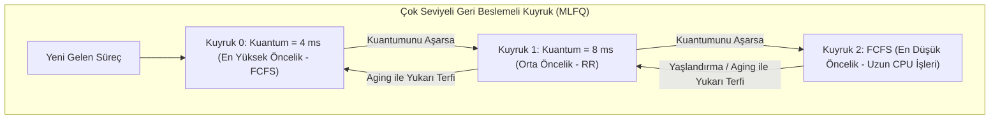

### Adım Adım Çözümlü Örnek / Vaka

**Senaryo:** Sistemde $P_1, P_2, P_3, P_4$ süreçleri aşağıdaki varış (*Arrival Time - AT*) ve CPU patlama süreleriyle (*Burst Time - BT*) hazırdır:

| Süreç | Varış Zamanı ($AT$) | Patlama Süresi ($BT$) |
| :--- | :--- | :--- |
| $P_1$ | 0 ms | 7 ms |
| $P_2$ | 2 ms | 4 ms |
| $P_3$ | 4 ms | 1 ms |
| $P_4$ | 5 ms | 4 ms |

1. **SRTF (Shortest Remaining Time First)** algoritması için Gantt şemasını çiziniz; her sürecin Tamamlanma ($CT$), Dönüş ($TAT$), Bekleme ($WT$) sürelerini ve sistemin ortalama bekleme süresini hesaplayınız.
2. **Round Robin (Kuantum $q = 3\text{ ms}$)** algoritması için aynı değerleri adım adım hesaplayınız.

**Çözüm Adımları:**

#### 1. SRTF Çözümü
- $t=0$: Yalnızca $P_1$ var. $P_1$ çalışmaya başlar (kalan: 7).
- $t=2$: $P_2$ sisteme varır ($BT=4$). $P_1$'in kalan süresi $7-2 = 5\text{ ms}$. $P_2$'nin süresi ($4\text{ ms}$) $P_1$'in kalanından ($5\text{ ms}$) küçük olduğu için kesinti (*preemption*) olur! CPU $P_2$'ye verilir.
- $t=4$: $P_3$ sisteme varır ($BT=1$). $P_2$'nin kalan süresi $4-2 = 2\text{ ms}$. $P_3$'ün süresi ($1\text{ ms}$) $P_2$'den küçük olduğu için kesinti olur! CPU $P_3$'e geçer.
- $t=5$: $P_3$, 1 ms çalışıp tamamen biter ($CT_3 = 5$). Bu anda $P_4$ sisteme varır ($BT=4$).
  Hazır kuyruğundaki kalan süreler: $P_2(2)$, $P_4(4)$, $P_1(5)$. En kısa $P_2$'dir. CPU $P_2$'ye verilir.
- $t=7$: $P_2$, 2 ms daha çalışarak biter ($CT_2 = 7$).
  Hazır kuyruğu: $P_4(4)$, $P_1(5)$. En kısa $P_4$'tür. CPU $P_4$'e verilir.
- $t=11$: $P_4$, 4 ms çalışarak biter ($CT_4 = 11$). CPU $P_1$'e verilir.
- $t=16$: $P_1$, kalan 5 ms patlamasını bitirir ve sonlanır ($CT_1 = 16$).

**SRTF Gantt Şeması:**
```
| P1 (0-2) | P2 (2-4) | P3 (4-5) | P2 (5-7) | P4 (7-11) | P1 (11-16) |
0          2          4          5          7           11           16
```

**Süreç Tablosu (SRTF):**
- $P_1$: $CT=16 \implies TAT = 16 - 0 = 16\text{ ms}, \quad WT = 16 - 7 = 9\text{ ms}$.
- $P_2$: $CT=7 \implies TAT = 7 - 2 = 5\text{ ms}, \quad WT = 5 - 4 = 1\text{ ms}$.
- $P_3$: $CT=5 \implies TAT = 5 - 4 = 1\text{ ms}, \quad WT = 1 - 1 = 0\text{ ms}$.
- $P_4$: $CT=11 \implies TAT = 11 - 5 = 6\text{ ms}, \quad WT = 6 - 4 = 2\text{ ms}$.
- **Ortalama Dönüş Süresi (Avg TAT):** $(16 + 5 + 1 + 6) / 4 = 28 / 4 = 7.00\text{ ms}$.
- **Ortalama Bekleme Süresi (Avg WT):** $(9 + 1 + 0 + 2) / 4 = 12 / 4 = 3.00\text{ ms}$.

#### 2. Round Robin ($q = 3\text{ ms}$) Çözümü
- $t=0$: Kuyruk: $[P_1]$. $P_1$ çalışır.
- $t=2$: $P_2$ varır.
- $t=3$: $P_1$'in kuantumu dolar (çalıştı: 3, kalan: 4). $P_1$ kuyruğun sonuna geçer. Kuyruk: $[P_2, P_1]$.
- $t=3 \dots 6$: $P_2$ çalışır (kalan 1). Bu arada $t=4$'te $P_3$, $t=5$'te $P_4$ varır. $t=6$'da $P_2$ kuyruğun sonuna atılır. Kuyruk: $[P_1, P_3, P_4, P_2]$.
- $t=6 \dots 9$: $P_1$ çalışır (kalan 1). Kuyruk sonuna geçer. Kuyruk: $[P_3, P_4, P_2, P_1]$.
- $t=9 \dots 10$: $P_3$ çalışır (sadece 1 ms gerekir). $t=10$'da biter ($CT_3 = 10$). Kuyruk: $[P_4, P_2, P_1]$.
- $t=10 \dots 13$: $P_4$ çalışır (kalan 1). Kuyruk sonuna geçer. Kuyruk: $[P_2, P_1, P_4]$.
- $t=13 \dots 14$: $P_2$ çalışır (1 ms gerekir) ve $t=14$'te biter ($CT_2 = 14$). Kuyruk: $[P_1, P_4]$.
- $t=14 \dots 15$: $P_1$ çalışır (1 ms gerekir) ve $t=15$'te biter ($CT_1 = 15$). Kuyruk: $[P_4]$.
- $t=15 \dots 16$: $P_4$ çalışır (1 ms gerekir) ve $t=16$'da biter ($CT_4 = 16$).

**RR ($q=3$) Gantt Şeması:**
```
| P1 (0-3) | P2 (3-6) | P1 (6-9) | P3 (9-10) | P4 (10-13) | P2 (13-14) | P1 (14-15) | P4 (15-16) |
0          3          6          9          10          13           14           15           16
```

**Süreç Tablosu (RR $q=3$):**
- $P_1$: $CT=15 \implies TAT = 15 - 0 = 15\text{ ms}, \quad WT = 15 - 7 = 8\text{ ms}$.
- $P_2$: $CT=14 \implies TAT = 14 - 2 = 12\text{ ms}, \quad WT = 12 - 4 = 8\text{ ms}$.
- $P_3$: $CT=10 \implies TAT = 10 - 4 = 6\text{ ms}, \quad WT = 6 - 1 = 5\text{ ms}$.
- $P_4$: $CT=16 \implies TAT = 16 - 5 = 11\text{ ms}, \quad WT = 11 - 4 = 7\text{ ms}$.
- **Ortalama Dönüş Süresi (Avg TAT):** $(15 + 12 + 6 + 11) / 4 = 44 / 4 = 11.00\text{ ms}$.
- **Ortalama Bekleme Süresi (Avg WT):** $(8 + 8 + 5 + 7) / 4 = 28 / 4 = 7.00\text{ ms}$.

### Sık Karıştırılan Nokta
Dönüş Süresi (*Turnaround Time*) ile Bekleme Süresi (*Waiting Time*) ve Yanıt Süresi (*Response Time*) sıklıkla birbirine karıştırılır:
- **Dönüş Süresi:** Bir sürecin varışından tamamen tamamlanıp sistemden çıktığı ana kadar geçen toplam süredir (içinde CPU süresi, G/Ç süresi ve bekleme süresi bulunur).
- **Bekleme Süresi:** Sürecin sadece hazır kuyruğunda CPU için bekletildiği sürelerin toplamıdır ($TAT - \text{CPU Burst}$).
- **Yanıt Süresi:** Sürecin varışından ilk defa CPU alıp ilk tepkisini ürettiği ana kadar geçen süredir (etkileşimli sistemlerde kullanıcının ekranda bir şey görme süresidir).

### Kaynak Kartı
- **Ders Kitabı:** Silberschatz, Galvin, Gagne — *Operating System Concepts (10th Ed.)*, Bölüm 5: CPU Scheduling.
- **Video Ders (Doğrulanmış Kaynak):** Prof. Mythili Vutukuru (IIT Bombay), Lecture 5: Scheduling policies  
  URL: https://www.youtube.com/watch?v=c1I99E1S3QA  
  *Gerekçe:* FCFS, SJF, SRTF ve Round Robin algoritmalarını Gantt grafikleri ve matematiksel metrikler üzerinden adım adım karşılaştırır.
- **Ders Portalı:** https://www.cse.iitb.ac.in/~mythili/os/

### Aktif Hatırlama Soruları ve Cevapları

**Soru 1:** Round Robin planlamasında zaman kuantumu ($q$) gereğinden çok küçük seçilirse sistem performansında ne gibi bir felaket ortaya çıkar?
<details>
<summary>Cevap ve Açıklama</summary>
Zaman kuantumu bağlam değiştirme (context switch) süresine yaklaşacak kadar küçük seçilirse, işlemci vaktinin neredeyse tamamını süreçlerin kaydedicilerini kaydedip yenilerini yüklemekle geçirir. Kullanıcı kodunu ilerletmeye vakit kalmaz, CPU verimi sıfıra yaklaşır ve sistem "thrashing" benzeri aşırı bağlam değiştirme yükü altında ezilir. Genel kural olarak kuantumu, tipik CPU patlamalarının en az %80'inin tek kuantumda bitebileceği büyüklükte seçmek tavsiye edilir.
</details>

**Soru 2:** Shortest Job First (SJF) algoritması matematiksel olarak minimum ortalama bekleme süresini garanti etmesine rağmen genel amaçlı işletim sistemlerinde neden doğrudan kullanılamaz?
<details>
<summary>Cevap ve Açıklama</summary>
Çünkü bir sürecin bir sonraki CPU patlamasının (burst time) kaç milisaniye süreceği çalıştırılmadan önce kesin olarak bilinemez. Kullanıcı veya işletim sistemi geleceği göremez. Bu nedenle ancak üstel yumuşatma (exponential smoothing) formülleriyle ($	au_{n+1} = lpha t_n + (1-lpha)	au_n$) geçmişe bakılarak tahmin yapılabilir.
</details>

**Soru 3:** "Konvoy Etkisi (Convoy Effect)" nedir ve hangi planlama algoritmasında belirgin olarak gözlenir?
<details>
<summary>Cevap ve Açıklama</summary>
Konvoy Etkisi, FCFS (First-Come, First-Served) algoritmasında uzun bir CPU patlamasına sahip tek bir sürecin CPU'yu uzun süre meşgul etmesi yüzünden, arkasında bekleyen çok sayıda kısa G/Ç yoğunluklu sürecin hazır kuyruğunda yığılması durumudur. Bu esnada G/Ç aygıtları boş kalır, süreçler CPU'yu bekler; süreç bittiğinde ise tüm süreçler aynı anda G/Ç'ye hücum edip bu kez CPU'yu boş bırakır. Genel sistem kaynaklarının verimi ciddi oranda düşer.
</details>

---
## Hafta 6 — Senkronizasyon (Bölüm 6–7)

### Öğrenme Hedefleri
Bu bölümü tamamladığınızda şunları yapabileceksiniz:
1. **Yarış Durumu (Race Condition)** kavramını ve paylaşılan veride yol açtığı tutarsızlıkları açıklayabilmek.
2. **Kritik Bölge Problemi (Critical-Section Problem)** için zorunlu 3 temel şartı (**Karşılıklı Dışlama**, **İlerleme**, **Sınırlı Bekleme**) tanımlayabilmek.
3. Donanım seviyesindeki atomik komutları (**Test-and-Set**, **Compare-and-Swap**) ve meşgul bekleme (*Spinlock*) mekanizmasını kavramak.
4. **Mutex Kilitleri** ile **Semaforlar (Semaphores - `wait()` ve `signal()`)** arasındaki farkı kavramak; klasik senkronizasyon problemlerini (**Üretici-Tüketici / Bounded-Buffer**, **Okuyucu-Yazarlar**, **Filozofların Yemeği**) ve **Monitörleri** analiz edebilmek.

### Kavram Anlatımı ve Temel Teori

#### 1. Yarış Durumu ve Kritik Bölge
Birden fazla sürecin veya iş parçacığının aynı paylaşılan veriye eşzamanlı olarak erişip değiştirdiği ve nihai sonucun yürütümün tam sırasına (zamanlamasına) bağlı olduğu duruma **Yarış Durumu (Race Condition)** denir.

Paylaşılan kaynaklara erişilen kod bloklarına **Kritik Bölge (Critical Section)** adı verilir. Bir kritik bölge çözümünün doğru sayılabilmesi için şu üç koşulu eksiksiz sağlaması şarttır:
1. **Karşılıklı Dışlama (Mutual Exclusion):** Eğer bir süreç kendi kritik bölgesinde yürütülüyorsa, başka hiçbir süreç kendi kritik bölgesine giremez.
2. **İlerleme (Progress):** Kritik bölgesinde hiçbir süreç yoksa ve bazı süreçler girmek istiyorsa, yalnızca kalan bölümlerinde (*remainder section*) çalışmayan süreçler bir sonraki girecek süreci seçebilir ve bu seçim süresiz ertelenemez.
3. **Sınırlı Bekleme (Bounded Waiting):** Bir süreç kritik bölgeye girme talebinde bulunduktan sonra, bu talep onaylanana kadar diğer süreçlerin kritik bölgeye giriş sayıları üzerinde bir üst sınır bulunmalıdır (açlık - starvation engellenmelidir).

#### 2. Donanım Desteği ve Atomik Komutlar
Yazılımsal çözümler (örneğin Peterson Algoritması) modern işlemcilerin kod yeniden sıralama (*out-of-order execution*) mekanizmaları nedeniyle doğrudan çalışmayabilir. Donanım seviyesinde işlemciler **atomik (bölünemez)** komutlar sunar:
- `TestAndSet(&target)`: Hedef baytın eski değerini okur ve atomik olarak hedefi `true` yapar.
- `CompareAndSwap(&value, expected, new_value)`: Değer beklenen ile eşitse atomik olarak yeni değeri yazar; her durumda eski değeri döndürür.

Bu komutlarla kurulan kilitlere kilit açılana kadar döngüde dönüldüğü için **Spinlock (Meşgul Bekleme - Busy Waiting)** denir. Çok çekirdekli sistemlerde kilit süresi çok kısaysa bağlam değiştirme masrafı yapmamak için tercih edilir; tek çekirdekte veya uzun kilitlerde CPU'yu boşa harcar.

#### 3. Semaforlar (Semaphores)
Edsger Dijkstra tarafından önerilen semafor, atomik iki standart işlemle yönetilen bir tamsayı değişkendir:
- `wait(S)` (veya `P(S)`):
  ```c
  S.value--;
  if (S.value < 0) {
      // Süreci semaforun bekleme kuyruğuna ekle ve uyu (block/sleep)
  }
  ```
- `signal(S)` (veya `V(S)`):
  ```c
  S.value++;
  if (S.value <= 0) {
      // Bekleme kuyruğundaki bir süreci uyandır (wake up / ready yap)
  }
  ```
*Önemli Matematiksel Kural:* `S.value` negatif ise, mutlak değeri ($|S.value|$) semafor kuyruğunda bekleyen bloklanmış süreç sayısını verir!

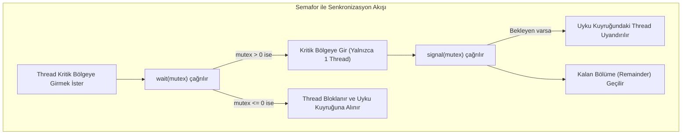

### Adım Adım Çözümlü Örnek / Vaka

**Senaryo (Bounded-Buffer / Sınırlı Tampon Üretici-Tüketici Problemi):**
$N = 5$ elemanlık dairesel bir paylaşılan tampon bulunmaktadır. Üretici (*Producer*) tampona veri yazar, Tüketici (*Consumer*) tampondan veri okur. Sistemde 3 adet semafor tanımlanmıştır:
- `semaphore mutex = 1;` (Tampon veri yapısını koruyan ikili semafor)
- `semaphore empty = 5;` (Tampondaki boş yuva sayısını tutan sayma semaforu)
- `semaphore full = 0;` (Tampondaki dolu yuva sayısını tutan sayma semaforu)

Bir stajyer yazılımcı üretici kodunu aşağıdaki gibi yanlış sırada yazmıştır:
```c
// HATALI ÜRETİCİ KODU:
void producer() {
    while(1) {
        item = produce_item();
        wait(mutex);   // YANLIŞ SIRA! Önce mutex alındı
        wait(empty);   // Sonra boş yer kontrolü yapılıyor
        
        insert_item(item);
        
        signal(mutex);
        signal(full);
    }
}
```
Tampon tamamen dolu iken ($empty = 0, full = 5$), bu hatalı kodun neden kesin bir **Kilitlenmeye (Deadlock)** yol açacağını adım adım ispatlayınız ve doğru kodu veriniz.

**Çözüm Adımları:**
1. **Başlangıç Durumu:** Tampon doludur: `empty = 0`, `full = 5`, `mutex = 1`.
2. Üretici yeni bir eleman üretir ve `producer()` döngüsüne girer.
3. İlk işlem: `wait(mutex)` çağrılır. `mutex` değeri 1'den 0'a iner. Üretici tamponun kilit mekanizmasını ele geçirir.
4. İkinci işlem: `wait(empty)` çağrılır. `empty` değeri 0'dır; `empty--` ile -1 olur. `empty < 0` olduğu için üretici **bloklanır ve uyku kuyruğuna alınır!**
5. **Kritik Hata:** Üretici uykuya dalarken elindeki `mutex` kilidini serbest bırakmamıştır!
6. Tüketici devreye girer. Tüketici tampondan eleman alıp yer açmak istemektedir. Kendi kodunda `wait(full)` çağırır (`full` 5'tir, geçer), ardından `wait(mutex)` çağırır.
7. Ancak `mutex` hala uyuyan üreticinin elindedir! Dolayısıyla tüketici de `wait(mutex)` çağrısında bloklanır!
8. **Sonuç:** Üretici, tüketicinin `signal(empty)` yapmasını beklemektedir. Tüketici ise üreticinin `signal(mutex)` yapmasını beklemektedir. İki süreç de birbirini sonsuza kadar bekler $\to$ **DEADLOCK!**

**Düzeltilmiş Doğru Kod (Doğru Semafor Sırası):**
```c
void producer() {
    while(1) {
        item = produce_item();
        wait(empty);   // 1. Önce boş yer var mı bakılır (yoksa uyu, mutex'i tutma!)
        wait(mutex);   // 2. Boş yer varsa tampon kilidini al
        
        insert_item(item);
        
        signal(mutex); // 3. Tampon kilidini bırak
        signal(full);  // 4. Dolu yuva sayısını artır
    }
}
```

### Sık Karıştırılan Nokta
**Mutex** ile **İkili Semafor (Binary Semaphore)** sıklıkla aynı şey zannedilir. Oysa temel fark **Sahiplik (Ownership)** ilkesidir:
- **Mutex:** Bir sahiplik kavramına sahiptir. Mutex'i hangi iş parçacığı kilitlediyse (`lock`), kilidi **yalnızca o iş parçacığı açabilir** (`unlock`).
- **Binary Semaphore:** Bir sahiplik taşımaz; bir **sinyalleşme mekanizmasıdır**. Bir thread `wait()` ile beklemeye geçmişken, bambaşka bir thread veya bir kesme işleyicisi (ISR) `signal()` çağırarak o semaforu serbest bırakabilir.

### Kaynak Kartı
- **Ders Kitabı:** Silberschatz, Galvin, Gagne — *Operating System Concepts (10th Ed.)*, Bölüm 6: Synchronization Tools & Bölüm 7: Synchronization Examples.
- **Video Ders (Doğrulanmış Kaynak):** Prof. Mythili Vutukuru (IIT Bombay), Lecture 13: Locks  
  URL: https://youtu.be/EBevKfTDXUI  
  *Gerekçe:* Test-and-set ve spinlock donanım mekanizmalarını ve mutex kilitlerinin yazılım temellerini inceler.
- **Tamamlayıcı Videolar:**
  - Prof. Mythili Vutukuru, Lecture 14: Condition variables (https://youtu.be/rMpOfbaP2PQ)
  - Prof. Mythili Vutukuru, Lecture 15: Semaphores (https://youtu.be/XN2P60BcowI)

### Aktif Hatırlama Soruları ve Cevapları

**Soru 1:** Tek çekirdekli bir sistemde "Spinlock (Meşgul Bekleme)" kullanmak neden son derece kötü bir tasarım tercihidir?
<details>
<summary>Cevap ve Açıklama</summary>
Tek çekirdekli bir sistemde kilidi elinde tutan süreç ile kilidi bekleyen süreç aynı anda koşamaz. Kilidi bekleyen süreç spinlock döngüsünde boş yere CPU döngülerini tüketirken, kilidi serbest bırakacak olan sürecin CPU alıp kilidi açması engellenmiş olur. Kilidi açacak süreç ancak spinlock yapan sürecin zaman kuantumu dolduğunda CPU alabilir. Bu nedenle tek çekirdekte meşgul bekleme yerine sürecin uyutulup (sleep/block) kuyruğa alındığı bloklayıcı semafor/mutex yapıları kullanılmalıdır.
</details>

**Soru 2:** Kritik bölge probleminin 3 şartından biri olan "İlerleme (Progress)" şartı neyi garanti altına alır?
<details>
<summary>Cevap ve Açıklama</summary>
İlerleme şartı, kritik bölgeye girmek isteyen süreçlerin birbirini sonsuza kadar bloke etmesini (livelock veya deadlock oluşmasını) engeller. Eğer kritik bölgede hiç kimse yoksa ve içeri girmek isteyen aday süreçler varsa, içeri kimin gireceği kararı yalnızca şu anda girmek isteyen süreçler arasında derhal verilmeli ve bu karar süreci belirsiz bir süre boyunca ertelenmemelidir.
</details>

**Soru 3:** Monitör (Monitor) yapısının semaforlara kıyasla programcıya sağladığı en büyük güvenlik avantajı nedir?
<details>
<summary>Cevap ve Açıklama</summary>
Semaforlarda `wait()` ve `signal()` çağrılarının sırası tamamen programcının dikkatine bağlıdır; tek bir yanlış sırada çağırma kilitlenmeye veya veri bozulmasına yol açar. Monitör ise programlama dili seviyesinde bir kapsülleme (encapsulation) soyutlamasıdır. Monitör içindeki tüm fonksiyonlar dilin derleyicisi tarafından otomatik olarak karşılıklı dışlama (mutual exclusion) ile korunur. Monitör içine aynı anda birden fazla thread'in girmesi derleyici ve çalışma zamanı tarafından fiziksel olarak imkansız kılınır.
</details>

---
## Hafta 7 — Kilitlenmeler (Bölüm 8)

### Öğrenme Hedefleri
Bu bölümü tamamladığınızda şunları yapabileceksiniz:
1. **Kilitlenme (Deadlock)** tanımını yapmak ve **Canlı Kilitlenme (Livelock)** ile farkını ayırt edebilmek.
2. Kilitlenmenin gerçekleşmesi için zorunlu olan **4 Coffman Koşulunu** (Mutual Exclusion, Hold and Wait, No Preemption, Circular Wait) açıklayabilmek.
3. **Kaynak Tahsis Grafiğini (Resource Allocation Graph - RAG)** analiz ederek döngü ve kilitlenme varlığını tespit edebilmek.
4. Kilitlenme yönetim stratejilerini (**Önleme - Prevention**, **Kaçınma - Avoidance / Banker Algoritması**, **Tespit ve Kurtarma - Detection & Recovery**, **İhmal Etme / Devekuşu Stratejisi**) mühendislik ödünleşimleriyle değerlendirebilmek.

### Kavram Anlatımı ve Temel Teori

#### 1. Kilitlenme Nedir? 4 Coffman Koşulu
Kilitlenme; bir süreç kümesindeki her bir sürecin, yalnızca yine aynı kümedeki başka bir sürecin gerçekleştirebileceği bir olayı (genellikle kaynak serbest bırakma) beklemesi nedeniyle tüm kümenin sonsuza kadar tıkanması durumudur.

Bir sistemde kilitlenmenin meydana gelebilmesi için Edward G. Coffman tarafından tanımlanan **4 koşulun aynı anda** sağlanması şarttır:
1. **Karşılıklı Dışlama (Mutual Exclusion):** En az bir kaynak paylaşılamaz modda olmalıdır (yani bir anda yalnızca tek bir süreç tarafından kullanılabilir).
2. **Tut ve Bekle (Hold and Wait):** Bir süreç en az bir kaynağı elinde tutarken (*holding*), başka süreçlerin elinde bulunan ek kaynakları almak için beklemektedir (*waiting*).
3. **Önceliksiz Kaynak / Zorla Alamama (No Preemption):** Kaynaklar bir sürecin elinden zorla alınamaz; kaynak ancak süreci elinde tutan süreç tarafından görevi bittiğinde gönüllü olarak serbest bırakılabilir.
4. **Dairesel Bekleme (Circular Wait):** Süreçler arasında dairesel bir bekleme zinciri bulunmalıdır: $\{P_0, P_1, \dots, P_n\}$ kümesinde $P_0$, $P_1$'in tuttuğu kaynağı; $P_1$, $P_2$'nin kaynağını; $\dots P_n$ ise $P_0$'ın tuttuğu kaynağı beklemektedir.

#### 2. Kaynak Tahsis Grafiği (RAG)
Sistemdeki durum yönlü bir çizge ile gösterilir:
- Düğümler: Süreçler $P = \{P_1, P_2, \dots\}$ (daire) ve Kaynak Tipleri $R = \{R_1, R_2, \dots\}$ (kare, içindeki noktalar kaynak örnekleridir).
- Kenarlar:
  - **Talep Kenarı (Request Edge):** $P_i \to R_j$ (Süreç $P_i$, kaynak $R_j$'yi talep ediyor ve bekliyor).
  - **Tahsis Kenarı (Assignment Edge):** $R_j \to P_i$ (Kaynak $R_j$'nin bir örneği $P_i$'ye tahsis edilmiş).

*Temel Teorem:*
- Grafikte **hiç döngü (cycle) yoksa**, sistemde **kesinlikle kilitlenme yoktur**.
- Grafikte **döngü varsa**:
  - Eğer her kaynak tipinden **yalnızca 1 örnek (single instance)** varsa, döngü kilitlenme için **hem gerekli hem yeterli koşuldur (kesin deadlock vardır)**.
  - Eğer kaynak tiplerinden **birden fazla örnek (multiple instances)** varsa, döngü olması kilitlenme anlamına **gelmeyebilir**; diğer süreçler işini bitirip kaynağı boşa çıkarabilir.

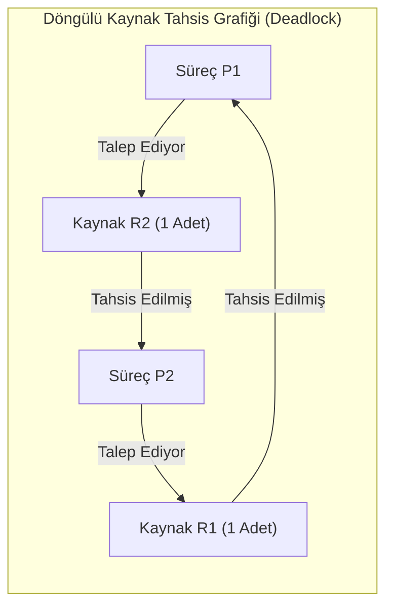

#### 3. Kilitlenme Yönetim Stratejileri
1. **Kilitlenmeyi Önleme (Deadlock Prevention):** Sistemin tasarım aşamasında kurallar koyarak 4 Coffman koşulundan en az birini **kesinlikle imkansız kılmaktır**.
   - *Dairesel Beklemeyi Kırmak:* Tüm kaynak tiplerine küresel bir sıra numarası atanır ($F: R \to \mathbb{N}$). Süreçler kaynakları yalnızca kesin artan sırada talep edebilir ($R_i < R_j$). Bu en pratik ve yaygın önleme yöntemidir.
2. **Kilitlenmeden Kaçınma (Deadlock Avoidance):** İşletim sistemi dinamik olarak her kaynak talebinde sistemi simüle eder. Eğer talep onaylandığında sistem **Güvenli Durumda (Safe State)** kalıyorsa kaynak verilir; **Güvensiz Duruma (Unsafe State)** düşülecekse süreç bekletilir. En ünlü algoritma Dijkstra'nın **Banker Algoritmasıdır**.
3. **Kilitlenme Tespiti ve Kurtarma (Detection and Recovery):** Kilitlenmelere izin verilir. Sistem periyodik olarak bir çizge analizi (Wait-For Graph) çalıştırarak döngü arar. Kilitlenme bulunursa bazı süreçler kurban seçilerek sonlandırılır (*terminate*) veya kaynakları ellerinden zorla alınır (*preempt*).
4. **Devekuşu Algoritması (Ostrich Algorithm):** Kilitlenmeyi ele almamayı seçen genel bir mühendislik stratejisidir. Tasarımcı, sorunun olasılığını ve olası etkisini, önleme ya da tespit mekanizmasının sürekli maliyetiyle karşılaştırır. Bu bir bağlam kararıdır; belirli bir işletim sisteminin politikasına dair iddia değildir.

### Adım Adım Çözümlü Örnek / Vaka

**Senaryo (Banker Algoritması Güvenlik Kontrolü):**
Sistemde 5 süreç ($P_0, P_1, P_2, P_3, P_4$) ve 3 kaynak türü ($A, B, C$) bulunmaktadır. Kaynakların toplam miktarı: $A = 10, B = 5, C = 7$ adettir.
Belirli bir $T_0$ anındaki durum tabloları şöyledir:

| Süreç | Tahsis Edilmiş (*Allocation*) [A B C] | Maksimum Talep (*Max*) [A B C] |
| :--- | :---: | :---: |
| $P_0$ | 0 1 0 | 7 5 3 |
| $P_1$ | 2 0 0 | 3 2 2 |
| $P_2$ | 3 0 2 | 9 0 2 |
| $P_3$ | 2 1 1 | 2 2 2 |
| $P_4$ | 0 0 2 | 4 3 3 |

1. Kalan İhtiyaç matrisini ($Need = Max - Allocation$) hesaplayınız.
2. Kullanılabilir mevcut kaynak vektörünü ($Available$) bulunuz.
3. Sistemin güvenli durumda (*Safe State*) olup olmadığını Banker'ın Güvenlik Algoritması ile adım adım ispatlayınız ve güvenli bir yürütüm sırası (*Safe Sequence*) çıkarınız.

**Çözüm Adımları:**

**1. Kalan İhtiyaç ($Need$) Matrisi Hesabı ($Need = Max - Allocation$):**
- $P_0: [7-0, 5-1, 3-0] = [7, 4, 3]$
- $P_1: [3-2, 2-0, 2-0] = [1, 2, 2]$
- $P_2: [9-3, 0-0, 2-2] = [6, 0, 0]$
- $P_3: [2-2, 2-1, 2-1] = [0, 1, 1]$
- $P_4: [4-0, 3-0, 3-2] = [4, 3, 1]$

**2. Mevcut Kaynaklar ($Available$) Hesabı:**
Toplam tahsis edilen kaynaklar ($Allocation$ sütun toplamı):
- $A: 0 + 2 + 3 + 2 + 0 = 7$
- $B: 1 + 0 + 0 + 1 + 0 = 2$
- $C: 0 + 0 + 2 + 1 + 2 = 5$
- Toplam Tahsis: $[7, 2, 5]$
Mevcut kaynaklar: $Available = \text{Toplam Kaynaklar} - \text{Toplam Tahsis}$
- $Available = [10 - 7, 5 - 2, 7 - 5] = [3, 3, 2]$

**3. Güvenlik Algoritması Yürütümü:**
Başlangıç: $Work = Available = [3, 3, 2]$, $Finish = [F, F, F, F, F]$.

- **Adım 1:** $Need_i \le Work$ olan bir süreç ara.
  - $P_0$: $Need_0 [7, 4, 3] \le [3, 3, 2]$ $\implies$ Hayır (A yetersiz).
  - $P_1$: $Need_1 [1, 2, 2] \le [3, 3, 2]$ $\implies$ **EVET!**
    $P_1$ çalışır, biter ve tahsis ettiği kaynakları geri verir:
    $Work = Work + Allocation_1 = [3, 3, 2] + [2, 0, 0] = [5, 3, 2]$
    $Finish[1] = True$.
- **Adım 2:** Kalan süreçler için ara ($Work = [5, 3, 2]$):
  - $P_3$: $Need_3 [0, 1, 1] \le [5, 3, 2]$ $\implies$ **EVET!**
    $Work = [5, 3, 2] + [2, 1, 1] = [7, 4, 3]$
    $Finish[3] = True$.
- **Adım 3:** Kalan süreçler için ara ($Work = [7, 4, 3]$):
  - $P_4$: $Need_4 [4, 3, 1] \le [7, 4, 3]$ $\implies$ **EVET!**
    $Work = [7, 4, 3] + [0, 0, 2] = [7, 4, 5]$
    $Finish[4] = True$.
- **Adım 4:** Kalan süreçler için ara ($Work = [7, 4, 5]$):
  - $P_0$: $Need_0 [7, 4, 3] \le [7, 4, 5]$ $\implies$ **EVET!**
    $Work = [7, 4, 5] + [0, 1, 0] = [7, 5, 5]$
    $Finish[0] = True$.
- **Adım 5:** Kalan son süreç için ara ($Work = [7, 5, 5]$):
  - $P_2$: $Need_2 [6, 0, 0] \le [7, 5, 5]$ $\implies$ **EVET!**
    $Work = [7, 5, 5] + [3, 0, 2] = [10, 5, 7]$
    $Finish[2] = True$.

Tüm süreçler başarıyla tamamlanabilmiştir ($Finish$ dizisi tamamen True).
**Sonuç:** Sistem **GÜVENLİ DURUMDADIR (Safe State)**.
**Güvenli Dizi (Safe Sequence):** $\langle P_1, P_3, P_4, P_0, P_2 \rangle$ (Başka alternatif geçerli dizilimler de bulunabilir).

### Sık Karıştırılan Nokta
**Kilitlenmeyi Önleme (Prevention)** ile **Kilitlenmeden Kaçınma (Avoidance)** prensipleri sıklıkla karıştırılır:
- **Önleme (Prevention):** Statik bir yaklaşımdır. Çalışma zamanında süreçlerin ne talep edeceğine bakmaz; mimari kurallarla (örneğin dairesel beklemeyi yasaklayarak) 4 koşuldan birini kalıcı olarak imkansız kılar. Kaynak kullanım verimini düşürür.
- **Kaçınma (Avoidance):** Dinamik bir yaklaşımdır. Süreçlerin maksimum ihtiyaçlarını önceden bildirmesi gerekir. Her talep anında algoritma (Banker) sistemi simüle eder; eğer talep sistemi güvensiz bir duruma sokacaksa süreç bekletilir.

### Kaynak Kartı
- **Ders Kitabı:** Silberschatz, Galvin, Gagne — *Operating System Concepts (10th Ed.)*, Bölüm 8: Deadlocks.
- **Video Ders:** NPTEL, *Introduction to Operating Systems*, Lecture 33: Dealing with Deadlocks  
  URL: https://www.youtube.com/watch?v=8ZS7xzWPo5A  
  *Gerekçe:* Video açıklaması kilitlenme yönetimi, Banker algoritması, güvenli/güvensiz durumlar ve kurtarmayı açıkça sayar. Nişantaşı ders izlencesinin yerine geçmeyen ek kaynaktır.
- **Ders Portalı:** https://www.cse.iitb.ac.in/~mythili/os/

### Aktif Hatırlama Soruları ve Cevapları

**Soru 1:** Bir sistemin "Güvensiz Durumda (Unsafe State)" olması kesin olarak bir kilitlenme (deadlock) olduğu anlamına gelir mi? Açıklayınız.
<details>
<summary>Cevap ve Açıklama</summary>
Hayır, kesinlikle gelmez! Güvensiz durum, sistemin tüm süreçlerin maksimum kaynak taleplerini aynı anda istemesi senaryosunda bir kilitlenmeyi engelleyemeyeceğini gösterir. Ancak süreçler pratikte maksimum taleplerini aynı anda istemeyebilir veya ellerindeki kaynakları erken serbest bırakabilirler. Bu durumda kilitlenme olmadan da sistem çalışmasını tamamlayabilir. Özetle: Tüm kilitlenmeler güvensiz durumdur; ancak her güvensiz durum kilitlenme değildir.
</details>

**Soru 2:** Dairesel Bekleme (Circular Wait) koşulunu kırmak için kullanılan küresel kaynak sıralaması ($F: R \to \mathbb{N}$) yönteminin kilitlenmeyi nasıl kesin olarak imkansız kıldığını açıklayınız.
<details>
<summary>Cevap ve Açıklama</summary>
Bu kurala göre bir süreç elinde kaynak $R_i$ varken yalnızca $F(R_j) > F(R_i)$ olan bir $R_j$ kaynağını talep edebilir. Eğer dairesel bir bekleme zinciri ($P_0 \to R_1 \to P_1 \to R_2 \dots \to R_k \to P_0$) oluşsaydı, sıra numaralarının kesin eşitsizliği gereği $F(R_1) < F(R_2) < \dots < F(R_k) < F(R_1)$ gibi matematiksel bir çelişki ($x < x$) ortaya çıkardı. Dolayısıyla grafikte hiçbir döngü oluşamaz ve kilitlenme kesin olarak önlenir.
</details>

**Soru 3:** Canlı Kilitlenme (Livelock) ile Kilitlenme (Deadlock) arasındaki temel fark nedir?
<details>
<summary>Cevap ve Açıklama</summary>
Deadlock durumunda süreçler bloklanmış (waiting/sleep) durumdadır; hiçbiri CPU kullanmaz ve hiçbir durum değişikliği yapamaz. Livelock durumunda ise süreçler bloklanmamıştır; sürekli olarak durumlarını değiştirir ve CPU döngüsü tüketirler (örneğin iki kişinin dar bir koridorda birbirine yol vermek için aynı anda sürekli sağa ve sola adım atması gibi). Süreçler aktif olarak çalışır ancak hiçbiri gerçek bir iş ilerlemesi kaydedemez.
</details>

---
## Hafta 8 — Ara Sınav

> [!NOTE]
> **Özgün Tekrar ve Deneme Sınavı Bildirimi**  
> Bu bölüm, dönemin ilk yarısını kapsayan 1–7. haftalardaki (Silberschatz Bölüm 1–8) çekirdek işletim sistemleri konularının kavranmasını ölçmek amacıyla **bu çalışma rehberi için özel olarak oluşturulmuş özgün bir pratik deneme sınavıdır**. İstanbul Nişantaşı Üniversitesi'nin veya dersin öğretim üyesinin gerçek vize sınav soruları veya sınav takvimi değildir.

### Öğrenme Hedefleri
Bu ara sınav tekrar ve deneme bölümünü tamamladığınızda şunları yapabileceksiniz:
1. Silberschatz 10. baskı 1–8. bölümler arasındaki çekirdek işletim sistemi mimarilerini (çift mod, sistem çağrıları, kesmeler) sentezleyebilmek.
2. Süreç yaşam döngüsü, PCB geçişleri, iş parçacığı modelleri (ULT/KLT) ve Amdahl Kanunu hızlanma sınırlarını sayısal olarak hesaplayabilmek.
3. CPU çizelgeleme algoritmaları (FCFS, SJF, SRTF, RR) için Gantt şemalarını hatasız çıkarıp ortalama bekleme ve dönüş sürelerini bulabilmek.
4. Kritik kesit senkronizasyon araçlarını (semaforlar, muteksler) ve kilitlenme (Banker algoritması, RAG döngü analizi) problemlerini adım adım çözebilmek.

### Kapsam Analizi ve Sınav Stratejisi
Dönemin ilk yarısı temel olarak işletim sistemlerinin çekirdek mekanizmalarını kapsar:
1. **Bölüm 1–2:** Çift modlu çalışma, sistem çağrıları, kesmeler, çekirdek mimarileri.
2. **Bölüm 3–4:** Süreçler, PCB, durum geçişleri, IPC, iş parçacıkları (ULT/KLT), Amdahl kanunu.
3. **Bölüm 5:** CPU çizelgeleme algoritmaları, Gantt şemaları, metrik hesaplamaları.
4. **Bölüm 6–8:** Yarış durumları, semaforlar, kilitlenmeler (Coffman koşulları, Banker algoritması).

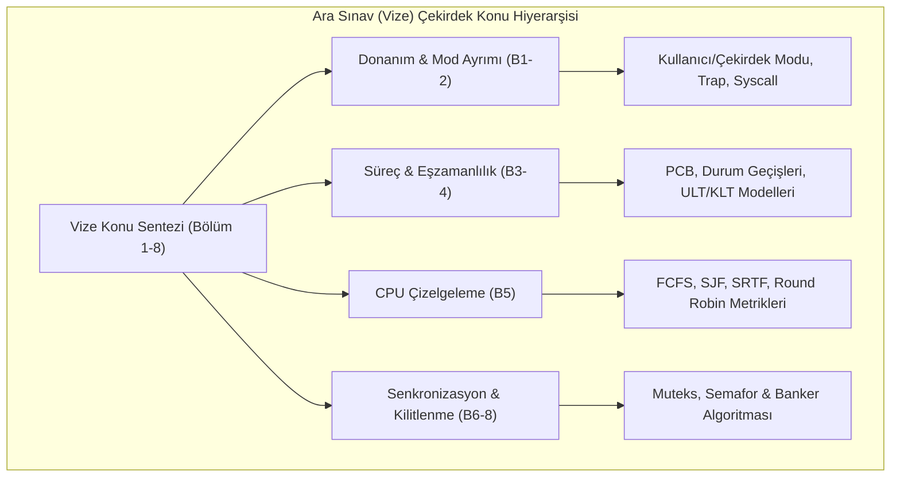

---

### Bölüm I: Kavramsal Çoktan Seçmeli ve Kısa Cevaplı Sorular

**Soru 1:** Aşağıdakilerden hangisi bir işletim sisteminde "Çekirdek Modu (Kernel Mode)" ile "Kullanıcı Modu (User Mode)" arasındaki farkı yöneten mekanizmadır?
- A) ALU içindeki bayrak yazmacı (Zero Flag)
- B) İşlemci durum yazmacındaki Donanımsal Mod Biti (Mode Bit)
- C) C standart kütüphanesindeki `errno` değişkeni
- D) Dosya sistemindeki Inode izin baytları  
<details>
<summary>Çözüm ve Açıklama</summary>
**Doğru Cevap: B.**  
İşlemci donanımı seviyesinde yer alan mod biti (mode bit), sistemin çekirdek modunda (0) mı yoksa kullanıcı modunda (1) mı çalıştığını donanımsal olarak belirler. Sistem çağrısı veya kesme tetiklendiğinde donanım bu biti 0 yapar; kullanıcıya dönerken ayrıcalıklı bir komutla tekrar 1 yapılır.
</details>

**Soru 2:** Bir tek çekirdekli sistemde 10 adet iş parçacığı (thread) bulunmaktadır. İş parçacıkları "Many-to-One" modeliyle kullanıcı alanında yönetilmektedir. İş parçacıklarından biri bloklayıcı bir `read()` sistem çağrısı yaparsa ne olur?
- A) Yalnızca o iş parçacığı bloklanır, diğer 9 iş parçacığı çalışmaya devam eder.
- B) İşletim sistemi diğer iş parçacıklarını başka bir çekirdeğe kaydırır.
- C) Çekirdek tüm süreci tek bir iş parçacığı olarak gördüğü için sürecin tümü (ve içindeki tüm iş parçacıkları) bloklanır.
- D) Sistem çöker ve Kernel Panic üretir.  
<details>
<summary>Çözüm ve Açıklama</summary>
**Doğru Cevap: C.**  
Many-to-One modelinde çekirdeğin kullanıcı düzeyindeki iş parçacıklarından haberi yoktur. Süreç içinden gelen bloklayıcı bir sistem çağrısı çekirdek tarafından tüm sürece uygulanır; dolayısıyla sürecin tamamı uyutulur.
</details>

**Soru 3:** Sayma semaforunda `wait()` fonksiyonu yürütüldükten sonra semafor değişkeninin değeri $-4$ olarak ölçülmüştür. Bu durumun tam teknik anlamı nedir?
<details>
<summary>Çözüm ve Açıklama</summary>
Semafor değerinin negatif olması, kaynağın tamamen tükendiğini ve mutlak değer kadar ($|-4| = 4$) sürecin/iş parçacığının bu semaforun bekleme kuyruğunda bloklanmış vaziyette kaynak beklediğini gösterir.
</details>

---

### Bölüm II: Sayısal ve Tasarım Odaklı Büyük Problemler

#### Problem A: Bağlam Değiştirme Masraflı CPU Çizelgeleme Analizi
**Senaryo:** Bir işlemcide $P_1, P_2, P_3$ süreçleri $t=0$ anında sırasıyla hazır kuyruğuna girmiştir.
- $P_1$: Patlama süresi $BT = 8\text{ ms}$
- $P_2$: Patlama süresi $BT = 4\text{ ms}$
- $P_3$: Patlama süresi $BT = 2\text{ ms}$

Sistemde her bağlam değiştirme (*context switch*) işlemi **$1\text{ ms}$ saf ek yük** getirmektedir. Süreçlerin ilk defa CPU alırkenki başlangıç yükleme maliyeti de $1\text{ ms}$ kabul edilmektedir.

1. **FCFS** algoritması için toplam bitiş süresini ve ortalama dönüş süresini ($TAT$) hesaplayınız.
2. **Kesintisiz SJF (Shortest Job First)** için aynı hesaplamayı yürütünüz. Bağlam değiştirme ek yükünün sıralama verimine etkisini kıyaslayınız.

**Çözüm Adımları:**

**1. FCFS Hesabı (Sıra: $P_1, P_2, P_3$):**
- $t=0 \dots 1$: $P_1$ için bağlam değiştirme / yükleme ($1\text{ ms}$).
- $t=1 \dots 9$: $P_1$ çalışır ($8\text{ ms}$). $P_1$ biter ($CT_1 = 9$).
- $t=9 \dots 10$: $P_1 \to P_2$ bağlam değişimi ($1\text{ ms}$).
- $t=10 \dots 14$: $P_2$ çalışır ($4\text{ ms}$). $P_2$ biter ($CT_2 = 14$).
- $t=14 \dots 15$: $P_2 \to P_3$ bağlam değişimi ($1\text{ ms}$).
- $t=15 \dots 17$: $P_3$ çalışır ($2\text{ ms}$). $P_3$ biter ($CT_3 = 17$).
- **Dönüş Süreleri ($TAT = CT - AT$, hepsi $AT=0$):**
  - $TAT_1 = 9 - 0 = 9\text{ ms}$
  - $TAT_2 = 14 - 0 = 14\text{ ms}$
  - $TAT_3 = 17 - 0 = 17\text{ ms}$
  - **Ortalama $TAT$:** $(9 + 14 + 17) / 3 = 40 / 3 \approx 13.33\text{ ms}$.

**2. SJF Hesabı (Sıra: $P_3(2), P_2(4), P_1(8)$):**
- $t=0 \dots 1$: $P_3$ için bağlam değiştirme ($1\text{ ms}$).
- $t=1 \dots 3$: $P_3$ çalışır ($2\text{ ms}$). $P_3$ biter ($CT_3 = 3$).
- $t=3 \dots 4$: $P_3 \to P_2$ bağlam değişimi ($1\text{ ms}$).
- $t=4 \dots 8$: $P_2$ çalışır ($4\text{ ms}$). $P_2$ biter ($CT_2 = 8$).
- $t=8 \dots 9$: $P_2 \to P_1$ bağlam değişimi ($1\text{ ms}$).
- $t=9 \dots 17$: $P_1$ çalışır ($8\text{ ms}$). $P_1$ biter ($CT_1 = 17$).
- **Dönüş Süreleri ($TAT$):**
  - $TAT_3 = 3 - 0 = 3\text{ ms}$
  - $TAT_2 = 8 - 0 = 8\text{ ms}$
  - $TAT_1 = 17 - 0 = 17\text{ ms}$
  - **Ortalama $TAT$:** $(3 + 8 + 17) / 3 = 28 / 3 \approx 9.33\text{ ms}$.
- **Kıyaslama Analizi:** Toplam süre her ikisinde de $17\text{ ms}$ olmasına rağmen, SJF kısa işleri öne alarak ortalama dönüş süresini $13.33\text{ ms}$'den $9.33\text{ ms}$'ye düşürmüştür (tam $4\text{ ms}$ tasarruf).

---

#### Problem B: Çok Örnekli Kaynak Tahsis Grafiği ve Kilitlenme Tespiti
**Senaryo:** Sistemde 3 süreç ($P_1, P_2, P_3$) ve 2 kaynak tipi ($R_1: 2\text{ adet}$, $R_2: 2\text{ adet}$) bulunmaktadır.
Mevcut durum şöyledir:
- $R_1$'in bir örneği $P_1$'e, bir örneği $P_2$'ye tahsis edilmiştir.
- $R_2$'nin bir örneği $P_2$'ye, bir örneği $P_3$'e tahsis edilmiştir.
- $P_1$, bir adet $R_2$ talep etmekte ve beklemektedir.
- $P_2$, bir adet $R_1$ talep etmekte ve beklemektedir.

1. Sistemin Kaynak Tahsis Grafiğinde döngü olup olmadığını belirleyiniz.
2. Sistemde kilitlenme (deadlock) var mıdır? Adım adım kanıtlayınız.

**Çözüm Adımları:**
1. **Döngü Tespiti:**
   - $P_1 \to R_2 \to P_2 \to R_1 \to P_1$ yönlü bir döngü mevcuttur!
2. **Kilitlenme Analizi:**
   - Dikkat edilirse kaynaklar tek örnekli (*single instance*) değildir; her kaynaktan 2'şer adet vardır.
   - Boşta hiç kaynak kalmamıştır ($R_1$ ve $R_2$'nin ikişer örneği de doludur).
   - $P_3$'ün durumunu inceleyelim: $P_3$ elinde bir adet $R_2$ tutmaktadır ve **hiçbir kaynak talep etmemektedir!**
   - Dolayısıyla $P_3$ çalışmasını bağımsızca tamamlayabilir!
   - $P_3$ bittiğinde elindeki $R_2$ örneğini serbest bırakır.
   - Boşa çıkan $R_2$, $P_1$'e tahsis edilir. $P_1$ işini bitirir ve elindeki $R_1$ ve $R_2$'yi bırakır.
   - Ardından $P_2$ ihtiyaç duyduğu $R_1$'i alarak biter.
- **Sonuç:** Grafikte döngü olmasına rağmen sistemde **KİLİTLENME YOKTUR**. Bu durum, çok örnekli kaynaklarda döngünün kilitlenme için yeterli koşul olmadığını kanıtlayan klasik bir örnektir.

---

### Aktif Hatırlama Soruları ve Cevapları

**Soru 1:** Amdahl Kanununda paralel kısımdaki hızlanmayı sınırlandıran asıl faktör nedir?
<details>
<summary>Cevap ve Açıklama</summary>
Programın kesinlikle seri çalışmak zorunda olan kısmıdır ($S = 1-p$). Çekirdek sayısı sonsuza gitse dahi serileştirilmiş kısım hızlandırılamaz ve azami hızlanma tavanı $1/S$ ile sınırlanır.
</details>

**Soru 2:** "Test-and-Set" gibi donanımsal atomik komutlar tek çekirdekli sistemlerde neden kesmeleri kapatmaktan (interrupt disable) daha az tercih edilir?
<details>
<summary>Cevap ve Açıklama</summary>
Tek çekirdekli bir sistemde çekirdek içi senkronizasyon için kesmeleri geçici olarak kapatmak (`CLI/STI`) son derece ucuz ve basittir; işlemcinin bağlam değiştirmesini kesin olarak durdurur. Test-and-set ise donanımsal veriyolu kilitlemesi (*bus locking*) yapar ve gereksiz meşgul bekleme döngüsü üretir. Çok çekirdekli sistemlerde ise kesmeleri kapatmak yalnızca o tek çekirdeği etkilediği için diğer çekirdeklerdeki thread'leri durduramaz; bu nedenle çok çekirdekte atomik komutlar zorunludur.
</details>

**Soru 3:** Banker Algoritmasında bir talep geldiğinde sistemin o talebi derhal karşılamayıp süreci bekletmesinin gerekçesi ne olabilir?
<details>
<summary>Cevap ve Açıklama</summary>
Talebi karşılayacak kadar anlık boş kaynak bulunsa bile, eğer bu kaynak verildiğinde sistem "Güvensiz Duruma (Unsafe State)" düşecekse talep bekletilir. Çünkü güvensiz durumda gelecekte süreçlerin maksimum talepleri geldiğinde kilitlenmeyi önleyecek hiçbir güvenli yürütüm sırası (safe sequence) bulunamaz.
</details>

### Sık Karıştırılan Nokta
**Kilitlenme (Deadlock) ile Açlık (Starvation) ve Grafikte Döngü Varlığı:**  
Öğrenciler sınav sorularında sıklıkla kilitlenme ile açlık kavramlarını veya grafikte döngü olma durumunu karıştırırlar:
1. **Açlık vs Kilitlenme:** Açlık durumunda bir süreç belirli bir kaynağa süresiz olarak erişemez ancak sistemdeki diğer süreçler çalışıp kaynak alarak ilerlemeye devam eder. Kilitlenmede ise döngüye dahil olan süreçlerin hiçbiri ilerleyemez; sistem kilitlenir.
2. **Kaynak Tahsis Grafiğinde (RAG) Döngü:** Her kaynak türünden yalnızca 1 adet varsa (*single instance*), grafikte döngü olması kilitlenme için hem gerek hem yeter koşuldur. Ancak kaynaklar birden fazla örneğe sahipse (*multiple instances*), grafikte döngü bulunması kilitlenme için **yalnızca gerek koşuldur, yeterli değildir** (örneğin döngüye dahil olmayan başka bir süreç elindeki kaynağı bıraktığında döngü kırılabilir).

### Kaynak Kartı
- **Ders Kitabı:** Silberschatz, Galvin, Gagne — *Operating System Concepts (10th Ed.)*, Bölüm 1–8 Genel Tekrarı.
- **Ders Portalı:** https://www.cse.iitb.ac.in/~mythili/os/

---
## Hafta 9 — Bellek (Bölüm 9)

### Öğrenme Hedefleri
Bu bölümü tamamladığınızda şunları yapabileceksiniz:
1. **Mantıksal Adres Alanı (Logical / Virtual Address)** ile **Fiziksel Adres (Physical Address)** arasındaki farkı ve **Bellek Yönetim Biriminin (MMU - Memory Management Unit)** rolünü açıklayabilmek.
2. Bitişik bellek tahsisindeki dinamik yerleşim stratejilerini (**First-Fit**, **Best-Fit**, **Worst-Fit**) ve **İç / Dış Parçalanma (Internal / External Fragmentation)** farkını analiz edebilmek.
3. **Sayfalama (Paging)** mekanizmasını; Sayfa Numarası ($p$), Ofset ($d$), Çerçeve ($f$) ve Sayfa Tablosu (*Page Table*) üzerinden matematiksel olarak hesaplayabilmek.
4. **Çeviri Bakış Tamponu (TLB - Translation Lookaside Buffer)** donanımının önemini ve **Etkin Bellek Erişim Süresi (EAT - Effective Memory Access Time)** formülünü uygulayabilmek.

### Kavram Anlatımı ve Temel Teori

#### 1. Adres Bağlama ve MMU
Bir program derlendiğinde ve bağlandığında sembolik adresler (fonksiyon adları, değişkenler) mantıksal adreslere dönüşür. CPU'nun ürettiği her adrese **Mantıksal Adres (Logical Address)**, ana belleğin (RAM) gördüğü gerçek adrese ise **Fiziksel Adres (Physical Address)** denir.

Bu iki adres arasındaki dinamik dönüşüm donanımsal **Bellek Yönetim Birimi (MMU)** tarafından çalışma zamanında gerçekleştirilir. En basit modelde bir **Yeniden Konumlandırma Yazmacı (Relocation Register / Base Register)** ve **Sınır Yazmacı (Limit Register)** kullanılır. Mantıksal adres sınır değerinden küçükse, taban yazmacı ile toplanarak fiziksel adrese dönüştürülür; aksi halde donanım bir bellek koruma tuzağı (Trap) fırlatır.

#### 2. Bitişik Bellek Ayırma ve Parçalanma (Fragmentation)
- **First-Fit:** Belleği baştan tarar ve süreci sığdırabilecek ilk boş deliğe yerleştirir (en hızlı yöntem).
- **Best-Fit:** Bellekteki tüm delikleri tarar ve sürece yetecek en küçük deliğe yerleştirir (artık kalan delik çok küçüktür).
- **Worst-Fit:** En büyük deliğe yerleştirir (geriye kullanılabilir büyük bir artık delik bırakma amacı güder, ancak başarımda zayıftır).

**Parçalanma Türleri:**
- **Dış Parçalanma (External Fragmentation):** Bellekte toplamda süreci karşılayacak kadar boş alan bulunmasına rağmen, bu boşlukların küçük parçalar halinde dağılmış olması nedeniyle yeni bir sürecin bitişik olarak belleğe alınamamasıdır. Çözüm: **Sıkıştırma (Compaction)** veya **Sayfalama (Paging)**.
- **İç Parçalanma (Internal Fragmentation):** Sürece tahsis edilen sabit blok boyutunun, sürecin gerçekte ihtiyaç duyduğu boyuttan büyük olması ve blok içinde kalan artık alanın başka hiçbir süreç tarafından kullanılamayıp israf edilmesidir.

#### 3. Sayfalama (Paging) Mimarisi
Sayfalama, sürecin fiziksel belleğe **bitişik olmayan (non-contiguous)** şekilde yerleştirilmesine izin vererek dış parçalanmayı tamamen ortadan kaldıran temel bellek yönetimi yöntemidir:
- **Fiziksel Bellek**, sabit boyutlu bloklara bölünür: **Çerçeve (Frame)**.
- **Mantıksal Bellek**, aynı boyuttaki bloklara bölünür: **Sayfa (Page)**.
- İşletim sistemi her süreç için bir **Sayfa Tablosu (Page Table)** tutar. Bu tablo, mantıksal sayfaların hangi fiziksel çerçevelerde oturduğunu eşler.

CPU tarafından üretilen bir mantıksal adres ikiye ayrılır:
- **Sayfa Numarası ($p$):** Sayfa tablosunun indeksidir.
- **Sayfa Ofseti / Kayması ($d$):** Sayfa içindeki bayt konumudur.
Eğer mantıksal adres alanı boyutu $2^m$ bayt ve sayfa boyutu $2^n$ bayt ise; ofset $n$ bitten, sayfa numarası ise $m - n$ bitten oluşur.

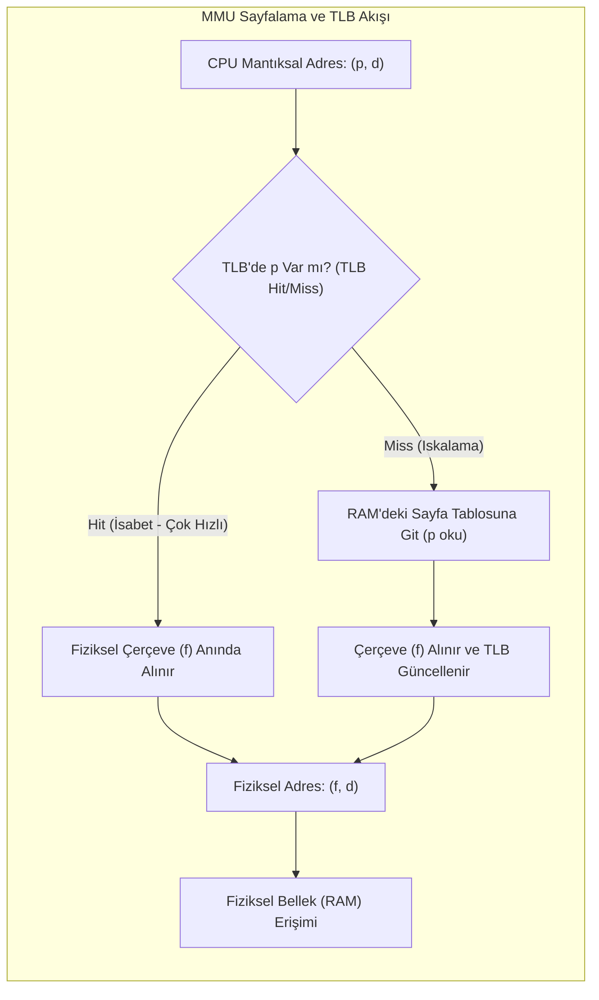

#### 4. TLB ve Etkin Bellek Erişim Süresi (EAT)
Sayfa tablosu ana bellekte tutulduğundan, bellekteki bir veriye erişmek normalde **2 bellek erişimi** gerektirir: 1. Sayfa tablosundan $f$ çerçeve numarasını okumak, 2. Gerçek veriyi fiziksel adresten okumak. Bu durum hızı yarı yarıya düşürür.

Bu gecikmeyi önlemek için CPU içine son derece hızlı ve paralel arama yapabilen donanımsal bir önbellek olan **TLB (Translation Lookaside Buffer)** konulur.
TLB isabet oranı $\alpha$ ($0 \le \alpha \le 1$), TLB arama süresi $t_{TLB}$ ve ana bellek erişim süresi $t_{RAM}$ olduğunda **Etkin Bellek Erişim Süresi (EAT)**:

$$EAT = \alpha \times (t_{TLB} + t_{RAM}) + (1 - \alpha) \times (t_{TLB} + 2 \times t_{RAM})$$

### Adım Adım Çözümlü Örnek / Vaka

**Senaryo:** 32-bit mimariye sahip bir bilgisayarda sayfa boyutu $4\text{ KB}$ ($2^{12}\text{ bayt}$) olarak yapılandırılmıştır.
1. Bir mantıksal adresteki sayfa numarası ($p$) ve ofset ($d$) bit genişliklerini bulunuz. Sistemin destekleyebileceği maksimum sayfa sayısını hesaplayınız.
2. Ana bellek erişim süresi $t_{RAM} = 100\text{ ns}$, TLB arama süresi $t_{TLB} = 10\text{ ns}$ ve TLB isabet oranı $\alpha = \%90$ ($0.90$) olduğuna göre sistemin Etkin Bellek Erişim Süresini ($EAT$) adım adım hesaplayınız.
3. İsabet oranı $\%98$'e ($0.98$) çıkarılırsa $EAT$ nasıl değişir?

**Çözüm Adımları:**

**1. Adres Bit Dağılımı:**
- Sayfa boyutu = $4\text{ KB} = 4096\text{ bayt} = 2^{12}\text{ bayt}$.
- Dolayısıyla sayfa içindeki baytları adreslemek için ofset $d = 12\text{ bit}$ olmalıdır.
- Toplam adres genişliği 32 bit olduğuna göre, sayfa numarası bit sayısı:
  $$p = 32 - 12 = 20\text{ bit}$$
- Sistemin destekleyebileceği mantıksal sayfa sayısı:
  $$2^{20} = 1.048.576\text{ adet sayfa (yaklaşık 1 milyon sayfa)}$$

**2. $\alpha = 0.90$ için EAT Hesabı:**
- **TLB Hit Durumu (İsabet):** $p$ TLB'de bulunur. Süre: $t_{TLB} + t_{RAM} = 10 + 100 = 110\text{ ns}$.
- **TLB Miss Durumu (Iskalama):** $p$ TLB'de bulunamaz. Önce TLB aranır ($10\text{ ns}$), sonra RAM'deki sayfa tablosuna erişilir ($100\text{ ns}$), ardından RAM'deki asıl veriye erişilir ($100\text{ ns}$). Toplam süre: $10 + 100 + 100 = 210\text{ ns}$.
- Formülün uygulanması:
  $$EAT = 0.90 \times 110 + 0.10 \times 210$$
  $$EAT = 99 + 21 = 120\text{ ns}$$
TLB olmasaydı her erişim $200\text{ ns}$ sürecekken, $\%90$ TLB başarımı sayesinde erişim süresi $120\text{ ns}$'ye inmiştir.

**3. $\alpha = 0.98$ için EAT Hesabı:**
  $$EAT = 0.98 \times 110 + 0.02 \times 210$$
  $$EAT = 107.8 + 4.2 = 112\text{ ns}$$
İsabet oranının $\%98$'e çıkması erişim süresini $112\text{ ns}$'ye düşürmüştür (ideal $100\text{ ns}$'lik tek bellek erişimine çok yaklaşılmıştır).

### Sık Karıştırılan Nokta
İç parçalanma (*Internal Fragmentation*) ile Dış parçalanma (*External Fragmentation*) sıklıkla karıştırılır:
- **Dış Parçalanma:** Bitişik bellek ayırmada görülür. Süreçlerin aralarında kalan boş bellek deliklerinin toplamı büyüktür ancak bölünmüş olduğu için içeriye yeni süreç alınamaz. Sayfalama (Paging) yöntemi dış parçalanmayı **tamamen ortadan kaldırır**.
- **İç Parçalanma:** Sayfalama yönteminde süreçlerin bellek talepleri sayfa boyutunun tam katı olmadığında görülür. Örneğin sayfa boyutu $4\text{ KB}$ iken bir süreç $4097\text{ bayt}$ isterse, sürece 2 sayfa ($8192\text{ bayt}$) tahsis edilir. İkinci sayfanın $4095\text{ baytı}$ kullanılmadan kalır. Ortalama olarak her süreç başına $1/2$ sayfa kadar iç parçalanma israfı oluşur.

### Kaynak Kartı
- **Ders Kitabı:** Silberschatz, Galvin, Gagne — *Operating System Concepts (10th Ed.)*, Bölüm 9: Main Memory.
- **Video Ders (Doğrulanmış Kaynak):** Prof. Mythili Vutukuru (IIT Bombay), Lecture 8: Mechanism of address translation  
  URL: https://youtu.be/mYxkp5vpyqc  
  *Gerekçe:* Taban/sınır yazmaçları, mantıksal adres çevirimi ve sayfalama matematiğini donanımsal boyutuyla ele alır.
- **Tamamlayıcı Videolar:**
  - Prof. Mythili Vutukuru, Lecture 7: Introduction to virtual memory (https://youtu.be/2Xj2V8kYNWM)
  - Prof. Mythili Vutukuru, Lecture 9: Paging (https://youtu.be/PTh2kL8ENzU)

### Aktif Hatırlama Soruları ve Cevapları

**Soru 1:** Sayfalama mimarisinde sayfa boyutu donanım seviyesinde neden her zaman 2'nin bir kuvveti ($2^n$, örneğin 4096 bayt) olarak seçilmek zorundadır?
<details>
<summary>Cevap ve Açıklama</summary>
Çünkü sayfa boyutu $2^n$ seçildiğinde donanımsal adres çevirimi son derece ucuz ve hızlı hale gelir. İşlemcinin herhangi bir bölme veya mod alma işlemi yapmasına gerek kalmaz. Bir ikili (binary) mantıksal adresin en sağdaki $n$ biti doğrudan ofseti ($d$), kalan yüksek dereceli bitleri ise doğrudan sayfa numarasını ($p$) verir. Donanım bunu yalnızca bit maskeleme ve kaydırma ile nano-saniyeler içinde çözer.
</details>

**Soru 2:** 32-bit adres alanı kullanan bir sistemde tek seviyeli doğrusal bir sayfa tablosu kullanmanın yaratacağı bellek sorunu nedir ve modern işletim sistemleri bunu nasıl çözer?
<details>
<summary>Cevap ve Açıklama</summary>
32-bit adreste $4\text{ KB}$ sayfa boyutuyla $2^{20} \approx 1\text{ milyon}$ sayfa girişi gerekir. Her giriş 4 bayt olsa, tek bir sürecin sayfa tablosu bellekte $4\text{ MB}$ bitişik alan kaplar. 100 süreç için sadece sayfa tabloları $400\text{ MB}$ RAM tüketir. Oysa süreçlerin çoğu bu adres alanının yalnızca minik bir kısmını kullanır. Çözüm: **Çok Seviyeli Sayfalama (Hierarchical / Multi-level Paging)** veya **Ters Çevrilmiş Sayfa Tabloları (Inverted Page Tables)** kullanmaktır. Böylece yalnızca kullanılan bölgelerin sayfa tabloları belleğe yüklenir.
</details>

**Soru 3:** İki farklı sürecin aynı fiziksel çerçeveyi (frame) sayfa tablolarında işaret etmesi hangi işletim sistemi özelliğini mümkün kılar?
<details>
<summary>Cevap ve Açıklama</summary>
Bu mekanizma **Paylaşılan Bellek (Shared Memory)** ve **Paylaşılan Kütüphanelerin (Shared Libraries - örneğin C `libc.so` veya DLL'ler)** tek bir fiziksel kopyasının RAM'e yüklenerek yüzlerce süreç tarafından ortak kullanılmasını sağlar. Ayrıca `fork()` sonrasındaki Copy-on-Write (CoW) tekniğinin de temel çalışma zeminidir.
</details>

---
## Hafta 10 — Sanal Bellek (Bölüm 10)

### Öğrenme Hedefleri
Bu bölümü tamamladığınızda şunları yapabileceksiniz:
1. **Sanal Bellek (Virtual Memory)** ve **İstek Üzerine Sayfalama (Demand Paging)** mimarisinin çalışma prensibini açıklayabilmek.
2. Bir **Sayfa Hatası (Page Fault)** oluştuğunda işletim sisteminin yürüttüğü 6 temel adımı sırasıyla sıralayabilmek.
3. Sayfa değiştirme algoritmalarını (**FIFO**, **Optimal - OPT**, **LRU**, **Second-Chance / Clock**) referans dizileri üzerinde adım adım çözümleyebilmek.
4. **Belady Anomalisi (Belady's Anomaly)**, **Çalışma Kümesi Modeli (Working-Set Model)** ve **Çırpınma (Thrashing)** fenomenini teknik gerekçeleriyle analiz edebilmek.

### Kavram Anlatımı ve Temel Teori

#### 1. Sanal Bellek ve İstek Üzerine Sayfalama (Demand Paging)
Sanal bellek, bir programın çalışabilmesi için tamamının ana bellekte bulunması zorunluluğunu ortadan kaldıran devrimsel bir soyutlamadır. Programlar fiziksel RAM boyutundan çok daha büyük sanal adres alanlarına sahip olabilirler.

**İstek Üzerine Sayfalama (Demand Paging):** Sayfalar belleğe yalnızca yürütüm esnasında gerçekten ihtiyaç duyulduklarında (*on-demand*) yüklenir. Sayfa tablosunda her giriş için bir **Geçerli/Geçersiz Biti (Valid/Invalid Bit)** tutulur:
- **Valid ($v$):** Sayfa şu anda geçerlidir ve ana bellekteki fiziksel bir çerçevededir.
- **Invalid ($i$):** Sayfa ya sürecin mantıksal adres alanında hiç yoktur (geçersiz adres) ya da henüz disktedir (ana belleğe getirilmemiştir).

#### 2. Sayfa Hatası (Page Fault) Mekanizması
CPU, tablodaki geçerlilik biti $i$ olan bir sayfaya erişmek istediğinde donanım bir **Sayfa Hatası Tuzağı (Page Fault Trap)** üretir. Çekirdek şu 6 adımı yürütür:

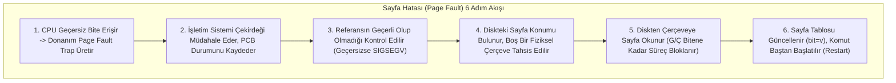

#### 3. Sayfa Değiştirme Algoritmaları
Boş çerçeve kalmadığında, bellekteki kurban bir sayfa (*victim page*) seçilip diske geri yazılmalı (eğer değişmişse / *dirty bit = 1*) ve yeri yeni sayfaya tahsis edilmelidir.
- **FIFO (First-In, First-Out):** Belleğe ilk giren sayfa ilk çıkarılır. Uygulaması basittir ancak performansı düşüktür.
- **Optimal (OPT):** Gelecekte en uzun süre boyunca kullanılmayacak olan sayfayı kurban seçer. Matematiksel olarak minimum sayfa hatası üreten algoritmadır ancak geleceği bilmek imkansız olduğu için pratik sistemlerde referans kıyaslama amacıyla kullanılır.
- **LRU (Least Recently Used):** Geçmişe bakar ve yakın geçmişte en uzun süredir kullanılmamış olan sayfayı kurban seçer. Donanımsal sayaç veya yığın desteği gerektirir.
- **İkinci Şans / Saat (Second-Chance / Clock):** FIFO tabanlıdır ancak sayfaların referans bitini ($0$ veya $1$) kontrol eder. Sayfanın biti 1 ise ikinci bir şans verilip bit 0 yapılır ve saat kolu ilerler; biti 0 olan ilk sayfa kurban seçilir.

#### 4. Belady Anomalisi ve Çırpınma (Thrashing)
- **Belady Anomalisi:** Bazı sayfa değiştirme algoritmalarında (özellikle **FIFO**'da), sisteme daha fazla fiziksel çerçeve tahsis edilmesine rağmen sayfa hatası sayısının azalmak yerine **artması** anomalisi. LRU ve OPT algoritmaları "Yığın Algoritması (Stack Algorithm)" sınıfında olduklarından Belady anomalisinden kesinlikle etkilenmezler.
- **Çırpınma (Thrashing):** Bir süreç aktif olarak ihtiyaç duyduğu çalışma kümesi (*working set*) sayfalarına yetecek kadar çerçeveye sahip olmadığında, sürekli sayfa hatası üretir. Sayfa hatası yüzünden süreçler disk G/Ç kuyruğunda beklemeye başlar. CPU boş kaldığı için işletim sistemi çoklu programlama derecesini (*degree of multiprogramming*) artırarak sisteme yeni süreçler sokar. Bu durum felaketi derinleştirir; sistem zamanının %99'unu sayfa değiştirip disk beklemekle geçirir ve sistem fiilen kilitlenir.

### Adım Adım Çözümlü Örnek / Vaka

**Senaryo:** Fiziksel belleğin **3 çerçeveye (3 frames)** sahip olduğu bir sistemde, başlangıçta tüm çerçeveler boştur. Aşağıdaki 20 elemanlı sayfa referans dizisi verilmiştir:
$$7, 0, 1, 2, 0, 3, 0, 4, 2, 3, 0, 3, 2, 1, 2, 0, 1, 7, 0, 1$$

Bu referans dizisi için **FIFO**, **LRU** ve **Optimal (OPT)** algoritmalarının üreteceği toplam Sayfa Hatası (*Page Fault - PF*) sayılarını adım adım hesaplayınız.

**Çözüm Adımları:**

#### 1. FIFO (3 Çerçeve):
1. **7:** [7, -, -] $\to$ PF 1
2. **0:** [7, 0, -] $\to$ PF 2
3. **1:** [7, 0, 1] $\to$ PF 3
4. **2:** 7 çıkar, [2, 0, 1] $\to$ PF 4
5. **0:** İsabet (Hit) [2, 0, 1]
6. **3:** 0 çıkar, [2, 3, 1] $\to$ PF 5
7. **0:** 1 çıkar, [2, 3, 0] $\to$ PF 6
8. **4:** 2 çıkar, [4, 3, 0] $\to$ PF 7
9. **2:** 3 çıkar, [4, 2, 0] $\to$ PF 8
10. **3:** 0 çıkar, [4, 2, 3] $\to$ PF 9
11. **0:** 4 çıkar, [0, 2, 3] $\to$ PF 10
12. **3:** İsabet [0, 2, 3]
13. **2:** İsabet [0, 2, 3]
14. **1:** 2 çıkar, [0, 1, 3] $\to$ PF 11
15. **2:** 3 çıkar, [0, 1, 2] $\to$ PF 12
16. **0:** İsabet [0, 1, 2]
17. **1:** İsabet [0, 1, 2]
18. **7:** 0 çıkar, [7, 1, 2] $\to$ PF 13
19. **0:** 1 çıkar, [7, 0, 2] $\to$ PF 14
20. **1:** 2 çıkar, [7, 0, 1] $\to$ PF 15
- **Toplam FIFO Sayfa Hatası:** **15**

#### 2. LRU (3 Çerçeve):
1. **7:** [7, -, -] $\to$ PF 1
2. **0:** [7, 0, -] $\to$ PF 2
3. **1:** [7, 0, 1] $\to$ PF 3
4. **2:** En eski 7, [2, 0, 1] $\to$ PF 4
5. **0:** İsabet (Yenilenme: 0 en yeni)
6. **3:** En eski 1, [2, 0, 3] $\to$ PF 5
7. **0:** İsabet (0 en yeni)
8. **4:** En eski 2, [4, 0, 3] $\to$ PF 6
9. **2:** En eski 3, [4, 0, 2] $\to$ PF 7
10. **3:** En eski 0, [4, 3, 2] $\to$ PF 8
11. **0:** En eski 4, [0, 3, 2] $\to$ PF 9
12. **3:** İsabet
13. **2:** İsabet
14. **1:** En eski 0, [1, 3, 2] $\to$ PF 10
15. **2:** İsabet
16. **0:** En eski 3, [1, 0, 2] $\to$ PF 11
17. **1:** İsabet
18. **7:** En eski 2, [1, 0, 7] $\to$ PF 12
19. **0:** İsabet
20. **1:** İsabet
- **Toplam LRU Sayfa Hatası:** **12**

#### 3. Optimal (OPT - 3 Çerçeve):
1. **7:** [7, -, -] $\to$ PF 1
2. **0:** [7, 0, -] $\to$ PF 2
3. **1:** [7, 0, 1] $\to$ PF 3
4. **2:** 7 gelecekte en geç kullanılacak (adım 18), 7 çıkar: [2, 0, 1] $\to$ PF 4
5. **0:** İsabet
6. **3:** Gelecek: 0 (adım 7), 2 (adım 9), 1 (adım 14). 1 en uzakta! 1 çıkar: [2, 0, 3] $\to$ PF 5
7. **0:** İsabet
8. **4:** Gelecek: 2 (adım 9), 3 (adım 10), 0 (adım 11). En uzakta olan 0 çıkarılır: [2, 4, 3] $\to$ PF 6
9. **2:** İsabet
10. **3:** İsabet
11. **0:** Gelecek: 3 (adım 12), 2 (adım 13), 4 bir daha hiç yok! 4 çıkar: [2, 0, 3] $\to$ PF 7
12. **3:** İsabet
13. **2:** İsabet
14. **1:** Gelecek: 2 (adım 15), 0 (adım 16), 3 bir daha hiç yok! 3 çıkar: [2, 0, 1] $\to$ PF 8
15. **2:** İsabet
16. **0:** İsabet
17. **1:** İsabet
18. **7:** Gelecek: 0 (adım 19), 1 (adım 20), 2 bir daha hiç yok! 2 çıkar: [7, 0, 1] $\to$ PF 9
19. **0:** İsabet
20. **1:** İsabet
- **Toplam Optimal Sayfa Hatası:** **9**

**Özet Karşılaştırma:** $\text{OPT (9)} < \text{LRU (12)} < \text{FIFO (15)}$. Sayısal sonuçlar algoritmaların teorik etkinlik sırasını doğrulamaktadır.

### Sık Karıştırılan Nokta
Sayfa Değiştirme (*Page Replacement*) sırasında **Dirty Bit (Modify Bit)** bayrağının rolü hayati önem taşır. Eğer kurban seçilen sayfanın bellekte bulunduğu süre boyunca içeriği değiştirilmemişse (*dirty bit = 0*), bu sayfa zaten diskteki kopyasıyla birebir aynıdır; diske yeniden yazılmasına gerek yoktur, çerçeve doğrudan ezilebilir. Yalnızca veri yazılmış sayfalar (*dirty bit = 1*) diske geri yazılmak zorundadır. Bu bayrak disk G/Ç yükünü yarı yarıya azaltır.

### Kaynak Kartı
- **Ders Kitabı:** Silberschatz, Galvin, Gagne — *Operating System Concepts (10th Ed.)*, Bölüm 10: Virtual Memory.
- **Video Ders (Doğrulanmış Kaynak):** Prof. Mythili Vutukuru (IIT Bombay), Lecture 10: Demand paging  
  URL: https://www.youtube.com/watch?v=r9NwqtqS2Ac  
  *Gerekçe:* Sayfa hatası oluşumunu, işletim sistemi işleyicisini, dirty bit mantığını ve sayfa değiştirme algoritmalarını derinlemesine açıklar.
- **Ders Portalı:** https://www.cse.iitb.ac.in/~mythili/os/

### Aktif Hatırlama Soruları ve Cevapları

**Soru 1:** Belady Anomalisi nedir ve LRU (Least Recently Used) algoritmasının bu anomaliyi göstermeyeceği matematiksel olarak nasıl kanıtlanır?
<details>
<summary>Cevap ve Açıklama</summary>
Belady Anomalisi, fiziksel çerçeve sayısı artırıldığında sayfa hatası sayısının beklenmedik şekilde artması durumudur. LRU algoritması bir "Yığın Algoritmasıdır (Stack Algorithm)". Bir yığın algoritmasında, $N$ çerçeveye sahip bir bellekte bulunan sayfalar kümesi, daima $N+1$ çerçeveye sahip bellekteki sayfalar kümesinin kesin bir alt kümesidir ($S_N \subseteq S_{N+1}$). Dolayısıyla çerçeve sayısı artırıldığında daha önce isabet eden hiçbir sayfa ıskalamaya dönüşemez; bu nedenle LRU'da Belady anomalisi ortaya çıkamaz.
</details>

**Soru 2:** Sistem çırpınmaya (Thrashing) girdiğinde işletim sisteminin CPU kullanımının düştüğünü görüp çoklu programlama derecesini artırması neden ölümcül bir kısır döngü yaratır?
<details>
<summary>Cevap ve Açıklama</summary>
İşletim sisteminin klasik CPU çizelgeleyicisi CPU kullanım oranı düştüğünde sistemde yeterince iş olmadığını varsayarak belleğe yeni süreçler yükler. Ancak CPU'nun boş kalmasının asıl nedeni iş olmaması değil, mevcut süreçlerin bellek yetersizliği yüzünden disk sayfa hatası kuyruğunda bloklanmış olmasıdır. Belleğe yeni bir süreç sokulması, mevcut süreçlerin elindeki çerçeveleri daha da azaltır; sayfa hataları geometrik olarak patlar, disk kuyruğu kilitlenir ve CPU kullanımı neredeyse sıfıra düşer.
</details>

**Soru 3:** İkinci Şans (Clock) sayfa değiştirme algoritmasında referans biti 1 olan bir sayfa saat kolu tarafından tarandığında ne yapılır?
<details>
<summary>Cevap ve Açıklama</summary>
Sayfaya kurban edilmemesi için "ikinci bir şans" verilir. Sayfanın referans biti 1'den 0'a çekilir, sayfa bellekte bırakılır ve saat kolu bir sonraki sayfayı incelemek üzere ilerletilir. Eğer tüm sayfaların referans biti 1 ise, saat kolu tam bir tur atarak tüm bitleri 0 yapar ve başlangıçtaki sayfayı kurban seçerek FIFO gibi davranır.
</details>

---
## Hafta 11 — Depolama Yapıları (Bölüm 11)

### Öğrenme Hedefleri
Bu bölümü tamamladığınızda şunları yapabileceksiniz:
1. Manyetik Sabit Disklerin (**HDD**) fiziksel geometrisini (**Platter**, **Track**, **Sector**, **Cylinder**) ve erişim zamanı bileşenlerini (**Seek Time**, **Rotational Latency**, **Transfer Time**) tanımlayabilmek.
2. Katı Hal Sürücülerinin (**SSD - NAND Flash**) çalışma mekanizmasını, Blok Silme / Sayfa Yazma kısıtını, **FTL (Flash Translation Layer)** ve **Aşınma Dengelemeyi (Wear Leveling)** açıklayabilmek.
3. Disk kafası çizelgeleme algoritmalarını (**FCFS**, **SSTF**, **SCAN**, **C-SCAN**) kafa hareketi silindir mesafesi üzerinden matematiksel olarak hesaplayabilmek.
4. **RAID** seviyelerini (**RAID 0, 1, 5, 6, 10**) başarım, güvenilirlik ve depolama verimliliği yönünden karşılaştırabilmek.

### Kavram Anlatımı ve Temel Teori

#### 1. Sabit Disk Geometrisi ve Erişim Süresi
Geleneksel bir sabit disk (HDD), manyetik kaplı dönen disk plakaları (*platters*) ve bunların üzerinde hareket eden okuma/yazma kafalarından (*heads*) oluşur. Bir disk erişim süresi 3 temel bileşenin toplamıdır:

$$T_{erisim} = T_{seek} + T_{rotational} + T_{transfer}$$

1. **Arama Süresi (Seek Time):** Disk kafasının hedef silindire/ize (*track*) mekanik olarak hareket etmesi için geçen süredir. En pahalı bileşendir (tipik olarak 3–10 ms).
2. **Dönme Gecikmesi (Rotational Latency):** İstenen sektörün dönerek kafa altına gelmesi için geçen süredir. Ortalama dönme gecikmesi, diskin yarım tur dönme süresidir:
   $$T_{rot} = \frac{1}{2} \times \frac{60}{\text{RPM}} \text{ saniye}$$
   (Örneğin 7200 RPM bir diskte ortalama dönme gecikmesi $\approx 4.17\text{ ms}$).
3. **Aktarım Süresi (Transfer Time):** Veri baytlarının manyetik yüzeyden okunup aktarılma süresidir ($T_{trans} = \frac{\text{Bayt Sayısı}}{\text{Aktarım Hızı}}$).

#### 2. Katı Hal Sürücüleri (SSD) ve Flash Mimarisi
SSD'ler hiçbir mekanik hareketli parça içermez; NAND flash bellek hücrelerinden oluşur. Ancak SSD'lerin çok katı bir fiziksel kısıtı vardır:
- Veri **Sayfa (Page)** bazında okunur ve yazılır (örneğin 4 KB veya 8 KB).
- Ancak veri doğrudan üzerine yazılamaz (*no overwrite*); bir sayfanın yeniden yazılabilmesi için bağlı olduğu tüm **Bloğun (Block - tipik olarak 128–256 sayfa, örn. 2–4 MB)** tamamen silinmesi gerekir!
- Bu asimetriyi yönetmek için SSD içinde gömülü bir **FTL (Flash Translation Layer)** mikroişlemcisi çalışır. FTL mantıksal sektörleri sürekli yeni boş sayfalara eşler, arka planda çöp toplama (*Garbage Collection*) yapar ve hücrelerin erken yıpranmasını önlemek için yazmaları disk geneline yayan **Aşınma Dengeleme (Wear Leveling)** yürütür. İşletim sistemi silinen dosyaları SSD'ye **TRIM** komutu ile bildirir.

#### 3. Disk Çizelgeleme Algoritmaları
İşletim sistemi gelen disk isteklerini kafa hareket mesafesini (toplam seek süresini) minimize edecek şekilde sıraya koyar:
- **FCFS:** İstekleri geliş sırasına göre işler. Adildir ancak kafa disk üzerinde çılgınca ileri geri hareket edebilir.
- **SSTF (Shortest Seek Time First):** Mevcut kafa konumuna en yakın silindir isteğini ilk işler. Arama süresini düşürür ancak uç silindirlerdeki istekler için **açlığa (starvation)** neden olabilir.
- **SCAN (Asansör Algoritması):** Kafa diskin bir ucundan diğer ucuna doğru sürekli hareket eder; yol boyunca karşılaştığı istekleri işler. Diskin sonuna ulaştığında ters yöne döner.
- **C-SCAN (Circular SCAN):** SCAN gibidir ancak yalnızca tek yönde hizmet verir; diğer uca vardığında hiç istek işlemeden hızla başlangıç ucuna geri döner. Bekleme sürelerinin disk genelinde daha homojen dağılmasını sağlar.

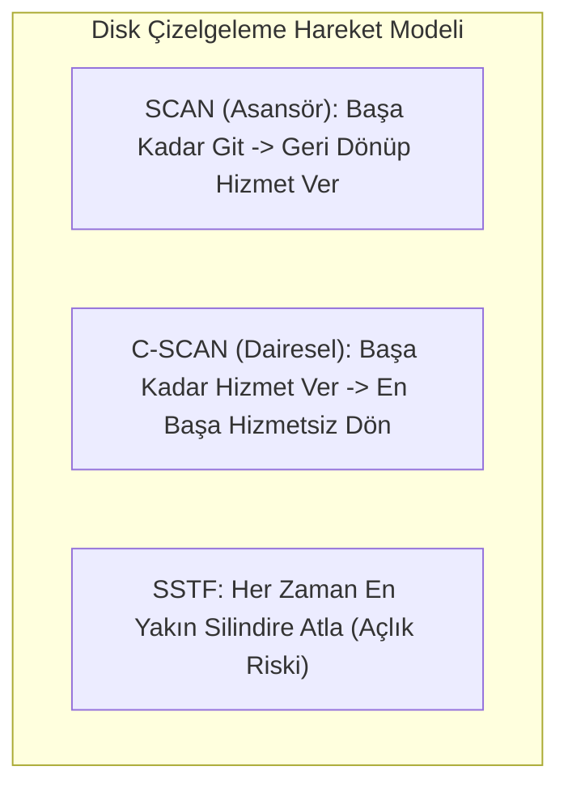

#### 4. RAID Seviyeleri (Redundant Array of Independent Disks)
Birden fazla fiziksel diski tek bir mantıksal depolama biriminde birleştirerek başarım ve/veya hata toleransı sağlama teknolojisidir:
- **RAID 0 (Şeritleme - Striping):** Veri bloklara ayrılarak disklere paralel yazılır. Hız çok yüksektir; yedeklilik (redundancy) yoktur, tek disk bozulursa tüm veri kaybedilir.
- **RAID 1 (Aynalama - Mirroring):** Her diskin birebir tam kopyası tutulur. Okuma hızı yüksek, hata toleransı mükemmeldir; ancak depolama verimi $\%50$'dir (maliyet iki katıdır).
- **RAID 5 (Dağıtık Eşlik - Distributed Parity):** Veriler disklere şeritlenir, her satır için bir XOR eşlik (*parity*) bloku disklere dağıtılarak yazılır. En az 3 disk gerekir. 1 diskin arızalanmasını tolere eder. Depolama verimi: $\frac{N-1}{N}$.
- **RAID 6 (Çift Eşlik):** İki farklı matematiksel eşlik tutulur. Aynı anda 2 diskin birden bozulmasına dayanıklıdır.
- **RAID 10 (1+0):** Aynalanmış disklerin şeritlenmesidir. Hem maksimum performans hem de yüksek hata toleransı sağlar.

### Adım Adım Çözümlü Örnek / Vaka

**Senaryo:** 0 ile 199 arasında numaralandırılmış 200 silindire sahip bir diskte, kafa şu anda **53. silindirdedir**.
Bekleyen G/Ç istek kuyruğu FIFO sırasıyla şöyledir:
$$98, 183, 37, 122, 14, 124, 65, 67$$

1. **FCFS**
2. **SSTF**
3. **SCAN** (Kafanın büyük silindirlere doğru, yani 199 yönünde hareket ettiğini varsayınız)
4. **C-SCAN** (Büyük silindirlere doğru hareket ettiğini, 199'a ulaştığında hizmet vermeden doğrudan 0'a döndüğünü varsayınız)

algoritmaları için toplam kafa hareket mesafesini (kat edilen silindir sayısını) adım adım hesaplayınız.

**Çözüm Adımları:**

**1. FCFS Hesabı:**
Kafa sırası: $53 \to 98 \to 183 \to 37 \to 122 \to 14 \to 124 \to 65 \to 67$
- $|53 - 98| = 45$
- $|98 - 183| = 85$
- $|183 - 37| = 146$
- $|37 - 122| = 85$
- $|122 - 14| = 108$
- $|14 - 124| = 110$
- $|124 - 65| = 59$
- $|65 - 67| = 2$
- **Toplam Mesafe:** $45 + 85 + 146 + 85 + 108 + 110 + 59 + 2 = 640\text{ silindir}$.

**2. SSTF Hesabı:**
Başlangıç: 53. En yakın istek aranır:
- $53 \to 65$ (mesafe: 12)
- $65 \to 67$ (mesafe: 2)
- $67 \to 37$ (mesafe: 30) [Alternatif 98'e mesafe 31, 37 daha yakın!]
- $37 \to 14$ (mesafe: 23)
- $14 \to 98$ (mesafe: 84)
- $98 \to 122$ (mesafe: 24)
- $122 \to 124$ (mesafe: 2)
- $124 \to 183$ (mesafe: 59)
- **Toplam Mesafe:** $12 + 2 + 30 + 23 + 84 + 24 + 2 + 59 = 236\text{ silindir}$.

**3. SCAN Hesabı (53'ten 199 yönüne doğru):**
Kafa 199'a kadar giderken yoldaki büyükleri toplar, sonra ters dönüp kalanları toplar.
Sıra: $53 \to 65 \to 67 \to 98 \to 122 \to 124 \to 183 \to 199 \to 37 \to 14$.
- 53'ten 199'a kadar mesafe: $199 - 53 = 146$.
- 199'dan 14'e kadar dönüş mesafesi: $199 - 14 = 185$.
- **Toplam Mesafe:** $146 + 185 = 331\text{ silindir}$.

**4. C-SCAN Hesabı (53'ten 199 yönüne doğru, sonra 0'a sıçrama):**
Sıra: $53 \to 65 \to 67 \to 98 \to 122 \to 124 \to 183 \to 199 \to [0'a sıçra] \to 14 \to 37$.
- 53'ten 199'a mesafe: $199 - 53 = 146$.
- 199'dan 0'a sıçrama: $199 - 0 = 199$.
- 0'dan 37'ye mesafe: $37 - 0 = 37$.
- **Toplam Mesafe:** $146 + 199 + 37 = 382\text{ silindir}$.

### Sık Karıştırılan Nokta
Rotational Latency (Dönme Gecikmesi) ile Seek Time (Arama Süresi) sıklıkla karıştırılır:
- **Seek Time:** Disk kolunun motoruyla fiziksel kafayı doğru silindirin (içe/dışa) üzerine götürmesidir.
- **Rotational Latency:** Kafa doğru silindirin üzerine geldikten sonra, diskin kendi ekseni etrafında dönerek istenen sektörün kafanın altından geçtiği anı beklemesidir.

### Kaynak Kartı
- **Ders Kitabı:** Silberschatz, Galvin, Gagne — *Operating System Concepts (10th Ed.)*, Bölüm 11: Mass-Storage Structure.
- **Video Ders (Doğrulanmış Kaynak):** Prof. Mythili Vutukuru (IIT Bombay), Lecture 20: Hard disk internals  
  URL: https://www.youtube.com/watch?v=-ZFINyHshqo  
  *Gerekçe:* Plaka, sektör geometrisini, arama/dönme sürelerinin mekanik gecikmelerini ve disk çizelgeleme algoritmalarını ayrıntılı işler.
- **Ders Portalı:** https://www.cse.iitb.ac.in/~mythili/os/

### Aktif Hatırlama Soruları ve Cevapları

**Soru 1:** SSD sürücülerinde geleneksel HDD disk çizelgeleme algoritmalarının (örneğin SCAN veya SSTF) kullanılmasının neden hiçbir anlamı yoktur?
<details>
<summary>Cevap ve Açıklama</summary>
Çünkü SSD'lerde mekanik hareketli bir kafa veya dönen plaka bulunmaz. Herhangi bir sektör/sayfaya erişim süresi elektronik olarak neredeyse eşittir ($O(1)$ rastgele erişim). Dolayısıyla kafayı yakın silindire götürmeye dayalı algoritmalar anlamsızdır; SSD'lerde asıl amaç aşınmayı dengelemek (wear leveling) ve eşzamanlı flash kanallarını paralel kullanmaktır (NOOP veya basit FIFO kullanılır).
</details>

**Soru 2:** 4 adet 2 TB'lık disk kullanılarak bir RAID 5 dizisi oluşturulduğunda kullanıcıya sunulan net kullanılabilir depolama kapasitesi kaç TB olur? Neden?
<details>
<summary>Cevap ve Açıklama</summary>
RAID 5'te toplam kapasite $(N - 1) \times \text{Disk Kapasitesi}$ formülüyle hesaplanır (bir disklik alan eşlik / parity bilgileri için harcanır). $N = 4$ olduğuna göre: $(4 - 1) \times 2\text{ TB} = 6\text{ TB}$ net depolama alanı elde edilir.
</details>

**Soru 3:** Katı hal sürücülerinde (SSD) işletim sisteminin dosya silindiğinde sürücüye gönderdiği "TRIM" komutunun hayati önemi nedir?
<details>
<summary>Cevap ve Açıklama</summary>
İşletim sistemi bir dosyayı sildiğinde dosya sisteminde yalnızca Inode veya işaretçi silinir, diske sıfır yazılmaz. SSD denetleyicisi (FTL) ise hangi sektörlerin geçerli veri hangilerinin silinmiş dosya olduğunu bilemez. TRIM komutu olmadan SSD, silinmiş dosyaların verilerini de çöp toplama (garbage collection) sırasında boş yere bloktan bloğa taşır; bu durum yazma katlanmasına (write amplification) ve sürücünün erkenden yıpranmasına yol açar. TRIM komutu FTL'ye o sayfaların geçersiz olduğunu bildirir.
</details>

---
## Hafta 12 — Giriş/Çıkış Sistemleri (Bölüm 12)

### Öğrenme Hedefleri
Bu bölümü tamamladığınızda şunları yapabileceksiniz:
1. G/Ç donanım ilkelerini (**Portlar**, **Veriyolları: PCIe, USB, SATA**, **Aygıt Denetleyicileri - Device Controllers**) açıklayabilmek.
2. Üç temel G/Ç iletişim yöntemini (**Programlanmış G/Ç / Polling**, **Kesme Tabanlı G/Ç / Interrupt-Driven**, **Doğrudan Bellek Erişimi / DMA**) CPU yükü ve bant genişliği yönünden karşılaştırabilmek.
3. Çekirdek G/Ç alt sisteminin sunduğu hizmetleri (**G/Ç Çizelgeleme**, **Tamponlama / Buffering**, **Önbellekleme / Caching**, **Spooling**) tanımlayabilmek.
4. **Blok Aygıtları** ile **Karakter Aygıtları** ve **Senkron (Bloklayıcı)** ile **Asenkron (Non-blocking / `epoll`)** G/Ç modellerini analiz edebilmek.

### Kavram Anlatımı ve Temel Teori

#### 1. G/Ç Donanım Mimarisi ve Aygıt Denetleyicisi
Bir bilgisayarın çevre birimleriyle konuşması için her donanım birimi bir **Aygıt Denetleyicisine (Device Controller)** bağlıdır. Denetleyici, cihazın donanımsal mantığını yöneten küçük bir özel işlemcidir ve üzerinde genellikle şu yazmaçlar bulunur:
- **Veri Giriş/Çıkış Yazmaçları (Data-in / Data-out Registers):** Aktarılacak baytları tutar.
- **Durum Yazmacı (Status Register):** Cihazın meşgul (*busy*), hata (*error*) veya veri hazır (*ready*) durumunu gösteren bayrakları tutar.
- **Kontrol Yazmacı (Control Register):** Cihaza yapılacak komutu (oku, yaz, sıfırla) bildirir.

Bu yazmaçlara erişim iki yöntemle yapılır:
- **Port Tabanlı G/Ç (Port-Mapped I/O):** Özel makine komutları (`IN`, `OUT`) kullanılır.
- **Bellek Eşlemeli G/Ç (Memory-Mapped I/O):** Cihaz yazmaçları doğrudan CPU'nun fiziksel adres alanına eşlenir; standart bellek okuma/yazma komutlarıyla (`MOV`) cihaz yönetilir.

#### 2. Üç G/Ç İletişim Yöntemi
1. **Programlanmış G/Ç (Polling / Busy-Waiting):** CPU, aygıtın durum yazmacındaki "meşgul" biti sıfır olana kadar bir döngü içinde sürekli yazmacı okur. Çok hızlı cihazlarda mantıklıdır ancak yavaş cihazlarda CPU vaktini tamamen israf eder.
2. **Kesme Tabanlı G/Ç (Interrupt-Driven I/O):** CPU cihaza komutu verir ve başka bir süreci çalıştırmaya devam eder. Cihaz işlemi tamamladığında kesme hattından CPU'ya bir donanım kesmesi (*Interrupt*) fırlatır. CPU mevcut işi durdurup **Kesme Servis Rutinini (ISR - Interrupt Service Routine)** çalıştırır. Veri aktarım hızı düşük/orta cihazlar (klavye, fare) için idealdir.
3. **Doğrudan Bellek Erişimi (DMA - Direct Memory Access):** Yüksek hızlı veri aktarımı yapan birimler (diskler, ağ kartları) her bayt için bir kesme üretirse CPU kesme işlemekten felç olur. **DMA Denetleyicisi**, CPU'nun araya girmesine gerek kalmadan doğrudan cihaz ile RAM arasında veri bloklarını taşır. Aktarım bittiğinde CPU'ya yalnızca **tek bir kesme** üretir.

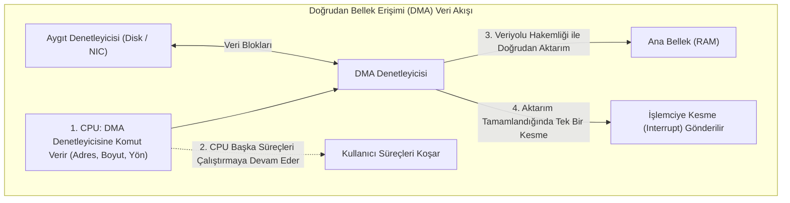

#### 3. Çekirdek G/Ç Alt Sistemi Hizmetleri
- **Ara Belleğe Alma (Buffering):** Hızları veya transfer boyutları uyuşmayan iki birim arasında (örneğin yavaş internetten gelen veri ile hızlı CPU belleği arasında) verinin geçici bir bellek alanında toplanmasıdır.
- **Önbellekleme (Caching):** Sık erişilen verilerin hızlı bir bellek alanında (RAM) tutularak sonraki erişimlerin hızlandırılmasıdır.
- **Biriktirme (Spooling - Simultaneous Peripheral Operations On-Line):** Aynı anda yalnızca tek bir sürecin erişebileceği paylaşılamaz cihazlara (örneğin yazıcı - printer) giden işlerin diskteki bir kuyrukta sıraya dizilerek yönetilmesidir.

### Adım Adım Çözümlü Örnek / Vaka

**Senaryo:** $10\text{ MB}$ ($10 \times 1024 \times 1024 \approx 10.485.760\text{ bayt}$) boyutundaki büyük bir dosya, $1\text{ Gbps}$'lik ($125\text{ MB/sn}$) bir ağ arabirim kartından (NIC) ana belleğe aktarılacaktır.
1. Eğer aktarım **bayt başına bir kesme** üreten kesme tabanlı yöntemle yapılsaydı ve her kesmenin işlenmesi $2\text{ mikrosaniye}$ ($2 \times 10^{-6}\text{ sn}$) sürseydi, yalnızca kesmeleri işlemek için kaç saniye CPU süresi gerekirdi? Bu sistemin neden çökeceğini açıklayınız.
2. Aktarım $4\text{ KB}$ ($4096\text{ bayt}$) bloklar halinde **DMA denetleyicisi** ile yapıldığında ve yalnızca tüm dosya transferi bittiğinde tek bir kesme üretildiğinde CPU kesme maliyetini hesaplayınız.

**Çözüm Adımları:**

**1. Bayt Başına Kesme Yöntemi:**
- Toplam bayt sayısı: $N = 10.485.760\text{ bayt}$.
- Üretilen kesme sayısı: $10.485.760\text{ adet kesme}$.
- Toplam harcanacak CPU süresi:
  $$T_{CPU} = 10.485.760 \times 2 \times 10^{-6}\text{ saniye} \approx 20.97\text{ saniye!}$$
- Oysa $125\text{ MB/sn}$ hızında $10\text{ MB}$ verinin fiziksel olarak hattan akma süresi:
  $$T_{hat} = \frac{10\text{ MB}}{125\text{ MB/sn}} = 0.08\text{ saniye (80 ms)!}$$
- **Çıkarım:** Veri $0.08$ saniyede gelirken işlemcinin kesmeleri işlemesi $21$ saniye sürecektir! Sistem aradaki devasa hız farkı yüzünden paketleri düşürecek, CPU tamamen kilitlenecek (*livelock*) ve sistem çökecektir.

**2. DMA Tabanlı Yöntem:**
- CPU, aktarımın başlangıcında DMA yazmaçlarına kaynak cihazı, hedef RAM adresini ve $10\text{ MB}$ boyutunu yazar ($< 1\text{ mikrosaniye}$).
- DMA denetleyicisi veriyi veriyolu üzerinden doğrudan RAM'e yazar. Bu esnada CPU başka kullanıcı süreçlerini yürütmeye devam eder.
- Transfer $0.08$ saniye sonra bittiğinde DMA denetleyicisi **yalnızca 1 adet kesme** üretir.
- Toplam CPU kesme süresi: **$2\text{ mikrosaniye}$** ($0.000002\text{ sn}$).
- **Verimlilik Artışı:** CPU kesme yükü $21\text{ saniyeden}$ $2\text{ mikrosaniyeye}$ indirilmiştir (yaklaşık 10 milyon kat kazanç!).

### Sık Karıştırılan Nokta
**Buffering (Tamponlama)** ile **Caching (Önbellekleme)** sıklıkla birbirinin yerine kullanılır:
- **Buffering:** İki cihaz arasındaki hız uyumsuzluğunu (örneğin klavyeden yavaş yazılan harflerin toplanması) veya veri transfer boyutu farkını çözmek için kullanılır; tamponlanan veri bir kez tüketildikten sonra genellikle atılır.
- **Caching:** Verinin bir kopyasını daha hızlı bir bellekte tutarak aynı veriye gelecekte yapılabilecek mükerrer erişimleri hızlandırmayı amaçlar; veri tekrar tekrar okunabilir.

### Kaynak Kartı
- **Ders Kitabı:** Silberschatz, Galvin, Gagne — *Operating System Concepts (10th Ed.)*, Bölüm 12: I/O Systems.
- **Video Ders (Doğrulanmış Kaynak):** Prof. Mythili Vutukuru (IIT Bombay), Lecture 17: Communication with I/O devices  
  URL: https://www.youtube.com/watch?v=7F4qQOSJGDw  
  *Gerekçe:* G/Ç denetleyicileri, bellek eşlemeli yazmaçlar, kesme işleme hiyerarşisi ve DMA mimarisini şemalarla anlatır.
- **Ders Portalı:** https://www.cse.iitb.ac.in/~mythili/os/

### Aktif Hatırlama Soruları ve Cevapları

**Soru 1:** Blok aygıtı (Block Device) ile Karakter aygıtı (Character Device) arasındaki fark nedir? Her birine birer donanım örneği veriniz.
<details>
<summary>Cevap ve Açıklama</summary>
- **Blok Aygıtı:** Veriyi sabit boyutlu bloklar halinde (örneğin 512 bayt veya 4 KB) aktarır ve rastgele erişimi (random access - seek) destekler; herhangi bir bloğa doğrudan atlanabilir (Örnek: Sabit diskler, SSD'ler, USB bellekler).
- **Karakter Aygıtı:** Veriyi sıralı bir bayt akışı (stream of bytes) halinde aktarır; rastgele erişim veya geriye sarma desteği yoktur (Örnek: Klavye, seri port, fare).
</details>

**Soru 2:** DMA denetleyicisi veriyolunu (bus) kullanırken CPU ile çekiştiğinde uygulanan "Döngü Çalma (Cycle Stealing)" yöntemi nedir?
<details>
<summary>Cevap ve Açıklama</summary>
Sistem veriyolunu aynı anda hem CPU hem de DMA kullanamaz. DMA denetleyicisi bir bayt veya kelime aktaracağı zaman, işlemcinin bellek erişimi yapmadığı boş saat çevrimlerini yakalar veya işlemciden bir bellek çevrimini geçici olarak "çalar". Bu sayede DMA işlemciyi tamamen durdurmadan araya girerek veri transferini gerçekleştirir.
</details>

**Soru 3:** Yüksek eşzamanlı ağ sunucularında neden her bağlantı için bloklayıcı bir iş parçacığı açmak yerine `epoll()` gibi asenkron/olay güdümlü G/Ç arabirimleri tercih edilir?
<details>
<summary>Cevap ve Açıklama</summary>
Her istemci için ayrı bir thread ve bloklayıcı `read()` kullanıldığında (thread-per-connection), binlerce bağlantıda on binlerce thread oluşur; bu durum gigabaytlarca yığın belleği israfına ve felç edici bir bağlam değiştirme (context switch) ek yüküne yol açar (C10K problemi). `epoll()` ise tek bir thread'in işletim sistemine binlerce soket tanıtıcısını kaydetmesini ve yalnızca veri gelen soketlerin olay bildirimiyle (event notification) tetiklenmesini sağlar; gereksiz bekleme ve bellek israfını sıfıra indirir.
</details>

---
## Hafta 13 — Dosya Sistemi (Bölüm 13–15)

### Öğrenme Hedefleri
Bu bölümü tamamladığınızda şunları yapabileceksiniz:
1. **Dosya Kavramını**, dosya niteliklerini (*metadata*) ve dizin hiyerarşisi yapılarını (**Ağaç Yapılı**, **Asiklik Çizge / Linkler**) açıklayabilmek.
2. Çekirdek dosya sistemi veri yapılarını (**Süperblok - Superblock**, **Inode - Index Node**, **Dentry**, **Açık Dosya Tabloları**) analiz edebilmek.
3. Blok tahsis yöntemlerini (**Bitişik / Contiguous**, **Bağlı / Linked - FAT**, **İndeksli / Indexed - UNIX Çok Seviyeli Inode**) karşılaştırabilmek ve maksimum dosya boyutu hesabı yapabilmek.
4. **Sabit Bağlantı (Hard Link)** ile **Sembolik Bağlantı (Soft / Symbolic Link)** farkını ve **Günlüklemeli Dosya Sistemlerinin (Journaling)** çökme sonrası tutarlılık sağlama mantığını kavrayabilmek.

### Kavram Anlatımı ve Temel Teori

#### 1. Dosya ve Dizin Kavramı
Dosya; işletim sistemi tarafından fiziksel depolama birimlerine (HDD, SSD) haritalanan, mantıksal olarak ilişkili baytlar dizisidir. Dosyanın içeriği ile dosya hakkındaki üstveriler (**Metadata:** dosya adı, boyutu, oluşturulma tarihi, izinleri, blok adresleri) birbirinden kesin olarak ayrılır.

**Dizin Yapısı:** Dizinler de özel birer dosyadır; içlerinde `(dosya_adı, inode_numarası)` eşleme tablolarını barındırırlar.
- **Sabit Bağlantı (Hard Link):** Var olan bir Inode'a yeni bir dizin girişi (yeni bir ad) ekler. Inode referans sayacını (*link count*) 1 artırır. Orijinal dosya adı silinse dahi Inode referans sayısı sıfır olmadığı sürece dosya verisi silinmez! Dosya sistemleri arasında (*cross-filesystem*) veya dizinlere hard link verilemez.
- **Sembolik Bağlantı (Soft / Symlink):** İçinde yalnızca hedef dosyanın yolunu (*path string*) barındıran tamamen bağımsız küçük bir dosyadır. Hedef dosya silinirse sembolik link çalışmaz hale gelir (*kırık link - dangling link*). Farklı dosya sistemlerine ve dizinlere verilebilir.

#### 2. UNIX Inode Mimarisi ve Blok Tahsis Yöntemleri
Bir dosyanın veri bloklarını diskte tutmanın üç klasik yolu vardır:
1. **Bitişik Tahsis (Contiguous):** Dosya blokları diskte yan yana oturur. Sıralı ve rastgele erişim son derece hızlıdır; ancak dış parçalanmaya yol açar ve dosyanın büyümesi zordur.
2. **Bağlı Tahsis (Linked / FAT):** Her blok bir sonraki bloğun disk adresini işaretçi olarak tutar (MS-DOS FAT). Parçalanma yoktur ancak rastgele erişim ($O(N)$) felaket derecede yavaştır; aradaki bir blok bozulursa tüm dosya kaybolur.
3. **Çok Seviyeli İndeksli Tahsis (UNIX Inode):** Her dosya için bir **Inode** yapısı tutulur. Inode içinde doğrudan blok işaretçileri ve dolaylı işaretçiler yer alır:

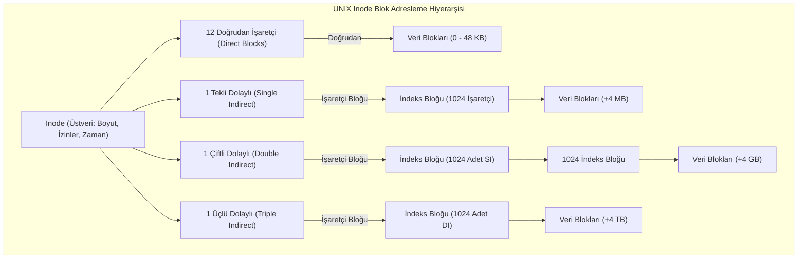

#### 3. Çökme Tutarlılığı ve Günlükleme (Journaling)
Bir dosya yazılırken sistem çökerse veya elektrik kesilirse (örneğin veri bloğu yazılmış ama Inode veya serbest blok haritası güncellenememişse) dosya sistemi tutarsız kalır. Geleneksel sistemler açılışta saatler süren `fsck` taraması yapardı.
Modern sistemler (**Ext4**, **NTFS**, **XFS**) **Günlükleme (Journaling)** mimarisini kullanır:
1. Herhangi bir değişiklik yapılmadan önce, yapılacak işlemler bir günlüğe (*Journal Log*) atomik bir işlem (*transaction*) olarak yazılır.
2. Ardından asıl dosya sistemi yapıları güncellenir (*commit*).
3. Çökme durumunda açılışta yalnızca günlük okunarak yarım kalan işlemler geri sarılır (*rollback*) veya tamamlanır (*redo*); açılış saniyeler içinde gerçekleşir.

### Adım Adım Çözümlü Örnek / Vaka

**Senaryo:** Standart bir UNIX dosya sisteminde disk blok boyutu $4\text{ KB}$ ($4096\text{ bayt}$) ve disk blok adresleri $4\text{ bayt}$ ($32\text{ bit}$) uzunluğundadır.
Her Inode yapısı:
- 12 Doğrudan (*Direct*) blok işaretçisi,
- 1 Tekli Dolaylı (*Single Indirect*) blok işaretçisi,
- 1 Çiftli Dolaylı (*Double Indirect*) blok işaretçisi,
- 1 Üçlü Dolaylı (*Triple Indirect*) blok işaretçisi barındırmaktadır.

1. Tek bir indeks bloğunun içine kaç adet blok işaretçisi sığabileceğini bulunuz.
2. Bu dosya sisteminde tek bir dosyanın erişebileceği teorik maksimum dosya boyutunu adım adım hesaplayınız.

**Çözüm Adımları:**

**1. Tek Bir İndeks Bloğundaki İşaretçi Kapasitesi:**
$$\text{İşaretçi Sayısı } (K) = \frac{\text{Blok Boyutu}}{\text{İşaretçi Boyutu}} = \frac{4096\text{ bayt}}{4\text{ bayt}} = 1024\text{ adet işaretçi}$$
Demek ki bir dolaylı blok $1024$ adet başka bloğu adresleyebilir.

**2. Seviye Seviye Kapasite Hesabı:**
- **Doğrudan Bloklar:**
  $$12 \times 4\text{ KB} = 48\text{ KB}$$
- **Tekli Dolaylı Blok (Single Indirect):**
  1 adet indeks bloğu $\times 1024$ işaretçi $\times 4\text{ KB}$:
  $$1024 \times 4\text{ KB} = 4096\text{ KB} = 4\text{ MB}$$
- **Çiftli Dolaylı Blok (Double Indirect):**
  1 adet blok $\times 1024$ tekli dolaylı indeks $\times 1024$ veri bloğu $\times 4\text{ KB}$:
  $$1024 \times 1024 \times 4\text{ KB} = 1.048.576 \times 4\text{ KB} = 4.194.304\text{ KB} = 4\text{ GB}$$
- **Üçlü Dolaylı Blok (Triple Indirect):**
  $1024 \times 1024 \times 1024$ veri bloğu $\times 4\text{ KB}$:
  $$1024^3 \times 4\text{ KB} = 1.073.741.824 \times 4\text{ KB} = 4\text{ TB}$$

**3. Teorik Azami Dosya Boyutu:**
$$\text{Maksimum Boyut} = 48\text{ KB} + 4\text{ MB} + 4\text{ GB} + 4\text{ TB} \approx 4.004\text{ TB}$$
*Not:* 32-bit işaretçi sınırında $2^{32} \times 4\text{ KB} = 16\text{ TB}$'lık genel dosya sistemi sınırı içerisinde bu dosya boyutu ($4\text{ TB}$) matematiksel olarak geçerlidir.

### Sık Karıştırılan Nokta
Dizin girişlerinde (*Directory Entry - dentry*) dosya verisinin veya izinlerinin saklandığı yanılgısı çok yaygındır. UNIX/Linux mimarisinde dizin girişinde **yalnızca iki bilgi** bulunur: `(Dosya Adı, Inode Numarası)`. Dosyanın boyutu, oluşturulma zamanı, sahibi (`UID/GID`), okuma/yazma izinleri ve diskteki blok adresleri **Inode** içinde saklanır. Bu ayrım sayesinde aynı Inode'a işaret eden birden fazla dosya adı (Hard link) sorunsuzca var olabilir.

### Kaynak Kartı
- **Ders Kitabı:** Silberschatz, Galvin, Gagne — *Operating System Concepts (10th Ed.)*, Bölüm 13: File-System Interface, Bölüm 14: File-System Implementation & Bölüm 15: File-System Internals.
- **Video Ders (Doğrulanmış Kaynak):** Prof. Mythili Vutukuru (IIT Bombay), Lecture 18: Files and directories  
  URL: https://www.youtube.com/watch?v=sBQeOJvbOvw  
  *Gerekçe:* Dosya ve dizin soyutlamalarını, POSIX dosya API'sini (`open`, `read`, `write`, `lseek`) ve açık dosya tablolarını açıklar.
- **Tamamlayıcı Video:** Prof. Mythili Vutukuru, Lecture 19: File system implementation  
  URL: https://youtu.be/JoTIG_ElTyY

### Aktif Hatırlama Soruları ve Cevapları

**Soru 1:** Bir dosyanın orijinalini sildiğinizde (`rm dosya.txt`), o dosyaya verilmiş olan Hard Link ve Soft (Symbolic) Link nasıl davranır?
<details>
<summary>Cevap ve Açıklama</summary>
- **Hard Link:** Dosya verisine hiçbir şey olmaz; erişilmeye devam edilir. Çünkü `rm` komutu Inode'un referans sayacını (link count) 1 azaltır. Sayac sıfır olmadığı sürece Inode ve veri blokları diskte kalır.
- **Soft Link (Symlink):** Bozulur ve "kırık link" (dangling link) haline gelir. Çünkü sembolik link doğrudan Inode'a değil, `dosya.txt` isimli yola (path string) işaret eder. Yol artık var olmadığı için sembolik link açılamaz (`No such file or directory` hatası döner).
</details>

**Soru 2:** UNIX Inode mimarisinde ilk 12 bloğun doğrudan (direct pointer) tutulmasının temel tasarım gerekçesi nedir?
<details>
<summary>Cevap ve Açıklama</summary>
Ampirik işletim sistemi araştırmaları (örneğin Berkeley dosya sistemi çalışmaları), bilgisayarlardaki dosyaların ezici çoğunluğunun (%80'den fazlasının) çok küçük boyutlu (birkaç kilobayt) olduğunu göstermiştir. Küçük dosyalar için dolaylı indeks bloklarına gitmek ek disk okuması gerektirir. 12 doğrudan işaretçi sayesinde küçük dosyaların verilerine tek bir Inode okumasıyla sıfır ek indeks gecikmesiyle doğrudan erişilir.
</details>

**Soru 3:** FAT (File Allocation Table) dosya sisteminde büyük bir dosyanın sonlarına doğru rastgele erişim (`lseek`) yapılmak istendiğinde neden ciddi bir performans kaybı yaşanır?
<details>
<summary>Cevap ve Açıklama</summary>
Çünkü FAT bağlı liste (linked list) mantığıyla çalışır. Her blok bir sonraki bloğun numarasını tabloda saklar. Dosyanın 500. bloğuna erişmek için tablonun başından itibaren 500 adet bağlantıyı sırayla taramak ($O(N)$ adım) zorunludur. Inode tabanlı indeksli sistemlerde ise çiftli/üçlü dolaylı bloklarla doğrudan matematiksel hesaplama yapılarak $O(1)$ sürede ilgili bloğa atlanabilir.
</details>

---
## Hafta 14 — Güvenlik (Bölüm 16–17)

### Öğrenme Hedefleri
Bu bölümü tamamladığınızda şunları yapabileceksiniz:
1. İşletim sistemlerinde **Koruma (Protection - İç Mekanizma)** ile **Güvenlik (Security - Dış Savunma)** kavramlarını kesin sınırlarla ayırt edebilmek.
2. **Koruma Alanlarını (Protection Domains)**, **Erişim Matrisini (Access Matrix)**, **Erişim Kontrol Listelerini (ACL - Access Control Lists)** ve **Yetenek Listelerini (Capability Lists)** karşılaştırabilmek.
3. Bellek güvenliği açıklarının şahı olan **Tampon Bellek Taşması (Buffer Overflow / Stack Smashing)** saldırısının yığın anatomisi üzerindeki mekanizmasını açıklayabilmek.
4. Modern işletim sistemi savunma mekanizmalarını (**En Az Ayrıcalık İlkesi**, **ASLR**, **Stack Canaries**, **DEP / NX Biti**) ve kimlik doğrulama ilkelerini kavramak.

### Kavram Anlatımı ve Temel Teori

#### 1. Koruma (Protection) vs Güvenlik (Security)
Bu iki kavram sıklıkla birbirine karıştırılır ancak işletim sistemi kuramında temel bir ayrıma sahiptir:
- **Koruma (Protection):** İşletim sisteminin kendi içindeki süreçlerin veya kullanıcıların, sisteme ait kaynaklara (CPU, bellek sayfaları, dosyalar) erişimini denetleyen **içsel mekanizmalar bütünüdür**. Bir sürecin diğerinin belleğine yazmasını engellemek bir koruma sorunudur.
- **Güvenlik (Security):** Sistemin ve kullanıcı verilerinin dış tehditlere, yetkisiz saldırganlara, zararlı yazılımlara (virüs, solucan, fidye yazılımı) ve fiziksel/ağ ihlallerine karşı korunmasıdır. Kimlik doğrulama (*authentication*), şifreleme (*cryptography*) ve denetim izleri güvenlik kapsamındadır.

#### 2. Erişim Matrisi, ACL ve Capability
Sistemdeki koruma politikası teorik olarak bir **Erişim Matrisi (Access Matrix)** ile modellenir:
- Satırlar: **Özneler / Etki Alanları (Domains - Kullanıcılar, Süreçler)**
- Sütunlar: **Nesneler (Objects - Dosyalar, Aygıtlar, Bellek Segmentleri)**
- Hücreler: **Erişim Hakları (Haklar: Read, Write, Execute, Delete)**

Pratikte bu devasa seyrek matris iki şekilde parçalanarak saklanır:
1. **Erişim Kontrol Listesi (ACL - Sütun Bazlı):** Her nesnenin (dosyanın) yanına bir liste iliştirilir: *"Bu dosyayı kim, hangi hakla açabilir?"* (Örnek: UNIX dosya izinleri `rwxr-xr--` veya Windows NTFS ACL). Nesne merkezlidir.
2. **Yetenek Listesi (Capability List - Satır Bazlı):** Her sürecin/etki alanının eline bir "bilet cüzdanı" verilir: *"Bu sürecin elinde hangi kaynaklara erişim bileti var?"* Süreç merkezlidir; nesneye erişirken biletini gösterir.

#### 3. Bellek Taşması Açıkları (Buffer Overflow / Stack Smashing)
C ve C++ gibi dillerde dizi sınır denetimi (*array bounds checking*) yapılmaz. Eğer bir program kullanıcıdan aldığı girdiyi sınır kontrolü yapmadan bir yerel diziye kopyalarsa (örneğin güvensiz `gets()`, `strcpy()`, `scanf("%s")`), fazla baytlar yığındaki (*stack frame*) diğer kritik verileri ezer.

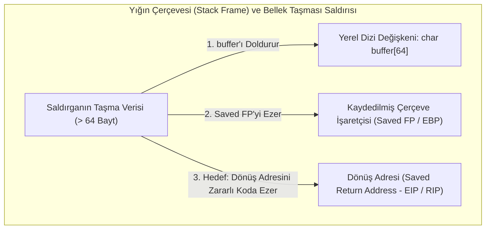

Fonksiyon sonlandığında işlemci `RET` makine komutunu çalıştırır ve yığındaki adrese sıçrar. Saldırgan dönüş adresini kendi enjekte ettiği zararlı kodun (*shellcode*) adresine yönlendirerek sistemde tam yetki elde eder.

#### 4. Modern Savunma Mekanizmaları
1. **ASLR (Address Space Layout Randomization):** Program her çalıştırıldığında yığın (stack), öbek (heap) ve kütüphane adresleri bellekte rastgele konumlara yerleştirilir. Saldırgan zararlı kodun nereye düştüğünü tahmin edemez.
2. **Stack Canaries (Yığın Kanaryası):** Derleyici, yerel değişkenler ile dönüş adresi arasına rastgele gizli bir tamsayı yerleştirir. Fonksiyon dönmeden önce bu değer kontrol edilir; eğer taşma yüzünden kanarya ezilmişse program anında sonlandırılır.
3. **DEP / NX Biti (Data Execution Prevention / No-Execute):** Bellek sayfaları işaretlenir. Kod içeren sayfalar çalıştırılabilir ama yazılamaz; yığın ve öbek sayfaları ise yazılabilir ama **kesinlikle çalıştırılamaz (NX)**. Yığına enjekte edilen kabuk kodunun CPU tarafından yürütülmesi donanımsal olarak engellenir.
4. **En Az Ayrıcalık İlkesi (Principle of Least Privilege):** Süreçler ve kullanıcılar her an yalnızca o anki görevlerini tamamlamak için ihtiyaç duydukları asgari yetkilerle çalıştırılmalıdır (örneğin web sunucusunun root yetkisiyle değil `www-data` kullanıcısıyla çalışması).

### Adım Adım Çözümlü Örnek / Vaka

**Senaryo:** Aşağıdaki savunmasız C kodunu inceleyiniz:
```c
void vulnerable_function(char *user_input) {
    char buffer[32];
    strcpy(buffer, user_input); // Sınır denetimi YOK!
}
```
x86-32 mimarisinde `buffer` yerel dizisi $32\text{ bayt}$, `Saved EBP` $4\text{ bayt}$ ve `Saved EIP (Dönüş Adresi)` $4\text{ bayt}$ yer kaplamaktadır.
1. Dönüş adresini tam olarak ezebilmek için saldırganın göndermesi gereken asgari girdi boyutunu ve yükün (*payload*) yapısını bayt düzeyinde hesaplayınız.
2. Bu saldırıyı engellemek için kod seviyesinde ve işletim sistemi/donanım seviyesinde alınması gereken ikişer önlemi belirtiniz.

**Çözüm Adımları:**

**1. Yığın Boyutu ve Yük Hesabı:**
Yığındaki dizilim yüksek adreslerden düşük adreslere doğru şöyledir:
- `[Dönüş Adresi (Saved EIP)]` $\to 4\text{ bayt}$
- `[Kaydedilmiş Çerçeve İşaretçisi (Saved EBP)]` $\to 4\text{ bayt}$
- `[buffer dizisi (32 bayt)]` $\to 32\text{ bayt}$
- Tampondaki $32\text{ bayt}$ doldurulur: $32\text{ bayt}$ çöp veri ('A' karakteri).
- `Saved EBP` doldurulur ve ezilir: $4\text{ bayt}$ çöp veri ('B' karakteri).
- Bir sonraki 4 bayt doğrudan `Saved EIP`'nin (Dönüş Adresi) üzerine yazılır!
- **Asgari Girdi Boyutu:** $32 + 4 + 4 = 40\text{ bayt}$.
- **Yük Düzeni:** $36\text{ bayt dolgu} + 4\text{ bayt hedef adres}$. Fonksiyon bittiğinde CPU saldırganın yazdığı 4 baytlık adrese atlayacaktır.

**2. Savunma Önlemleri:**
- **Kod Seviyesinde:**
  1. `strcpy()` yerine azami sınır belirten `strncpy(buffer, user_input, sizeof(buffer) - 1)` kullanmak ve sonuna `` koymak.
  2. Statik analiz araçları ve modern güvenli kütüphane fonksiyonlarını tercih etmek.
- **İşletim Sistemi / Donanım Seviyesinde:**
  1. **NX / DEP Biti:** Yığın alanını çalıştırılamaz (*non-executable*) işaretlemek; böylece yığına yazılan kabuk kodunun çalışması donanımca engellenir.
  2. **ASLR ve Stack Canary:** Derleyiciye `-fstack-protector` bayrağını vermek ve işletim sisteminde ASLR'ı aktif kılmak.

### Sık Karıştırılan Nokta
**Erişim Kontrol Listesi (ACL)** ile **Yetenek Listesi (Capability List)** arasındaki ayrım mülakatlarda ve sınavlarda sıkça karıştırılır:
- **ACL:** Kaynak/Nesne merkezlidir. Dosya der ki: *"Benim üzerimde Alice okuyabilir, Bob yazabilir."*
- **Capability:** Süreç/Özne merkezlidir. Süreç der ki: *"Benim elimde X dosyasını okuma ve Y dosyasına yazma yetki belgem var."* Gerçek hayatta ACL bir binanın kapısındaki davetli listesine, Capability ise metro jetonuna veya konser biletine benzer.

### Kaynak Kartı
- **Ders Kitabı:** Silberschatz, Galvin, Gagne — *Operating System Concepts (10th Ed.)*, Bölüm 16: Security & Bölüm 17: Protection.
- **Video Ders (Doğrulanmış Kaynak):** NPTEL-NOC IIT Madras, Operating System Security Part 1  
  URL: https://www.youtube.com/watch?v=i_7ofp7fK_E  
  *Gerekçe:* Bellek güvenliği açıklarını, yığın taşması (buffer overflow) anatomisini ve işletim sistemi seviyesi koruma mimarilerini derinlemesine ele alır.

### Aktif Hatırlama Soruları ve Cevapları

**Soru 1:** İşletim sistemlerinde "En Az Ayrıcalık İlkesi (Principle of Least Privilege)" ihlal edilirse bir sistem açığının yaratacağı tahribat nasıl katlanır?
<details>
<summary>Cevap ve Açıklama</summary>
Eğer bir uygulama yalnızca sıradan dosya okuma işlemi yapacakken gereksiz yere en yüksek yetkili kullanıcı (Root veya Administrator) haklarıyla çalıştırılırsa, uygulamada ortaya çıkabilecek en ufak bir bellek taşması veya güvenlik açığı saldırgana doğrudan tüm işletim sisteminin tam kontrolünü verir. En az ayrıcalık ilkesi uygulandığında ise saldırgan uygulamayı ele geçirse bile yalnızca o kısıtlı kullanıcının yetkileriyle sınırlı kalır ve diğer sistem bileşenlerine zarar veremez.
</details>

**Soru 2:** NX (No-Execute) biti aktif olan bir sistemde saldırganlar yığına kabuk kodu (shellcode) yazıp çalıştıramadıklarında bu engeli aşmak için hangi ileri seviye saldırı tekniğini geliştirmişlerdir?
<details>
<summary>Cevap ve Açıklama</summary>
Saldırganlar **Return-to-libc** ve **Return-Oriented Programming (ROP)** tekniklerini geliştirmişlerdir. Bu teknikte saldırgan yığına yeni bir kod yazıp çalıştırmaz; bunun yerine bellekte zaten çalıştırılabilir olarak bulunan mevcut kütüphane kodlarının (örneğin `libc` içindeki `system()` fonksiyonunun) veya küçük makine kodu parçacıklarının (*gadgets*) adreslerini ardı ardına yığına dizerek mevcut meşru kodları kendi kötü niyetli sırasıyla çalıştırır.
</details>

**Soru 3:** Simetrik şifreleme (Symmetric Encryption - örn. AES) ile Asimetrik şifreleme (Asymmetric / Public-Key - örn. RSA) arasındaki hız ve kullanım amacı farkı nedir?
<details>
<summary>Cevap ve Açıklama</summary>
Simetrik şifrelemede şifreleme ve deşifreleme için tek bir gizli anahtar kullanılır; matematiksel olarak son derece hızlıdır ve büyük boyutlu dosya/ağ verilerinin şifrelenmesinde kullanılır. Asimetrik şifrelemede ise bir Açık Anahtar (Public Key) ve bir Özel Anahtar (Private Key) vardır; matematiksel hesaplama yükü yüzlerce kat daha ağırdır. Bu nedenle asimetrik şifreleme büyük verileri şifrelemek yerine güvenli kimlik doğrulama, dijital imza ve simetrik oturum anahtarının karşı tarafa güvenle iletilmesi (anahtar değişimi - key exchange) amacıyla kullanılır.
</details>

---
## Hafta 15 — İleri Konular (Bölüm 18–19: Sanal Makineler; Ağlar ve Dağıtık Sistemler)

### Öğrenme Hedefleri
Bu bölümü tamamladığınızda şunları yapabileceksiniz:
1. Donanım sanallaştırmasındaki **Tip-1 (Bare-Metal)** ve **Tip-2 (Hosted)** Hipervizör (*Hypervisor*) mimarilerini karşılaştırabilmek.
2. **Kapsayıcılar (Containers: Linux cgroups ve namespaces)** ile **Sanal Makineler (VM)** arasındaki çekirdek izolasyonu ve başarım farklarını açıklayabilmek.
3. Ağ arabirimi üzerinden **Soket Programlama (Sockets API)** ilkelerini ve **Uzaktan Yordam Çağrısı (RPC - Remote Procedure Call)** mekanizmasını kavramak.
4. Dağıtık sistemlerin temel tasarım zorluklarını (**Durumlu vs Durumsuz Sunucular**, **Ağ Bölünmesi / Network Partition**, **Dağıtık Konsensüs**) analiz edebilmek.

### Kavram Anlatımı ve Temel Teori

#### 1. Sanallaştırma Mimarileri (Bölüm 18: Virtual Machines)
Sanallaştırma; tek bir fiziksel bilgisayar donanımının soyutlanarak üzerinde birden fazla bağımsız işletim sisteminin (Konuk - *Guest OS*) eşzamanlı çalıştırılmasıdır. Sanallaştırmayı yöneten yazılıma **Hipervizör (Hypervisor / Virtual Machine Monitor - VMM)** denir:

```mermaid
flowchart TD
    subgraph Tip1 ["Tip-1 Hipervizör (Bare-Metal: ESXi, KVM, Xen)"]
        H1["Fiziksel Donanım (CPU, RAM, Disk)"] --> V1["Tip-1 Hipervizör (Doğrudan Donanımda)"]
        V1 --> G1["Konuk İşletim Sistemi 1 (VM1)"]
        V1 --> G2["Konuk İşletim Sistemi 2 (VM2)"]
    end

    subgraph Tip2 ["Tip-2 Hipervizör (Hosted: VirtualBox, Workstation)"]
        H2["Fiziksel Donanım"] --> OS2["Ana İşletim Sistemi (Host OS: Windows/Linux)"]
        OS2 --> V2["Tip-2 Hipervizör Uygulaması"]
        V2 --> G3["Konuk İşletim Sistemi (VM)"]
    end

    subgraph Kapsayici ["Kapsayıcı Mimarisi (Containers: Docker, Podman)"]
        H3["Fiziksel Donanım"] --> OS3["Ortak Çekirdek (Host Linux Kernel)"]
        OS3 --> CR["Kapsayıcı Motoru (cgroups + namespaces)"]
        CR --> C1["Kapsayıcı 1 (İzole Kök Dizin & PID)"]
        CR --> C2["Kapsayıcı 2 (İzole Ağ & Mount)"]
    end
```

- **Tip-1 (Bare-Metal):** Hipervizör doğrudan çıplak donanım üzerinde çalışır; araya genel amaçlı bir ana işletim sistemi girmez. Kurumsal veri merkezlerinde yüksek başarım ve düşük gecikme için kullanılır (VMware ESXi, KVM, Xen).
- **Tip-2 (Hosted):** Hipervizör mevcut bir işletim sisteminin üzerinde sıradan bir uygulama gibi koşar (VirtualBox, VMware Workstation). Geliştirme ve test ortamları için uygundur; ek işletim sistemi katmanı yüzünden başarım kaybı vardır.
- **Kapsayıcılar (Containers):** Sanal makinelerin aksine ayrı bir konuk işletim sistemi veya sanal donanım çalıştırmaz! Ana makinenin **tek bir Linux çekirdeğini** ortak kullanırlar. İzolasyon çekirdeğin iki özelliğiyle sağlanır:
  - **Namespaces (İsim Alanları):** Sürecin ne görebileceğini sınırlar (ayrı PID ağacı, ayrı ağ arabirimi, ayrı mount noktası).
  - **Control Groups (cgroups):** Sürecin ne kadar kaynak tüketebileceğini sınırlar (CPU kotası, bellek limiti, disk G/Ç bant genişliği).

#### 2. Ağlar ve Dağıtık Sistemler (Bölüm 19: Networks & Distributed Systems)
Dağıtık bir sistem, fiziksel olarak ayrı makinelerde çalışan ancak kullanıcıya tek ve tutarlı bir sistemmiş gibi görünen yazılımlar bütünüdür.
- **Soketler (Sockets API):** Ağ üzerinden süreçler arası iletişimin temel uç noktasıdır. IP adresi ve Port numarasının birleşimidir (`IP:Port`). Standart akış: `socket()` $\to$ `bind()` $\to$ `listen()` $\to$ `accept()` $\to$ `read()/write()`.
- **Uzaktan Yordam Çağrısı (RPC - Remote Procedure Call):** Bir sürecin, yerel bir fonksiyon çağırıyormuş gibi ağ üzerindeki uzak bir makinedeki fonksiyonu çağırmasını sağlayan soyutlamadır. İstemci tarafında **Client Stub**, parametreleri serileştirir (*Marshalling / Serialization*) ve ağ üzerinden sunucuya gönderir. Sunucu tarafındaki **Server Stub**, paketi çözer (*Unmarshalling*), yerel fonksiyonu çalıştırır ve cevabı geri döndürür.
- **Durumlu (Stateful) vs Durumsuz (Stateless) Servisler:**
  - *Stateful:* Sunucu istemcinin oturum durumunu belleğinde tutar (örneğin FTP). Sunucu çökerse oturum kaybolur.
  - *Stateless:* Sunucu istemci hakkında hiçbir oturum bilgisi tutmaz; her istek kendi içinde tüm yetkilendirme ve durum bilgilerini taşır (örneğin RESTful HTTP API, NFS v3). Sunucu çökerse istemci hiçbir şey olmamış gibi isteği tekrarlayabilir (*idempotent*).

### Adım Adım Çözümlü Örnek / Vaka

> [!NOTE]
> **Varsayımsal Mimari Kıyaslama Vakası**  
> *Dönem izlencesi PDF'sinde herhangi bir dönem projesi veya sınıf projesi zorunluluğu yer almamaktadır. Aşağıdaki analiz, Sanal Makineler, Kapsayıcılar ve Dağıtık Ağ Servislerinin çalışma mekanizmalarını somutlaştırmak amacıyla hazırlanmış varsayımsal bir teknik mühendislik kıyaslamasıdır.*

**Senaryo:** Yüksek işlem hacimli bir e-ticaret ödeme doğrulama servisi tasarlanacaktır. Mimarlık ekibi şu 3 farklı dağıtım modelini teknik parametrelerle kıyaslamak istemektedir:
- **Seçenek A:** Tip-1 Donanım Sanal Makinesi (VMware ESXi üzerinde bağımsız Linux VM).
- **Seçenek B:** Linux Kapsayıcısı (Linux Container - Docker/cgroups).
- **Seçenek C:** Doğrudan fiziksel ağda koşan bağımsız RPC Dağıtık Mikroservisi.

Bu üç mimariyi **Başlatma Süresi**, **Bellek Genel Gideri (Overhead)**, **Güvenlik İzolasyonu** ve **Ağ/Disk G/Ç Başarımı** açısından adım adım karşılaştırınız.

**Çözüm Adımları:**

| Kıyaslama Parametresi | Seçenek A: Tip-1 Sanal Makine (VM) | Seçenek B: Linux Kapsayıcısı (Container) | Seçenek C: Dağıtık RPC Servisi |
| :--- | :--- | :--- | :--- |
| **Başlatma Süresi (Boot Time)** | **Saniyeler - Dakikalar:** Bağımsız bir sanal BIOS, çekirdek ve sistem servislerinin sıfırdan önyüklenmesi gerekir. | **Milisaniyeler:** Yalnızca tek bir sürecin izole isim alanında başlatılmasıdır; çekirdek zaten çalışmaktadır. | **Milisaniyeler:** Standart bir sürecin çalıştırılması hızındadır. |
| **Bellek Ek Yükü (Memory Overhead)** | **Çok Yüksek (Yüzlerce MB - GB):** Her VM kendi konuk çekirdeğini, sayfa tablolarını ve sistem daemon'larını RAM'e yüklemek zorundadır. | **Çok Düşük (Birkaç MB):** Ana makinenin çekirdeği paylaşılır; yalnızca uygulamanın tükettiği bellek harcanır. | **Minimum:** Sıfır sanallaştırma katmanı; doğrudan donanım belleği kullanılır. |
| **Güvenlik İzolasyonu** | **Mükemmel (Donanımsal Sınır):** Saldırgan konuk işletim sisteminin root yetkisini ele geçirse bile hipervizörü aşıp ana makineye geçemez. | **Orta (Paylaşılan Çekirdek):** Tüm kapsayıcılar aynı çekirdeği kullandığından, çekirdekteki bir sıfırıncı gün açığı (kernel exploit) tüm ana makineyi ele geçirebilir. | **Ağ Seviyesinde İzolasyon:** Servis yalnızca açtığı RPC portu üzerinden korunur. |
| **G/Ç Başarımı (I/O Performance)** | **Daha Düşük:** Donanım erişimleri hipervizörün emülasyon veya çeviri katmanından (*VT-d/EPT*) geçer. | **Neredeyse Çıplak Donanım Hızı:** Ağ ve disk doğrudan Linux çekirdeğinin sürücüleri üzerinden yürütülür. | **Doğrudan Donanım Hızı:** Sıfır sanallaştırma veya isim alanı katmanı. |

**Mühendislik Karar Özeti:** Yüksek yoğunluk, hızlı yatay ölçekleme ve mikroservis mimarileri için **Kapsayıcılar (Containers)** en optimal çözümdür. Ancak farklı müşterilerin birbirine güvenmediği çok kiracılı (*multi-tenant*) bulut ortamlarında katı izolasyon için **Tip-1 Sanal Makineler** vazgeçilmezdir.

### Sık Karıştırılan Nokta
Kapsayıcıların (*Containers*) içinde sanal bir işletim sistemi çekirdeği çalıştığı yanılgısı son derece yaygındır. Bir Ubuntu Docker kapsayıcısını RedHat bir ana makinede çalıştırdığınızda, kapsayıcının içinde ayrı bir Ubuntu çekirdeği koşmaz! Kapsayıcı yalnızca Ubuntu'nun kullanıcı alanı kütüphanelerini (`glibc`, `apt`) barındırır; tüm sistem çağrıları alttaki **RedHat Linux çekirdeği** tarafından karşılanır. Dolayısıyla bir Linux makinede kapsayıcı içinde yerel Windows çekirdeği çalıştırılamaz (tam sanal makine gerekir).

### Kaynak Kartı
- **Ders Kitabı:** Silberschatz, Galvin, Gagne — *Operating System Concepts (10th Ed.)*, Bölüm 18: Virtual Machines & Bölüm 19: Networks and Distributed Systems (Wiley resmî içindekiler tablosuyla doğrulanmıştır: https://bcs.wiley.com/he-bcs/Books?action=contents&bcsId=11228&itemId=1119320917).
- **Video Ders (Doğrulanmış Kaynak):** Prof. Mythili Vutukuru (IIT Bombay), Lecture 33: Network I/O using sockets  
  URL: https://www.youtube.com/watch?v=2TrQXSFgqBY  
  *Gerekçe:* Ağ G/Ç modellerini, BSD soket arabirimini ve ağ alt sistemini kod seviyesinde ele alır.
- **İleri Seviye Tamamlayıcı Kaynak (Doğrulanmış):** Prof. Mythili Vutukuru (IIT Bombay), Virtualization and Cloud Computing Ders Portalı (https://www.cse.iitb.ac.in/~mythili/virtcc/) ve Resmî YouTube Oynatma Listesi  
  URL: https://www.youtube.com/playlist?list=PLDW872573QAbcpQ7VSUdcm4o3tgnQYBE8  
  *Not:* Bu oynatma listesi dönem izlencesiyle birebir eşleşme iddiası taşımamakta; sanallaştırma, canlı göç (*live migration*) ve dağıtık depolama konuları için ileri düzey ek referans olarak sunulmaktadır.

### Aktif Hatırlama Soruları ve Cevapları

**Soru 1:** Geleneksel x86 mimarisinde Tip-1 hipervizör çalıştırmayı zorlaştıran "Sanallaştırılamayan Hassas Komutlar (Sensitive Non-Privileged Instructions)" sorunu donanım üreticileri tarafından nasıl çözülmüştür?
<details>
<summary>Cevap ve Açıklama</summary>
Klasik x86 mimarisinde bazı hassas komutlar (örneğin `POPF` bayrak değiştirme komutu), kullanıcı modunda çalıştırıldığında bir donanım tuzağı (Trap) fırlatmak yerine sessizce başarısız oluyordu. Bu durum hipervizörün komutu yakalayıp emüle etmesini (Trap-and-Emulate) imkansız kılıyordu (Popek-Goldberg teoremine aykırılık). Intel (Intel VT-x) ve AMD (AMD-V), işlemciye yeni bir donanımsal mod olan "Root Mode / Non-Root Mode" (veya VMX modları) ekleyerek donanım destekli sanallaştırmayı başarmış ve bu açığı kapatmıştır.
</details>

**Soru 2:** Uzaktan Yordam Çağrısında (RPC) "Tam Olarak Bir Kez (Exactly-Once)" yürütüm garantisi vermenin ağ arızaları altında neredeyse imkansız olmasının nedeni nedir?
<details>
<summary>Cevap ve Açıklama</summary>
Ağ gecikmesi veya paket kaybı olduğunda istemci sunucunun işlemi yapıp yapmadığını kesin olarak bilemez. İstek sunucuya ulaşmamış da olabilir; sunucu işlemi yapıp cevabı dönerken ağda kopma olmuş da olabilir. İstemci isteği tekrar gönderirse işlem iki kez yürütülebilir (örneğin para transferi). İstemci göndermezse işlem hiç yapılmamış kalabilir. Dağıtık sistemlerde bu ikilem benzersiz istek numaraları (*transaction ID*) ve işlemlerin "Tekrarlanabilir / Değişmez (Idempotent)" tasarlanmasıyla aşılmaya çalışılır.
</details>

**Soru 3:** Linux Kapsayıcılarında (Containers) `cgroups` ile `namespaces` arasındaki işlevsel fark nedir?
<details>
<summary>Cevap ve Açıklama</summary>
- **Namespaces (İsim Alanları):** Görünürlük ve ad alanı izolasyonu sağlar. Bir kapsayıcının diğer kapsayıcıların süreçlerini (PID), ağ arabirimlerini (NET), dosya bağlama noktalarını (MNT) görmesini engeller.
- **cgroups (Control Groups):** Kaynak sınırlandırması ve ölçümü sağlar. Bir kapsayıcının en fazla ne kadar CPU çekirdeği, ne kadar megabayt RAM veya ne kadar disk G/Ç bant genişliği kullanabileceğini sınırlayarak tek bir kapsayıcının tüm sunucuyu tüketmesini engeller.
</details>

---
## Hafta 16 — Dönem Sonu Sınavı

> [!NOTE]
> **Dönem Sonu Bütünsel Tekrar ve Final Deneme Sınavı Bildirimi**  
> Bu bölüm, tüm dönemi (Bölüm 1–19) kapsayan temel ve ileri seviye işletim sistemleri konularının bütünsel kavranmasını ve sentezlenmesini ölçmek amacıyla **bu çalışma rehberi için özel olarak oluşturulmuş özgün bir pratik final deneme sınavıdır**. İstanbul Nişantaşı Üniversitesi'nin veya dersin öğretim üyesinin gerçek final sınav soruları veya sınav takvimi değildir.

### Öğrenme Hedefleri
Bu dönem sonu bütünsel sınav ve tekrar bölümünü tamamladığınızda şunları yapabileceksiniz:
1. Silberschatz 10. baskı 1–19. bölümler arasındaki tüm işletim sistemi bileşenlerini uçtan uca sentezleyebilmek.
2. Sanal bellek sayfa hatası (Page Fault) mekanizmasını, TLB etkin erişim süresi (EAT) hesaplamalarını ve sayfa değiştirme algoritmalarını (LRU, FIFO, OPT) sayısal olarak uygulayabilmek.
3. UNIX Inode hiyerarşisi üzerinden doğrudan, tekli ve çiftli dolaylı blok adresleme hesaplamalarını diske erişim sayılarıyla belirleyebilmek.
4. RAID seviyeleri (RAID 0, 1, 5, 6), DMA/kesme döngüleri, hipervizör mimarileri (Tip-1 vs Tip-2) ve dağıtık sistem ağ modelleri arasındaki mühendislik ödünleşimlerini değerlendirebilmek.

### Final İçin Tekrar Planı
Paylaşılan izlence final notunun ağırlığını %60 olarak belirtir; sınav sorularının konu başlıklarına göre dağılımını belirtmez. Bu nedenle aşağıdaki harita yalnızca çalışırken bütün ders içeriğini sırayla gözden geçirmek içindir, gerçek sınav ağırlığı tahmini değildir. Önce 1–8. haftalardaki süreç, eşzamanlılık, çizelgeleme, senkronizasyon ve kilitlenmeleri; sonra 9–15. haftalardaki bellek, depolama, G/Ç, dosya sistemi, güvenlik, sanal makineler ve dağıtık sistemleri gözden geçir. Süreyi kendi eksiklerine göre ayarla.

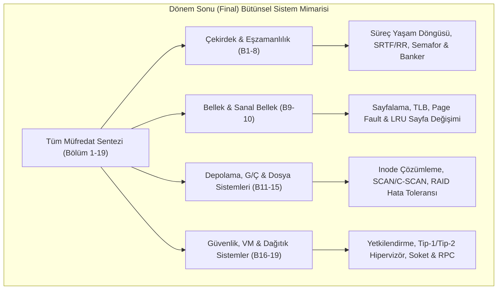

---

### Bölüm I: Çoktan Seçmeli ve Kavramsal Final Soruları

**Soru 1:** Bir dosya sisteminde dizin girişi (`dentry`) yalnızca `(dosya_adı, inode_numarası)` eşlemesini tutmaktadır. Bir sürecin `open("/home/user/data.txt", O_RDONLY)` çağrısı yaptığında diske yapılan işlemlerin sırası aşağıdakilerden hangisinde doğru verilmiştir?
- A) Önce veri blokları okunur, sonra Inode bulunur, en son dizin taranır.
- B) Kök dizin (`/`) Inode'undan başlanarak sırasıyla `home`, `user` dizin blokları taranır, `data.txt` Inode numarası bulunur, dosyanın Inode'u okunur ve dosya tanıtıcısı atanır.
- C) Süperblok doğrudan dosyanın sektör adresini verir.
- D) Dosya adı doğrudan sabit diskin sektör etiketidir; dizin Inode'larına bakılmaz.  
<details>
<summary>Çözüm ve Açıklama</summary>
**Doğru Cevap: B.**  
İşletim sistemi mutlak yol çözümlemesi (*path resolution*) yapar. Kök dizinin Inode numarası sabittir (genellikle 2). Kök dizinin blokları taranarak `home` dizininin Inode'u bulunur; oradan `user` dizini taranır; `data.txt` dosyasının Inode numarasına ulaşılır. Inode okunarak dosyanın izinleri denetlenir ve çekirdeğin açık dosya tablosuna yeni bir giriş eklenir.
</details>

**Soru 2:** Sanal bellek kullanan bir sistemde sayfa boyutu $4\text{ KB}$ iken sayfa boyutunun $2\text{ MB}$'a (Huge Pages) çıkarılması hangi donanımsal bileşenin başarımını doğrudan artırır?
- A) Disk kafasının dönüş hızını (RPM)
- B) TLB (Translation Lookaside Buffer) isabet oranını (Hit Ratio)
- C) Kesme Vektör Tablosunun (IVT) boyutunu
- D) DMA veri yolunun voltajını  
<details>
<summary>Çözüm ve Açıklama</summary>
**Doğru Cevap: B.**  
TLB donanımı çok az sayıda giriş (örneğin 64–512 giriş) tutabilir. Sayfa boyutu $4\text{ KB}$ olduğunda 512 giriş yalnızca $2\text{ MB}$'lık bir bellek alanını kapsayabilir. Sayfa boyutu $2\text{ MB}$ yapıldığında aynı 512 TLB girişi tam $1\text{ GB}$'lık belleği önbelleğe alabilir! Bu durum özellikle büyük veritabanlarında TLB ıskalamalarını (TLB miss) dramatik olarak azaltır.
</details>

**Soru 3:** Aşağıdakilerden hangisi bir Linux kapsayıcısının (Container) sanal bir makineye (VM) kıyasla en belirgin güvenlik zafiyeti riskidir?
<details>
<summary>Çözüm ve Açıklama</summary>
Kapsayıcılar ana makinenin (host) işletim sistemi çekirdeğini doğrudan paylaşırlar. Eğer kapsayıcı içindeki bir saldırgan çekirdeğin bir sistem çağrısındaki veya aygıt sürücüsündeki güvenlik açığından yararlanırsa (Kernel Exploit), doğrudan tüm ana makinenin çekirdeğini çökertebilir veya ana makinenin tam yetkili root kontrolünü ele geçirebilir. Oysa sanal makinelerde saldırgan yalnızca kendi konuk çekirdeğini çökertebilir; hipervizör donanım seviyesinde güçlü bir sınır oluşturur.
</details>

---

### Bölüm II: Sayısal ve Tasarım Odaklı Büyük Final Problemleri

#### Problem 1: Sayfalama, EAT ve Sayfa Değiştirme Bütünleşik Analizi
**Senaryo:** 32-bit mantıksal adres kullanan bir sistemde sayfa boyutu $4\text{ KB}$'tır ($2^{12}\text{ bayt}$).
Fiziksel bellek erişim süresi $t_{RAM} = 80\text{ ns}$, TLB erişim süresi $t_{TLB} = 5\text{ ns}$'dir.
1. TLB isabet oranı $\alpha = \%95$ ($0.95$) olduğuna göre Etkin Bellek Erişim Süresini ($EAT$) hesaplayınız.
2. Bir sürecin çalışma kümesine 3 adet fiziksel çerçeve ayrılmıştır. Başlangıçta çerçeveler boştur. Süreç şu sayfa dizisine erişmektedir:
   $$1, 2, 3, 4, 1, 2, 5, 1, 2, 3, 4, 5$$
   **LRU (Least Recently Used)** algoritması için sayfa hatası sayısını adım adım hesaplayınız.

**Çözüm Adımları:**

**1. EAT Hesabı:**
$$EAT = \alpha \times (t_{TLB} + t_{RAM}) + (1 - \alpha) \times (t_{TLB} + 2 \times t_{RAM})$$
- İsabet Durumu: $5 + 80 = 85\text{ ns}$
- Iskalama Durumu: $5 + 80 + 80 = 165\text{ ns}$
$$EAT = 0.95 \times 85 + 0.05 \times 165$$
$$EAT = 80.75 + 8.25 = 89.00\text{ ns}$$

**2. LRU Sayfa Hatası Adımları (3 Çerçeve):**
1. **1:** [1, -, -] $\to$ Sayfa Hatası 1
2. **2:** [1, 2, -] $\to$ Sayfa Hatası 2
3. **3:** [1, 2, 3] $\to$ Sayfa Hatası 3
4. **4:** En eski 1; [4, 2, 3] $\to$ Sayfa Hatası 4
5. **1:** En eski 2; [4, 1, 3] $\to$ Sayfa Hatası 5
6. **2:** En eski 3; [4, 1, 2] $\to$ Sayfa Hatası 6
7. **5:** En eski 4; [5, 1, 2] $\to$ Sayfa Hatası 7
8. **1:** İsabet! [5, 2, 1 (en yeni)]
9. **2:** İsabet! [5, 1, 2 (en yeni)]
10. **3:** En eski 5; [3, 1, 2] $\to$ Sayfa Hatası 8
11. **4:** En eski 1; [3, 4, 2] $\to$ Sayfa Hatası 9
12. **5:** En eski 2; [3, 4, 5] $\to$ Sayfa Hatası 10
- **Toplam LRU Sayfa Hatası:** **10** (12 erişimde 10 hata; çalışma kümesi 3 çerçeveye sığmadığı için yüksek hata oranı gözlenmiştir).

---

#### Problem 2: Dosya Sistemi Inode ve Disk G/Ç Maliyeti
**Senaryo:** Blok boyutu $4\text{ KB}$, blok adresi $4\text{ bayt}$ olan bir UNIX Inode dosya sisteminde bir dosyanın Inode'u okunmuş ve RAM'e alınmıştır.
Dosyanın $12\text{ MB}$ büyüklüğünde olduğu bilinmektedir.
1. Bu dosyanın $5.000.000$. baytına ($5\text{ MB}$) doğrudan erişmek (`lseek(fd, 5000000, SEEK_SET)`) isteyen bir sürecin bu baytı okuyabilmesi için diske **kaç adet ek blok okuma işlemi** yapması gerekir? Adım adım kanıtlayınız.

**Çözüm Adımları:**
1. **Hedef Mantıksal Blok Numarası:**
   $$\text{Blok No} = \lfloor \frac{5.000.000}{4096} \rfloor = 1220. \text{ blok}$$
   (Ofset: $5.000.000 \pmod{4096} = 2944$. bayt).
2. **Hiyerarşi Kapasite Analizi:**
   - İlk 12 blok (0–11): Doğrudan bloklar.
   - Tekli dolaylı blok: 1024 blok kapsar (12 ile 1035 arası bloklar).
   - Çiftli dolaylı blok: 1036. bloktan itibaren başlar.
3. **Konum Belirleme:**
   - 1220. blok, $1036$'dan büyük olduğu için **Çiftli Dolaylı (Double Indirect)** alandadır!
   - Çiftli dolaylı alan içindeki sırası: $1220 - 1036 = 184$. blok.
4. **Gerekli Disk G/Ç Sayısı:**
   Inode zaten RAM'dedir.
   - **1. Disk Okuması:** Inode'un işaret ettiği "Birinci Seviye Çiftli İndeks Bloğu" diskten okunur.
   - **2. Disk Okuması:** İlgili aralığa denk gelen "İkinci Seviye Tekli İndeks Bloğu" diskten okunur.
   - **3. Disk Okuması:** Hedef veriyi içeren "Asıl Veri Bloğu" diskten okunur.
- **Sonuç:** Sürecin bu baytı okuyabilmesi için diske **tam 3 adet blok okuma işlemi** yapılması zorunludur.

---

### Aktif Hatırlama Soruları ve Cevapları

**Soru 1:** RAID 5 ile RAID 6 arasındaki hata toleransı ve yazma cezası (write penalty) farkı nedir?
<details>
<summary>Cevap ve Açıklama</summary>
RAID 5 tek bir eşlik (parity) bloğu tutar ve aynı anda en fazla 1 diskin bozulmasını tolere edebilir; her rastgele yazmada 2 okuma ve 2 yazma (toplam 4 disk işlemi) gerekir. RAID 6 ise iki farklı matematiksel eşlik tutar (biri XOR, diğeri Reed-Solomon kodu); aynı anda 2 diskin birden bozulmasına dayanıklıdır. Ancak RAID 6'da her rastgele yazma işlemi 3 okuma ve 3 yazma (toplam 6 disk işlemi) gerektirdiğinden yazma cezası daha ağırdır.
</details>

**Soru 2:** Bir işletim sisteminde "Trap" ile "System Call" arasındaki teknik ilişkiyi tek bir cümleyle özetleyiniz.
<details>
<summary>Cevap ve Açıklama</summary>
Sistem çağrısı (System Call) kullanıcının çekirdekten hizmet talep ettiği mantıksal arayüzdür; Trap ise bu çağrıyı gerçekleştirmek için donanım seviyesinde işlemciyi kullanıcı modundan çekirdek moduna geçiren senkron yazılımsal kesme mekanizmasıdır.
</details>

**Soru 3:** Sanal bellekte "Demand Paging" kullanan bir sistemde donanım seviyesinde "Komutun Yeniden Başlatılabilir Olması (Instruction Restartability)" özelliği neden zorunludur?
<details>
<summary>Cevap ve Açıklama</summary>
Çünkü bir makine komutu (örneğin iki bellek alanını toplayan `ADD [R1], [R2]`) çalışırken ilk işleneni okuduktan sonra ikinci işlenende sayfa hatası (Page Fault) oluşabilir. Sayfa hatası işleyicisi diske gidip sayfayı getirirken süreç durdurulur. Sayfa RAM'e yüklendikten sonra komut yarım kaldığı yerden devam edemez; tüm yazmaçlar ve program sayacı komut hiç çalışmamış gibi başlangıç durumuna döndürülüp komut baştan yürütülmelidir.
</details>

### Sık Karıştırılan Nokta
**Sanal Bellek Sayfalaması ile Dosya Sistemi Inode Çözümlemesinin Ayrımı:**  
Final sınavlarında en sık yapılan kavramsal hata, sanal bellekteki sayfa hatası (*Page Fault*) mekanizması ile dosya sistemindeki blok okuma sürecinin karıştırılmasıdır:
1. **Sayfa Hatası (Page Fault):** Donanımsal MMU tarafından tetiklenen bir kesmedir (*Trap/Fault*). Sürecin sanal adres alanındaki bir sayfa RAM'de bulunmadığında (`valid-invalid bit = 0`) çekirdek devreye girer ve sayfayı diskteki takas (*swap*) alanından veya belleğe eşlenmiş (*mmap*) ikili dosyadan ana belleğe yükler.
2. **Dosya Sistemi Inode Çözümlemesi:** Bir dosya açıldığında (`open`), çekirdeğin VFS katmanı dizin ağacındaki `dentry` girişlerini kökten (`/`) itibaren tarayarak ilgili Inode'a ulaşır. Unutulmamalıdır ki **Inode dosyanın adını barındırmaz**; dosya adı yalnızca dizin dosyası içerisindeki bir eşlemedir. Inode yalnızca dosyanın boyutunu, sahipliğini, izinlerini ve veri bloklarının fiziksel disk adreslerini tutar.

### Kaynak Kartı
- **Ders Kitabı:** Silberschatz, Galvin, Gagne — *Operating System Concepts (10th Ed.)*, Bölüm 1–19 Kapsamlı Sentezi.
- **Ders Portalı:** https://www.cse.iitb.ac.in/~mythili/os/

---

## Kaynakça ve Doğrulanmış Referanslar

Bu dokümanın hazırlanmasında ve teknik doğruluk denetimlerinde aşağıdaki birincil kaynaklar esas alınmıştır:

1. **Ders İzlencesi (Birincil Kaynak):**  
   - İstanbul Nişantaşı Üniversitesi Bilgisayar Mühendisliği Bölümü, EBLG341 / EBLG341.1 İşletim Sistemleri Dönem İzlencesi (`content/syllabi/EBLG341-izlence-2026.pdf`).
2. **Ders Kitabı ve Resmî İçindekiler:**  
   - Silberschatz, A., Galvin, P. B., & Gagne, G. (2018). *Operating System Concepts* (10th Edition). John Wiley & Sons.  
   - Wiley Resmî Öğrenci İçindekiler Dizini (Bölüm 18 Virtual Machines ve Bölüm 19 Network and Distributed Systems doğrulaması):  
     https://bcs.wiley.com/he-bcs/Books?action=contents&bcsId=11228&itemId=1119320917
3. **IIT Bombay İşletim Sistemleri Ders Portalı (Prof. Mythili Vutukuru):**  
   - Resmî Ders Ana Sayfası, Slaytlar ve Laboratuvarlar: https://www.cse.iitb.ac.in/~mythili/os/  
   - Resmî YouTube Ders Oynatma Listesi: https://www.youtube.com/playlist?list=PLDW872573QAb4bj0URobvQTD41IV6gRkx  
   - *Doğrulanan Spesifik Dersler:*  
     - Lecture 1 (OS Giriş): https://www.youtube.com/watch?v=aCJ3YgoolHQ  
     - Lecture 5 (CPU Çizelgeleme): https://www.youtube.com/watch?v=c1I99E1S3QA  
     - Lecture 10 (Sanal Bellek & Demand Paging): https://www.youtube.com/watch?v=r9NwqtqS2Ac  
     - Lecture 17 (Giriş/Çıkış Aygıtları): https://www.youtube.com/watch?v=7F4qQOSJGDw  
     - Lecture 18 (Dosyalar ve Dizinler): https://www.youtube.com/watch?v=sBQeOJvbOvw  
     - Lecture 20 (Sabit Disk İç Yapısı): https://www.youtube.com/watch?v=-ZFINyHshqo  
     - Lecture 33 (Ağ G/Ç ve Soketler): https://www.youtube.com/watch?v=2TrQXSFgqBY
4. **İleri Seviye Sanallaştırma ve Bulut Bilişim (Prof. Mythili Vutukuru):**  
   - Resmî Ders Sayfası: https://www.cse.iitb.ac.in/~mythili/virtcc/  
   - Resmî YouTube Oynatma Listesi (Hafta 15 İleri Seviye Tamamlayıcı Kaynak): https://www.youtube.com/playlist?list=PLDW872573QAbcpQ7VSUdcm4o3tgnQYBE8
5. **İşletim Sistemi Güvenliği (NPTEL - IIT Madras):**  
   - Operating System Security Part 1 (Hafta 14 Tamamlayıcı Kaynak): https://www.youtube.com/watch?v=i_7ofp7fK_E

> *Dürüstlük ve İnceleme Beyanı:* Yukarıdaki video ve oynatma listesi referanslarının tüm video kayıtlarının baştan sona izlendiği iddia edilmemektedir. Resmî üniversite web sayfalarındaki konu haritaları, ders izlenceleri, slaytlar ve başlık üstverileri incelenerek müfredat eşleştirmeleri yapılmıştır.
