## Hafta 1: Algoritmik Analiz Modeli, Girdi Boyutu, Temel İşlem ve Maliyet (Önerilen Akış — Resmî Olmayan)

### Öğrenme Hedefleri
Bu bölümü tamamladığınızda şunları yapabileceksiniz:
1. Algoritma analizinde donanım ve derleyiciden bağımsız soyutlama sağlayan **Rastgele Erişimli Makine (RAM - Random Access Machine)** modelinin varsayımlarını açıklayabilmek.
2. Girdi boyutunun ($n$) farklı problem tiplerinde (dizi, çizge, büyük tamsayı) nasıl ölçüldüğünü matematiksel olarak tanımlayabilmek.
3. Temel işlem (primitive operation) kavramını ve birim maliyet (unit-cost) ile bit maliyeti (bit-cost / logarithmic cost) modelleri arasındaki farkı ayırt edebilmek.
4. En kötü durum (worst-case), en iyi durum (best-case) ve ortalama durum (average-case) analizlerinin matematiksel formülasyonlarını kurabilmek.

### Kavram Anlatımı ve Temel Teori

#### 1. Rastgele Erişimli Makine (RAM) Hesaplama Modeli
Algoritmaların çalışma zamanını doğrudan fiziksel bir bilgisayarda (örneğin Intel Core i7 veya Apple M3 işlemcide) milisaniye cinsinden ölçmek bilimsel genelleme sağlamaz; çünkü ölçüm CPU frekansına, önbellek hiyerarşisine, işletim sistemi çizelgeleyicisine ve derleyici optimizasyon bayraklarına bağımlıdır.

Algoritma kuramı bu nedenle standart bir soyutlama olan **RAM (Random Access Machine)** modelini kullanır:
- **Tek İşlemci:** Talimatlar çekirdekler arası paralellik olmaksızın sıralı (sequential) yürütülür.
- **Sabit Zamanlı Bellek Erişimi:** Belleğin herhangi bir adresindeki veriyi okumak veya yazmak adresten bağımsız olarak $\Theta(1)$ birim zaman alır (önbellek ıskalaması / cache miss modellenmez).
- **Temel İşlemler (Primitive Operations):** Aritmetik işlemler ($+, -, \times, /$), mantıksal karşılaştırmalar ($<, \le, ==$), atama, dizi indisleme ve fonksiyon çağrısı/dönüşü $O(1)$ birim maliyetli kabul edilir.
- **Sözcük Boyutu Sınırı (Word Size):** Bir bellek hücresi $w$ bit veri tutabilir. Girdi boyutu $n$ olan bir problemde indislerin adreslenebilmesi için $w \ge \log_2 n$ varsayılır. Bu sayede girdi indisleri üzerindeki aritmetik işlemler birim zamanda gerçekleşir.

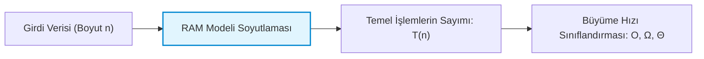

#### 2. Girdi Boyutu ($n$) ve Maliyet Modelleri
Bir algoritmanın çalışma zamanı girdinin büyüklüğü $n$'in bir fonksiyonu olan $T(n)$ ile ifade edilir:
- **Dizi/Liste Problemleri:** $n$, dizideki eleman sayısıdır.
- **Çizge (Graph) Problemleri:** İki parametre ile ifade edilir: düğüm sayısı $|V|$ ve kenar sayısı $|E|$.
- **Sayı Teorisi / Kriptografi Problemleri:** Girdi $N$ tamsayısının kendisi değil, bu sayıyı ikili (binary) tabanda temsil etmek için gereken bit uzunluğudur: $n = \lfloor \log_2 N \rfloor + 1$.
  - *Birim Maliyet Modeli (Unit-Cost):* $N$ üzerindeki her aritmetik işlem 1 adım sayılır.
  - *Bit Maliyeti Modeli (Bit-Cost):* $\beta$-bitlik iki sayının çarpımı $\Theta(\beta^2)$ veya FFT ile $\Theta(\beta \log \beta)$ sürer. Çok büyük sayılarla çalışırken bit maliyeti kullanılmalıdır.

#### 3. Analiz Türleri: En Kötü, Ortalama ve En İyi Durum
Girdi kümesi $D_n$, boyutu $n$ olan tüm olası girdileri temsil etsin. Herhangi bir $x \in D_n$ girdisi için çalışma maliyeti $t(x)$ olsun:

1. **En Kötü Durum (Worst-Case) — $T_{\text{worst}}(n)$:**
   $$T_{\text{worst}}(n) = \max_{x \in D_n} t(x)$$
   Algoritmanın hiçbir koşulda bu süreyi aşmayacağını kesin olarak garanti eder (üst sınır güvencesi). Güvenlik ve gerçek zamanlı sistemlerde hayati önem taşır.

2. **En İyi Durum (Best-Case) — $T_{\text{best}}(n)$:**
   $$T_{\text{best}}(n) = \min_{x \in D_n} t(x)$$
   Algoritmanın en elverişli girdideki taban performansıdır. Genellikle pratik bir güvence sağlamaz.

3. **Ortalama Durum (Average-Case) — $T_{\text{avg}}(n)$:**
   $$T_{\text{avg}}(n) = \mathbb{E}[t(x)] = \sum_{x \in D_n} P(x) \cdot t(x)$$
   Burada $P(x)$, $x$ girdisinin gelme olasılık dağılımıdır. Tüm girdilerin eşit olasılıklı olduğu varsayımı (uniform distribution) pratik hayatta her zaman geçerli olmayabilir.

---

### Adım Adım Çözümlü Özgün Örnek

**Problem:**  
Boyutu $n=10$ olan sıralı bir tamsayı dizisi veriliyor:  
$A = [12, 24, 37, 45, 59, 68, 73, 85, 91, 104]$  
Aşağıdaki iki hedef değer için hem **Doğrusal Arama (Linear Search)** hem de **İkili Arama (Binary Search)** algoritmalarının temel karşılaştırma sayılarını adım adım çıkarınız:
- Durum I: Hedef $x = 73$ (dizide mevcut)
- Durum II: Hedef $x = 99$ (dizide mevcut değil)

**Çözüm:**

**1. Doğrusal Arama (Linear Search):**
Algoritma diziyi baştan sona $A[i] == x$ kontrolü ile tarar.
- *Durum I ($x=73$):*
  1. $A[0]=12 \ne 73$ (1. karşılaştırma)
  2. $A[1]=24 \ne 73$ (2. karşılaştırma)
  3. $A[2]=37 \ne 73$ (3. karşılaştırma)
  4. $A[3]=45 \ne 73$ (4. karşılaştırma)
  5. $A[4]=59 \ne 73$ (5. karşılaştırma)
  6. $A[5]=68 \ne 73$ (6. karşılaştırma)
  7. $A[6]=73 == 73$ (7. karşılaştırma — bulundu).  
  Toplam temel karşılaştırma sayısı = **7**.
- *Durum II ($x=99$):*
  Dizi sıralı olduğundan $A[i] > 99$ görüldüğü anda veya dizi sonuna kadar taranır. $A[8]=91 < 99$, $A[9]=104 > 99$ olduğunda durulsa bile 10 karşılaştırma yapılır.  
  Toplam temel karşılaştırma sayısı = **10** ($n$ işlem).

**2. İkili Arama (Binary Search):**
Arama aralığı $[low, high]$ ve $mid = low + \lfloor (high - low)/2 \rfloor$:
- *Durum I ($x=73$):*
  - Adım 1: $low=0, high=9 \implies mid = 0 + \lfloor 9/2 \rfloor = 4$. $A[4]=59$.  
    Karşılaştırma: $73 > 59 \implies low = mid + 1 = 5$. (1. karşılaştırma)
  - Adım 2: $low=5, high=9 \implies mid = 5 + \lfloor 4/2 \rfloor = 7$. $A[7]=85$.  
    Karşılaştırma: $73 < 85 \implies high = mid - 1 = 6$. (2. karşılaştırma)
  - Adım 3: $low=5, high=6 \implies mid = 5 + \lfloor 1/2 \rfloor = 5$. $A[5]=68$.  
    Karşılaştırma: $73 > 68 \implies low = mid + 1 = 6$. (3. karşılaştırma)
  - Adım 4: $low=6, high=6 \implies mid = 6$. $A[6]=73$.  
    Karşılaştırma: $73 == 73 \implies$ bulundu! (4. karşılaştırma)  
  Toplam temel karşılaştırma sayısı = **4** ($\approx \log_2 10$).

- *Durum II ($x=99$):*
  - Adım 1: $low=0, high=9 \implies mid=4, A[4]=59 < 99 \implies low=5$. (1. karşılaştırma)
  - Adım 2: $low=5, high=9 \implies mid=7, A[7]=85 < 99 \implies low=8$. (2. karşılaştırma)
  - Adım 3: $low=8, high=9 \implies mid=8, A[8]=91 < 99 \implies low=9$. (3. karşılaştırma)
  - Adım 4: $low=9, high=9 \implies mid=9, A[9]=104 > 99 \implies high=8$. (4. karşılaştırma)
  - Adım 5: $low=9 > high=8 \implies$ Döngü sonlandı, eleman yok.  
  Toplam temel karşılaştırma sayısı = **4** ($\le \lfloor \log_2 10 \rfloor + 1$).

---

### Sık Yapılan Hatalar ve Kavram Yanılgıları
- **Worst-Case ile Big-O'yu Özdeşleştirmek:** En kötü durum (worst-case) bir girdi senaryosudur; Big-O ($O$) ise bir fonksiyonun asimptotik üst sınırını ifade eden matematiksel bir gösterimdir. En iyi durum için de Big-O yazılabilir ($T_{\text{best}}(n) \in O(1)$ gibi).
- **Bellek Önbelleğini (Cache) RAM Modeline Dahil Etmeye Çalışmak:** RAM modelinde $A[0]$ ile $A[1.000.000]$'a erişim eşit sürede ($O(1)$) kabul edilir. Gerçek donanımda spatial locality / cache line etkisi olsa da teorik temel modelde bu ihmal edilir.
- **Tamsayı Bit Boyutunu Atlamak:** Kriptografik anahtarlarla çalışırken (örneğin 2048-bit RSA) iki sayının çarpımının $O(1)$ süreceğini varsaymak büyük bir yanılgıdır; bu durumda bit-cost modeli işletilmelidir.

---

### Aktif Hatırlama Soruları

1. Rastgele Erişimli Makine (RAM) hesaplama modelinde sabit zamanlı ($\Theta(1)$) kabul edilen işlemler nelerdir ve bellek hiyerarşisi neden modellenmez?
2. Boyutu $n$ olan bir tamsayı listesinde arama yaparken ortalama durum analizi yapabilmek için neden girdi olasılık dağılımını ($P(x)$) bilmek şarttır?
3. Girdi olarak bir $N$ tamsayısı alan asal sayı test etme algoritmasının girdi boyutu neden $N$ değil de $\Theta(\log N)$'dir?

<details>
<summary>Çözüm ve Açıklama</summary>

1. Aritmetik işlemler ($+, -, \times$), mantıksal sınamalar, atamalar ve doğrudan bellek adresi okuma/yazma $\Theta(1)$ kabul edilir. Bellek hiyerarşisi (L1/L2/L3 önbellekler, RAM, disk) modellenmez; çünkü algoritma analizinin amacı donanım mimarisinden bağımsız, evrensel ve matematiksel olarak kıyaslanabilir bir büyüme hızı çıkarmaktır.
2. Ortalama durum beklenen değer formülü $\mathbb{E}[T(n)] = \sum P(x) t(x)$ ile hesaplanır. Eğer aranan elemanın dizinin ilk yarısında yer alma olasılığı %90 ise ortalama maliyet, her konumun eşit olasılıklı ($1/n$) olduğu duruma kıyasla radikal biçimde değişir. Dağılım bilinmeden nesnel ortalama hesaplanamaz.
3. RAM modelinde girdi boyutu, girdiyi kodlamak için gereken toplam bit/hücre sayısıdır. Bir $N$ tamsayısını ikili sistemde saklamak için $\lfloor \log_2 N \rfloor + 1$ bit gerekir. Dolayısıyla algoritma $N$ adım atıyorsa, bu girdi boyutu $n = \log_2 N$'e göre $2^n$ (üstel) adım demektir.
</details>

---

### Kaynak ve Destek Kartı
- **Konu Eşleşmesi:** Algoritmik modeller, temel işlem analizi ve RAM mimarisi.
- **Birincil Destek:** [MIT 6.006 Recitation Video Galerisi](https://ocw.mit.edu/courses/6-006-introduction-to-algorithms-fall-2011/video_galleries/recitation-videos/) — Algoritmik maliyet modellemesi ve arama analizleri.
- **Doğrulanmış Video:** [MIT 6.006 Recitation 1: Asymptotic Complexity, Peak Finding](https://ocw.mit.edu/courses/6-006-introduction-to-algorithms-fall-2011/video_galleries/recitation-videos/) (MIT resmî video başlığı).

---

## Hafta 2: Asimptotik Notasyon: O, Ω, Θ, o, ω ve İspatlama Yöntemleri (Önerilen Akış — Resmî Olmayan)

### Öğrenme Hedefleri
Bu bölümü tamamladığınızda şunları yapabileceksiniz:
1. $O$ (Big-O), $\Omega$ (Big-Omega), $\Theta$ (Big-Theta), $o$ (Little-o) ve $\omega$ (Little-omega) asimptotik notasyonlarının formel matematiksel eşitsizlik ve limit tanımlarını yazabilmek.
2. Verilen iki fonksiyon arasındaki asimptotik ilişkiyi tanım kümesindeki $c, c_1, c_2$ ve $n_0$ pozitif sabitlerini bularak ilk ilkelerden (first principles) ispatlayabilmek.
3. Limit testi ($\lim_{n \to \infty} \frac{f(n)}{g(n)}$) ve L'Hôpital kuralı ile fonksiyonların büyüme hızlarını kesin olarak hiyerarşiye dizebilmek.
4. Asimptotik bağıntıların geçişlilik (transitivity), simetri ve toplam özelliklerini problem çözümlerinde uygulayabilmek.

### Kavram Anlatımı ve Temel Teori

#### 1. Beş Temel Asimptotik Notasyonun Formel Tanımları
Asimptotik analiz, $n \to \infty$ iken fonksiyonların davranışını inceler. Sabit katsayılar ve düşük dereceli terimler ihmal edilir.

| Notasyon | Sezgisel Anlamı | Formel Tanım ($\exists c>0, n_0>0$ öyle ki $\forall n \ge n_0$) | Limit Karşılığı ($L = \lim_{n \to \infty} \frac{f(n)}{g(n)}$) |
| :--- | :--- | :--- | :--- |
| $f(n) \in O(g(n))$ | Asimptotik Üst Sınır ($\le$) | $0 \le f(n) \le c \cdot g(n)$ | $L < \infty$ ($0 \le L < \infty$) |
| $f(n) \in \Omega(g(n))$ | Asimptotik Alt Sınır ($\ge$) | $0 \le c \cdot g(n) \le f(n)$ | $L > 0$ ($0 < L \le \infty$) |
| $f(n) \in \Theta(g(n))$ | Asimptotik Sıkı Sınır ($=$) | $0 \le c_1 g(n) \le f(n) \le c_2 g(n)$ | $0 < L < \infty$ |
| $f(n) \in o(g(n))$ | Kesin Üst Sınır ($<$) | $\forall c > 0, \exists n_0 > 0, \forall n \ge n_0, 0 \le f(n) < c \cdot g(n)$ | $L = 0$ |
| $f(n) \in \omega(g(n))$ | Kesin Alt Sınır ($>$) | $\forall c > 0, \exists n_0 > 0, \forall n \ge n_0, 0 \le c \cdot g(n) < f(n)$ | $L = \infty$ |

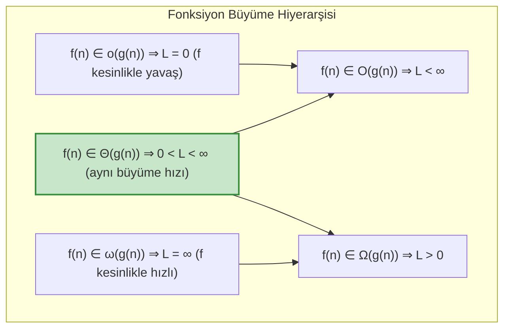

#### 2. Matematiksel Özellikler
- **Geçişlilik (Transitivity):** $f(n) \in \Theta(g(n)) \land g(n) \in \Theta(h(n)) \implies f(n) \in \Theta(h(n))$. ($O, \Omega, o, \omega$ için de geçerlidir).
- **Simetri:** $f(n) \in \Theta(g(n)) \iff g(n) \in \Theta(f(n))$.
- **Devrik Simetri (Transpose Symmetry):** $f(n) \in O(g(n)) \iff g(n) \in \Omega(f(n))$ ve $f(n) \in o(g(n)) \iff g(n) \in \omega(f(n))$.
- **Toplam Kuralı:** $T_1(n) \in O(f(n))$ ve $T_2(n) \in O(g(n))$ ise $T_1(n) + T_2(n) \in O(\max(f(n), g(n)))$.

---

### Adım Adım Çözümlü Özgün Örnek

**Problem 1 (İlk İlkelerden İspat):**  
$f(n) = 4n^2 - 6n + 11$ fonksiyonunun $f(n) \in \Theta(n^2)$ olduğunu $c_1, c_2 > 0$ ve $n_0 > 0$ sabitlerini açıkça bularak formel tanım üzerinden ispatlayınız.

**Çözüm:**  
Tanıma göre öyle $c_1, c_2, n_0 > 0$ bulmalıyız ki $\forall n \ge n_0$ için:
$$c_1 n^2 \le 4n^2 - 6n + 11 \le c_2 n^2$$

1. **Üst Sınır ($c_2$ ve $n_0'$):**
   $n \ge 1$ için $11 \le 11n^2$ yazılabilir.
   $$4n^2 - 6n + 11 \le 4n^2 + 11 \le 4n^2 + 11n^2 = 15n^2$$
   Dolayısıyla $c_2 = 15$ ve $n_0' = 1$ seçilebilir. (Daha sıkı bir $c_2 = 5$ de $n \ge 11$ için geçerlidir).

2. **Alt Sınır ($c_1$ ve $n_0''$):**
   Negatif terimi sınırlamamız gerekir: $6n \le 2n^2 \iff n \ge 3$.  
   $n \ge 3$ olduğunda:
   $$4n^2 - 6n + 11 \ge 4n^2 - 6n \ge 4n^2 - 2n^2 = 2n^2$$
   Dolayısıyla $c_1 = 2$ ve $n_0'' = 3$ seçilebilir.

3. **Birleşim:**
   $n_0 = \max(n_0', n_0'') = \max(1, 3) = 3$.  
   $c_1 = 2, c_2 = 15, n_0 = 3$ değerleri için $\forall n \ge 3$:
   $$2n^2 \le 4n^2 - 6n + 11 \le 15n^2$$
   eşitsizliği sağlanır. Tanım gereği $4n^2 - 6n + 11 \in \Theta(n^2)$'dir. $\blacksquare$

---

**Problem 2 (Limit Testi ve Üstel Fonksiyonlar):**  
$f(n) = 2^{2n}$ ile $g(n) = 2^n$ fonksiyonlarının asimptotik ilişkisini limit testiyle belirleyiniz. $2^{2n} \in O(2^n)$ denebilir mi?

**Çözüm:**  
Limit oranını kuralım:
$$L = \lim_{n \to \infty} \frac{f(n)}{g(n)} = \lim_{n \to \infty} \frac{2^{2n}}{2^n} = \lim_{n \to \infty} \frac{(2^2)^n}{2^n} = \lim_{n \to \infty} \frac{4^n}{2^n} = \lim_{n \to \infty} 2^n = \infty$$
$L = \infty$ çıktığından formel tanım gereği:
$$2^{2n} \in \omega(2^n) \quad \text{ve} \quad 2^{2n} \in \Omega(2^n)$$
Ancak $2^{2n} \notin O(2^n)$'dir!  
*Önemli Çıkarım:* $n$ katsayısındaki çarpım üstel fonksiyonlarda asimptotik sınıfı tamamen değiştirir ($2^{n+1} \in \Theta(2^n)$ iken $2^{2n} \notin O(2^n)$).

---

### Sık Yapılan Hatalar ve Kavram Yanılgıları
- **"Big-O En Kötü Durumdur" Hatası:** $O$, üst sınır fonksiyon kümesidir. "QuickSort'un en iyi durumu $O(n \log n)$'dir" ifadesi matematiksel olarak tamamen doğrudur.
- **Logaritma Tabanını Dert Etmek:** Bilgisayar biliminde $\log_a n = \frac{\log_b n}{\log_b a}$ olduğundan, $\frac{1}{\log_b a}$ sabit bir çarpandır. Dolayısıyla tüm logaritma tabanları asimptotik olarak eşdeğerdir: $\Theta(\log_2 n) = \Theta(\ln n) = \Theta(\log_{10} n)$. Ancak $2^{\log_2 n} = n$ iken $2^{\ln n} = n^{\ln 2} \approx n^{0.693}$ olduğundan üste geçen logaritmalarda taban kritik önem taşır!
- **$f(n) \le O(g(n))$ Yazımı:** $O(g(n))$ bir kümedir. Doğru gösterim $f(n) \in O(g(n))$'dir; yaygın eşittir yazımı ($f(n) = O(g(n))$) tek yönlü bir gösterim olarak yorumlanmalıdır.

---

### Aktif Hatırlama Soruları

1. $f(n) \in o(g(n))$ ile $f(n) \in O(g(n))$ arasındaki temel matematiksel farkı limit değeri ve eşitsizlik sağlayıcı $c$ katsayısı açısından açıklayınız.
2. $\log(n!)$ fonksiyonunun $\Theta(n \log n)$ olduğunu Stirling yaklaşımı veya integral sınırlandırmasıyla açıklayınız.
3. $f(n) = n^{\sin(n)}$ fonksiyonu ile $g(n) = n$ fonksiyonu arasında $O, \Omega$ veya $\Theta$ ilişkisi kurulabilir mi? Neden?

<details>
<summary>Çözüm ve Açıklama</summary>

1. $O(g(n))$ için eşitsizliğin *en az bir* $c > 0$ sabiti için sağlanması yeterlidir ($L < \infty$). $o(g(n))$ için ise eşitsizlik *istisnasız her* $c > 0$ sabiti için yeterince büyük $n$'lerde sağlanmalıdır ($L = 0$). Yani $f(n)$, $g(n)$'e göre asimptotik olarak kesinlikle önemsizleşir.
2. Üst sınır: $n! = 1 \cdot 2 \cdots n \le n^n \implies \log(n!) \le n \log n \implies \log(n!) \in O(n \log n)$.  
   Alt sınır: $n! \ge (n/2)^{n/2} \implies \log(n!) \ge \frac{n}{2} \log(n/2) = \frac{n}{2}(\log n - 1) \ge \frac{n}{4} \log n$ ($n \ge 4$ için). Bu da $\Omega(n \log n)$ verir. İkisi birleştiğinde $\Theta(n \log n)$ elde edilir.
3. Kurulamaz. $\sin(n)$ fonksiyonu $[-1, 1]$ aralığında sürekli salınım yapar. $n$ büyüdükçe $f(n)$ değeri $1/n$ ile $n$ arasında dalgalanır. Dolayısıyla $\lim_{n \to \infty} \frac{f(n)}{g(n)}$ limiti tanımsızdır ve ne bir üst sınır ne de bir alt sınır sabiti ($c, n_0$) bulunamaz.
</details>

---

### Kaynak ve Destek Kartı
- **Konu Eşleşmesi:** Asimptotik notasyonlar ($O, \Omega, \Theta, o, \omega$), eşitsizlik ispatları ve limit özellikleri.
- **Doğrulanmış Akademik Video:** [MIT 6.046J / 18.410J — Lecture 2: Asymptotic Notation, Recurrences, Substitution, Master Method](https://www.youtube.com/watch?v=whjt_N9uYFI) (Asimptotik gösterimler ve ispat için; zaman damgası eklenmedi).
- **Ders Notu Referansı:** [MIT OCW 6.046J Lecture Videos](https://ocw.mit.edu/courses/6-046j-design-and-analysis-of-algorithms-spring-2015/resources/lecture-videos/) — Ders 1 Asymptotic Growth and Recurrences.

---

## Hafta 3: Döngüler, Özyineleme ve Yineleme Bağıntısı Kurma (Önerilen Akış — Resmî Olmayan)

### Öğrenme Hedefleri
Bu bölümü tamamladığınızda şunları yapabileceksiniz:
1. İç içe döngülü (nested loops) kod bloklarının çalışma zamanını toplam sembolü ($\sum$) ile kesin olarak ifade edip çözebilmek.
2. Bir algoritmanın doğruluğunu kanıtlamak için **Döngü Değişmezi (Loop Invariant)** yönteminin 3 aşamasını (Başlangıç, Sürdürme, Sonlanma) eksiksiz uygulayabilmek.
3. Özyinelemeli (recursive) bir algoritmanın çalışma yapısını Böl ($D(n)$), Yönet ($a \cdot T(n/b)$) ve Birleştir ($C(n)$) adımlarına ayırarak matematiksel **Yineleme Bağıntısını (Recurrence Relation)** kurabilmek.
4. Bağımlı sayaçlara sahip karmaşık döngülerin adım sayılarını logaritmik ve harmonik seriler üzerinden hesaplayabilmek.

### Kavram Anlatımı ve Temel Teori

#### 1. Döngülerin Matematiksel Analizi ve Toplam Hesabı
Döngülerin zaman analizi, her iterasyonda yürütülen temel işlem sayısının toplanmasıyla yapılır:
- **Basit Bağımsız Döngüler:**
  $$\sum_{i=1}^n \sum_{j=1}^m c = c \cdot n \cdot m = \Theta(n \cdot m)$$
- **Bağımlı İç İçe Döngüler:** İç döngünün sınırı dış döngü indisine bağlı olduğunda:
  $$\sum_{i=1}^n \sum_{j=1}^i 1 = \sum_{i=1}^n i = \frac{n(n+1)}{2} = \Theta(n^2)$$
- **Çarpımsal Artan Döngüler:** $j$ indisi $1, 2, 4, 8, \dots \le n$ şeklinde katlanarak ilerliyorsa adım sayısı $\lfloor \log_2 n \rfloor + 1$'dir:
  $$\sum_{k=0}^{\lfloor \log_2 n \rfloor} 1 = \Theta(\log n)$$

#### 2. Algoritmik Doğruluk: Döngü Değişmezi (Loop Invariant)
Bir algoritmanın doğru çalıştığını matematiksel tümevarımla ispatlama yöntemidir. Değişmez, döngünün her adımında korunan bir mantıksal önermedir:
1. **Başlangıç (Initialization):** Döngünün ilk iterasyonundan önce değişmez önermesi doğrudur.
2. **Sürdürme (Maintenance):** Döngünün bir iterasyonundan önce doğruysa, o iterasyonun sonunda da doğru kalır.
3. **Sonlanma (Termination):** Döngü bittiğinde, değişmez önermesi algoritmanın hedeflenen doğru sonuca ulaştığını gösterir.

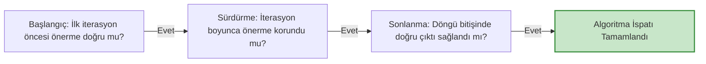

#### 3. Özyineleme ve Yineleme Bağıntısı Kurma
Özyinelemeli bir algoritmanın maliyeti $T(n)$ şu parçalardan oluşur:
$$T(n) = \begin{cases} \Theta(1) & n \le n_0 \text{ (Taban Durumu)} \\ a \cdot T(n/b) + D(n) + C(n) & n > n_0 \text{ (Özyinelemeli Adım)} \end{cases}$$
- $a$: Oluşan alt problem sayısı ($a \ge 1$).
- $n/b$: Her bir alt problemin boyutu ($b > 1$).
- $D(n)$: Problemi alt problemlere bölme maliyeti.
- $C(n)$: Alt problemlerin çözümlerini ana çözümde birleştirme maliyeti.
Genellikle $f(n) = D(n) + C(n)$ olarak birleştirilir.

---

### Adım Adım Çözümlü Özgün Örnek

**Problem (Bağımlı ve Katlanan Döngü Analizi):**  
Aşağıda verilen algoritma parçasının toplam temel işlem sayısını ($T(n)$) $\sum$ toplam formülü kurarak hesaplayınız ve asimptotik sıkı sınırını ($\Theta$) belirleyiniz:

```text
Algorithm ComplexLoop(n):
    total = 0
    for i = 1 to n do:
        j = 1
        while j < i do:
            total = total + 1
            j = j * 2
```

**Çözüm:**  
1. **Döngü Sınırlarının İncelenmesi:**
   - Dış döngü $i = 1$'den $n$'e kadar $n$ kez döner.
   - İçteki while döngüsünde $j$ değişkeni $1$'den başlar ve her adımda $2$ ile çarpılır ($j = 1, 2, 4, 8, \dots, 2^k$).
   - Döngü koşulu: $j < i \iff 2^k < i \implies k < \log_2 i$.
   - $j$'nin alacağı değer sayısı (iterasyon adımı): $\lceil \log_2 i \rceil$'dir ($i=1$ iken $0$ adım).

2. **Toplam Sembolü ile İfade:**
   $$T(n) = \sum_{i=1}^n \lceil \log_2 i \rceil = \sum_{i=2}^n \lceil \log_2 i \rceil$$

3. **Asimptotik Değerlendirme:**
   Tavan fonksiyonunu ihmal ederek integral ve Stirling yaklaşımı uygulayalım:
   $$\sum_{i=1}^n \log_2 i = \log_2(1 \cdot 2 \cdot 3 \cdots n) = \log_2(n!)$$
   Stirling formülüne göre:
   $$\log_2(n!) = n \log_2 n - n \log_2 e + O(\log n) = \Theta(n \log n)$$

   *Sıkı Sınır Kanıtı (Integral Sınırlandırması):*
   $$\int_1^n \log_2 x \, dx \le \sum_{i=1}^n \log_2 i \le \int_1^{n+1} \log_2 x \, dx$$
   $$\int \log_2 x \, dx = \frac{1}{\ln 2} (x \ln x - x) = x \log_2 x - x \log_2 e$$
   Dolayısıyla:
   $$T(n) \ge n \log_2 n - n \log_2 e - O(1) \implies T(n) = \Omega(n \log n)$$
   $$T(n) \le (n+1) \log_2(n+1) - (n+1) \log_2 e \implies T(n) = O(n \log n)$$
   Sonuç olarak algoritmanın zaman karmaşıklığı **$\Theta(n \log n)$**'dir.

---

### Sık Yapılan Hatalar ve Kavram Yanılgıları
- **İç Döngü Değişkeninin Dış Döngüden Bağımsız Sayılması:** $j$'nin $i$'ye bağlı olduğu durumlarda $n \times \log n$ doğrudan çarpılamaz; $\sum \log i$ toplamı açılmalıdır (bu örnekte tesadüfen aynı asimptotik sınıf çıksa da, $j < i^2$ gibi durumlarda katsayılar tamamen değişir).
- **Taban Durumunu (Base Case) Unutmak:** Özyineleme bağıntısı yazılırken $T(1) = \Theta(1)$ taban koşulu yazılmazsa matematiksel tümevarım zeminsiz kalır ve çözümsüzlüğe düşer.
- **Döngü Değişmezinde Sonlanmayı Atlamak:** Önermenin döngü boyunca korunması yeterli değildir; döngü sonlandığında aranan sonucun neden elde edildiğini kanıtlamak zorunludur.

---

### Aktif Hatırlama Soruları

1. İkili arama (Binary Search) algoritmasının doğruluğunu ispatlamak için kullanılabilecek döngü değişmezi (loop invariant) önermesini tanımlayınız.
2. Bir problemi 3 eşit parçaya bölen, bu parçalardan 2 tanesini özyinelemeli çözen ve bölme/birleştirme adımları toplamı doğrusal zaman ($\Theta(n)$) alan bir algoritmanın yineleme bağıntısını yazınız.
3. $\sum_{i=1}^n \frac{1}{i}$ (Harmonik Seri) toplamının büyüme hızı nedir ve algoritma analizinde nerede karşımıza çıkar?

<details>
<summary>Çözüm ve Açıklama</summary>

1. *Değişmez Önermesi:* "Eğer aranan anahtar $x$ dizide mevcutsa, kesinlikle $A[low \dots high]$ alt dizisinin sınırları içerisindedir."  
   - *Başlangıç:* $low=0, high=n-1$; tüm dizi kapsanır, önerme doğrudur.  
   - *Sürdürme:* $mid$ konumu test edilir. $x < A[mid]$ ise $x$ sağ yarıda olamaz, $high = mid - 1$ yapılarak aralık daraltılır ama $x$'in bulunma ihtimali korunur.  
   - *Sonlanma:* $low > high$ olduğunda aralık boşalır; önermeye göre eleman dizide yoktur.
2. Yineleme bağıntısı:
   $$T(n) = 2T(n/3) + \Theta(n), \quad T(1) = \Theta(1)$$
3. Harmonik seri toplamı $H_n = \sum_{i=1}^n \frac{1}{i} = \ln n + \gamma + O(1/n)$ olup büyüme hızı **$\Theta(\log n)$**'dir. Quicksort'un ortalama durum analizinde pivot karşılaştırma olasılıklarının toplamında ve kupon toplayıcı (coupon collector) problemlerinde karşımıza çıkar.
</details>

---

### Kaynak ve Destek Kartı
- **Konu Eşleşmesi:** Döngü karmaşıklıkları, toplam serileri, döngü değişmezleri ve yineleme bağıntılarının modellenmesi.
- **Doğrulanmış Akademik Video:** [MIT 6.046J / 18.410J — Lecture 2: Asymptotic Notation, Recurrences, Substitution, Master Method](https://www.youtube.com/watch?v=whjt_N9uYFI) (Yineleme bağıntıları için; zaman damgası eklenmedi).
- **Açık Ders Dizin Referansı:** [MIT OCW 6.006 Recitation Videos](https://ocw.mit.edu/courses/6-006-introduction-to-algorithms-fall-2011/video_galleries/recitation-videos/) — Recitation 5: Recursion Trees; Recitation 2: Python Cost Model ve Document Distance.

---

## Hafta 4: Yineleme Çözümü: Yerine Koyma, Yineleme Ağacı ve Master Teoremi (Önerilen Akış — Resmî Olmayan)

### Öğrenme Hedefleri
Bu bölümü tamamladığınızda şunları yapabileceksiniz:
1. **Yerine Koyma (Substitution / Mathematical Induction)** yöntemiyle özyinelemeli fonksiyonların üst ve alt sınırlarını matematiksel olarak kanıtlayabilmek.
2. **Yineleme Ağacı (Recursion Tree)** çizerek her seviyedeki alt problem sayısını, alt problem boyutunu, seviye maliyetini ve yaprak toplamını hesaplayabilmek.
3. **Master Teoremi'nin** üç temel durumunu formüle edebilmek; $f(n)$ ile $n^{\log_b a}$ arasındaki polinom farkı ($\epsilon > 0$) koşulunu ve düzenlilik şartını (regularity condition) doğru test edebilmek.
4. Master Teoremi'nin uygulanamadığı sınır durumları (polinomiyal olmayan logaritmik boşluklar) tespit edip alternatif yöntemlerle çözebilmek.

### Kavram Anlatımı ve Temel Teori

#### 1. Yerine Koyma Yöntemi (Substitution Method)
İki aşamadan oluşur: Çözümün biçimini tahmin etmek ve matematiksel tümevarımla sabitlerin doğruluğunu göstermek.
- *Tuzak ve Çözüm:* Tahmin $T(n) \le c \cdot n$ seçildiğinde bazen alt dereceli terimler tümevarımı bozabilir ($c \cdot n + 1 \le c \cdot n$ çıkmazı). Bu durumda hipotez güçlendirilir: $T(n) \le c \cdot n - d$ yazılarak alt dereceli terimler dengelenir.

#### 2. Yineleme Ağacı Yöntemi (Recursion Tree)
Ağaç her seviyedeki maliyeti görselleştirir:
- Kök seviyesi (seviye 0): $f(n)$ maliyet.
- Seviye $i$: $a^i$ adet alt problem, her birinin boyutu $n / b^i$. Seviye toplam maliyeti: $a^i \cdot f(n / b^i)$.
- Ağacın derinliği: $n / b^h = 1 \implies h = \log_b n$.
- Toplam yaprak sayısı: $a^h = a^{\log_b n} = n^{\log_b a}$.
- Toplam Yaprak Maliyeti: $\Theta(n^{\log_b a})$.
- Toplam Maliyet: Tüm seviye maliyetlerinin toplamı:
  $$T(n) = \sum_{i=0}^{\log_b n - 1} a^i f(n/b^i) + \Theta(n^{\log_b a})$$

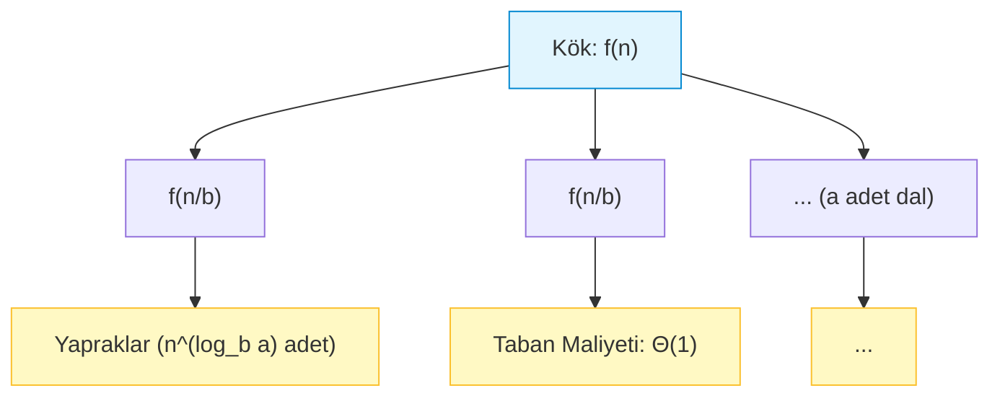

#### 3. Master Teoremi (Master Theorem)
Form: $T(n) = a T(n/b) + f(n)$ burada $a \ge 1, b > 1$ sabitler, $f(n)$ asimptotik pozitif fonksiyondur.  
Kritik eşik fonksiyonu: $n^{\log_b a}$ (yaprakların büyüme hızı).

1. **Durum 1 (Yapraklar Baskın):**  
   Eğer $f(n) = O(n^{\log_b a - \epsilon})$ olacak şekilde bir $\epsilon > 0$ sabiti varsa:
   $$T(n) = \Theta(n^{\log_b a})$$
2. **Durum 2 (Dengeli Dağılım):**  
   Eğer $f(n) = \Theta(n^{\log_b a} \lg^k n)$ ($k \ge 0$) ise (standart durum $k=0$ için $f(n) = \Theta(n^{\log_b a})$):
   $$T(n) = \Theta(n^{\log_b a} \lg^{k+1} n)$$
3. **Durum 3 (Kök Baskın):**  
   Eğer $f(n) = \Omega(n^{\log_b a + \epsilon})$ olacak şekilde bir $\epsilon > 0$ sabiti varsa VE yeterince büyük $n$'ler için $c < 1$ olmak üzere **Düzenlilik Koşulu (Regularity Condition)** sağlanıyorsa:
   $$a \cdot f(n/b) \le c \cdot f(n) \implies T(n) = \Theta(f(n))$$

**Master Teoreminin Uygulanamadığı Durumlar (Kritik İstisnalar):**
- $a$ sabit değilse (örneğin $T(n) = n T(n/2) + n$).
- $b \le 1$ ise.
- $f(n)$ ile $n^{\log_b a}$ arasındaki fark polinomiyal ($\epsilon > 0$) değil, logaritmik ise. Örneğin: $T(n) = 2T(n/2) + \frac{n}{\log n}$. Burada $n^{\log_2 2} = n^1$ olup oran $\log n$'dir; $n^\epsilon$ farkı yoktur. Durum 1 uygulanamaz!

---

### Adım Adım Çözümlü Özgün Örnek

**Problem 1 (Üç Durumun Analizi):**  
Aşağıdaki yineleme bağıntılarının zaman karmaşıklıklarını Master Teoremi ile belirleyiniz:
1. $T(n) = 4T(n/2) + n$
2. $T(n) = 4T(n/2) + n^2$
3. $T(n) = 4T(n/2) + n^3$

**Çözüm:**  
Tüm bağıntılarda $a = 4, b = 2$'dir.  
Kritik fonksiyon: $n^{\log_b a} = n^{\log_2 4} = n^2$.

1. $f(n) = n$:  
   $n = O(n^{2 - \epsilon})$ için $\epsilon = 1 > 0$ seçilebilir ($n \in O(n^1)$).  
   Yapraklar kökten polinomiyal olarak daha hızlı büyür. **Durum 1** geçerlidir:
   $$T(n) = \Theta(n^2)$$

2. $f(n) = n^2$:  
   $f(n) = \Theta(n^{\log_2 4}) = \Theta(n^2)$ ($k=0$).  
   Kök ile yapraklar her seviyede eşit enerji harcar. **Durum 2** geçerlidir:
   $$T(n) = \Theta(n^2 \log n)$$

3. $f(n) = n^3$:  
   $n^3 = \Omega(n^{2 + \epsilon})$ için $\epsilon = 1 > 0$ seçilebilir ($n^3 \in \Omega(n^3)$).  
   Kök yapraklardan daha hızlı büyür. **Durum 3** adaydır. Düzenlilik koşulunu test edelim:
   $$a \cdot f(n/b) \le c \cdot f(n) \implies 4 \cdot \left(\frac{n}{2}\right)^3 = 4 \cdot \frac{n^3}{8} = \frac{1}{2} n^3 \le c \cdot n^3$$
   $c = 1/2 < 1$ seçildiğinde koşul sağlanır. **Durum 3** geçerlidir:
   $$T(n) = \Theta(n^3)$$

---

**Problem 2 (Master Teoreminin Yetmediği Sınır Durum):**  
$T(n) = 2T(n/2) + n \log n$ bağıntısını çözünüz.

**Çözüm:**  
$a = 2, b = 2 \implies n^{\log_2 2} = n^1$.  
$f(n) = n \log n$.  
Burada $f(n) = \Omega(n^{1 + \epsilon})$ koşulu sağlanamaz; çünkü hiçbir $\epsilon > 0$ için $n \log n \ge c \cdot n^{1+\epsilon}$ olamaz ($\log n$, herhangi bir $n^\epsilon$ kuvvetinden asimptotik olarak daha yavaş büyür).  
Dolayısıyla klasik 3 durumlu Master teoremi doğrudan uygulanamaz. Ancak genişletilmiş Durum 2 ($k=1$) gereğince:
$$f(n) = \Theta(n^{\log_b a} \lg^k n) = \Theta(n^1 \lg^1 n) \implies T(n) = \Theta(n \log^{k+1} n) = \Theta(n \log^2 n)$$

*Yineleme Ağacı İle Sağlama:*
- Ağaç derinliği: $\log_2 n$.
- Seviye $i$ maliyeti: $2^i \cdot f(n/2^i) = 2^i \cdot \frac{n}{2^i} \log\left(\frac{n}{2^i}\right) = n (\log n - i)$.
- Toplam maliyet: $\sum_{i=0}^{\log_2 n} n (\log n - i) \approx n \log^2 n - n \frac{\log^2 n}{2} = \Theta(n \log^2 n)$. $\blacksquare$

---

### Sık Yapılan Hatalar ve Kavram Yanılgıları
- **Düzenlilik Koşulunu (Regularity Condition) Test Etmemek:** Durum 3'te $f(n) = \Omega(n^{\log_b a + \epsilon})$ sağlansa dahi $a f(n/b) \le c f(n)$ ($c < 1$) koşulu sağlanmıyorsa Master Teoremi uygulanamaz. (Örnek: $f(n) = n(2 - \cos n)$ gibi salınımlı fonksiyonlar).
- **Polinom Farkı ile Asimptotik Farkı Karıştırmak:** $n$ ile $n \log n$ arasında $\Theta$ farkı vardır ancak *polinomiyal* fark ($n^\epsilon$) yoktur. Bu nedenle Durum 3 işletilemez.
- **Yerine Koyma İspatında Eşitsizlik Yönünü İhlal Etmek:** İndüksiyon adımında varsayım $T(k) \le c k \log k$ iken $T(n) \le \dots \le c n \log n$ gösterilmelidir. Arada bir yerde $\ge$ yapıp sonra $\le$'ye dönmek matematiksel kanıtı geçersiz kılar.

---

### Aktif Hatırlama Soruları

1. $T(n) = 8T(n/2) + 1000 n^2$ bağıntısında katsayı $1000$ çok büyük olmasına rağmen asimptotik çalışma zamanı neden $\Theta(n^3)$ çıkar?
2. Akra-Bazzi yöntemi Master Teoremine göre hangi temel üstünlüklere sahiptir (alt problem boyutları açısından)?
3. $T(n) = T(n-1) + O(1)$ yinelemesinin çözümü nedir ve hangi algoritmada görülür?

<details>
<summary>Çözüm ve Açıklama</summary>

1. Master Teoreminde sabit çarpanlar ($1000$) asimptotik büyümeyi belirlemez. $a=8, b=2 \implies n^{\log_2 8} = n^3$. $f(n) = 1000n^2 = O(n^{3 - \epsilon})$ ($\epsilon = 1$ için). Yaprak sayısı $n^3$ mertebesinde olduğundan yapraklar domine eder ve sonuç $\Theta(n^3)$ olur.
2. Master Teoremi alt problemlerin eşit boyutta ($n/b$) bölünmesini şart koşar. Akra-Bazzi yöntemi ise farklı boyutlardaki bölünmeleri (örneğin $T(n) = T(n/3) + T(2n/3) + f(n)$ gibi) ve tam sayı yuvarlama taban/tavan etkilerini eksiksiz çözebilir.
3. Çözüm $\Theta(n)$'dir (Aritmetik seri toplamı: $1 + 1 + \dots + 1$). Dizide en büyük elemanı özyinelemeli arama veya boyutu 1 azalan taban durumuna giden özyinelemelerde görülür.
</details>

---

### Kaynak ve Destek Kartı
- **Konu Eşleşmesi:** Yineleme ağaçları, yerine koyma yöntemi ve Master Teoremi durum analizleri.
- **Doğrulanmış Akademik Video:** [MIT 6.046J / 18.410J — Lecture 2: Asymptotic Notation, Recurrences, Substitution, Master Method](https://www.youtube.com/watch?v=whjt_N9uYFI) (Master teoremi anlatımı; video bölüm zamanları ayrıca doğrulanmadığı için zaman damgası verilmedi).
- **Ders Notu Referansı:** [MIT OCW 6.046J Problem-Solving Videos](https://ocw.mit.edu/courses/6-046j-design-and-analysis-of-algorithms-spring-2015/download/) — Recitation 1: Master Theorem ve divide-and-conquer örnekleri.

---
## Hafta 5: Böl ve Yönet; Merge Sort, Quicksort ve İkili Arama (Önerilen Akış — Resmî Olmayan)

### Öğrenme Hedefleri
Bu bölümü tamamladığınızda şunları yapabileceksiniz:
1. **Böl ve Yönet (Divide and Conquer)** tasarım paradigmasının üç aşamasını (Böl, Fethet/Yönet, Birleştir) algoritmalar üzerinde analiz edebilmek.
2. **Merge Sort** algoritmasının birleştirme adımını, $O(n)$ yardımcı bellek ihtiyacını ve kararlılık (stability) özelliğini açıklayabilmek.
3. **Quicksort** algoritmasının bölme mekanizmalarını (Lomuto ve Hoare), en kötü durum ($O(n^2)$) senaryolarını ve rastgele pivot (Randomized QuickSort) ile beklenen durum ($\Theta(n \log n)$) kanıtını kavrayabilmek.
4. İkili Arama (Binary Search) algoritmasında sınır koşullarını, arama uzayı indirgemesini ve tamsayı taşması (integer overflow) önlemlerini uygulayabilmek.

### Kavram Anlatımı ve Temel Teori

#### 1. Böl ve Yönet Paradigması
Bir problemi doğrudan çözmek yerine üç adıma ayırır:
1. **Böl (Divide):** Problemi aynı tipteki daha küçük alt problemlere ayır.
2. **Yönet / Fethet (Conquer):** Alt problemleri özyinelemeli olarak çöz. Alt problem yeterince küçükse taban durumunda doğrudan çöz.
3. **Birleştir (Combine):** Alt problemlerin çözümlerini bir araya getirerek orijinal problemin çözümünü üret.

#### 2. Merge Sort Analizi
- **Böl:** Diziyi ortadan ikiye böl ($D(n) = \Theta(1)$).
- **Yönet:** İki yarıyı özyinelemeli sırala ($2 T(n/2)$).
- **Birleştir:** Sıralı iki alt diziyi tek bir sıralı dizide birleştir ($C(n) = \Theta(n)$).
- **Yineleme Bağıntısı:** $T(n) = 2T(n/2) + \Theta(n) \implies \Theta(n \log n)$ (En iyi, en kötü ve ortalama durumların tamamında).
- **Bellek ve Kararlılık:** Yerinde (in-place) değildir; birleştirme adımı için $O(n)$ ek bellek gerekir. Eşit anahtarların sırası korunduğundan **kararlıdır (stable)**.

#### 3. Quicksort Analizi ve Pivot Seçimi
Tüm işi birleştirme adımında yapan Merge Sort'un aksine, Quicksort işi **bölme (partition)** adımında yapar:
- **Böl:** Diziden bir $x$ pivotu seç. Diziyi $x$'ten küçük elemanlar solda, büyükler sağda olacak şekilde yeniden düzenle ($\Theta(n)$).
- **Yönet:** Sol ve sağ parçaları bağımsız sırala.
- **Birleştir:** Hiçbir işlem gerektirmez ($C(n) = 0$).
- **En Kötü Durum:** Pivot her seferinde en küçük veya en büyük eleman seçilirse (örneğin zaten sıralı dizide ilk eleman pivot seçilirse):
  $$T(n) = T(n-1) + T(0) + \Theta(n) = \Theta(n^2)$$
  Özyineleme çağrı yığıtı derinliği $\Theta(n)$ olur (yığıt taşması riski).
- **En İyi Durum:** Pivot diziyi her adımda tam ortadan bölerse:
  $$T(n) = 2T(n/2) + \Theta(n) = \Theta(n \log n)$$
- **Rastgele Pivot (Randomized QuickSort):** Pivot rastgele seçildiğinde hiçbir sabit girdi sırası en kötü durumu tetikleyemez. Rastgele gösterge değişkenleri (indicator random variables) ile beklenen çalışma zamanı:
  $$\mathbb{E}[T(n)] = \Theta(n \log n)$$
  Kuyruk özyinelemesi optimizasyonu (küçük parçaya özyineleme, büyük parçaya döngü) ile yığıt alanı $O(\log n)$ ile sınırlandırılabilir.

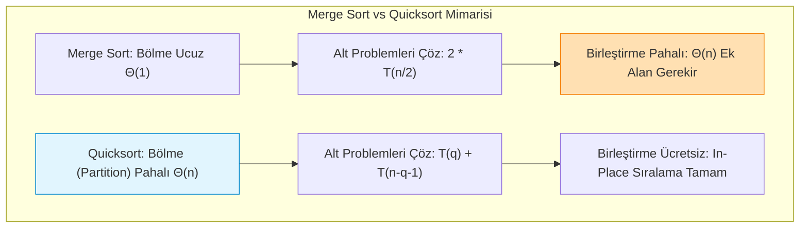

---

### Adım Adım Çözümlü Özgün Örnek

**Problem (Lomuto vs Hoare Bölme İzi):**  
Dizi: $A = [38, 27, 43, 3, 9, 82, 10]$  
1. **Lomuto Partition** yöntemini dizinin son elemanını ($pivot = 10$) kullanarak adım adım yürütünüz.
2. **Hoare Partition** yöntemini dizinin ilk elemanını ($pivot = 38$) kullanarak adım adım yürütünüz.

**Çözüm:**

**1. Lomuto Partition ($pivot = A[high] = 10$):**
- Başlangıç: $low = 0, high = 6, i = low - 1 = -1$.
- $j=0$: $A[0]=38 > 10$. İşlem yok.
- $j=1$: $A[1]=27 > 10$. İşlem yok.
- $j=2$: $A[2]=43 > 10$. İşlem yok.
- $j=3$: $A[3]=3 \le 10 \implies i = 0$. $A[i]$ ile $A[j]$ takas ($A[0] \leftrightarrow A[3]$):  
  Dizi: $[3, 27, 43, 38, 9, 82, 10]$
- $j=4$: $A[4]=9 \le 10 \implies i = 1$. $A[1]$ ile $A[4]$ takas ($A[1] \leftrightarrow A[4]$):  
  Dizi: $[3, 9, 43, 38, 27, 82, 10]$
- $j=5$: $A[5]=82 > 10$. İşlem yok.
- Döngü bitti. Pivotu yerine koy ($A[i+1] \leftrightarrow A[high]$, yani $A[2] \leftrightarrow A[6]$):  
  Nihai Dizi: $[3, 9, \mathbf{10}, 38, 27, 82, 43]$  
  Dönen pivot indisi: $i+1 = \mathbf{2}$. Pivotun solundakiler $\le 10$, sağındakiler $> 10$'dur.

**2. Hoare Partition ($pivot = A[low] = 38$):**
- Başlangıç: $i = -1, j = 7$.
- İterasyon 1:
  - $i$ sağa ilerler: $A[0]=38 \ge 38 \implies i = 0$'da durur.
  - $j$ sola ilerler: $A[6]=10 \le 38 \implies j = 6$'da durur.
  - $i < j$ ($0 < 6$) $\implies A[0]$ ile $A[6]$ takas:  
    Dizi: $[10, 27, 43, 3, 9, 82, 38]$
- İterasyon 2:
  - $i$ ilerler: $A[1]=27 < 38$, $A[2]=43 \ge 38 \implies i = 2$'de durur.
  - $j$ ilerler: $A[5]=82 > 38$, $A[4]=9 \le 38 \implies j = 4$'te durur.
  - $i < j$ ($2 < 4$) $\implies A[2]$ ile $A[4]$ takas:  
    Dizi: $[10, 27, 9, 3, 43, 82, 38]$
- İterasyon 3:
  - $i$ ilerler: $A[3]=3 < 38$, $A[4]=43 \ge 38 \implies i = 4$'te durur.
  - $j$ ilerler: $A[3]=3 \le 38 \implies j = 3$'te durur.
  - $i \ge j$ ($4 \ge 3$) $\implies$ Kesişme gerçekleşti! Takas yapılmaz, döngü sonlanır.  
  Dönen ayırma indisi: $j = \mathbf{3}$.  
  Sol parça: $A[0 \dots 3] = [10, 27, 9, 3]$ (hepsi $\le 38$).  
  Sağ parça: $A[4 \dots 6] = [43, 82, 38]$ (hepsi $\ge 38$).  
  *Not:* Hoare bölmesi ortalama 3 kat daha az takas (swap) yapar ve Lomuto'dan pratikte çok daha hızlıdır.

---

### Sık Yapılan Hatalar ve Kavram Yanılgıları
- **İkili Aramada Tamsayı Taşması:** `mid = (low + high) / 2` yazıldığında $low + high > 2^{31}-1$ ise taşma (overflow) meydana gelir ve negatif sayıya döner. Doğru yazım: `mid = low + (high - low) / 2` olmalıdır.
- **Quicksort'un Kararlı (Stable) Olduğunu Varsaymak:** Quicksort takas işlemleri sırasında eşit anahtarların birbirinin üzerinden atlamasına neden olduğu için doğası gereği kararlı değildir.
- **Merge Sort'un Her Zaman Ek Bellek İstemediğini İddia Etmek:** Bağlı listelerde (Linked List) Merge Sort $O(1)$ ek bellek ile koşturulabilir; ancak dizilerde klasik algoritma $O(n)$ yardımcı alan gerektirir.

---

### Aktif Hatırlama Soruları

1. Quicksort'un en kötü durum çalışma zamanı $O(n^2)$ olmasına rağmen neden endüstri standardı kütüphanelerde (örneğin C++ `std::sort`) Merge Sort yerine tercih edilir?
2. Kararlılık (stability) bir sıralama algoritmasında neden hayati bir gereksinimdir? Bir senaryo ile açıklayınız.
3. İkili arama algoritması neden sıralı bir bağlı listede (Linked List) $\Theta(\log n)$ sürede çalıştırılamaz?

<details>
<summary>Çözüm ve Açıklama</summary>

1. Quicksort yerinde (in-place) çalışır ($O(1)$ yardımcı bellek, $O(\log n)$ yığıt) ve mükemmel yerel önbellek (cache locality) başarımı sunar. Merge Sort ise her birleştirme adımında büyük veri kopyalama maliyeti ($O(n)$ bellek) üretir. Ayrıca `std::sort` (Introsort), derinlik $\approx 2 \log n$ olunca Heapsort'a geçerek $O(n^2)$ riskini tamamen yok eder.
2. Kararlılık, eşit anahtara sahip elemanların göreli sırasının korunmasıdır. Örneğin önce öğrenci numarasına göre sıralanmış bir listede, ardından not ortalamasına göre sıralama yapıldığında, eşit ortalamaya sahip öğrencilerin numara sırasının bozulmaması için sıralayıcının kararlı olması şarttır.
3. Bağlı listelerde rastgele erişim ($\Theta(1)$ indisleme) yoktur. Ortadaki elemana ($mid$) ulaşmak için listenin başından itibaren $\Theta(n)$ adım yürümek gerekir; bu da ikili aramanın avantajını yok ederek süreyi $\Theta(n)$'e düşürür.
</details>

---

### Kaynak ve Destek Kartı
- **Konu Eşleşmesi:** Böl ve Yönet paradigması, Merge Sort birleştirme analizi ve Quicksort bölme mekanizmaları.
- **Ders Notu ve Video Referansı:** [MIT OCW 6.006 Recitation Videos](https://ocw.mit.edu/courses/6-006-introduction-to-algorithms-fall-2011/video_galleries/recitation-videos/) — Recitation 3: Insertion and Merge Sort.
- **Akademik Destek:** [MIT OCW 6.046J Lecture Videos](https://ocw.mit.edu/courses/6-046j-design-and-analysis-of-algorithms-spring-2015/resources/lecture-videos/) — Lecture 2: Convex Hull and Median Finding; Lecture 6: Randomized Algorithms and Quicksort.

---

## Hafta 6: Sıralama Alt Sınırları, Karşılaştırma Ağacı ve Doğrusal Zamanlı Seçim (Önerilen Akış — Resmî Olmayan)

### Öğrenme Hedefleri
Bu bölümü tamamladığınızda şunları yapabileceksiniz:
1. Karşılaştırma tabanlı tüm sıralama algoritmalarının en kötü durumda **$\Omega(n \log n)$** alt sınırına mahkum olduğunu **Karar Ağacı (Decision Tree)** modeliyle ispatlayabilmek.
2. Doğrusal zamanlı sıralama algoritmalarının (Counting Sort, Radix Sort, Bucket Sort) hangi varsayımlar ve kısıtlar altında $O(n)$ sürede çalıştığını açıklayabilmek.
3. Sırasız bir dizide $k$. en küçük elemanı bulan **Quickselect** algoritmasının beklenen doğrusal süresini ($\Theta(n)$) modelleyebilmek.
4. Deterministik en kötü durumda doğrusal çalışan **Medyanların Medyanı (Median-of-Medians / BFPRT)** algoritmasının $T(n) \le T(n/5) + T(7n/10) + O(n)$ bağıntısını ve 5'li gruplamanın matematiksel gerekliliğini kanıtlayabilmek.

### Kavram Anlatımı ve Temel Teori

#### 1. Karşılaştırma Tabanlı Sıralamanın Alt Sınırı ($\Omega(n \log n)$)
Sadece eleman çiftlerini karşılaştırarak ($a_i \le a_j$) çalışan herhangi bir algoritma bir **Karar Ağacı (Decision Tree)** olarak modellenebilir:
- **İç Düğümler:** Yapılan iki elemanlı karşılaştırmalar ($a_i : a_j$).
- **Yapraklar:** Olası tüm sıralama permütasyonları. $n$ elemanlı bir dizinin $n!$ farklı permütasyonu olduğundan ağaçta en az $L = n!$ adet yaprak bulunmalıdır.
- **Çalışma Zamanı:** Kökten yaprağa giden en uzun yol, yani ağacın yüksekliğidir ($h$).

İkili bir ağaçta $h$ yükseklikte en fazla $2^h$ yaprak bulunabilir:
$$2^h \ge n! \implies h \ge \log_2(n!)$$
Stirling yaklaşımı veya toplam sınırlandırmasıyla:
$$\log_2(n!) = \sum_{i=1}^n \log_2 i \ge \sum_{i=n/2}^n \log_2(n/2) = \frac{n}{2} \log_2(n/2) = \frac{n}{2}(\log_2 n - 1) = \Omega(n \log n)$$
*Sonuç:* Karşılaştırma tabanlı hiçbir sıralama algoritması en kötü durumda $\Omega(n \log n)$'den daha hızlı çalışamaz!

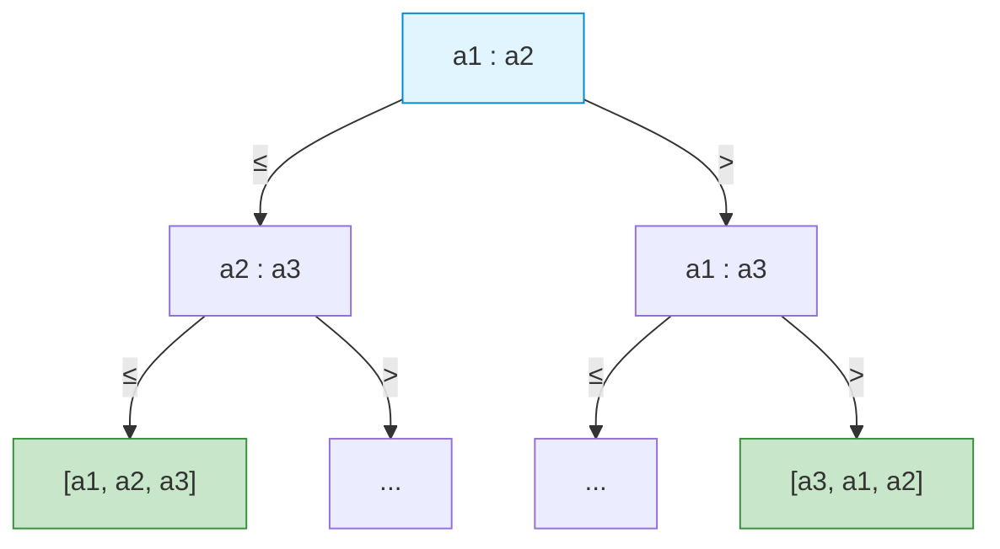

#### 2. Doğrusal Zamanlı Sıralama Algoritmaları
$\Omega(n \log n)$ alt sınırı karşılaştırma yapmayan algoritmalar için geçerli değildir:
- **Counting Sort:** Elemanların tamsayı ve $[0, k]$ aralığında olduğunu varsayar. Frekans dizisi kurarak elemanların yerini doğrudan hesaplar. Zaman: $\Theta(n + k)$, Bellek: $\Theta(n + k)$. $k = O(n)$ ise $\Theta(n)$ sürer. Kararlıdır.
- **Radix Sort:** Sayıları $b$ tabanında $d$ basamak üzerinden en anlamsız basamaktan (LSD) en anlamlı basamağa (MSD) doğru kararlı bir algoritmayla (Counting Sort) sıralar. Zaman: $\Theta(d(n + b))$.
- **Bucket Sort:** Girdinin $[0, 1)$ aralığında tekdüze (uniform) dağıldığını varsayar. Elemanları $n$ adet kovaya dağıtır, kovaları sıralar. Beklenen zaman: $\Theta(n)$.

#### 3. Seçim Problemi (Selection) ve Medyanların Medyanı (BFPRT)
Problem: $n$ elemanlı sırasız bir kümede $k$. en küçük elemanı bulmak.
- **Quickselect:** Rastgele pivotla bölme yapar; yalnızca aranan elemanın düştüğü tarafa özyineleme açar. Beklenen süre $\Theta(n)$, en kötü durum $O(n^2)$.
- **Deterministik BFPRT Algoritması (Blum, Floyd, Pratt, Rivest, Tarjan):**
  1. Elemanları 5'erli $\lceil n/5 \rceil$ gruba ayır.
  2. Her 5'li grubun medyanını $\le 7$ karşılaştırma ile bul.
  3. Bu medyanların medyanını ($x$) bulmak için algoritmayı özyinelemeli çağır: $T(n/5)$.
  4. Diziyi $x$ etrafında partition et.
  5. $x$'ten küçük veya büyük elemanların sayısı garanti olarak en az $3(\lceil \frac{1}{2} \lceil \frac{n}{5} \rceil \rceil - 2) \ge \frac{3n}{10} - 6$'dır.
  6. En kötü durumda kalan alt problem boyutu en fazla: $n - \frac{3n}{10} = \frac{7n}{10}$'dur.
  7. **Yineleme Bağıntısı:**
     $$T(n) \le T(n/5) + T(7n/10) + c \cdot n$$
     $1/5 + 7/10 = 9/10 < 1$ olduğundan çözüm **$\Theta(n)$** doğrusal zamandır!

---

### Adım Adım Çözümlü Özgün Örnek

**Problem:**  
BFPRT algoritmasının yineleme bağıntısı $T(n) \le T(n/5) + T(7n/10) + a \cdot n$ olarak veriliyor ($a > 0$ sabit).  
1. Yerine koyma (substitution) yöntemiyle $T(n) \le c \cdot n$ olduğunu kanıtlayınız ve gerekli $c$ katsayısını $a$ cinsinden bulunuz.
2. Eğer elemanlar 5'erli gruplar yerine 3'erli gruplara ayrılsaydı yineleme bağıntısı ne olurdu ve algoritma neden doğrusal zamanda çalışamazdı?

**Çözüm:**

**1. Yerine Koyma İspatı ($T(n) \le c \cdot n$):**
- Tümevarım Hipotezi: $k < n$ için $T(k) \le c \cdot k$ sağlansın.
- İndüksiyon Adımı:
  $$T(n) \le c \left(\frac{n}{5}\right) + c \left(\frac{7n}{10}\right) + a \cdot n$$
  $$T(n) \le c \cdot n \left(\frac{1}{5} + \frac{7}{10}\right) + a \cdot n = c \cdot n \left(\frac{9}{10}\right) + a \cdot n$$
  Hedefimiz bu ifadenin $\le c \cdot n$ olduğunu göstermektir:
  $$\frac{9}{10} c \cdot n + a \cdot n \le c \cdot n \iff a \cdot n \le c \cdot n - \frac{9}{10} c \cdot n \iff a \cdot n \le \frac{1}{10} c \cdot n$$
  Her iki tarafı $n$'e bölersek:
  $$c \ge 10a$$
  $c = 10a$ seçildiğinde indüksiyon adımı tam olarak sağlanır. Dolayısıyla $T(n) \in O(n)$'dir. $\blacksquare$

**2. 3'erli Gruplama Durumu:**
- $n/3$ grup oluşur.
- Medyanların medyanından kesin küçük veya büyük olan eleman sayısı: $2 \times \frac{1}{2} \frac{n}{3} = \frac{n}{3}$.
- Kalan alt problem boyutu en kötü durumda: $n - n/3 = \frac{2n}{3}$.
- Bağıntı:
  $$T(n) \le T(n/3) + T(2n/3) + a \cdot n$$
  Burada katsayılar toplamı: $\frac{1}{3} + \frac{2}{3} = 1$'dir!  
  Yineleme ağacının her seviyesinin toplam maliyeti tam olarak $a \cdot n$ olur. Ağacın derinliği $\log_3 n$ olduğundan toplam süre:
  $$T(n) = \Theta(n \log n)$$
  çıkar ve doğrusal zaman garantisi çöker. 5 sayısı $1/5 + 7/10 = 0.9 < 1$ eşitsizliğini sağlayan en küçük tek sayıdır!

---

### Sık Yapılan Hatalar ve Kavram Yanılgıları
- **Counting Sort'un Her Zaman $O(n)$ Olduğunu Sanmak:** $k$ anahtar aralığı $n^2$ veya $2^n$ ise Counting Sort $O(n^2)$ veya $O(2^n)$ zaman ve bellek tüketir; bu koşulda QuickSort'tan çok daha yavaştır.
- **Karşılaştırma Sınırını Yanlış Yorumlamak:** Karar ağacı ispatı yalnızca karşılaştırma yapan algoritmalar için geçerlidir. Bir sayıyı indis olarak kullanmak ($A[key]$) karşılaştırma işlemi değil, doğrudan adreslemedir.
- **Quickselect ile Quicksort'u Karıştırmak:** Quicksort her iki parçayı da çözer ($T(n) = 2T(n/2) + O(n) = O(n \log n)$); Quickselect ise tek bir parçaya iner ($T(n) = T(n/2) + O(n) = O(n)$).

---

### Aktif Hatırlama Soruları

1. $n$ elemanlı bir karar ağacında en az $n!$ yaprak bulunması zorunluluğunun fiziksel gerekçesi nedir?
2. Radix Sort çalışırken neden alt basamakları sıralayan algoritmanın **kararlı (stable)** olması zorunludur?
3. Medyanların Medyanı (BFPRT) algoritmasında elemanlar neden 7'şerli gruplara ayrılabilirken 3'erli gruplara ayrılamaz?

<details>
<summary>Çözüm ve Açıklama</summary>

1. Girdi elemanlarının $n!$ farklı başlangıç sıralanma ihtimali (permütasyonu) vardır. Doğru bir sıralama algoritması, bu olası permütasyonların her birini ayırt edebilecek farklı bir yaprak düğüme ulaşabilmelidir. Eğer yaprak sayısı $< n!$ olsaydı, en az iki farklı permütasyon aynı yaprağa düşer ve algoritma bazı girdileri yanlış sıralardı.
2. Radix Sort basamak basamak ilerler. Örneğin onlar basamağına göre sıralama yapılırken, onlar basamağı aynı olan iki sayının (örneğin 42 ve 47) birler basamağından gelen doğru göreli sırasının bozulmaması için kullanılan ara algoritmanın kararlı olması şarttır. Aksi halde önceki basamak sıralaması silinir.
3. 3'erli gruplamada alt problem oranları toplamı $1/3 + 2/3 = 1$ olduğu için her seviyede $n$ iş yapılır ve toplam süre $\Theta(n \log n)$ olur. 7'şerli gruplamada ise oranlar $1/7 + 5/7 = 6/7 < 1$ olduğundan süre doğrusal kalır. Ancak 5, hem $1$'den küçük toplam veren hem de grup içi medyanı en az işlemle ($\le 7$ karşılaştırma) bulan en optimal sayıdır.
</details>

---

### Kaynak ve Destek Kartı
- **Konu Eşleşmesi:** Sıralama alt sınırları, Karar Ağacı ispatı, doğrusal sıralama (Counting, Radix) ve Medyanların Medyanı (BFPRT).
- **Akademik Ders Kaydı:** [MIT OCW 6.046J Lecture Videos](https://ocw.mit.edu/courses/6-046j-design-and-analysis-of-algorithms-spring-2015/resources/lecture-videos/) — Lecture 2: Median Finding.
- **Açık Ders Dizin Referansı:** [MIT OCW 6.006 Recitation Videos](https://ocw.mit.edu/courses/6-006-introduction-to-algorithms-fall-2011/video_galleries/recitation-videos/) — Recitation 7: Comparison Sort, Counting and Radix Sort.

---

## Hafta 7: Hash Tabloları, Çakışma Çözümü ve Beklenen Maliyet Analizi (Önerilen Akış — Resmî Olmayan)

### Öğrenme Hedefleri
Bu bölümü tamamladığınızda şunları yapabileceksiniz:
1. Doğrudan Adresleme Tablosu (Direct Addressing) ile **Hash Tablosu** arasındaki uzay-zaman ödünleşimini formüle edebilmek.
2. **Basit Tekdüze Hashleme Varsayımı (SUHA)** altında yük faktörünü ($\alpha = n/m$) ve arama maliyetlerini matematiksel olarak ispatlayabilmek.
3. Çakışma çözüm yöntemlerini (Ayrı Zincirleme / Chaining ve Açık Adresleme: Doğrusal Yoklama, İkinci Derece Yoklama, Çift Hashleme) teknik detaylarıyla uygulayabilmek.
4. **Evrensel Hashleme (Universal Hashing)** ailesi mantığını kavrayarak kötü niyetli girdilere karşı en kötü durum hasarını önleme güvencesini açıklayabilmek.

### Kavram Anlatımı ve Temel Teori

#### 1. Doğrudan Adresleme vs Hashleme
- Evren $U$, olası tüm anahtarların kümesidir. Gerçekte saklanan anahtar sayısı $n = |K|$ olsun.
- Eğer $|U|$ çok büyükse (örneğin 64-bitlik T.C. kimlik veya IP adresleri, $|U| = 2^{64}$), doğrudan adresleme tablosu tutmak imkansız bellek gerektirir.
- **Hash Fonksiyonu ($h$):** Devasa evreni $m$ boyutlu bir tabloya eşler: $h: U \to \{0, 1, \dots, m-1\}$ ($m = \Theta(n)$).
- **Güvercin Yuvası İlkesi (Pigeonhole Principle):** $|U| > m$ olduğundan en az iki farklı anahtarın aynı hücreye eşlenmesi ($h(k_1) = h(k_2)$) kaçınılmazdır; buna **çakışma (collision)** denir.

#### 2. Çakışma Çözüm Yöntemleri
1. **Ayrı Zincirleme (Chaining):** Her tablo hücresi çakışan elemanları tutan bir bağlı liste (veya dengeli ağaç) taşır.
   - *SUHA (Simple Uniform Hashing Assumption):* Her anahtarın $m$ yuvadan herhangi birine eşit olasılıkla ($1/m$) ve diğer anahtarlardan bağımsız eşlendiği varsayımıdır.
   - Yük faktörü: $\alpha = n / m$.
   - Başarısız Arama: Listenin sonuna kadar taranır: $\Theta(1 + \alpha)$.
   - Başarılı Arama: Ortalama eleman sayısı analizi ile: $\Theta(1 + \alpha / 2) = \Theta(1 + \alpha)$.
   - Eğer $m = \Omega(n)$ seçilirse $\alpha = O(1)$ olur ve işlemler ortalama $\Theta(1)$ sürer.

2. **Açık Adresleme (Open Addressing):** Tüm elemanlar doğrudan tablonun içinde saklanır ($\alpha = n/m \le 1$). Çakışma durumunda alternatif yuvalar taranır (probing):
   - **Doğrusal Yoklama (Linear Probing):** $h(k, i) = (h'(k) + i) \bmod m$.
     - *Kusur:* **Birincil Kümelenme (Primary Clustering).** Dolu yuvalar uzadıkça yeni çakışma olasılığı artar; arama süresi dramatik biçimde yükselir.
   - **İkinci Derece Yoklama (Quadratic Probing):** $h(k, i) = (h'(k) + c_1 i + c_2 i^2) \bmod m$.
     - *Kusur:* **İkincil Kümelenme (Secondary Clustering).** Aynı ilk hash değerini alan anahtarlar aynı yoklama dizisini takip eder.
   - **Çift Hashleme (Double Hashing):** $h(k, i) = (h_1(k) + i \cdot h_2(k)) \bmod m$.
     - En iyi açık adresleme yöntemidir; kümelenmeyi minimuma indirir. Tablonun tüm yuvalarını tarayabilmesi için $\gcd(h_2(k), m) = 1$ olmalıdır (genellikle $m$ asal sayı, $h_2(k) = 1 + (k \bmod m')$ seçilir).
   - *Açık Adreslemede Arama Maliyetleri (Düzgün Hashleme Altında):*
     - Başarısız aramadaki beklenen yoklama sayısı: $\frac{1}{1 - \alpha}$.
     - Başarılı aramadaki beklenen yoklama sayısı: $\frac{1}{\alpha} \ln \frac{1}{1 - \alpha}$.
     - ($\alpha = 0.9$ iken başarısız arama $1/(1-0.9) = 10$ adım sürer!).

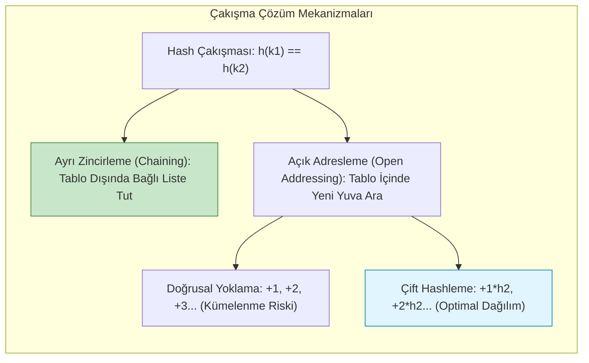

#### 3. Evrensel Hashleme (Universal Hashing)
Deterministik bir hash fonksiyonunda kötü niyetli bir saldırgan aynı yuvaya düşen $n$ adet anahtar seçerek arama süresini $O(n)$'e (bağlı liste bozulması) kilitleyebilir (DoS saldırısı).
- **Tanım:** $\mathcal{H}$ sonlu bir hash fonksiyonu ailesi olsun. $\forall x \ne y \in U$ için:
  $$\Pr_{h \in \mathcal{H}}[h(x) = h(y)] \le \frac{1}{m}$$
  ise bu aile **evrenseldir (universal)**. Fonksiyon çalışma zamanında $\mathcal{H}$ ailesinden rastgele seçilir; dolayısıyla hiçbir sabit girdi dizisi en kötü durumu tetikleyemez.

---

### Adım Adım Çözümlü Özgün Örnek

**Problem:**  
Tablo boyutu $m = 11$ olarak veriliyor. Aşağıdaki anahtar dizisi sırayla tabloya eklenecektir:  
$K = [22, 33, 44, 15, 26, 37]$  
1. $h_1(k) = k \bmod 11$ temel hash fonksiyonu ve **Doğrusal Yoklama (Linear Probing)** kullanarak ekleme adımlarını ve oluşan çakışmaları gösteriniz.
2. Aynı anahtarları $h_1(k) = k \bmod 11$ ve $h_2(k) = 1 + (k \bmod 7)$ fonksiyonlarıyla **Çift Hashleme (Double Hashing)** kullanarak ekleyiniz.

**Çözüm:**

**1. Doğrusal Yoklama:**
- $k=22$: $h(22, 0) = 22 \bmod 11 = 0$. Yuva 0 boş $\to$ **Yuva 0 = 22** (0 çakışma).
- $k=33$: $h(33, 0) = 33 \bmod 11 = 0$. Yuva 0 dolu (22)!  
  $i=1: h(33, 1) = (0 + 1) \bmod 11 = 1$. Yuva 1 boş $\to$ **Yuva 1 = 33** (1 çakışma).
- $k=44$: $h(44, 0) = 0$ (dolu), $h(44, 1) = 1$ (dolu).  
  $i=2: h(44, 2) = (0 + 2) \bmod 11 = 2$. Yuva 2 boş $\to$ **Yuva 2 = 44** (2 çakışma).
- $k=15$: $h(15, 0) = 15 \bmod 11 = 4$. Yuva 4 boş $\to$ **Yuva 4 = 15** (0 çakışma).
- $k=26$: $h(26, 0) = 26 \bmod 11 = 4$. Yuva 4 dolu (15)!  
  $i=1: h(26, 1) = (4 + 1) \bmod 11 = 5$. Yuva 5 boş $\to$ **Yuva 5 = 26** (1 çakışma).
- $k=37$: $h(37, 0) = 37 \bmod 11 = 4$ (dolu), $h(37, 1) = 5$ (dolu).  
  $i=2: h(37, 2) = (4 + 2) \bmod 11 = 6$. Yuva 6 boş $\to$ **Yuva 6 = 37** (2 çakışma).  
*Toplam Çakışma:* $0 + 1 + 2 + 0 + 1 + 2 = \mathbf{6}$. Birincil kümelenme nedeniyle ardışık bloklar ($0-2$ ve $4-6$) oluşmuştur.

**2. Çift Hashleme:**
- Formül: $h(k, i) = (k \bmod 11 + i \cdot (1 + (k \bmod 7))) \bmod 11$.
- $k=22$: $h_1 = 0 \to$ **Yuva 0 = 22**.
- $k=33$: $h_1 = 0$ (dolu). $h_2(33) = 1 + (33 \bmod 7) = 1 + 5 = 6$.  
  $i=1: h(33, 1) = (0 + 1 \times 6) \bmod 11 = 6$. Yuva 6 boş $\to$ **Yuva 6 = 33** (1 çakışma).
- $k=44$: $h_1 = 0$ (dolu). $h_2(44) = 1 + (44 \bmod 7) = 1 + 2 = 3$.  
  $i=1: h(44, 1) = (0 + 1 \times 3) \bmod 11 = 3$. Yuva 3 boş $\to$ **Yuva 3 = 44** (1 çakışma).
- $k=15$: $h_1 = 4 \to$ **Yuva 4 = 15**.
- $k=26$: $h_1 = 4$ (dolu). $h_2(26) = 1 + (26 \bmod 7) = 1 + 5 = 6$.  
  $i=1: h(26, 1) = (4 + 1 \times 6) \bmod 11 = 10$. Yuva 10 boş $\to$ **Yuva 10 = 26** (1 çakışma).
- $k=37$: $h_1 = 4$ (dolu). $h_2(37) = 1 + (37 \bmod 7) = 1 + 2 = 3$.  
  $i=1: h(37, 1) = (4 + 1 \times 3) \bmod 11 = 7$. Yuva 7 boş $\to$ **Yuva 7 = 37** (1 çakışma).  
*Toplam Çakışma:* $0 + 1 + 1 + 0 + 1 + 1 = \mathbf{4}$. Elemanlar tabloya mükemmel şekilde dağılmış, kümelenme tamamen engellenmiştir.

---

### Sık Yapılan Hatalar ve Kavram Yanılgıları
- **Açık Adreslemede Doğrudan `NIL` ile Silme Yapmak:** Açık adreslemede bir eleman silindiğinde yuvasına doğrudan `NIL` yazılırsa, o yuvadan geçerek daha ileriye yerleşmiş olan diğer elemanların arama zinciri kopar. Bu nedenle silinen yere özel bir bayrak (`DELETED` / Tombstone) konulmalıdır.
- **$h_2(k)$ Fonksiyonunun Sıfır Üretmesi:** Çift hashlemede $h_2(k) = 0$ olursa $h(k, i) = h_1(k)$ sabit kalır ve sonsuz döngüye girilir. Bu yüzden $h_2(k)$ daima $\ge 1$ üretmelidir (örneğin $1 + (k \bmod m')$).
- **Yük Faktörünün 1'i Geçmesine İzin Vermek (Açık Adreslemede):** Ayrı zincirlemede $\alpha > 1$ olabilir (listeler uzar); ancak açık adreslemede $\alpha$ kesinlikle $1$'i aşamaz ($\alpha \ge 1$ iken boş yuva kalmaz).

---

### Aktif Hatırlama Soruları

1. Basit Tekdüze Hashleme Varsayımı (SUHA) gerçek hayatta neden her zaman sağlanamaz?
2. Açık adresleme tablosunda yük faktörü $\alpha = 0.5$'ten $\alpha = 0.9$'a çıktığında başarısız aramadaki beklenen yoklama sayısı nasıl değişir?
3. Dinamik hash tablolarında tablo boyutu iki katına çıkarıldığında (rehashing) neden tüm elemanların hash değerleri baştan hesaplanmalıdır?

<details>
<summary>Çözüm ve Açıklama</summary>

1. SUHA, anahtarların bağımsız ve eşit olasılıkla dağıldığını varsayar. Gerçek dünyada veriler çoğunlukla korelasyonludur (örneğin benzer adlara sahip değişkenler, ardışık kimlik numaraları, ortak uzantılı dosya adları). Kötü seçilmiş bir hash fonksiyonu bu korelasyonları aynı yuvalara yığar.
2. Başarısız arama formülü $E = \frac{1}{1 - \alpha}$'dır.  
   - $\alpha = 0.5$ için: $E = \frac{1}{1 - 0.5} = 2$ yoklama.  
   - $\alpha = 0.9$ için: $E = \frac{1}{1 - 0.9} = 10$ yoklama.  
   Yük faktöründeki bu artış arama maliyetini tam 5 katına çıkarır.
3. Hash fonksiyonu tablo boyutuna modüler olarak bağlıdır ($h(k) = k \bmod m$). $m$ değiştiğinde (örneğin $11$'den $23$'e çıktığında), $k \bmod 11$ ile $k \bmod 23$ farklı indeksler verir. Eski indeksler yeni tabloda anlamsızlaşacağından her eleman yeni $m$'e göre yeniden konumlandırılmalıdır.
</details>

---

### Kaynak ve Destek Kartı
- **Konu Eşleşmesi:** Hash fonksiyonları, çakışma çözümleri, SUHA ve açık adresleme maliyet analizleri.
- **Akademik Video ve Ders:** [MIT OCW 6.006 Recitation Videos](https://ocw.mit.edu/courses/6-006-introduction-to-algorithms-fall-2011/video_galleries/recitation-videos/) — Recitation 9: Rolling Hashes and Amortized Analysis. MIT 6.046J Lecture 8: Universal and Perfect Hashing.
- **İleri Analiz Kaynağı:** [MIT OCW 6.046J Lecture Videos](https://ocw.mit.edu/courses/6-046j-design-and-analysis-of-algorithms-spring-2015/resources/lecture-videos/) — Hashing with Chaining & Open Addressing.

---

## Hafta 8: Kapsamlı Karma Alıştırma ve Öz Değerlendirme (Önerilen Çalışma — Resmî Ara Sınav Değildir)

> [!IMPORTANT]
> **Öz Değerlendirme Oturumu Bildirimi**  
> Bu bölüm resmî bir üniversite ara sınavı, sınav takvimi veya notlandırma maddesi değildir. Öğrencinin ilk 7 haftada edindiği kuramsal temelleri (Asimptotik ispat, döngü/özyineleme analizleri, sıralama sınırları ve hashleme) bütüncül olarak ölçmesini ve sentezlemesini amaçlayan **önerilen bireysel öz değerlendirme alıştırmaları** setidir.

### Öğrenme Hedefleri
Bu bölümü tamamladığınızda şunları yapabileceksiniz:
1. Farklı algoritma analizi paradigmalarını harmanlayan çok adımlı kuramsal problemleri çözebilmek.
2. Problem gereksinimlerine göre en uygun veri yapısı ve algoritmayı zaman/alan karmaşıklığı gerekçeleriyle savunabilmek.
3. Master Teoremi'nin sınırda kaldığı bağıntıları Akra-Bazzi veya yineleme ağacı yöntemleriyle kesinliğe kavuşturabilmek.
4. Sıralama algoritmalarının en iyi, en kötü, ortalama zaman ve bellek tüketimlerini tek bir karşılaştırmalı matriste sentezleyebilmek.

### Kavramsal Sentez ve Karar Matrisi

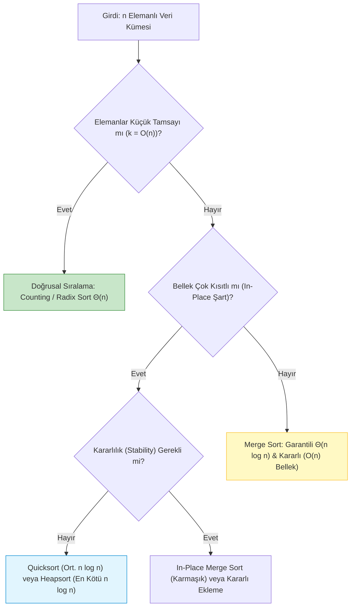

| Algoritma | En İyi Zaman | En Kötü Zaman | Ortalama Zaman | Ek Bellek | Kararlı mı? (Stable) | Tipik Kullanım Alanı |
| :--- | :--- | :--- | :--- | :--- | :--- | :--- |
| **Insertion Sort** | $\Theta(n)$ | $\Theta(n^2)$ | $\Theta(n^2)$ | $\Theta(1)$ | **Evet** | Küçük diziler ($n \le 30$) veya neredeyse sıralı veri |
| **Merge Sort** | $\Theta(n \log n)$ | $\Theta(n \log n)$ | $\Theta(n \log n)$ | $\Theta(n)$ | **Evet** | Dış bellek sıralaması, bağlı listeler, kararlılık şartı |
| **Quicksort** | $\Theta(n \log n)$ | $\Theta(n^2)$ | $\Theta(n \log n)$ | $\Theta(\log n)$ | **Hayır** | Genel amaçlı hızlı sıralama (standart kütüphaneler) |
| **Heapsort** | $\Theta(n \log n)$ | $\Theta(n \log n)$ | $\Theta(n \log n)$ | $\Theta(1)$ | **Hayır** | Katı $O(n \log n)$ ve $O(1)$ bellek garantisi gereken yerler |
| **Counting Sort** | $\Theta(n + k)$ | $\Theta(n + k)$ | $\Theta(n + k)$ | $\Theta(n + k)$ | **Evet** | Dar aralıklı tamsayılar ($k \le O(n)$) |
| **Radix Sort** | $\Theta(d(n+b))$ | $\Theta(d(n+b))$ | $\Theta(d(n+b))$ | $\Theta(n + b)$ | **Evet** | Sabit basamaklı tamsayı/dize anahtarları |

---

### Kapsamlı Çözümlü Özgün Problemler

#### Problem 1 (Yineleme Sınır Durumu Analizi)
Aşağıda verilen iki yineleme bağıntısını çözünüz:
- (A) $T(n) = 3T(n/3) + n \log_3 n$
- (B) $T(n) = 2T(n/4) + \sqrt{n}$

**Çözüm:**
- **(A) İncelemesi:** $a = 3, b = 3 \implies n^{\log_3 3} = n^1$.  
  $f(n) = n \log_3 n$. Burada $f(n)$ ile $n^1$ arasındaki çarpan $\log_3 n$'dir; polinom farkı ($\epsilon > 0$) yoktur.  
  Genişletilmiş Master Teoremi Durum 2 ($k=1$):
  $$f(n) = \Theta(n^{\log_b a} \log^k n) = \Theta(n \log n) \implies T(n) = \Theta(n \log^{k+1} n) = \mathbf{\Theta(n \log^2 n)}$$
- **(B) İncelemesi:** $a = 2, b = 4 \implies n^{\log_4 2} = n^{1/2} = \sqrt{n}$.  
  $f(n) = \sqrt{n}$.  
  $f(n) = \Theta(n^{\log_b a}) = \Theta(\sqrt{n})$ ($k=0$).  
  Standart Master Teoremi Durum 2 geçerlidir:
  $$T(n) = \mathbf{\Theta(\sqrt{n} \log n)}$$

---

#### Problem 2 (Hollanda Ulusal Bayrağı ile 3-Yollu Quicksort)
Dizide çok sayıda tekrar eden anahtar varsa klasik Quicksort $O(n^2)$'ye yavaşlayabilir. Diziyi üçe bölen (pivot'tan küçükler, pivot'a eşitler, pivot'tan büyükler) bir algoritmanın zaman analizini yapınız.

**Çözüm:**  
- Bölme işlemi üç göstericiyle ($low, mid, high$) diziyi tek geçişte ($\Theta(n)$) şu düzene sokar:  
  $A[0 \dots low-1] < pivot$, $A[low \dots high] == pivot$, $A[high+1 \dots n-1] > pivot$.
- Eşit elemanlar doğrudan nihai doğru konumlarına yerleştiğinden özyineleme yalnızca sol ($< pivot$) ve sağ ($> pivot$) parçalara açılır.
- **En Elverişsiz Durum:** Tüm elemanlar birbirine eşitse, $A[low \dots high]$ tüm diziyi kapsar. Sol ve sağ parçaların boyutu 0 olur. Özyineleme açılmaz! Algoritma $\Theta(n)$ zamanda tamamlanır (Klasik Quicksort ise burada $\Theta(n^2)$ yapardı!).
- **Ortalama Durum:** $\Theta(n \log n)$ korunur.

---

### Sık Yapılan Hatalar ve Kavram Yanılgıları
- **Sıralama Seçiminde Yalnızca Asimptotik Karmaşıklığa Bakmak:** $n=15$ için $O(n^2)$ olan Insertion Sort, sabit katsayıları çok düşük olduğu için $O(n \log n)$ olan Merge Sort'tan 2-3 kat daha hızlı koşar.
- **Tüm Doğrusal Sıralamaları In-Place Zannetmek:** Counting Sort ve Radix Sort yardımcı frekans ve çıktı dizileri gerektirir ($O(n)$ ek bellek).

---

### Aktif Hatırlama Soruları

1. $T(n) = 4T(n/2) + n^2 / \log n$ bağıntısına neden Master Teoremi uygulanamaz ve çözümün büyüme mertebesi nedir?
2. Karşılaştırma ağacı modelinde en iyi durum (best-case) alt sınırı neden $\Omega(n \log n)$ olmak zorunda değildir?
3. Bir veri tabanında veriler çoğunlukla zaten sıralı geliyorsa Quicksort yerine hangi algoritma tercih edilmelidir? Neden?
4. Hash tablolarında yük faktörü $\alpha > 1$ iken Ayrı Zincirleme mi yoksa Açık Adresleme mi çalışmaya devam edebilir?

<details>
<summary>Çözüm ve Açıklama</summary>

1. $n^{\log_2 4} = n^2$'dir. $f(n) = n^2 / \log n$ yapraklardan daha yavaştır ancak fark polinomiyal ($n^\epsilon$) değil, logaritmiktir ($1/\log n$). Master Teoremi Durum 1 uygulanamaz. Yineleme ağacı ile çözüldüğünde yaprakların maliyeti baskın çıkar ve $T(n) = \Theta(n^2)$ elde edilir.
2. Karşılaştırma ağacında en iyi durum kökten en erken ulaşılan yaprağın derinliğidir. Örneğin Insertion Sort zaten sıralı bir dizide her elemanı bir öncekiyle yalnızca 1 kez karşılaştırır ($n-1$ karşılaştırma) ve $\Theta(n)$ sürede durur. Alt sınır $\Omega(n \log n)$ yalnızca en kötü ve ortalama durumlar için geçerlidir.
3. Insertion Sort tercih edilmelidir; çünkü neredeyse sıralı dizilerde $\Theta(n)$ doğrusal sürede çalışır. Quicksort ise yanlış pivot seçiminde $\Theta(n^2)$'ye gerileyebilir.
4. Yalnızca Ayrı Zincirleme (Chaining) çalışmaya devam edebilir. Açık adreslemede her hücrede en fazla 1 eleman saklanabildiğinden $n \le m$ ($\alpha \le 1$) olmak zorundadır; $\alpha > 1$ olduğunda açık adresleme tablosu taşar ve yeni eleman kabul edemez.
</details>

---

### Kaynak ve Destek Kartı
- **Konu Eşleşmesi:** İlk 7 haftanın sentezi, karşılaştırmalı karmaşıklık matrisleri ve ileri problem çözümleri.
- **Akademik Arşiv:** [MIT OCW 6.006 Recitation Videos](https://ocw.mit.edu/courses/6-006-introduction-to-algorithms-fall-2011/video_galleries/recitation-videos/) Recitation Exam Review Sessions.
- **İleri Seviye Eşleşme:** [MIT OCW 6.046J Lecture Videos](https://ocw.mit.edu/courses/6-046j-design-and-analysis-of-algorithms-spring-2015/resources/lecture-videos/) Quiz 1 Review.

---
## Hafta 9: Ağaçlar ve Amortize Analiz (Aggregate, Accounting, Potential) (Önerilen Akış — Resmî Olmayan)

### Öğrenme Hedefleri
Bu bölümü tamamladığınızda şunları yapabileceksiniz:
1. İkili Arama Ağaçları (BST) ve dengeli arama ağaçlarının (AVL, Kırmızı-Siyah Ağaçlar) denge mekanizmalarını (dönmeler / rotations) ve $O(\log n)$ yükseklik sınırını açıklayabilmek.
2. Amortize analizin (Amortized Analysis) ortalama durum analizinden farkını ve en kötü durum işlem dizilerindeki mutlak deterministik güvencesini tanımlayabilmek.
3. Amortize analizin 3 temel tekniğini (**Toplam / Aggregate**, **Muhasebe / Accounting**, **Potansiyel / Potential**) matematiksel olarak formüle edip uygulayabilmek.
4. Dinamik dizi (Dynamic Array - Vector) genişletme ($2\times$ büyüme) ve $k$-bit ikili sayaç (binary counter) maliyetlerini potansiyel fonksiyonu $\Phi$ ile ispatlayabilmek.

### Kavram Anlatımı ve Temel Teori

#### 1. İkili Arama Ağaçları ve Dengeleme İhtiyacı
- **BST Özelliği:** Herhangi bir $x$ düğümü için sol alt ağaçtaki tüm anahtarlar $\le x.key$, sağ alt ağaçtaki tüm anahtarlar $\ge x.key$'dir.
- **Kusur:** Sıralı elemanlar eklendiğinde ağaç bağlı listeye dönüşür; yükseklik $h = \Theta(n)$ olur ve arama/ekleme maliyeti $O(n)$'e geriler.
- **Dengeli Ağaçlar (AVL & Red-Black):**
  - **AVL Ağacı:** Her düğümde sol ve sağ alt ağaçların yükseklik farkı (denge faktörü) $\in \{-1, 0, 1\}$ olmalıdır. Denge bozulduğunda tekli (LL, RR) veya çiftli (LR, RL) dönmelerle (rotations) $O(1)$ sürede onarılır. Yükseklik kesin olarak $\le 1.44 \log_2(n+2)$'dir.
  - **Kırmızı-Siyah Ağaç (Red-Black Tree):** Kök ve NIL yapraklar siyah, kırmızı düğümün çocukları siyah, her düğümden yaprağa giden yoldaki siyah düğüm sayısı eşittir. Yükseklik $\le 2 \log_2(n+1)$ ile sınırlandırılır.

#### 2. Amortize Analiz: Ortalama Durumdan Temel Farkı
Amortize analizde **hiçbir olasılık dağılımı veya şans varsayımı yoktur**.
En kötü durumdaki $n$ adetlik bir operasyon dizisi ele alınır. Bazı operasyonlar çok pahalı (örneğin diziyi 2 katına çıkarıp tüm elemanları kopyalamak), çoğu operasyon ise çok ucuzdur ($O(1)$ ekleme).
Amortize analiz, operasyon başına düşen ortalama en kötü durum maliyetini hesaplar.

#### 3. Üç Amortize Analiz Yöntemi
1. **Toplam Yöntemi (Aggregate Method):**  
   $n$ işlemden oluşan dizinin toplam maliyeti $T(n)$ en kötü durumda hesaplanır. İşlem başına amortize maliyet doğrudan bölünür:
   $$\hat{c} = \frac{T(n)}{n}$$
2. **Muhasebe Yöntemi (Accounting Method):**  
   Her işleme bir amortize ücret $\hat{c}_i$ atanır. Eğer gerçek maliyet $c_i < \hat{c}_i$ ise aradaki fark ($\hat{c}_i - c_i$) veri yapısının elemanları üzerinde "kredi" olarak biriktirilir. Pahalı bir işlem geldiğinde ($c_i > \hat{c}_i$), gereken ek ücret birikmiş kredilerden ödenir.
   - *Kritik Şart:* Her an toplam kredi $\ge 0$ olmalıdır: $\sum_{i=1}^n \hat{c}_i \ge \sum_{i=1}^n c_i$.
3. **Potansiyel Yöntemi (Potential Method):**  
   Veri yapısının durumunu $D_i$ reel bir sayıya eşleyen bir **potansiyel fonksiyonu** $\Phi(D)$ tanımlanır ($\Phi$: sistemde depolanan potansiyel enerji).
   $i$. işlemin amortize maliyeti:
   $$\hat{c}_i = c_i + \Phi(D_i) - \Phi(D_{i-1})$$
   $n$ işlem boyunca teleskopik toplam:
   $$\sum_{i=1}^n \hat{c}_i = \sum_{i=1}^n c_i + \Phi(D_n) - \Phi(D_0)$$
   Eğer $\Phi(D_n) \ge \Phi(D_0)$ güvencesi verilirse, toplam amortize maliyet toplam gerçek maliyetin kesin bir üst sınırıdır!

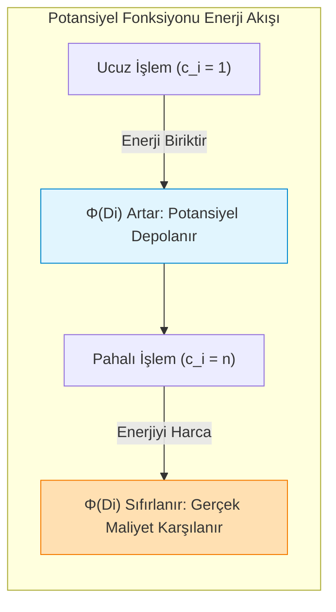

---

### Adım Adım Çözümlü Özgün Örnek

**Problem (Dinamik Dizi Genişlemesi ve Potansiyel İspatı):**  
Bir dinamik dizi başlangıçta boş ve kapasitesi $size = 1$'dir. Dizi dolduğunda kapasite $2$ katına çıkarılır ($size \to 2 \cdot size$) ve eski elemanlar yeni diziye kopyalanır.  
1. $n$ adet ekleme (push_back) işlemi için toplam maliyeti ve operasyon başına amortize maliyeti **Toplam Yöntemi** ile bulunuz.
2. $\Phi(D_i) = 2 \cdot num_i - size_i$ potansiyel fonksiyonunu kullanarak ($num_i$: dizideki eleman sayısı, $size_i$: ayrılan toplam kapasite) her ekleme işleminin amortize maliyetinin en fazla $3$ ($\hat{c}_i \le 3 = O(1)$) olduğunu adım adım ispatlayınız.

**Çözüm:**

**1. Toplam Yöntemi (Aggregate):**
- $i$. eklemede eğer dizi dolmamışsa gerçek maliyet $c_i = 1$'dir.
- Dizi tam $2^k$ boyutuna ulaştığında bir sonraki eklemede kapasite iki katına çıkar ve $2^k$ eleman kopyalanır.
- $n$ ekleme için toplam maliyet:
  $$T(n) = \sum_{i=1}^n c_i = n + \sum_{j=0}^{\lfloor \log_2 n \rfloor} 2^j = n + (2^{\lfloor \log_2 n \rfloor + 1} - 1) < n + 2n = 3n$$
- Amortize maliyet: $\hat{c} = \frac{T(n)}{n} < \frac{3n}{n} = 3 = \mathbf{O(1)}$.

**2. Potansiyel Yöntemi İspatı:**
- Başlangıç durumu $D_0$: $num_0 = 0, size_0 = 0 \implies \Phi(D_0) = 0$.
- Dizi dolduğunda $num_i = size_i$ olur; bu anda $\Phi(D_i) = 2 \cdot size_i - size_i = size_i \ge 0$.
- Her zaman $size_i \le 2 \cdot num_i$ olduğundan $\forall i$ için $\Phi(D_i) \ge 0 = \Phi(D_0)$ garantilidir.

Şimdi iki durumu inceleyelim:
- **Durum A: Kapasite artışı YOK ($num_{i-1} < size_{i-1}$):**
  - Gerçek maliyet: $c_i = 1$.
  - Yeni parametreler: $num_i = num_{i-1} + 1$, $size_i = size_{i-1}$.
  - Potansiyel değişimi:
    $$\Delta \Phi = \Phi(D_i) - \Phi(D_{i-1}) = (2(num_{i-1} + 1) - size_{i-1}) - (2 num_{i-1} - size_{i-1}) = 2$$
  - Amortize Maliyet:
    $$\hat{c}_i = c_i + \Delta \Phi = 1 + 2 = \mathbf{3}$$

- **Durum B: Kapasite artışı VAR ($num_{i-1} = size_{i-1}$):**
  - Gerçek maliyet: $c_i = num_{i-1} + 1$ (kopyalama + yeni eleman ekleme).
  - Yeni parametreler: $num_i = num_{i-1} + 1$, $size_i = 2 \cdot size_{i-1} = 2 \cdot num_{i-1}$.
  - Potansiyel değişimi:
    $$\Phi(D_i) = 2(num_{i-1} + 1) - 2 num_{i-1} = 2$$
    $$\Phi(D_{i-1}) = 2 num_{i-1} - size_{i-1} = 2 num_{i-1} - num_{i-1} = num_{i-1}$$
    $$\Delta \Phi = \Phi(D_i) - \Phi(D_{i-1}) = 2 - num_{i-1}$$
  - Amortize Maliyet:
    $$\hat{c}_i = c_i + \Delta \Phi = (num_{i-1} + 1) + (2 - num_{i-1}) = \mathbf{3}$$

*Sonuç:* Her iki durumda da $\hat{c}_i = 3 = O(1)$ çıkmıştır. Toplam gerçek maliyet hiçbir zaman $3n$'i aşamaz. $\blacksquare$

---

### Sık Yapılan Hatalar ve Kavram Yanılgıları
- **Amortize Maliyeti Ortalama Durum Sanmak:** Ortalama durum analizinde rastgele girdi dağılımı (örneğin uniform distribution) varsayılır. Amortize analizde ise girdi dizisi en kötü niyetli saldırgan tarafından seçilse bile operasyon başına maliyet sabittir.
- **Potansiyel Fonksiyonunun Başlangıç Altına İnmesi:** Eğer herhangi bir adımda $\Phi(D_i) < \Phi(D_0)$ olursa, $\sum \hat{c}_i \ge \sum c_i$ garantisi bozulur ve hesaplanan amortize maliyet gerçek maliyetin alt sınırına dönüşerek geçersiz kalır.
- **Sabit Artış Tuzağı ($size \to size + k$):** Dinamik dizi dolduğunda kapasiteyi 2 katına çıkarmak yerine sabit $k$ (örneğin 100) kadar artırırsak, $n$ işlemde $\approx \frac{n^2}{2k}$ kopyalama yapılır ve amortize maliyet $O(n)$'e çıkar! Çarpımsal büyüme şarttır.

---

### Aktif Hatırlama Soruları

1. AVL ağaçlarında silme (deletion) işlemi yapıldıktan sonra ağacı dengelemek için neden köke kadar birden fazla dönme gerekebilirken, ekleme (insertion) işleminde en fazla iki dönme yeterlidir?
2. Kırmızı-Siyah ağaçlarda "herhangi bir yapraktan köke giden yoldaki siyah düğüm sayısının eşit olması" kuralı ağacın yüksekliğinin $2 \log_2(n+1)$ ile sınırlı kalmasını nasıl garanti eder?
3. $k$-bitlik bir ikili sayacı 0'dan $n$'e kadar 1'er 1'er artırma (increment) işleminde toplam bit ters çevirme (bit-flip) maliyeti ve işlem başına amortize süre nedir?

<details>
<summary>Çözüm ve Açıklama</summary>

1. Ekleme işleminde yapılan tekli/çiftli dönme, ilgili alt ağacın yüksekliğini ekleme öncesindeki eski orijinal yüksekliğine geri döndürür; bu nedenle üst ataların denge faktörü değişmez. Silme işleminde ise dönme yapıldıktan sonra o alt ağacın toplam yüksekliği bir azalmış olabilir; bu kısalma yukarıdaki ataların denge faktörünü bozarak köke kadar $\Theta(\log n)$ sayıda dönmeyi tetikleyebilir.
2. Ağaçtaki en kısa yol yalnızca siyah düğümlerden oluşur (uzunluk: $bh$). En uzun yol ise bir siyah bir kırmızı düğüm şeklinde sıralanabilir (uzunluk: en fazla $2 \cdot bh$); çünkü iki kırmızı düğüm ardışık gelemez. Dolayısıyla en uzun yol hiçbir zaman en kısa yolun 2 katından daha uzun olamaz. Bu kural ağacın dengesinin bozulmasını imkansız kılar.
3. 0. bit her adımda ($n$ kez), 1. bit her 2 adımda bir ($n/2$ kez), $i$. bit her $2^i$ adımda bir ($n/2^i$ kez) ters çevrilir. Toplam bit ters çevirme maliyeti $\sum_{i=0}^{\infty} \frac{n}{2^i} = n \sum (1/2)^i < 2n$'dir. İşlem başına amortize maliyet $\frac{2n}{n} = \mathbf{O(1)}$'dir.
</details>

---

### Kaynak ve Destek Kartı
- **Konu Eşleşmesi:** Kendi kendini dengeleyen ikili ağaçlar (AVL, Red-Black) ve amortize analiz yöntemleri (Aggregate, Accounting, Potential).
- **Akademik Video ve Ders:** [MIT OCW 6.046J Lecture Videos](https://ocw.mit.edu/courses/6-046j-design-and-analysis-of-algorithms-spring-2015/resources/lecture-videos/) — Lecture 5: Amortization and Amortized Analysis.
- **Açık Ders Dizin Referansı:** [MIT OCW 6.006 Recitation Videos](https://ocw.mit.edu/courses/6-006-introduction-to-algorithms-fall-2011/video_galleries/recitation-videos/) — Recitation 6: AVL Trees.

---

## Hafta 10: Grafik Temelleri, BFS/DFS ve Bağlılık (Önerilen Akış — Resmî Olmayan)

### Öğrenme Hedefleri
Bu bölümü tamamladığınızda şunları yapabileceksiniz:
1. Çizge gösterimlerini (**Komşuluk Matrisi** vs **Komşuluk Listesi**) uzay karmaşıklığı ve temel sorgu süreleri açısından karşılaştırabilmek.
2. Genişlik Öncelikli Arama (**BFS - Breadth-First Search**) algoritmasını kuyruk (FIFO queue) yardımıyla yürütüp ağırlıksız çizgelerde en kısa yol özelliğini $\Theta(V + E)$ sürede kanıtlayabilmek.
3. Derinlik Öncelikli Arama (**DFS - Depth-First Search**) algoritmasında tepe zaman damgalarını (keşif $d[u]$, bitiş $f[u]$) hesaplayarak **Parantez Teoremini** uygulayabilmek.
4. Yönlü çizgilerde kenarları (Ağaç, Geri, İleri, Çapraz) sınıflandırıp döngü tespiti ve Yönlü Döngüsüz Çizgelerde (DAG) **Topolojik Sıralama (Topological Sort)** yapabilmek.

### Kavram Anlatımı ve Temel Teori

#### 1. Çizge Gösterim Biçimleri
- **Komşuluk Matrisi ($A$):** $|V| \times |V|$ boyutlu matris. $A[u][v] = 1$ ise kenar vardır.
  - Bellek: $\Theta(V^2)$. İki düğüm arası kenar sorgusu: $\Theta(1)$. Bir düğümün tüm komşularını bulma: $\Theta(V)$. Yoğun (dense, $|E| \approx |V|^2$) çizgeler için uygundur.
- **Komşuluk Listesi ($Adj$):** Her düğüm için komşularını tutan bir bağlı liste veya dinamik dizi.
  - Bellek: $\Theta(V + E)$. Kenar sorgusu: $O(\deg(u))$. Tüm komşuları gezme: $\Theta(\deg(u))$. Seyrek (sparse, $|E| \ll |V|^2$) çizgeler için standart tercihtir.

#### 2. Genişlik Öncelikli Arama (BFS)
- Başlangıç düğümünden itibaren katman katman (dalga cephesi gibi) ilerler.
- **Veri Yapısı:** FIFO Kuyruk (Queue). Düğümler renklendirilir: Beyaz (keşfedilmemiş), Gri (kuyrukta, işleniyor), Siyah (tüm komşuları gezilmiş).
- **Zaman Karmaşıklığı:** Her düğüm kuyruğa tam 1 kez girer ve çıkar ($O(V)$). Her düğümün komşuluk listesi 1 kez taranır ($O(E)$). Toplam: $\Theta(V + E)$.
- **En Kısa Yol Özelliği:** BFS, ağırlıksız çizgelerde başlangıç düğümünden diğer tüm erişilebilir düğümlere giden **en az kenarlı en kısa yolu (shortest path distance)** bulmayı garanti eder.

#### 3. Derinlik Öncelikli Arama (DFS) ve Kenar Sınıflandırması
- Bir koldan gidebildiği kadar derine iner, çıkmaz sokağa girdiğinde geri izleme (backtrack) yapar.
- **Zaman Damgaları:** Her $u$ düğümü için keşif zamanı $d[u]$ ve çıkış/bitiş zamanı $f[u]$ tutulur ($1 \le d[u] < f[u] \le 2|V|$).
- **Parantez Teoremi:** Herhangi iki $u$ ve $v$ için $[d[u], f[u]]$ ve $[d[v], f[v]]$ aralıkları ya tamamen ayrıktır (biri diğerinin soyundan gelmez) ya da biri diğerini tamamen kapsar (biri diğerinin atasıdır).
- **Kenar Tipleri (Yönlü Çizgeler):**
  1. **Ağaç Kenarı (Tree Edge):** İlk kez beyaz bir düğüme giden kenar (DFS ormanını oluşturur).
  2. **Geri Kenar (Back Edge):** Bir ataya (gri düğüme) giden kenar. **Bir çizgede geri kenar varsa kesinlikle döngü (cycle) vardır!**
  3. **İleri Kenar (Forward Edge):** Ağaçta toruna giden ağaç dışı kenar.
  4. **Çapraz Kenar (Cross Edge):** Ata-torun ilişkisi olmayan düğümler arası kenar.

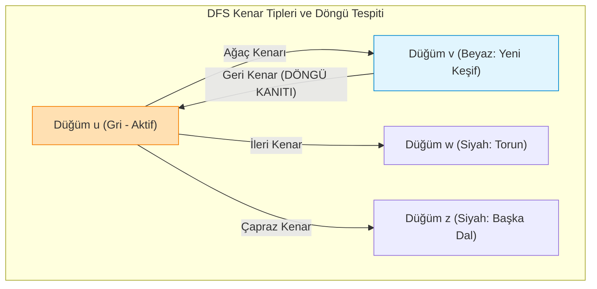

#### 4. Topolojik Sıralama (Topological Sort)
Bir Yönlü Döngüsüz Çizgede (DAG - Directed Acyclic Graph) tüm $(u, v)$ kenarları için $u$'nun $v$'den önce geldiği doğrusal sıralamadır (iş akışları, ders önkoşulları).
- **Algoritma:** Çizge üzerinde DFS koşturulur. Düğümler **bitiş zamanlarının azalan sırasına ($f[u]$)** göre dizilir. Zaman: $\Theta(V + E)$.

---

### Adım Adım Çözümlü Özgün Örnek

**Problem:**  
Aşağıdaki yönlü çizge veriliyor:  
Düğümler: $V = \{A, B, C, D, E, F\}$  
Kenarlar: $E = \{(A, B), (A, C), (B, D), (C, D), (D, E), (F, C), (F, E)\}$  
1. Alfabetik komşuluk önceliğiyle $A$ düğümünden başlayarak DFS koşturunuz; her düğümün $d[u]$ (keşif) ve $f[u]$ (bitiş) zaman damgalarını çıkarınız (erişilemeyen düğüm kalırsa alfabetik sıradaki ilk beyaz düğümden devam ediniz).
2. Tüm kenarları (Ağaç, Geri, İleri, Çapraz) sınıflandırınız. Çizgede döngü var mıdır?
3. Bu çizgenin Topolojik Sıralamasını elde ediniz.

**Çözüm:**

**1. DFS Yürütme İzi (Sayaç $time = 1$'den başlar):**
- $time=1: A$ keşfedildi $\to d[A] = 1$. Komşular: $B, C$. Alfabetik olarak $B$'ye git.
- $time=2: B$ keşfedildi $\to d[B] = 2$. Komşu: $D$. $D$'ye git.
- $time=3: D$ keşfedildi $\to d[D] = 3$. Komşu: $E$. $E$'ye git.
- $time=4: E$ keşfedildi $\to d[E] = 4$. $E$'nin dışarı giden kenarı yok.
- $time=5: E$ bitti $\to f[E] = 5$. $D$'ye geri dön.
- $time=6: D$'nin başka komşusu yok, bitti $\to f[D] = 6$. $B$'ye geri dön.
- $time=7: B$ bitti $\to f[B] = 7$. $A$'ya geri dön.
- $time=8: A$'nın diğer komşusu $C$ beyaz! $C$'ye git $\to d[C] = 8$. Komşu: $D$.
  - $(C, D)$ kenarı incelenir: $D$ siyah ve $d[C] > d[D]$ $\to$ Çapraz kenar.
- $time=9: C$ bitti $\to f[C] = 9$. $A$'ya geri dön.
- $time=10: A$ bitti $\to f[A] = 10$.
- Kalan beyaz düğüm: $F$.
- $time=11: F$ keşfedildi $\to d[F] = 11$. Komşular: $C, E$.
  - $(F, C)$ kenarı incelenir: $C$ siyah $\to$ Çapraz kenar.
  - $(F, E)$ kenarı incelenir: $E$ siyah $\to$ Çapraz kenar.
- $time=12: F$ bitti $\to f[F] = 12$.

*Zaman Damgaları Tablosu:*
- $A: [1, 10]$
- $B: [2, 7]$
- $C: [8, 9]$
- $D: [3, 6]$
- $E: [4, 5]$
- $F: [11, 12]$

**2. Kenar Sınıflandırması:**
- $(A, B)$: Ağaç Kenarı (Tree Edge)
- $(B, D)$: Ağaç Kenarı (Tree Edge)
- $(D, E)$: Ağaç Kenarı (Tree Edge)
- $(A, C)$: Ağaç Kenarı (Tree Edge)
- $(C, D)$: Çapraz Kenar (Cross Edge)
- $(F, C)$: Çapraz Kenar (Cross Edge)
- $(F, E)$: Çapraz Kenar (Cross Edge)  
*Döngü Analizi:* Hiçbir Geri Kenar (Back Edge) bulunmadığı için çizge bir **DAG**'dır; döngü yoktur.

**3. Topolojik Sıralama:**
Düğümleri azalan bitiş zamanına ($f[u]$) göre sıralayalım:
$$F (12) \to A (10) \to C (9) \to B (7) \to D (6) \to E (5)$$
*Sıralama Çıktısı:* **$[F, A, C, B, D, E]$** (veya eşdeğer geçerli bir DAG dizilimi: $[A, F, B, C, D, E]$). Tüm kenarlar soldan sağa doğrudur.

---

### Sık Yapılan Hatalar ve Kavram Yanılgıları
- **BFS Zaman Karmaşıklığına $O(E)$ Demek:** Çizgede hiç kenar olmasa dahi ($E=0$) tüm düğümlerin kuyruğa alınıp taranması $O(V)$ sürer. Bu nedenle karmaşıklık kesinlikle $\Theta(V + E)$'dir.
- **Yönsüz Çizgelerde İleri/Çapraz Kenar Aramak:** Yönsüz çizgelerde yapılan DFS'te yalnızca **Ağaç Kenarları** ve **Geri Kenarlar** ortaya çıkar; ileri ve çapraz kenarlar oluşamaz.
- **Döngülü Çizgide Topolojik Sıralama Denemek:** Çizgede döngü varsa topolojik sıralama matematiksel olarak imkansızdır; algoritma döngü tespit ettiği anda hata vermelidir.

---

### Aktif Hatırlama Soruları

1. BFS algoritması ağırlıklı çizgelerde (örneğin kenar ağırlıkları 2, 5, 8 olan bir çizgede) en kısa yolu neden bulamaz?
2. Bir yönlü çizgede DFS koştururken karşılaşılan bir $(u, v)$ kenarının "Geri Kenar" (Back Edge) olduğunu $v$ düğümünün renginden ve zaman damgasından nasıl anlarsınız?
3. Kosaraju algoritması Kuvvetli Bağlı Bileşenleri (SCC) bulmak için neden çizgenin devriğini ($G^T$) kullanır?

<details>
<summary>Çözüm ve Açıklama</summary>

1. BFS kuyruğu katman katman açar ve her kenarın maliyetini eşit (1 birim) sayar. 3 kenarlı ama toplam ağırlığı 3 olan bir yol varken, BFS tek kenarlı ama ağırlığı 10 olan bir yolu daha önce ziyaret edip en kısa yol ilan edebilir. Ağırlıklı çizgeler için Dijkstra gereklidir.
2. Kenar incelendiğinde hedef $v$ düğümünün rengi **Gri** ise (yani keşfedilmiş ancak bitişi henüz verilmemiş, yığıtta bekleyen bir ata ise) o kenar kesinlikle bir Geri Kenardır ($d[v] < d[u] < f[u] < f[v]$). Bu durum bir döngünün kesin kanıtıdır.
3. Çizgenin devriğinde ($G^T$) kenarlar ters çevrilir. Bir SCC içindeki düğümler birbirine çift yönlü bağlı olduğundan yönlerin ters çevrilmesi bileşen içi bağlılığı bozmaz; ancak farklı bileşenler arasındaki geçişleri tersine çevirerek DFS'in bir bileşenden diğerine kontrolsüz taşmasını engeller.
</details>

---

### Kaynak ve Destek Kartı
- **Konu Eşleşmesi:** Çizge gösterimleri, BFS, DFS zaman damgaları, kenar türleri ve topolojik sıralama.
- **Akademik Video ve Ders:** [MIT OCW 6.006 Recitation Videos](https://ocw.mit.edu/courses/6-006-introduction-to-algorithms-fall-2011/video_galleries/recitation-videos/) — Recitation 13: Breadth-First Search and Recitation 14: Depth-First Search.
- **Açık Ders Dizin Referansı:** [MIT OCW 6.046J Lecture Videos](https://ocw.mit.edu/courses/6-046j-design-and-analysis-of-algorithms-spring-2015/resources/lecture-videos/) — Graph Traversals & DAGs.

---

## Hafta 11: En Kısa Yollar ve Minimum Kapsayan Ağaçlar (Önerilen Akış — Resmî Olmayan)

### Öğrenme Hedefleri
Bu bölümü tamamladığınızda şunları yapabileceksiniz:
1. Tek kaynaklı en kısa yol (SSSP) probleminde kenar gevşetme (**Relaxation**) işlemini ve optimal alt yapı (optimal substructure) prensibini formüle edebilmek.
2. **Kritik Doğruluk Kuralı:** Dijkstra algoritmasının çalışma ilkelerini ve **negatif ağırlıklı kenarlar içeren çizgelerde neden kesinlikle çalışmadığını / hatalı sonuç ürettiğini** karşıt örnekle kanıtlayabilmek.
3. Öncelik kuyruğu (Binary Heap vs Fibonacci Heap) mimarileri altında Dijkstra algoritmasının karmaşıklığını ($O((V+E)\log V)$ vs $O(E + V \log V)$) analiz edebilmek.
4. Minimum Kapsayan Ağaç (MST) tanımını, **Kesim Özelliğini (Cut Property)** kavrayıp Kruskal (Ayrık Kümeler / DSU) ve Prim algoritmalarını karşılaştırabilmek.

### Kavram Anlatımı ve Temel Teori

#### 1. Kenar Gevşetme (Relaxation) Prensibi
$d[v]$, başlangıç düğümü $s$'den $v$'ye kadar şu ana kadar bulunan en kısa yolun üst sınırıdır. $(u, v)$ kenarı gevşetildiğinde:
```text
RELAX(u, v, w):
    if d[u] + w(u, v) < d[v]:
        d[v] = d[u] + w(u, v)
        pi[v] = u
```

#### 2. Dijkstra Algoritması ve Negatif Kenar Kısıtı
- **Açgözlü Strateji:** Her adımda henüz işlenmemiş düğümler arasından $d[u]$ mesafesi en küçük olan düğümü bir öncelik kuyruğundan (Min-Heap) çeker ve komşularını gevşetir.
- **Kritik Doğruluk Kanıtı:** Dijkstra algoritması bir $u$ düğümünü kuyruktan çektiği anda $d[u] = \delta(s, u)$ olduğunu, yani o düğümün en kısa yolunun kalıcılaştığını varsayar. Bu varsayım **yalnızca tüm kenar ağırlıkları negatif olmadığında ($w(e) \ge 0$) geçerlidir**.
- **Negatif Kenarlarda Neden Çöker?**  
  Eğer negatif ağırlıklı kenar varsa, daha önce kuyruktan çekilip en kısa yolu "kesinleşti" sanılan bir düğüme, ileride ziyaret edilecek başka bir koldan negatif kenar üzerinden daha küçük bir maliyetle dönülebilir. Dijkstra geriye dönüp finalized düğümleri yeniden kuyruğa almadığı için hatalı mesafe üretir.
- **Çözüm:** Negatif kenarlar varsa **Bellman-Ford** algoritması ($O(V \cdot E)$) veya negatif döngü yoksa Johnson algoritması kullanılmalıdır.

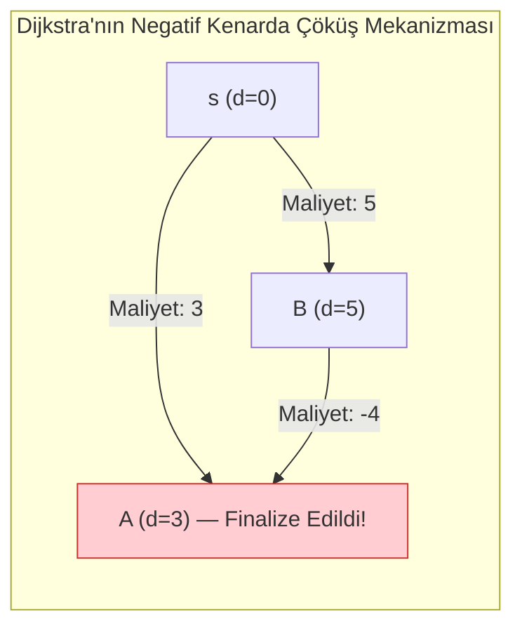
*Yukarıdaki şemada:* Dijkstra önce $A$'yı çeker ($d[A]=3$) ve sabitler. Ardından $B$'yi çeker ($d[B]=5$). $B \to A$ kenarı maliyeti $5 + (-4) = 1$'e düşürmesine rağmen $A$ finalize edildiğinden Dijkstra bu yolu kaçırır!

#### 3. Minimum Kapsayan Ağaç (MST) ve Kesim Özelliği (Cut Property)
- **MST Tanımı:** Bağlı, ağırlıklı ve yönsüz bir $G=(V, E)$ çizgesinde tüm düğümleri birbirine bağlayan, döngü içermeyen ve toplam kenar ağırlığı $\sum_{e \in T} w(e)$ en küçük olan ağaçtır. Ağaçta tam $|V|-1$ kenar bulunur.
- **Kesim Özelliği (Cut Property):** Çizgenin düğümlerini $(S, V \setminus S)$ şeklinde iki kümeye ayıran herhangi bir kesimi (cut) kesen kenarlar (crossing edges) arasında ağırlığı en küçük olan hafif kenar (light edge) **kesinlikle en az bir Minimum Kapsayan Ağacın elemanıdır**.

#### 4. Kruskal vs Prim Algoritmaları
- **Kruskal Algoritması:**
  - Kenarları ağırlıklarına göre küçükten büyüğe sıralar: $O(E \log E) = O(E \log V)$.
  - Sırayla kenarları inceler; iki uç nokta aynı bağlı bileşende değilse ağaca ekler.
  - Bileşen takibi için **Ayrık Kümeler (Disjoint Set Union - DSU)** kullanılır (Union by Rank + Path Compression ile işlem başına neredeyse sabit süre $\alpha(V)$).
  - Toplam Zaman: $\Theta(E \log V)$.
- **Prim Algoritması:**
  - Kök bir düğümden başlar, ağacı dışarıya bağlayan en hafif kenarı seçerek büyütür (Dijkstra'ya çok benzer).
  - İkili yığınla (Binary Heap): $O(E \log V)$. Fibonacci yığınıyla: $O(E + V \log V)$.

---

### Adım Adım Çözümlü Özgün Örnek

**Problem:**  
Aşağıdaki yönsüz, ağırlıklı çizge veriliyor:  
Düğümler: $\{A, B, C, D, E\}$  
Kenarlar ve Ağırlıklar:  
$(A, B): 4, \quad (A, C): 2, \quad (B, C): 1, \quad (B, D): 5$  
$(C, D): 8, \quad (C, E): 10, \quad (D, E): 2, \quad (D, Z): \text{yok}$  
1. **Kruskal Algoritması** adımlarını, her adımda seçilen/reddedilen kenarları ve DSU küme durumlarını göstererek MST'yi bulunuz. Toplam MST maliyetini hesaplayınız.
2. $A$ düğümü başlangıç olmak üzere **Dijkstra Algoritması** ile tüm düğümlere olan en kısa yolları adım adım çıkarınız.

**Çözüm:**

**1. Kruskal Algoritması Yürütmesi:**
- Adım 0: Kenarları ağırlıklarına göre sıralayalım:
  1. $(B, C) - 1$
  2. $(A, C) - 2$
  3. $(D, E) - 2$
  4. $(A, B) - 4$
  5. $(B, D) - 5$
  6. $(C, D) - 8$
  7. $(C, E) - 10$
- Başlangıç Kümeleri: $\{A\}, \{B\}, \{C\}, \{D\}, \{E\}$. $|V|-1 = 4$ kenar seçilmelidir.
- **İnceleme 1: $(B, C) - 1$:** $B$ ve $C$ farklı kümelerde $\to$ **SEÇİLDİ**.  
  Kümeler: $\{A\}, \{B, C\}, \{D\}, \{E\}$.
- **İnceleme 2: $(A, C) - 2$:** $A$ ve $C$ farklı kümelerde $\to$ **SEÇİLDİ**.  
  Kümeler: $\{A, B, C\}, \{D\}, \{E\}$.
- **İnceleme 3: $(D, E) - 2$:** $D$ ve $E$ farklı kümelerde $\to$ **SEÇİLDİ**.  
  Kümeler: $\{A, B, C\}, \{D, E\}$.
- **İnceleme 4: $(A, B) - 4$:** $A$ ve $B$ aynı kümede ($\{A, B, C\}$)! Döngü oluşturur $\to$ **REDDEDİLDİ**.
- **İnceleme 5: $(B, D) - 5$:** $B$ ($\{A, B, C\}$) ile $D$ ($\{D, E\}$) farklı kümelerde $\to$ **SEÇİLDİ**.  
  Kümeler: $\{A, B, C, D, E\}$.  
- 4 kenar seçildi, algoritma durdu.
- **Nihai MST Kenarları:** $\{(B, C), (A, C), (D, E), (B, D)\}$.  
- **Toplam MST Ağırlığı:** $1 + 2 + 2 + 5 = \mathbf{10}$.

**2. Dijkstra Algoritması Yürütmesi ($s = A$):**
- Başlangıç: $d[A] = 0; \quad d[B] = \infty, d[C] = \infty, d[D] = \infty, d[E] = \infty$.
- İterasyon 1: Kuyruktan en küçük $A$ çekildi ($d[A]=0$). Finalize edildi.  
  - $C$ gevşet: $0 + 2 < \infty \implies d[C] = 2, \pi[C] = A$.  
  - $B$ gevşet: $0 + 4 < \infty \implies d[B] = 4, \pi[B] = A$.
- İterasyon 2: En küçük $C$ çekildi ($d[C]=2$). Finalize edildi.  
  - $B$ gevşet: $d[C] + w(C, B) = 2 + 1 = 3 < d[B] (4) \implies d[B] = 3, \pi[B] = C$.  
  - $D$ gevşet: $2 + 8 = 10 \implies d[D] = 10, \pi[D] = C$.  
  - $E$ gevşet: $2 + 10 = 12 \implies d[E] = 12, \pi[E] = C$.
- İterasyon 3: En küçük $B$ çekildi ($d[B]=3$). Finalize edildi.  
  - $D$ gevşet: $d[B] + w(B, D) = 3 + 5 = 8 < d[D] (10) \implies d[D] = 8, \pi[D] = B$.
- İterasyon 4: En küçük $D$ çekildi ($d[D]=8$). Finalize edildi.  
  - $E$ gevşet: $d[D] + w(D, E) = 8 + 2 = 10 < d[E] (12) \implies d[E] = 10, \pi[E] = D$.
- İterasyon 5: En küçük $E$ çekildi ($d[E]=10$). Finalize edildi.  
*Nihai En Kısa Mesafeler:* $A: 0, \quad B: 3, \quad C: 2, \quad D: 8, \quad E: 10$.

---

### Sık Yapılan Hatalar ve Kavram Yanılgıları
- **Negatif Kenarlı Çizgelerde Dijkstra Koşturmak:** Sınavlarda ve mülakatlarda en sık yapılan hatadır. Negatif kenar varsa yanıt Dijkstra değil, Bellman-Ford'dur.
- **MST ile En Kısa Yol Ağacını (SPT) Birbirine Karıştırmak:** MST tüm kenarların toplam ağırlığını minimize eder; ancak iki düğüm arasındaki en kısa yolu vermeyebilir. SPT ise kökten her bir düğüme olan mesafeyi tek tek minimize eder.
- **Tüm Kenar Ağırlıklarına Sabit $k$ Ekleyip Negatifliği Yok Etmeye Çalışmak:** Çizgedeki tüm kenarlara örneğin $+10$ ekleyerek negatifliği gidermeye çalışmak hatalıdır; çünkü 5 kenarlı bir yol ile 2 kenarlı bir yol aynı oranda ötelenmez (biri $+50$, diğeri $+20$ artar) ve en kısa yolun kimliği tamamen değişir!

---

### Aktif Hatırlama Soruları

1. Negatif kenar ağırlığına sahip ancak hiçbir negatif döngü (negative cycle) içermeyen bir çizgede Dijkstra algoritmasının neden güvenilmez olduğunu tek bir cümleyle özetleyiniz.
2. Kruskal algoritmasında kenarları sıralamak yerine bir Min-Heap kullansaydık en iyi durumda algoritmanın hızı nasıl etkilenirdi?
3. Bir çizgedeki tüm kenar ağırlıkları birbirinden kesinlikle farklıysa (distinct weights), bu çizgenin Minimum Kapsayan Ağacı benzersiz (unique) olmak zorunda mıdır? Neden?

<details>
<summary>Çözüm ve Açıklama</summary>

1. Dijkstra bir düğümü öncelik kuyruğundan çıkardığı anda o düğüme giden mesafeyi kesinleşmiş (optimal) kabul eder ve geriye dönüp güncelleyemez; negatif kenarlar ise sonradan daha ucuz alternatif rotalar açarak bu varsayımı yıkar.
2. Eğer Min-Heap kullanılırsa kenarların tamamını baştan sıralamak ($O(E \log E)$) gerekmez. Özellikle yoğun çizgelerde ilk incelenen $|V|-1$ kenar döngü oluşturmadan MST'yi kurarsa, algoritma yalnızca $O(E + V \log E)$ sürede tamamlanabilir.
3. Evet, kesinlikle benzersizdir (unique). Kesim Özelliği (Cut Property) gereğince, her kesimi geçen tek bir kesin minimum hafif kenar bulunur; bu kenar istisnasız tüm MST'lerde yer almak zorunda olduğundan alternatif bir ağaç türetilemez.
</details>

---

### Kaynak ve Destek Kartı
- **Konu Eşleşmesi:** En kısa yol algoritmaları (Dijkstra, gevşetme) ve Minimum Kapsayan Ağaçlar (MST, Kruskal, Prim).
- **Akademik Video ve Ders:** [MIT OCW 6.006 Recitation Videos](https://ocw.mit.edu/courses/6-006-introduction-to-algorithms-fall-2011/video_galleries/recitation-videos/) — Recitation 15: Shortest Paths.
- **MST İleri Dersi:** [MIT OCW 6.046J Lecture Videos](https://ocw.mit.edu/courses/6-046j-design-and-analysis-of-algorithms-spring-2015/resources/lecture-videos/) — Minimum Spanning Trees (Kruskal and Prim analysis).

---

## Hafta 12: Açgözlü Algoritmalar ve Değiş Tokuş Argümanı (Önerilen Akış — Resmî Olmayan)

### Öğrenme Hedefleri
Bu bölümü tamamladığınızda şunları yapabileceksiniz:
1. Bir problemin açgözlü yöntemle çözülebilmesi için gereken iki temel şartı (**Açgözlü Seçim Özelliği** ve **Optimal Alt Yapı**) tanımlayabilmek.
2. Bir açgözlü algoritmanın optimalitesini **Değiş Tokuş Argümanı (Exchange Argument)** yöntemiyle formel olarak ispatlayabilmek.
3. Klasik açgözlü problemleri (Etkinlik Seçimi / Activity Selection, Kesirli Sırt Çantası / Fractional Knapsack, Huffman Kodlaması) tasarlayıp analiz edebilmek.
4. Açgözlü seçimin çöktüğü senaryoları (0/1 Sırt Çantası, Genel Para Üstü) karşıt örneklerle kanıtlayabilmek.

### Kavram Anlatımı ve Temel Teori

#### 1. Açgözlü (Greedy) Tasarım Paradigması
Açgözlü bir algoritma, her adımda o an için en iyi görünen, en karlı (yerel optimal) seçimi yapar. Gelecekteki adımları hesaba katmaz ve yaptığı seçimden asla geri dönmez (backtracking yapmaz).
Bir problemin açgözlü yaklaşımla çözülebilmesi için iki koşul şarttır:
1. **Açgözlü Seçim Özelliği (Greedy Choice Property):** Global optimal çözüme yerel açgözlü seçimler yapılarak ulaşılabilir.
2. **Optimal Alt Yapı (Optimal Substructure):** Ana problemin optimal çözümü, açgözlü seçim yapıldıktan sonra geriye kalan alt problemin de optimal çözümünü içerir.

#### 2. Doğruluk İspatı: Değiş Tokuş Argümanı (Exchange Argument)
Açgözlü algoritmaların doğruluğunu kanıtlamada en güçlü araçtır. Adımları şöyledir:
1. Algoritmamızın ürettiği çözüme $A$, varsayımsal bir optimal çözüme $O$ diyelim.
2. Eğer $A = O$ ise algoritmamız zaten optimaldir.
3. Eğer $A \ne O$ ise, $A$ ile $O$'nun farklılaştığı ilk seçimi tespit et ($A$'da $g$ seçilmişken, $O$'da $x$ seçilmiş olsun).
4. $O$ çözümündeki $x$ elemanını çıkarıp yerine açgözlü seçim olan $g$'yi koyarak yeni bir $O'$ çözümü oluştur.
5. $O'$ çözümünün geçerli olduğunu ve kalitesinin $O$'dan daha kötü olmadığını kanıtla ($f(O') \ge f(O)$).
6. Matematiksel tümevarımla bu takas adımını tekrarlayarak optimalitesi bozulmadan $O$'nun adım adım $A$'ya dönüştürülebileceğini göster. Dolayısıyla $A$ da optimal olmak zorundadır! $\blacksquare$

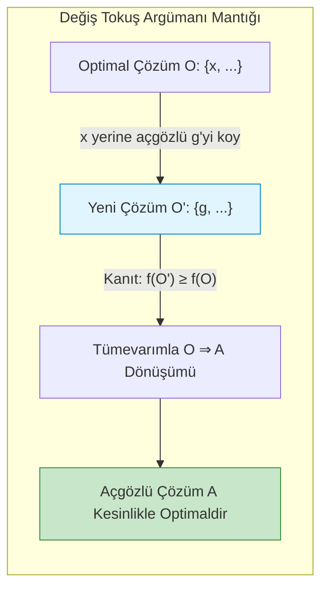

#### 3. Klasik Problemler
- **Etkinlik Seçimi (Activity Selection):** Çakışmayan maksimum sayıda etkinliği seçme problemi.
  - *Doğru Açgözlü Kriter:* **Bitiş zamanı en erken olan ($f_i$)** etkinliği seç. Kalan aralıkta çakışmayanlar arasından tekrar en erken biteni seç. Sıralama $\Theta(n \log n)$, seçim $\Theta(n)$.
  - *Hatalı Kriterler:* Başlama zamanı en erken olanı seçmek veya süresi ($f_i - s_i$) en kısa olanı seçmek suboptimaldir!
- **Kesirli Sırt Çantası (Fractional Knapsack):** Eşyaların kesilip parçalanabildiği sırt çantası.
  - *Kriter:* Birim değer oranına ($v_i / w_i$) göre sırala, oranı en yüksek olandan çantayı doldur. $\Theta(n \log n)$ zamanda optimaldir.
  - *0/1 Knapsack Uyarısı:* Eşyalar bölünemiyorsa (0/1) açgözlü oran yaklaşımı çöker! Bu durumda Dinamik Programlama şarttır.
- **Huffman Kodlaması:** Karakterlerin kullanım sıklığına göre değişken uzunluklu, önek-serbest (prefix-free) en optimal ikili ağacı kurar. En küçük frekansa sahip iki düğüm birleştirilerek Min-Heap ile $\Theta(n \log n)$ sürede inşa edilir.

---

### Adım Adım Çözümlü Özgün Örnek

**Problem 1 (Etkinlik Seçimi ve Değiş Tokuş İspatı):**  
Aşağıda başlama ($s_i$) ve bitiş ($f_i$) zamanları verilen 6 etkinlik bulunuyor:  
$E_1: [1, 4], \quad E_2: [3, 5], \quad E_3: [0, 6], \quad E_4: [5, 7], \quad E_5: [3, 9], \quad E_6: [5, 9]$  
1. Açgözlü algoritmayı çalıştırarak seçilen etkinlikleri adım adım bulunuz.
2. Bu algoritmanın optimal olduğunu Değiş Tokuş Argümanı ile gösteriniz.

**Çözüm:**

**1. Algoritma Adımları:**
Etkinlikleri bitiş zamanlarına ($f_i$) göre sıralayalım:
1. $E_1: [1, 4]$ ($f_1 = 4$)
2. $E_2: [3, 5]$ ($f_2 = 5$)
3. $E_3: [0, 6]$ ($f_3 = 6$)
4. $E_4: [5, 7]$ ($f_4 = 7$)
5. $E_5: [3, 9]$ ($f_5 = 9$)
6. $E_6: [5, 9]$ ($f_6 = 9$)

- İlk seçim: Bitiş zamanı en erken olan $E_1 [1, 4]$ seçilir. Son bitiş = $4$.
- $E_2 [3, 5]$: Başlama zamanı $3 < 4$ (çakışır, atla).
- $E_3 [0, 6]$: Başlama zamanı $0 < 4$ (çakışır, atla).
- $E_4 [5, 7]$: Başlama zamanı $5 \ge 4$ $\to$ **SEÇİLDİ**. Son bitiş = $7$.
- $E_5 [3, 9]$: Başlama zamanı $3 < 7$ (çakışır, atla).
- $E_6 [5, 9]$: Başlama zamanı $5 < 7$ (çakışır, atla).  
*Seçilen Etkinlikler:* $\{E_1, E_4\}$ (Toplam **2** etkinlik).

**2. Değiş Tokuş İspatı:**
- $A = \{a_1, a_2, \dots, a_k\}$ algoritmamızın seçtiği etkinlikler olsun ($f(a_1) \le f(a_2) \dots$).
- $O = \{o_1, o_2, \dots, o_m\}$ herhangi bir optimal çözüm olsun ($f(o_1) \le f(o_2) \dots$).
- Eğer $a_1 = o_1$ ise ilk seçim ortaktır.
- Eğer $a_1 \ne o_1$ ise: Algoritmamız tüm etkinlikler arasında bitiş zamanı en erken olanı seçtiğinden:
  $$f(a_1) \le f(o_1)$$
- $O$ çözümünden $o_1$'i çıkarıp yerine $a_1$'i koyarak $O' = (O \setminus \{o_1\}) \cup \{a_1\}$ kümesini oluşturalım.
- $O$'daki diğer etkinlikler $o_2, \dots, o_m$ birbirleriyle çakışmaz ve hepsi $f(o_1)$'den sonra başlar ($s(o_2) \ge f(o_1)$).
- $f(a_1) \le f(o_1)$ olduğundan, $s(o_2) \ge f(a_1)$ de kesinlikle sağlanır! Dolayısıyla $a_1$, $o_2$ ile çakışamaz.
- $O'$ geçerli bir çözümdür ve eleman sayısı $|O'| = |O| = m$'dir; yani optimalitesini korumuştur.
- Tümevarımla tüm elemanlar $A$'nın elemanlarıyla takas edilebilir. Dolayısıyla $|A| = |O|$ olmak zorundadır; açgözlü çözüm optimaldir. $\blacksquare$

---

### Sık Yapılan Hatalar ve Kavram Yanılgıları
- **0/1 Knapsack'ta Değer/Ağırlık Oranını Kullanmak:**  
  *Karşıt Örnek:* Çanta kapasitesi $W=50$. Eşya 1: $(v=60, w=10, v/w=6)$, Eşya 2: $(v=100, w=20, v/w=5)$, Eşya 3: $(v=120, w=30, v/w=4)$.  
  Açgözlü oran önce Eşya 1'i ($w=10$), sonra Eşya 2'yi ($w=20$) alır. Kalan kapasite 20'dir; Eşya 3 sığmaz. Toplam değer: $60+100 = \mathbf{160}$.  
  Oysa Eşya 2 ve Eşya 3 alınsaydı ağırlık $20+30=50$, toplam değer **$220$** olurdu! Açgözlülük çöker.
- **Etkinlik Seçiminde Süreye Göre Sıralamak:**  
  $[0, 10]$ aralığında bir uzun etkinlik, $[4, 6]$ aralığında bir kısa etkinlik olsun. Süresi en kısa olan $[4, 6]$ seçilirse tek etkinlik yapılır; oysa $[0, 4]$ ve $[6, 10]$ varsa iki etkinlik yapılabilirdi.

---

### Aktif Hatırlama Soruları

1. Bir problemin Dinamik Programlama yerine Açgözlü Yöntemle çözülebilmesini sağlayan ayırt edici teorik özellik nedir?
2. Huffman kodlamasında oluşturulan ikili kodların "önek-serbest" (prefix-free) olmasının getirdiği kod çözme (decoding) avantajı nedir?
3. Türkiye'deki madeni para sistemi ($1, 5, 10, 25, 50$ Kuruş, $1$ TL) açgözlü para üstü verme algoritmasında daima en az sayıda madeni para verirken, $\{1, 6, 10\}$ para sisteminde açgözlü algoritma neden çöker?

<details>
<summary>Çözüm ve Açıklama</summary>

1. "Açgözlü Seçim Özelliği"dir (Greedy Choice Property). DP'de alt problemlerin tüm olası dalları incelenip karşılaştırılırken, açgözlü yöntemde o anki yerel en iyi seçimin global optimumu bozmayacağı garanti altındadır; bu sayede geriye dönüp diğer dalları denemek gerekmez.
2. Önek-serbestlik sayesinde hiçbir karakterin kodu bir diğerinin başlangıcı (önek) olamaz. Bu durum, sıkıştırılmış bit dizisi okunurken aralara boşluk/ayraç koymadan soldan sağa tek geçişte belirsizlik olmaksızın (unambiguous) anında kod çözümünü mümkün kılar.
3. $\{1, 6, 10\}$ sisteminde 12 Kuruş para üstü verileceğini düşünelim:  
   - Açgözlü önce en büyük parayı seçer: $10$. Kalan 2 Kuruş için iki adet $1$ alır: $\{10, 1, 1\}$ (3 madeni para).  
   - Oysa optimal çözüm iki adet 6 Kuruştur: $\{6, 6\}$ (2 madeni para).  
   Madeni para değerleri kanonik sistem oluşturmadığında açgözlü algoritma çöker; DP gerekir.
</details>

---

### Kaynak ve Destek Kartı
- **Konu Eşleşmesi:** Açgözlü strateji, Değiş Tokuş Argümanı ispatı, Etkinlik Seçimi ve Huffman Kodlaması.
- **Akademik Video ve Ders:** [MIT OCW 6.046J Lecture Videos](https://ocw.mit.edu/courses/6-046j-design-and-analysis-of-algorithms-spring-2015/resources/lecture-videos/) — Lecture 1: Interval Scheduling; Lecture 12: Greedy Algorithms and Minimum Spanning Trees.
- **Açık Ders Dizin Referansı:** [MIT OCW 6.006 Recitation Videos](https://ocw.mit.edu/courses/6-006-introduction-to-algorithms-fall-2011/video_galleries/recitation-videos/) — Recitation 11: Principles of Algorithm Design.

---
## Hafta 13: Dinamik Programlama Temelleri: Durum, Bağıntı, Hesap Sırası ve LCS (Önerilen Akış — Resmî Olmayan)

### Öğrenme Hedefleri
Bu bölümü tamamladığınızda şunları yapabileceksiniz:
1. Dinamik Programlamanın iki vazgeçilmez temel şartını (**Optimal Alt Yapı** ve **Örtüşen Alt Problemler / Overlapping Subproblems**) tanımlayabilmek.
2. **Memoization (Yukarıdan Aşağıya / Top-Down)** ile **Tabulation (Aşağıdan Yukarıya / Bottom-Up)** yöntemlerinin bellek ve çağrı yığıtı (call stack) farklarını karşılaştırabilmek.
3. DP algoritmalarında 4 adımlı tasarım metodolojisini (**Durum Tanımı, Yineleme Bağıntısı, Taban Koşulları, Hesap Sırası ve Çözüm İnşası**) formüle edebilmek.
4. En Uzun Ortak Alt Dizi (**LCS - Longest Common Subsequence**) problemini iki boyutlu tablo üzerinde $\Theta(m \cdot n)$ zaman ve uzay karmaşıklığıyla çözüp geriye izleme (backtracking) ile optimal diziyi kurabilmek.

### Kavram Anlatımı ve Temel Teori

#### 1. Dinamik Programlama (DP) Nedir ve Ne Zaman Uygulanır?
Dinamik Programlama, Richard Bellman tarafından geliştirilen, karmaşık bir problemi örtüşen alt problemlere bölerek çözen ve bulunan ara sonuçları belleğe kaydederek (memoization / tabulation) aynı işin tekrar tekrar yapılmasını önleyen güçlü bir optimizasyon tekniğidir.
Bir problemin DP ile çözülebilmesi için iki temel özellik şarttır:
1. **Optimal Alt Yapı (Optimal Substructure):** Ana problemin optimal çözümü, alt problemlerin optimal çözümlerinden türetilebilmelidir.
2. **Örtüşen Alt Problemler (Overlapping Subproblems):** Özyineleme ağacı açıldığında aynı alt problemler defalarca yeniden hesaplanmalıdır (örneğin naif Fibonacci ağacında $Fib(n-2)$'nin binlerce kez çağrılması).
   - *Böl ve Yönet'ten Farkı:* Merge Sort'ta alt problemler (sol ve sağ yarı) tamamen **ayrıktır (disjoint)**; örtüşme yoktur. Bu nedenle Merge Sort DP değil, Böl ve Yönet'tir.

#### 2. Memoization (Top-Down) vs Tabulation (Bottom-Up)
- **Memoization (Yukarıdan Aşağıya):** Orijinal özyinelemeli fonksiyon yapısı korunur. Fonksiyon her çağrıldığında parametrelerin sonucu bir tabloda (hash map veya dizi) var mı diye kontrol edilir; varsa anında döndürülür, yoksa hesaplanıp tabloya yazılır.
  - *Avantajı:* Yalnızca ihtiyaç duyulan alt problemleri çözer.
  - *Dezavantajı:* Özyineleme çağrı yığıtı derinliği ($O(n)$) nedeniyle yığıt taşması (stack overflow) riski ve fonksiyon çağrı yükü taşır.
- **Tabulation (Aşağıdan Yukarıya):** Özyineleme tamamen kaldırılır. En küçük taban durumlarından (base cases) başlanarak bağımlılık sırasına göre tablo döngülerle doldurulur.
  - *Avantajı:* Çağrı yığıtı maliyeti yoktur, önbellek dostudur (cache locality), bellek optimizasyonuna (örneğin sadece son satırı tutmaya) olanak tanır.

#### 3. En Uzun Ortak Alt Dizi (LCS - Longest Common Subsequence)
Problem: İki dize $X = \langle x_1, x_2, \dots, x_m \rangle$ ve $Y = \langle y_1, y_2, \dots, y_n \rangle$ veriliyor. Her iki dizede de karakter sırası bozulmadan (ardışık olma zorunluluğu olmaksızın) yer alan en uzun ortak diziyi bulmak.
- **Durum Tanımı:** $c[i, j]$, $X[1 \dots i]$ ile $Y[1 \dots j]$ öneklerinin LCS uzunluğu olsun.
- **Yineleme Bağıntısı (Optimal Substructure):**
  $$c[i, j] = \begin{cases} 0 & \text{eğer } i=0 \text{ veya } j=0 \\ c[i-1, j-1] + 1 & \text{eğer } x_i = y_j \\ \max(c[i-1, j], c[i, j-1]) & \text{eğer } x_i \ne y_j \end{cases}$$
- **Karmaşıklık:** Tablo boyutu $(m+1) \times (n+1)$'dir. Her hücre $O(1)$ sürede dolar. Toplam zaman: $\Theta(m \cdot n)$, Tablo alanı: $\Theta(m \cdot n)$.

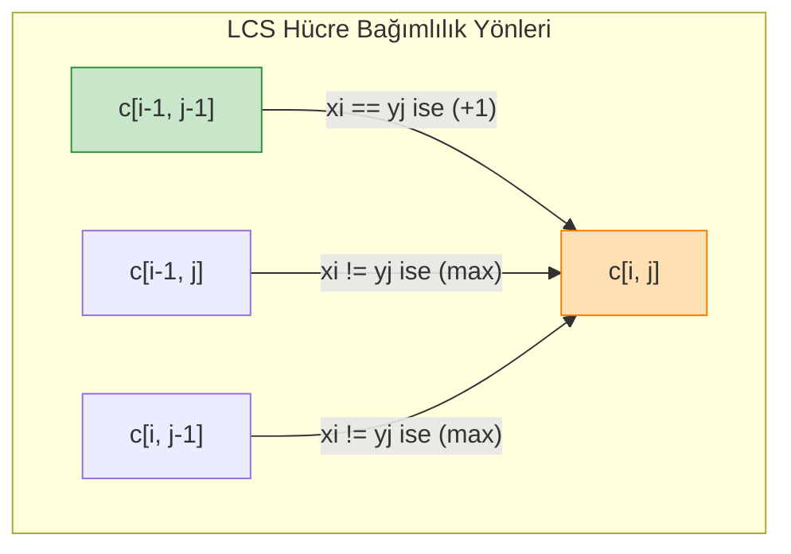

---

### Adım Adım Çözümlü Özgün Örnek

**Problem:**  
Aşağıda verilen iki dizi için LCS algoritmasını çalıştırınız:  
$X = \langle A, B, C, B, D, A, B \rangle \quad (m = 7)$  
$Y = \langle B, D, C, A, B, A \rangle \quad (n = 6)$  
1. $8 \times 7$ boyutundaki DP tablosunu adım adım doldurunuz.
2. Tablonun sağ alt köşesinden geriye izleme (backtracking) yaparak ortak alt diziyi çıkarınız.

**Çözüm:**

**1. Tablonun Doldurulması ($c[i, j]$ değerleri ve yönler):**
- 0. satır ve 0. sütun tamamen 0 ile başlar.
- Eşit karakterlerde ($\nwarrow$ sol-üst çapraz $+ 1$), farklı karakterlerde ($\uparrow$ üst ve $\leftarrow$ sol arasından maksimum alınır; eşitlikte standart olarak $\uparrow$ tercih edilir).

| $i \setminus j$ | $\emptyset$ (0) | B (1) | D (2) | C (3) | A (4) | B (5) | A (6) |
| :---: | :---: | :---: | :---: | :---: | :---: | :---: | :---: |
| **$\emptyset$ (0)** | 0 | 0 | 0 | 0 | 0 | 0 | 0 |
| **A (1)** | 0 | 0 | 0 | 0 | $1_{\nwarrow}$ | $1_{\leftarrow}$ | $1_{\nwarrow}$ |
| **B (2)** | 0 | $1_{\nwarrow}$ | $1_{\leftarrow}$ | $1_{\leftarrow}$ | $1_{\uparrow}$ | $2_{\nwarrow}$ | $2_{\leftarrow}$ |
| **C (3)** | 0 | $1_{\uparrow}$ | $1_{\uparrow}$ | $2_{\nwarrow}$ | $2_{\leftarrow}$ | $2_{\uparrow}$ | $2_{\uparrow}$ |
| **B (4)** | 0 | $1_{\nwarrow}$ | $1_{\uparrow}$ | $2_{\uparrow}$ | $2_{\uparrow}$ | $3_{\nwarrow}$ | $3_{\leftarrow}$ |
| **D (5)** | 0 | $1_{\uparrow}$ | $2_{\nwarrow}$ | $2_{\uparrow}$ | $2_{\uparrow}$ | $3_{\uparrow}$ | $3_{\uparrow}$ |
| **A (6)** | 0 | $1_{\uparrow}$ | $2_{\uparrow}$ | $2_{\uparrow}$ | $3_{\nwarrow}$ | $3_{\uparrow}$ | $4_{\nwarrow}$ |
| **B (7)** | 0 | $1_{\nwarrow}$ | $2_{\uparrow}$ | $2_{\uparrow}$ | $3_{\uparrow}$ | $4_{\nwarrow}$ | $4_{\uparrow}$ |

*En Uzun Ortak Alt Dizi Uzunluğu:* $c[7, 6] = \mathbf{4}$.

**2. Geriye İzleme (Backtracking) ile LCS Dizisinin Kurulması:**
Sağ alt köşe olan $c[7, 6]$'dan başlayalım:
- $c[7, 6] = 4$: $X[7]=B \ne Y[6]=A$. Değer $\uparrow c[6, 6]$'dan (4) gelmiştir $\to$ $(6, 6)$'ya git.
- $c[6, 6] = 4$: $X[6]=A == Y[6]=A$! Çapraz geçiş ($\nwarrow$). Karakter: **A**. $(5, 5)$'e git.
- $c[5, 5] = 3$: $X[5]=D \ne Y[5]=B$. Değer $\uparrow c[4, 5]$'ten (3) gelmiştir $\to$ $(4, 5)$'e git.
- $c[4, 5] = 3$: $X[4]=B == Y[5]=B$! Çapraz geçiş ($\nwarrow$). Karakter: **B**. $(3, 4)$'e git.
- $c[3, 4] = 2$: $X[3]=C \ne Y[4]=A$. Değer $\leftarrow c[3, 3]$'ten (2) gelmiştir $\to$ $(3, 3)$'e git.
- $c[3, 3] = 2$: $X[3]=C == Y[3]=C$! Çapraz geçiş ($\nwarrow$). Karakter: **C**. $(2, 2)$'ye git.
- $c[2, 2] = 1$: $X[2]=B \ne Y[2]=D$. Değer $\leftarrow c[2, 1]$'den (1) gelmiştir $\to$ $(2, 1)$'e git.
- $c[2, 1] = 1$: $X[2]=B == Y[1]=B$! Çapraz geçiş ($\nwarrow$). Karakter: **B**. $(1, 0)$'a git.
- 0. sütuna ulaşıldı, arama sonlandı.

Seçilen karakterleri ters sırayla dizersek:  
$B \to C \to B \to A \implies$ **"BCBA"** (Uzunluk: 4).  
*(Not: Eşitlik durumlarında alternatif yönler takip edildiğinde "BDAB" veya "BCAB" de geçerli 4 uzunluklu optimal çözümlerdir).*

---

### Sık Yapılan Hatalar ve Kavram Yanılgıları
- **Alt Dizi (Subsequence) ile Alt Kelimeyi (Substring) Karıştırmak:** Substring karakterlerin kesintisiz ardışık olmasını şart koşar. Subsequence'de ise aralarda başka karakterler bulunabilir, sadece göreli geliş sırası korunur.
- **Bellek İsrafı:** Eğer amaç sadece LCS'in uzunluğunu bulmaksa, tüm $(m+1) \times (n+1)$ tabloyu bellekte tutmak gereksizdir. $c[i, j]$ sadece $i$. satır ve $(i-1)$. satıra bağımlı olduğundan yalnızca iki satır tutularak uzay karmaşıklığı $O(\min(m, n))$'e düşürülebilir.
- **Hesap Sırasını Yanlış Kurmak:** Alt problemler çözülmeden üst problemleri çağırmak mantıksal hataya yol açar. Tabulation'da döngüler daima bağımlılık DAG'ının topolojik sırasına göre ($0 \to m, 0 \to n$) ilerlemelidir.

---

### Aktif Hatırlama Soruları

1. Naif özyinelemeli LCS fonksiyonunun en kötü durum çalışma zamanı neden $O(2^{m+n})$ iken Dinamik Programlama ile $O(m \cdot n)$'e düşer?
2. LCS probleminde iki dize tamamen özdeş ($X = Y$) ve $n$ uzunluğunda ise DP tablosundaki hesaplama nasıl seyreder?
3. Bir problemin "Optimal Alt Yapı" özelliğine sahip olup olmadığını nasıl test edersiniz?

<details>
<summary>Çözüm ve Açıklama</summary>

1. Naif özyinelemede her adımda $X[i] \ne Y[j]$ olduğunda iki yeni dal açılır ($c(i-1, j)$ ve $c(i, j-1)$). Aynı alt problemler ağacın farklı kollarında defalarca tekrar hesaplanır ve çağrı ağacı üstel ($2^{m+n}$) büyür. DP tablosunda ise toplamda yalnızca $(m+1)(n+1)$ farklı benzersiz alt problem vardır; her biri tam bir kez hesaplanıp saklandığından süre $O(m \cdot n)$'e kilitlenir.
2. Tüm $i = j$ indislerinde $X[i] == Y[i]$ olacağından tablonun ana köşegenindeki tüm hücreler sol-üst çaprazdaki değerin 1 fazlası olur ($c[i, i] = c[i-1, i-1] + 1$). Backtracking yapıldığında tam bir köşegen hattı boyunca geri gidilir ve LCS dizisi dizinin kendisi çıkar ($n$).
3. Çelişkiyle ispat (cut-and-paste tekniği) kullanılır: Ana problemin optimal bir çözümü $S$ olsun. $S$'nin içerdiği alt problem çözümü $s_{alt}$ yerine varsayımsal olarak daha iyi bir $s'_{alt}$ çözümü konulabildiği varsayılır. Eğer bu takas ana problemin toplam kalitesini $S$'den daha iyi yapabiliyorsa, bu durum $S$'nin optimal oluşuyla çelişir. Bu çelişki alt problemin de kesinlikle optimal olmak zorunda olduğunu kanıtlar.
</details>

---

### Kaynak ve Destek Kartı
- **Konu Eşleşmesi:** Dinamik Programlama temelleri, durum ve yineleme bağıntısı kurma, örtüşen alt problemler ve En Uzun Ortak Alt Dizi (LCS).
- **Doğrudan Destek Videosu:** [MIT 6.046J Lecture 15: LCS için YouTube destek videosu](https://www.youtube.com/watch?v=V5hZoJ6uK-s) — LCS tablosu, bellek ve geriye izleme.
- **Akademik Video ve Ders:** [MIT OCW 6.006 Recitation Videos](https://ocw.mit.edu/courses/6-006-introduction-to-algorithms-fall-2011/video_galleries/recitation-videos/) — Recitation 19: Dynamic Programming (Crazy Eights, Shortest Path) and Recitation 20: Dynamic Programming (Blackjack).
- **İleri Seviye Algoritma:** [MIT OCW 6.046J Lecture Videos](https://ocw.mit.edu/courses/6-046j-design-and-analysis-of-algorithms-spring-2015/resources/lecture-videos/) — Dynamic Programming.

---

## Hafta 14: Dinamik Programlama: 0/1 Sırt Çantası ve Matris Zincir Çarpımı (Önerilen Akış — Resmî Olmayan)

### Öğrenme Hedefleri
Bu bölümü tamamladığınızda şunları yapabileceksiniz:
1. **0/1 Sırt Çantası (0/1 Knapsack)** probleminin DP durum uzayını, yineleme bağıntısını ve **sözde-polinomiyal (pseudo-polynomial)** zaman karmaşıklığını ($O(n W)$) analiz edebilmek.
2. 0/1 Sırt Çantası algoritmasında bellek optimizasyonunu ($O(W)$ 1-boyutlu dizi) yaparken neden **sağdan sola (azalan sıra)** güncelleme yapılması gerektiğini kavrayabilmek.
3. **Matris Zincir Çarpımı (Matrix Chain Multiplication - MCM)** probleminde parantezleme sırasının skaler işlem sayısına etkisini ve arama uzayının Catalan sayıları ile üstel patlamasını açıklayabilmek.
4. MCM probleminde **Aralık DP (Interval DP)** tekniğini, $m[i, j] = \min_{i \le k < j} \{m[i, k] + m[k+1, j] + p_{i-1} p_k p_j\}$ bağıntısını ve zincir uzunluğuna göre diyagonal hesap sırasını uygulayabilmek.

### Kavram Anlatımı ve Temel Teori

#### 1. 0/1 Sırt Çantası Problemi
Problem: $n$ adet eşya veriliyor; her eşyanın bir ağırlığı $w_i$ ve bir değeri $v_i$ vardır. Çantanın taşıyabileceği maksimum ağırlık $W$'dir. Her eşyadan en fazla 1 adet alınabilir (0 veya 1). Toplam ağırlık $\le W$ olacak şekilde maksimum toplam değeri elde etmek.
- **Durum Tanımı:** $dp[i, w]$, ilk $i$ eşya kullanılarak $w$ kapasiteli bir çantada elde edilebilecek maksimum değerdir ($0 \le i \le n, 0 \le w \le W$).
- **Yineleme Bağıntısı:**
  $$dp[i, w] = \begin{cases} dp[i-1, w] & \text{eğer } w_i > w \text{ (eşya sığmaz, alma)} \\ \max(dp[i-1, w], dp[i-1, w - w_i] + v_i) & \text{eğer } w_i \le w \text{ (alma veya al)} \end{cases}$$
- **Sözde-Polinomiyal (Pseudo-Polynomial) Zaman:** Algoritmanın çalışma süresi $\Theta(n \cdot W)$'dir. Burada $W$ bir girdi boyutu (bit uzunluğu) değil, bir tamsayı değeridir. $W$ sayısı bellekte $b = \lceil \log_2 W \rceil$ bit ile tutulur. Dolayısıyla çalışma süresi $O(n \cdot 2^b)$'dir ve girdinin bit uzunluğuna göre **üsteldir**! Bu nedenle 0/1 Knapsack zayıf NP-Zor (weakly NP-hard) bir problemdir.
- **1-Boyutlu Dizi Optimizasyonu:** $dp[w]$ dizisi oluşturulur. İç döngüde $w$, $W$'den $w_i$'ye doğru **azalan sırada** taranmalıdır. Eğer artan sırada taranırsa, aynı adımda güncellenen $dp[w - w_i]$ yeni değeri temsil eder ve aynı eşya çantaya birden çok kez eklenmiş olur (Sınırsız Sırt Çantasına dönüşür!).

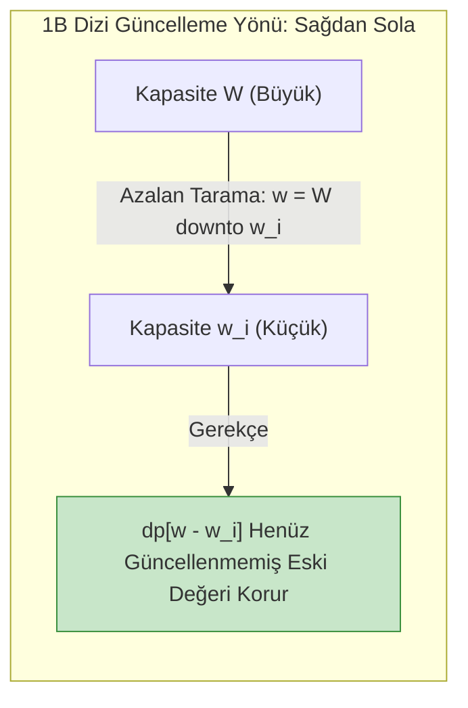

#### 2. Matris Zincir Çarpımı (Matrix Chain Multiplication)
Problem: Boyutları sırasıyla $p_0 \times p_1, p_1 \times p_2, \dots, p_{n-1} \times p_n$ olan $n$ adet matrisin çarpımı $A_1 \times A_2 \times \dots \times A_n$ veriliyor. Matris çarpımı birleşmelidir ($A(BC) = (AB)C$); ancak yapılan skaler çarpım sayısı parantezlemeye göre devasa oranda değişir!  
*Örnek:* $A_1 (10 \times 100), A_2 (100 \times 5), A_3 (5 \times 50)$.  
- $(A_1 A_2) A_3$: $10 \times 100 \times 5 + 10 \times 5 \times 50 = 5000 + 2500 = \mathbf{7500}$ skaler çarpım.  
- $A_1 (A_2 A_3)$: $100 \times 5 \times 50 + 10 \times 100 \times 50 = 25000 + 50000 = \mathbf{75000}$ skaler çarpım (10 kat fark!).
- **Olası Parantezleme Sayısı:** Catalan sayısı $P(n) = C_{n-1} = \frac{1}{n} \binom{2n-2}{n-1} = \Omega\left(\frac{4^n}{n^{3/2}}\right)$ (Kaba kuvvet imkansızdır).
- **Aralık DP Bağıntısı:** $m[i, j]$, $A_i \dots A_j$ alt zincirini çarpmak için gereken minimum skaler işlem sayısı olsun ($1 \le i \le j \le n$):
  $$m[i, j] = \begin{cases} 0 & \text{eğer } i = j \\ \min_{i \le k < j} \{m[i, k] + m[k+1, j] + p_{i-1} \cdot p_k \cdot p_j\} & \text{eğer } i < j \end{cases}$$
- **Hesap Sırası:** Tablo satır satır değil, **zincir uzunluğuna ($l = j - i + 1 = 2, 3, \dots, n$)** göre diyagonal olarak doldurulur. Zaman karmaşıklığı: $\Theta(n^3)$, Alan karmaşıklığı: $\Theta(n^2)$.

---

### Adım Adım Çözümlü Özgün Örnek

**Problem (0/1 Sırt Çantası Tablo İzi):**  
Çanta kapasitesi $W = 6$. Eşyalar:  
- Eşya 1: $w_1 = 2, v_1 = 12$  
- Eşya 2: $w_2 = 3, v_2 = 18$  
- Eşya 3: $w_3 = 4, v_3 = 25$  
1. $4 \times 7$ boyutundaki DP tablosunu adım adım doldurunuz.
2. Çantaya konulan eşyaları geriye izleme ile tespit ediniz.

**Çözüm:**

**1. Tablonun Doldurulması ($dp[i, w]$):**
- $i=0$ satırı ve $w=0$ sütunu tamamen 0'dır.
- $i=1 (w_1=2, v_1=12)$:  
  $w < 2 \implies dp[1, w] = dp[0, w] = 0$.  
  $w \ge 2 \implies dp[1, w] = \max(0, 0 + 12) = 12$.  
  Satır 1: $[0, 0, 12, 12, 12, 12, 12]$.
- $i=2 (w_2=3, v_2=18)$:  
  $w < 3 \implies dp[2, w] = dp[1, w]$. ($w=0: 0, w=1: 0, w=2: 12$).  
  $w=3: \max(dp[1, 3], dp[1, 0] + 18) = \max(12, 18) = 18$.  
  $w=4: \max(dp[1, 4], dp[1, 1] + 18) = \max(12, 0 + 18) = 18$.  
  $w=5: \max(dp[1, 5], dp[1, 2] + 18) = \max(12, 12 + 18) = \mathbf{30}$.  
  $w=6: \max(dp[1, 6], dp[1, 3] + 18) = \max(12, 12 + 18) = \mathbf{30}$.  
  Satır 2: $[0, 0, 12, 18, 18, 30, 30]$.
- $i=3 (w_3=4, v_3=25)$:  
  $w < 4 \implies dp[3, w] = dp[2, w]$. ($0, 0, 12, 18$).  
  $w=4: \max(dp[2, 4], dp[2, 0] + 25) = \max(18, 25) = 25$.  
  $w=5: \max(dp[2, 5], dp[2, 1] + 25) = \max(30, 0 + 25) = 30$.  
  $w=6: \max(dp[2, 6], dp[2, 2] + 25) = \max(30, 12 + 25) = \mathbf{37}$.  
  Satır 3: $[0, 0, 12, 18, 25, 30, 37]$.

*Maksimum Değer:* $dp[3, 6] = \mathbf{37}$.

**2. Geriye İzleme:**
- $dp[3, 6] = 37 \ne dp[2, 6] (30) \implies$ **Eşya 3 ÇANTAYA ALINDI!**  
  Kalan kapasite: $6 - w_3 = 6 - 4 = 2$.
- $dp[2, 2] = 12 == dp[1, 2] (12) \implies$ Eşya 2 alınmadı.  
  Kalan kapasite: $2$.
- $dp[1, 2] = 12 \ne dp[0, 2] (0) \implies$ **Eşya 1 ÇANTAYA ALINDI!**  
  Kalan kapasite: $2 - w_1 = 0$.  
*Seçilen Eşyalar:* **{Eşya 1, Eşya 3}** (Toplam ağırlık: $2 + 4 = 6$, Toplam değer: $12 + 25 = \mathbf{37}$).

---

### Sık Yapılan Hatalar ve Kavram Yanılgıları
- **Sözde-Polinomiyal ile Polinomiyali Karıştırmak:** $O(n W)$ karmaşıklığı $W$ küçükken (örneğin $W=1000$) son derece hızlıdır; ancak $W = 2^{64}$ olduğunda evrenin yaşından daha uzun sürer. Algoritma $W$'nin sayısal değerine bağımlıdır.
- **Matris Çarpımında Hesap Sırasını Satır Satır Yapmak:** $m[i, j]$ değerini hesaplarken $m[i, k]$ ve $m[k+1, j]$ alt problemlerine ihtiyaç duyulur. Bu alt problemler daha kısa uzunluklu alt zincirlerdir. Eğer döngü satır satır ilerlerse henüz hesaplanmamış hücrelere başvurulur ve algoritma çöker. Döngü mutlaka zincir uzunluğu $l=2, 3, \dots, n$ şeklinde kurulmalıdır.

---

### Aktif Hatırlama Soruları

1. 0/1 Sırt Çantası algoritmasında 1-boyutlu dizi kullanılırken iç döngü $w = w_i \dots W$ (artan sıra) şeklinde yazılırsa ne olur?
2. Boyutları $p = [10, 20, 30, 40]$ olan 3 matrisin ($A_1: 10\times 20, A_2: 20\times 30, A_3: 30\times 40$) optimal parantezlemesi nedir ve kaç skaler çarpım gerektirir?
3. Matris Zincir Çarpımı probleminde $s[i, j]$ tablosunun tutulma amacı nedir?

<details>
<summary>Çözüm ve Açıklama</summary>

1. Eğer döngü artan sırada ($w = w_i \dots W$) koşturulursa, örneğin $w = 2 \cdot w_i$ hücresi hesaplanırken aynı iterasyonda az önce güncellenmiş olan $dp[w_i]$ kullanılır. Bu durum aynı eşyanın çantaya tekrar tekrar eklenmesine (Sınırsız / Unbounded Knapsack) neden olur; 0/1 kısıtı çiğnenir.
2. İki seçenek vardır:  
   - $(A_1 A_2) A_3$: $(10 \times 20 \times 30) + (10 \times 30 \times 40) = 6000 + 12000 = \mathbf{18000}$.  
   - $A_1 (A_2 A_3)$: $(20 \times 30 \times 40) + (10 \times 20 \times 40) = 24000 + 8000 = 32000$.  
   Optimal parantezleme $((A_1 A_2) A_3)$ olup maliyeti **18.000** skaler çarpımdır.
3. $m[i, j]$ tablosu yalnızca minimum skaler işlem sayısını (sayısal maliyet) saklar. Çarpımın kendisini doğru parantezlerle ekrana basabilmek için, minimumu veren optimal $k$ bölme noktasının $s[i, j]$ tablosuna kaydedilmesi şarttır.
</details>

---

### Kaynak ve Destek Kartı
- **Konu Eşleşmesi:** 0/1 Sırt Çantası, sözde-polinomiyal zaman, Matris Zincir Çarpımı ve Aralık DP modelleri.
- **Akademik Video ve Ders:** [MIT OCW 6.006 Recitation Videos](https://ocw.mit.edu/courses/6-006-introduction-to-algorithms-fall-2011/video_galleries/recitation-videos/) — Recitation 21: Dynamic Programming, Knapsack Problem. MIT 6.046J Lecture 10 başlığı Advanced DP.
- **MCM İleri Dersi:** [MIT OCW 6.046J Lecture Videos](https://ocw.mit.edu/courses/6-046j-design-and-analysis-of-algorithms-spring-2015/resources/lecture-videos/) — Lecture 10: Advanced Dynamic Programming; Lecture 11: All-Pairs Shortest Paths.

---

## Hafta 15: Geri İzleme, P, NP ve NP-Tamlığa Giriş (Önerilen Akış — Resmî Olmayan)

### Öğrenme Hedefleri
Bu bölümü tamamladığınızda şunları yapabileceksiniz:
1. **Geri İzleme (Backtracking)** ve **Dal-Sınır (Branch and Bound)** paradigmalarını durum-uzayı ağacı (state-space tree) ve budama (pruning) prensipleriyle açıklayabilmek.
2. Karar Problemleri (Decision Problems), **P**, **NP**, **NP-Zor (NP-Hard)** ve **NP-Tam (NP-Complete)** karmaşıklık sınıflarının formel tanımlarını yapabilmek.
3. Bir problemin NP sınıfında olduğunu bir **tanık/sertifika (certificate)** ve **polinomiyal zamanlı doğrulayıcı (verifier)** ile ispatlayabilmek.
4. **Polinomiyal Zaman İndirgemesi (Polynomial-Time Reduction - $A \le_p B$)** mantığını kavrayarak NP-Tamlık ispat adımlarını (3-SAT $\le_p$ Independent Set) kurgulayabilmek.

### Kavram Anlatımı ve Temel Teori

#### 1. Geri İzleme (Backtracking) ve Budama
Geri izleme, olası tüm aday çözümleri derinlemesine arama (DFS) mantığıyla sistematik olarak deneyen bir kaba kuvvet iyileştirmesidir.
- Bir adayın geçerli bir çözüme genişletilemeyeceği anlaşıldığı anda o dal terk edilir (**budama / pruning**) ve bir önceki karar noktasına geri dönülür (backtrack).
- Tipik Örnekler: $N$-Vezir ($N$-Queens), Sudoku, Çizge Boyama (Graph Coloring), Alt Küme Toplamı (Subset Sum).

#### 2. Hesaplama Karmaşıklığı ve Sınıflar (P, NP, NPC, NP-Hard)
Tüm tanımlar evet/hayır yanıtı veren **Karar Problemleri (Decision Problems)** üzerinden yapılır.
- **P Sınıfı (Polynomial Time):** Deterministik bir Turing makinesinde **polinomiyal zamanda ($O(n^k)$) ÇÖZÜLEBİLEN** problemler kümesidir (örneğin Sıralama, En Kısa Yol, MST, BFS/DFS).
- **NP Sınıfı (Nondeterministic Polynomial):** Verilen bir çözüm sertifikasının deterministik bir algoritma tarafından **polinomiyal zamanda DOĞRULANABİLDİĞİ (verifiable)** problemler kümesidir.
  - *Not:* $P \subseteq NP$'dir (polinom zamanda çözülebilen bir problem, çözümüyle doğrulanabilir).
  - *Büyük Açık Soru:* $P \stackrel{?}{=} NP$. Çözümü hızlıca doğrulanabilen her problem hızlıca çözülebilir mi? (Genel kabul: $P \ne NP$).
- **NP-Zor (NP-Hard):** NP'deki tüm problemlerin polinomiyal zamanda kendisine indirgenebildiği ($\forall A \in NP, A \le_p X$) en az NP kadar zor problemlerdir. Karar problemi olmak zorunda değildir (optimizasyon problemleri olabilir) ve NP'de bulunması şart değildir (örneğin Halting Problemi).
- **NP-Tam (NP-Complete - NPC):** Hem NP sınıfında olan hem de NP-Zor olan problemlerdir. Yani:
  1. $X \in NP$ olmalıdır.
  2. $\forall A \in NP$ için $A \le_p X$ olmalıdır.
  *Önemi:* Eğer herhangi bir NP-Tam problem polinomiyal zamanda çözülebilirse, tüm NP problemleri polinomiyal zamanda çözülür ($P = NP$ olur!).

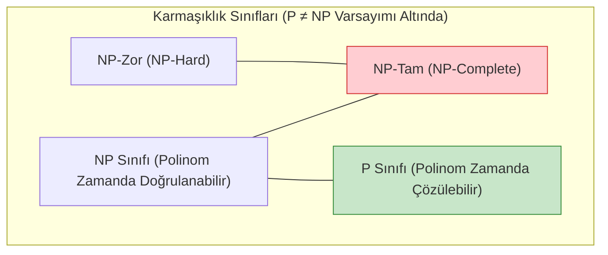

#### 3. Polinomiyal Zaman İndirgemesi ($A \le_p B$)
Bir $A$ problemini $B$ problemine dönüştüren bir fonksiyon $f$ varsa ve:
1. $f$, $A$'nın herhangi bir girdisini polinomiyal sürede $B$'nin girdisine dönüştürüyorsa,
2. $A$'nın cevabı "EVET" $\iff$ $B$'nin cevabı "EVET" oluyorsa,  
bu duruma **$A$, $B$'ye polinomiyal zamanda indirgenir ($A \le_p B$)** denir.
- **Anlamı:** $B$ problemi en az $A$ kadar zordur.
- Eğer $B \in P$ ise $A \in P$'dir.
- Eğer $A$ NP-Zor ise $B$ de NP-Zor olmak zorundadır!

#### 4. Bir Problemin NP-Tam Olduğunu İspatlama Adımları
Yeni bir $Y$ probleminin NP-Tam olduğunu göstermek için:
1. $Y \in NP$ olduğunu göster (bir sertifika tanımla ve $O(n^k)$ sürede doğrulandığını kanıtla).
2. Bilinen bir NP-Tam problem seç ($X \in NPC$; örneğin 3-SAT).
3. $X \le_p Y$ olduğunu göster ($X$'in herhangi bir örneğini $Y$'nin örneğine polinom zamanda dönüştür).
4. İki yönlü denkliği kanıtla ($X$'te çözüm var $\iff Y$'de çözüm var).

---

### Adım Adım Çözümlü Özgün Örnek

**Problem (3-SAT $\le_p$ Bağımsız Küme / Independent Set İndirgemesi):**  
Aşağıda 3-SAT formülü veriliyor:  
$$\phi = (x_1 \lor \neg x_2 \lor x_3) \land (\neg x_1 \lor x_2 \lor \neg x_3)$$
1. Bu formülü Bağımsız Küme (Independent Set - IS) problemine dönüştürmek için çizgeyi kurunuz.
2. $\phi$ formülü tatmin edilebilir midir? Çizgede $k = 2$ boyutunda bir Bağımsız Küme göstererek formülün doğruluk atamasını elde ediniz.

**Çözüm:**

**1. Çizgenin İnşası ($3\text{-SAT} \le_p \text{IS}$ Kuralı):**
- Formülde $m = 2$ adet cümlecik (clause) vardır.
- Her cümlecik için 3 düğümlü bir üçgen (tam çizge $K_3$) kurulur:
  - Üçgen 1 ($C_1$): $\{u_1: x_1, \quad u_2: \neg x_2, \quad u_3: x_3\}$ (birbirine bağlıdır).
  - Üçgen 2 ($C_2$): $\{v_1: \neg x_1, \quad v_2: x_2, \quad v_3: \neg x_3\}$ (birbirine bağlıdır).
- Çelişki Kenarları: Birbirinin değili olan tüm harfler arasına kenar çekilir:
  - $(u_1, v_1)$ kenarı ($x_1$ ile $\neg x_1$)
  - $(u_2, v_2)$ kenarı ($\neg x_2$ ile $x_2$)
  - $(u_3, v_3)$ kenarı ($x_3$ ile $\neg x_3$)
- Hedef bağımsız küme boyutu: $k = m = 2$.

**2. Bağımsız Küme ve Doğruluk Ataması:**
- Bir bağımsız kümede hiçbir iki düğüm birbirine kenarla bağlı olamaz.
- Her üçgenden en fazla 1 düğüm seçilebilir (çünkü üçgenin tüm köşeleri birbirine bağlıdır). $k=2$ düğüm seçebilmek için her üçgenden tam 1 düğüm seçilmelidir.
- Çelişki kenarları nedeniyle seçilen iki düğüm birbirinin değili olamaz!
- Seçim:
  - Üçgen 1'den $u_1: x_1$ seçilsin.
  - Üçgen 2'den $v_2: x_2$ seçilsin.
  - İnceleme: $u_1$ ile $v_2$ arasında kenar var mıdır? Hayır ($x_1$ ile $x_2$ çelişmez).
- $\{u_1, v_2\}$ geçerli bir bağımsız kümedir ($|S| = 2 = k$).
- **Doğruluk Değerleri:**  
  $x_1 = \text{TRUE}$, $x_2 = \text{TRUE}$, $x_3 = \text{TRUE (veya FALSE)}$.  
  - $C_1 = (\text{TRUE} \lor \text{FALSE} \lor \text{TRUE}) = \text{TRUE}$.  
  - $C_2 = (\text{FALSE} \lor \text{TRUE} \lor \text{FALSE}) = \text{TRUE}$.  
  $\phi = \text{TRUE} \land \text{TRUE} = \mathbf{TRUE}$. Formül tatmin edilebilir! $\blacksquare$

---

### Sık Yapılan Hatalar ve Kavram Yanılgıları
- **NP'nin "Polinom Olmayan" (Non-Polynomial) Anlamına Geldiğini Sanmak:** NP "Nondeterministic Polynomial" demektir; yani deterministik olmayan bir Turing makinesinde polinom zamanda çözülebilen veya deterministik olarak polinom sürede **doğrulanabilen** problemlerdir.
- **İndirgeme Yönünü Ters Kurmak:** $Y$'nin NP-Tam olduğunu kanıtlamak için $Y \le_p 3\text{-SAT}$ yazmak ölümcül bir mantık hatasıdır (bu sadece $Y$'nin NP'de olduğunu gösterir, en zor olduğunu göstermez). Doğru yön: bilinen NP-Tam problemden yeni probleme doğrudur ($3\text{-SAT} \le_p Y$).
- **NP-Zor ile NP-Tamı Özdeş Saymak:** NP-Zor problemlerin NP içinde olması şart değildir. Karar problemi olmayan gezgin satıcı turu uzunluğunu minimize etme veya Turing'in Durma Problemi (Halting Problem) NP-Zordur ama NP-Tam değildir.

---

### Aktif Hatırlama Soruları

1. Bir problemin NP sınıfında olduğunu kanıtlamak neden polinom zamanda çözüldüğünü kanıtlamaktan çok daha kolaydır?
2. Cook-Levin Teoremi'nin bilgisayar bilimleri tarihindeki çığır açıcı önemi nedir?
3. Bir yazılım mühendisi patronunun istediği bir optimizasyon probleminin NP-Tam olduğunu ispatlarsa bu mühendislik açısından ne anlama gelir?

<details>
<summary>Çözüm ve Açıklama</summary>

1. Çözüm aramak $2^n$ veya $n!$ olası kombinasyonu taramayı gerektirebilir (üstel patlama). Oysa doğrulamada biri size hazır bir cevap sertifikası (örneğin bir Hamilton döngüsü sıralaması) verir; siz sadece bu sertifikanın kurallara uyup uymadığını grafı tek geçişte ($O(V+E)$) gezerek doğrularsınız.
2. Cook ve Levin, Boole Tatmin Edilebilirliği (SAT) probleminin NP'deki İSTİSNASIZ TÜM problemlerden polinom zamanda indirgenebileceğini ilk kez matematiksel olarak ispatlamışlardır. Böylece ilk NP-Tam problem keşfedilmiş ve diğer tüm NP-Tamlık ispatlarının kapısı açılmıştır.
3. Bu ispat, problemin en kötü durumda polinomiyal zamanda kesin çözümünün bulunmasının neredeyse imkansız olduğunu gösterir. Mühendis artık naif algoritma aramakla vakit kaybetmek yerine; Dinamik Programlama (sözde-polinomiyal), Dal-Sınır (Branch and Bound), Sezgisel (Heuristic) algoritmalar veya Yaklaşıklık (Approximation) algoritmalarına yönelir.
</details>

---

### Kaynak ve Destek Kartı
- **Konu Eşleşmesi:** Geri izleme, P vs NP, sertifikalar, polinom indirgemeleri ve NP-Tamlık ispatları.
- **Akademik Video ve Ders:** [MIT OCW 6.046J Lecture Videos](https://ocw.mit.edu/courses/6-046j-design-and-analysis-of-algorithms-spring-2015/resources/lecture-videos/) — Lecture 16: Complexity: P, NP, NP-Completeness, Reductions.
- **Açık Ders Dizin Referansı:** [MIT OCW 6.006 Recitation Videos](https://ocw.mit.edu/courses/6-006-introduction-to-algorithms-fall-2011/video_galleries/recitation-videos/) — Recitation 23: Computational Complexity.

---

## Hafta 16: Bütünleşik Tekrar, Algoritma Seçim Kriterleri ve Problem Çözme (Önerilen Çalışma — Resmî Final Sınavı Değildir)

> [!IMPORTANT]
> **Dönem Sonu Öz Değerlendirme Bildirimi**  
> Bu bölüm resmî bir üniversite final sınavı, sınav tarihi veya üniversite notlandırma kriteri değildir. 16 haftalık Algoritma Analizi çalışmasını tamamlayan öğrencinin tüm tasarım paradigmalarını (Böl ve Yönet, Açgözlü, Dinamik Programlama, Çizgeler, Amortize Analiz, NP-Tamlık) harmanlayarak problem çözme ve algoritma seçim yeteneğini pekiştirmesi için hazırlanan **önerilen bütünleşik çalışma ve öz değerlendirme oturumudur**.

### Öğrenme Hedefleri
Bu bölümü tamamladığınızda şunları yapabileceksiniz:
1. 16 haftada işlenen tüm temel tasarım paradigmalarını karşılaştırmalı olarak değerlendirebilmek.
2. Yeni ve karmaşık bir problemle karşılaşıldığında doğru algoritma paradigmasını (Açgözlü, DP, Böl ve Yönet, Çizge Modeli) mühendislik gerekçeleriyle seçebilmek.
3. Algoritmaların zaman, ek bellek, önbellek yerelliği ve uygulama karmaşıklığı arasındaki ödünleşimleri (trade-offs) savunabilmek.
4. NP-Tam bir problemle karşılaşıldığında uygulanabilir alternatif mühendislik stratejilerini (Yaklaşıklık, Sezgisel, Dal-Sınır) planlayabilmek.

### Bütüncül Karar Verme Akış Şeması

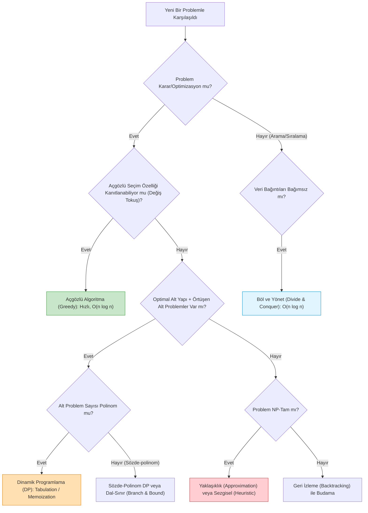

---

### Karşılaştırmalı Büyük Algoritma Matrisi

| Paradigma | Temel İlke | Karakteristik Özellik | Tipik Zaman Aralığı | Örnek Algoritmalar |
| :--- | :--- | :--- | :--- | :--- |
| **Böl ve Yönet** | Problemi bağımsız alt parçalara böl, çöz ve birleştir. | Alt problemler örtüşmez; özyineleme ağacı temizdir. | $\Theta(n \log n)$ | Merge Sort, Quicksort, Karatsuba, Strassen |
| **Açgözlü (Greedy)** | Her adımda geriye dönmeksizin yerel en iyi seçimi yap. | Değiş Tokuş Argümanı ile optimalite kanıtı şarttır. | $\Theta(n)$ — $\Theta(n \log n)$ | Dijkstra, Kruskal, Prim, Huffman, Etkinlik Seçimi |
| **Dinamik Programlama** | Örtüşen alt problemleri memoize et veya tabloya dök. | Bağımlılık DAG'ı yönünde taban durumundan yukarı örülür. | $\Theta(n^2)$ — $\Theta(n^3)$ | LCS, 0/1 Knapsack, Matris Zincir Çarpımı, Bellman-Ford |
| **Çizge Taraması** | Çizge topolojisini kuyruk veya yığıtla sistematik gez. | Kenar ve düğüm durumları; zaman damgaları. | $\Theta(V + E)$ | BFS, DFS, Topolojik Sıralama, Kosaraju SCC |
| **Geri İzleme (Backtrack)** | Durum uzayı ağacını derinlemesine ara, çıkmazda buda. | En kötü durumda üsteldir; budama aramayı daraltır. | $O(b^d)$ (Üstel) | $N$-Vezir, Sudoku, Alt Küme Toplamı |

---

### Kapsamlı Çözümlü Özgün Problemler

#### Problem 1 (İki Sıralı Dizinin Medyanını Bulma)
Boyutları $n$ olan sıralı iki dizi $A$ ve $B$ veriliyor. Birleşik dizinin ($2n$ elemanlı) medyanını $O(\log n)$ sürede bulan bir algoritma tasarlayınız.
- **Çözüm:**  
  1. Her iki dizinin medyanları $m_1 = A[n/2]$ ve $m_2 = B[n/2]$ hesaplanır ($O(1)$).
  2. Eğer $m_1 == m_2$ ise birleşik medyan doğrudan $m_1$'dir.
  3. Eğer $m_1 < m_2$ ise: Medyan $A$'nın sol yarısında veya $B$'nin sağ yarısında **kesinlikle bulunamaz**. Arama uzayı $A[n/2 \dots n-1]$ ve $B[0 \dots n/2]$ yarılarına indirgenir.
  4. Eğer $m_1 > m_2$ ise: Arama uzayı $A[0 \dots n/2]$ ve $B[n/2 \dots n-1]$ yarılarına indirgenir.
  5. Yineleme bağıntısı: $T(n) = T(n/2) + O(1) \implies \mathbf{O(\log n)}$. Master Teoremi Durum 2 gereğince logaritmik sürede çözülür.

---

#### Problem 2 (En Uzun Artan Alt Dizi — LIS: DP'den İkili Aramaya Geçiş)
Dizi $A = [10, 9, 2, 5, 3, 7, 101, 18]$ için:
- **Yaklaşım 1 (Klasik DP - $O(n^2)$):**  
  $dp[i] = 1 + \max_{j < i, A[j] < A[i]} dp[j]$. Her eleman için önceki tüm elemanlar taranır.
- **Yaklaşım 2 (Sabır Sıralaması / Patience Sorting + İkili Arama - $O(n \log n)$):**  
  $tails[len]$, $len$ uzunluğundaki artan alt dizilerin en küçük son elemanını saklar.  
  Her $x \in A$ için $tails$ dizisinde $x$'e eşit veya büyük ilk eleman ikili aramayla ($\log n$) bulunur ve $x$ ile güncellenir. Bulunamazsa diziye yeni bir uzunluk eklenir.  
  Süre: $n$ eleman $\times \log n$ ikili arama = $\mathbf{O(n \log n)}$.

---

### Sık Yapılan Hatalar ve Kavram Yanılgıları
- **Her Karmaşık Problemde Doğrudan DP'ye Sarılmak:** Eğer problemde açgözlü seçim özelliği sağlanıyorsa, DP kurmak $O(n^2)$ maliyet üretirken açgözlü yaklaşım $O(n \log n)$ sürede çözer.
- **NP-Tam Problem Karşısında Çaresiz Kalmak:** Bir problemin NP-Tam olduğunu belirlemek "çözülemez" demek değildir; kesin ve hızlı çözüm arayışını bırakıp kabul edilebilir hata payına sahip **polinomiyal zamanlı bir yaklaşıklık algoritması (PTAS)** veya sezgisel model kurmak demektir.

---

### Aktif Hatırlama Soruları

1. Sıralama algoritmalarında en kötü durum garantisi $O(n \log n)$ olan ve $O(1)$ ek bellek tüketen algoritma hangisidir? Endüstride neden doğrudan bu algoritma yerine Quicksort kullanılır?
2. Dinamik programlamada bellek optimizasyonu yapıldığında geriye izleme (backtracking) ile optimal çözümün elemanlarını yazdırmak neden zorlaşır?
3. Gezgin Satıcı Problemi (TSP) ile Minimum Kapsayan Ağaç (MST) arasındaki yapısal fark nedir? Neden biri NP-Zor iken diğeri $O(E \log V)$ sürede çözülür?
4. Bir algoritmanın ortalama çalışma zamanının $O(n)$ olması ile amortize çalışma zamanının $O(n)$ olması arasındaki güvence farkı nedir?

<details>
<summary>Çözüm ve Açıklama</summary>

1. Heapsort'tur. Heapsort en kötü durumda da $O(n \log n)$ garantisi verir ve yerinde ($O(1)$ alan) çalışır. Ancak bellekteki dizi indisleri üzerinde ($i \to 2i+1$) atlayarak gezindiği için CPU önbellek yerelliği (cache locality) çok zayıftır. Quicksort ardışık blokları taradığından pratikte Heapsort'tan 2-3 kat daha hızlı çalışır.
2. Backtracking yapabilmek için her adımda hangi kararın verildiğini gösteren tüm alt problem matrisine ihtiyaç vardır. Tabloyu 1-boyutlu diziye indirgeyip sadece son satırı tuttuğumuzda önceki satırların karar geçmişi silinir; dolayısıyla maksimum değer bulunur ama hangi elemanların seçildiği geriye dönük çıkarılamaz.
3. MST'de döngü olmaması şarttır ve düğümlerin derecesi serbesttir (bir düğüm 10 kenara bağlanabilir). Bu serbestlik Kesim Özelliğinin (Cut Property) açgözlü olarak işletilmesini sağlar. TSP'de ise her düğümün derecesi tam olarak 2 olmak ve tek bir kapalı dev tour oluşturmak zorundadır; bu katı kısıt açgözlü seçimi imkansız kılarak problemi NP-Zor yapar.
4. Ortalama durumda girdi verisinin rastgele bir olasılık dağılımından geldiği varsayılır; kötü niyetli özel bir girdi dizisi algoritmayı $O(n^2)$'ye kilitleyebilir. Amortize analizde ise hiçbir olasılık varsayımı yoktur; en kötü niyetli girdi dizisinde dahi $n$ işlemin toplam maliyetinin $c \cdot n$'i geçmeyeceği matematiksel kesinlikle garanti edilir.
</details>

---

### Kaynak ve Destek Kartı
- **Konu Eşleşmesi:** Tüm dönem konularının sentezi, algoritma seçim karar matrisleri ve ileri mülakat/sınav problemleri.
- **Akademik Video ve Ders:** [MIT OCW 6.006 Recitation Videos](https://ocw.mit.edu/courses/6-006-introduction-to-algorithms-fall-2011/video_galleries/recitation-videos/) — Recitation 24: Final Exam Review.
- **İleri Seviye Final Dersi:** [MIT OCW 6.046J Lecture Videos](https://ocw.mit.edu/courses/6-046j-design-and-analysis-of-algorithms-spring-2015/resources/lecture-videos/) — 6.046J ders sayfasındaki problem setleri ve sınav materyalleriyle genel tekrar.

