## Hafta 1: Ders Kapsamı ve Etik Kavramı

### Öğrenme Hedefleri
Bu bölümü tamamladığınızda:
- Etik sözcüğünün kökenini, normatif etik, meta-etik ve uygulamalı etik ayrımını açıklayabileceksiniz.
- Meslek etiği, kişisel ahlak, hukuk ve şirket politikası arasındaki çatışma noktalarını somutlaştırabileceksiniz.
- Bir teknik kararın neden yalnızca teknik değil, zorunlu olarak ahlaki bir seçim barındırdığını analiz edebileceksiniz.

### Kavram Açıklaması: Etik Nedir ve Neyi İnceler?
Etik terimi, Yunanca karakter, töre, alışkanlık ve ortak yaşam alanı anlamına gelen *ethos* sözcüğünden türemiştir. Felsefenin bir alt dalı olarak etik; neyin doğru veya yanlış, neyin adil veya adaletsiz, hangi eylemlerin övgüye değer veya yerilebilir olduğunu sistematik ve rasyonel bir temelde araştırır.

Felsefi etik üç ana düzeye ayrılır:
1. **Meta-Etik:** Ahlaki kavramların kökenini, doğasını ve anlamını sorgular ("İyi nedir?", "Ahlaki doğrular evrensel midir yoksa göreceli midir?").
2. **Normatif Etik:** İnsanların nasıl davranması gerektiğini belirleyen kural ve sistemleri kurar (Faydacılık, Deontoloji, Erdem Etiği).
3. **Uygulamalı Etik:** Teorik ilkeleri tıp, çevre, bilişim ve mühendislik gibi somut alanlardaki ikilemlere uygular. Meslek etiği doğrudan bu kategoridedir.

| Boyut | Kaynak | Yaptırım Türü | Temel Öncelik | Değişebilirlik |
| :--- | :--- | :--- | :--- | :--- |
| **Kişisel Ahlak** | Aile, inanç, vicdan | İçsel huzursuzluk, pişmanlık | Bireysel erdem | Bireyden bireye değişir |
| **Meslek Etiği** | Meslek topluluğu, uzmanlık | Meslekten men, kınama, itibar kaybı | Kamu güvenliği ve refahı | Evrensel meslek standartları |
| **Hukuk** | Yasama organı, devlet | Hapis, tazminat, idari para | Toplumsal düzen ve asgari sınır | Yasama ile değişir |
| **Şirket Politikası** | Şirket yönetimi, sözleşme | İşten çıkarma, uyarı, prim kesintisi | Kurumsal kâr ve operasyonel verim | Yönetim kararıyla değişir |

### Vaka İncelemesi (Öğrenme Amaçlı Senaryo 1)
*Senaryo:* Bir finansal teknoloji şirketinde çalışan yazılım mühendisi Aylin, kullanıcılara mikro-kredi sağlayan mobil uygulamanın yeni sürümünde kritik bir güvenlik açığı tespit eder. Saldırganlar belirli bir istek sırasıyla kullanıcıların kimlik ve banka hesap bilgilerine yetkisiz erişebilmektedir. Lansman 24 saat sonradır ve gecikme durumunda şirket ciddi bir pazar payı ve reklam bütçesi kaybedecektir. Ürün yöneticisi, "Bu riski kabul edelim, lansmanı yapalım; hatayı haftaya sessizce bir yama ile kapatırız. Şirket politikamız pazara ilk giren olmaktır" der.

### Gerekçeli Adım Adım Karar Analizi
1. **Olguların Belirlenmesi:** Güvenlik açığı mevcuttur; istismar edilebilirliği teknik olarak kanıtlanmıştır; 24 saat içinde lansman planlanmıştır.
2. **Paydaşların Tanımlanması:** Uygulama kullanıcıları (veri güvenliği ve maddi zarar riski), şirket hissedarları ve çalışanları (finansal kâr/zarar), yazılım mühendisi (mesleki sorumluluk), kamu güvenliği (finansal sisteme güven).
3. **Değerler ve Kuralların Çatışması:** Şirketin ticari takvimine uyum (şirket politikası) karşısında kullanıcıların veri gizliliği ve finansal güvenliği (meslek etiği ve geçerli veri koruma yükümlülükleri).
4. **Seçeneklerin Üretilmesi:**
   - *Seçenek A:* Ürün yöneticisini dinleyip susmak ve yayına izin vermek.
   - *Seçenek B:* İstifa edip sosyal medyada durumu ifşa etmek (ölçüsüz ve ilk basamakta yıkıcı).
   - *Seçenek C (Yaratıcı Çözüm):* Güvenlik açığını teknik bir kanıt raporuyla (PoC) dokümante etmek, riskin şirket için doğuracağı yasal/maddi tazminat boyutunu göstererek lansmanın güvenlik yaması uygulanana kadar (veya açığı kapatan güvenli bir acil önlem devreye alınana dek) ertelenmesini resmi olarak talep etmek.
5. **Zarar-Fayda ve Kamu Güvenliği Analizi:** Açığın sızdırılması durumunda kullanıcıların uğrayacağı telafisi imkânsız zarar, bir haftalık lansman gecikmesinin getireceği ticari maliyetten katbekat büyüktür. Kamu güvenliği ve kullanıcı hakkı ticari takvimden üstündür.
6. **Gerekçeli Karar ve İzleme:** Seçenek C uygulanır. Teknik kanıt doğrudan teknik direktöre (CTO) iletilir. Eğer yönetim itiraz ederse yazılı onay istenir ve risk resmîleştirilir.

### Görsel Analiz Şeması
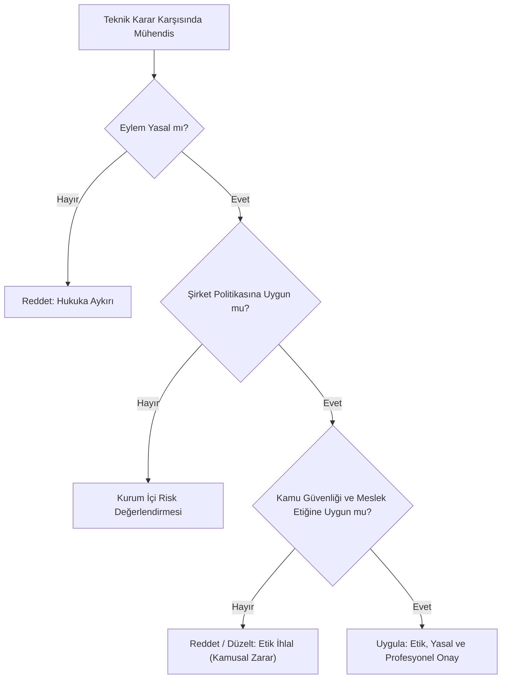
*Şekil 1.1: Teknik kararlarda dörtlü filtre ve kamu önceliği denetim döngüsü.*

### Sık Yapılan Hatalar ve Yanılgılar
- **"Yasal olan her eylem etiktir":** Yasa geçmişteki hatalara tepki olarak konur; yeni teknolojilerde (yapay zekâ, biyoteknoloji) yasal boşluklar olabilir. Yasal boşluktan yararlanarak kullanıcıyı zarara uğratmak hukuken cezasız kalsa bile meslek etiği açısından kusurdur.
- **"Etik sadece soyut felsefedir, sahada geçerliliği yoktur":** Etik ihlaller sistem çökmelerine, ölümlere, milyarlarca dolarlık tazminatlara ve meslekten ömür boyu ihraca yol açan somut operasyonel risklerdir.

### Aktif Hatırlama Soruları ve Çözümleri
1. *Soru:* Bir mühendisin işvereni yasalara aykırı olmayan ancak kullanıcının cihaz ömrünü gizlice kısaltan bir algoritma geliştirmesini isterse, bu talep hangi katmanlar arasında çatışma yaratır?

Çözüm ve Açıklama

Hukuk ile Meslek Etiği ve Tüketici Hakları arasında çatışma yaratır. Yasalarda cihaz yavaşlatmayı doğrudan yasaklayan açık bir ceza maddesi o an bulunmasa bile, meslek etiği kullanıcının güvenini suiistimal etmemeyi (faithfulness), yanıltıcı mühendislik yapmamayı ve dürüstlüğü (veracity) emreder. Şirket politikası kârı hedeflerken meslek etiği dürüstlüğü zorunlu kılar.

2. *Soru:* Meta-etik ile normatif etik arasındaki temel işlevsel fark nedir?

Çözüm ve Açıklama

Meta-etik "İyi kavramının anlamı nedir ve ahlakın kaynağı nerededir?" sorusuyla kavramsal ve anlamsal temeli inceler. Normatif etik ise "Hangi kurallara göre hareket etmeliyiz ve bir eylemi doğru kılan nedir?" sorusuyla somut davranış ilkeleri ve sistemleri üretir.

3. *Soru:* Bir mühendislik kararında kamu güvenliği ile şirket kârı çatıştığında hangi ilke tartışmasız önceliğe sahiptir?

Çözüm ve Açıklama

Kamu sağlığı, güvenliği ve refahı (Health, Safety, and Welfare - HSW) mühendislik etiğinde merkezi bir ilkedir. Örneğin ABD merkezli NSPE kodunun Madde I.1’i kamunun güvenliğini, sağlığını ve refahını öncelikli tutar. Her kodun kapsamı ve uygulanabilirliği kendi metninden değerlendirilmelidir.

### Hafta Kaynak ve Video Kartı
- **Video:** University of Virginia Online Ethics Center, Michael Loui, *Professional Ethics in Engineering video series* ([YouTube: n9A8-FjhArE](https://www.youtube.com/watch?v=n9A8-FjhArE)).
- **Web Kaynağı:** [UVA OEC Professional Ethics in Engineering](https://onlineethics.virginia.edu/cases/professional-ethics-engineering). Bu videoda profesyonel sorumluluğun neden salt iş tanımıyla sınırlı olmadığı, toplumsal güven sözleşmesi bağlamında açıklanmaktadır.

---

## Hafta 2: Etik-Ahlak İlişkisi, Değerler, Ahlaki Gelişim ve Meslek Ahlakı

### Öğrenme Hedefleri
Bu bölümü tamamladığınızda:
- Ahlak ve etik terimlerinin felsefi ve pratik ayrımlarını tanımlayabileceksiniz.
- Değer, norm, ilke ve kural hiyerarşisini açıklayabileceksiniz.
- Lawrence Kohlberg'in Ahlaki Gelişim Kuramı'nı mühendislik kararlarına uygulayabilecek ve aşamaları ayırt edebileceksiniz.

### Kavram Açıklaması: Ahlak ve Etik Ayrımı, Değerler Sistemi
Ahlak (Latince *moralitas*), belirli bir toplumda, çağda veya toplulukta kabul görmüş, tarihsel ve kültürel olarak aktarılan değer yargıları, adetler ve davranış kalıplarıdır. Öznel, yerele bağımlı ve duygusal bileşenleri güçlüdür.
Etik ise ahlak üzerine yapılan felsefi, eleştirel ve sistematik düşünmedir. "Bu ahlaki kural adil midir?", "Evrensel olarak savunulabilir mi?" sorularını sorar.

**Değerler Hiyerarşisi:**
- **Değer (Value):** Neyin arzu edilir, önemli ve saygıdeğer olduğuna dair temel inançtır (örneğin adalet, dürüstlük, insan hayatı).
- **İlke (Principle):** Değerlerden türetilen genel eylem kılavuzudur ("Kamu güvenliğine zarar verme").
- **Kural (Rule):** İlkelerin belirli durumlardaki somut, bağlayıcı emirleridir ("Yangın çıkış kapıları kilitlenemez").

### Lawrence Kohlberg'in Ahlaki Gelişim Kuramı
Psikolog Lawrence Kohlberg, bireylerin ahlaki muhakeme yeteneklerinin üç ana düzeyde ve altı basamakta geliştiğini ortaya koymuştur:

1. **Gelenek Öncesi Düzey (Pre-conventional Level):**
   - *Basamak 1: İtaat ve Ceza Yönelimi:* Doğru olan, cezadan kaçınmayı sağlayan eylemdir ("Yakalanmazsam sorun yok").
   - *Basamak 2: Bireycilik ve Çıkarcı Değiş-Tokuş:* Doğru olan, kendi çıkarıma hizmet eden veya karşılıklı menfaat sağlayan eylemdir ("Bana ne faydası var?").
2. **Geleneksel Düzey (Conventional Level):**
   - *Basamak 3: Kişilerarası Uyum ("İyi Çocuk"):* Doğru olan, yakın çevrenin onayını alan ve ilişkileri koruyan eylemdir ("Yöneticim beni sevsin, takım dışlamasın").
   - *Basamak 4: Yasa ve Düzen Yönelimi:* Doğru olan, kanunlara harfiyen uymak ve toplumsal düzeni sorgulamadan korumaktır ("Kural kuraldır, yönetmelik ne yazıyorsa o").
3. **Gelenek Ötesi Düzey (Post-conventional Level):**
   - *Basamak 5: Sosyal Sözleşme ve Bireysel Haklar:* Kurallar toplumun ortak iyiliği için vardır; kural kamu yararına aykırı hale gelirse meşru yollarla değiştirilmelidir.
   - *Basamak 6: Evrensel Ahlak İlkeleri:* İnsan onuru, eşitlik, adalet ve yaşam hakkı gibi soyut ve evrensel ilkelere göre muhakeme yapılır; kural bu ilkeyi eziyorsa vicdani ilke üstün gelir.

### Vaka İncelemesi (Öğrenme Amaçlı Senaryo 2)
*Senaryo:* Bir biyomedikal firmasında solunum cihazı basınç valflerinin kalite kontrol testini yürüten mühendis Burak, belirli sıcaklık aralıklarında valflerin sızdırmazlık toleransının %3 saptığını görür. Bu sapma hastada oksijen yetersizliği yaratabilir. Şirket kotayı tutturmak için ürünü piyasaya sürmek istemektedir. Burak'ın önündeki karar sürecinde farklı ahlaki gelişim basamaklarının tepkileri şunlardır:
- *Basamak 1 tepkisi:* "Eğer bunu raporlarsam ve üretim durursa müdürüm bana kızar, primim kesilir. Raporlamayayım."
- *Basamak 4 tepkisi:* "Mevcut fabrika iç kalite yönergesinde %3'lük sapma için açık bir yasak yok, yönergede yazmıyorsa imzalar geçerim."
- *Basamak 6 tepkisi:* "Yönerge yazmasa bile insan yaşamı kutsaldır ve hiçbir ticari kota hastanın hayati riskinden değerli olamaz. Testleri durdurup raporu bağımsız kurula sunmalıyım."

### Gerekçeli Adım Adım Karar Analizi
1. **Olgular:** Valf %3 sızdırma yapmaktadır; klinik risk mevcuttur; iç yönergede boşluk vardır.
2. **Paydaşlar:** Yoğun bakım hastaları, hasta yakınları, hekimler, şirket hissedarları, kalite kontrol mühendisi.
3. **Değerler:** İnsan yaşamının korunması (mutlak değer) vs şirketin üretim takvimi.
4. **Kohlberg Düzeyi Muhakemesi:** Basamak 1 ve 4 odaklı bir karar hastayı doğrudan tehlikeye atar. Mühendislik mesleği Gelenek Ötesi (Basamak 5 ve 6) bir sorumluluk bilinci gerektirir.
5. **Gerekçeli Karar:** Valflerin mevcut haliyle onaylanması reddedilir; risk resmi teknik notla kalite güvence direktörlüğüne bildirilir ve teknik düzeltme şart koşulur.

### Görsel Analiz Şeması
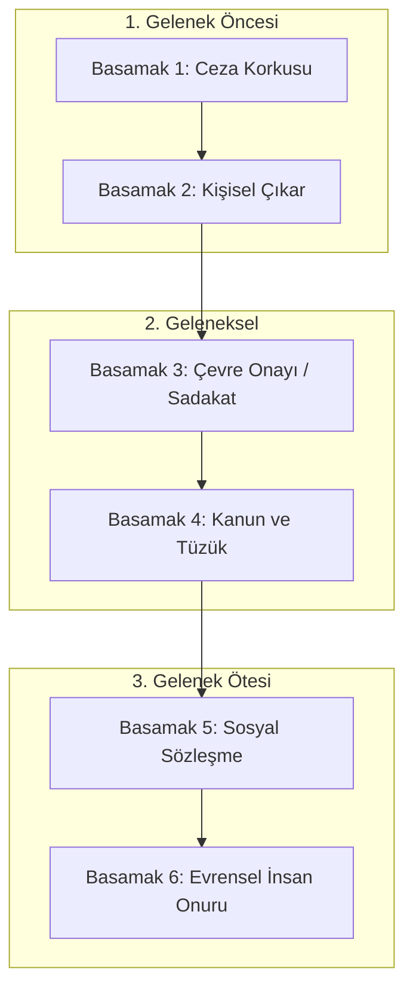
*Şekil 2.1: Kohlberg Ahlaki Gelişim Basamaklarının Mühendislik Kararlarına Etkisi.*

### Sık Yapılan Hatalar ve Yanılgılar
- **"Geleneksel düzey (Basamak 4: Kanun ve Düzen) profesyonel olmak için yeterlidir":** Yeterli değildir. Tarihteki birçok felaket ve etik facia, çalışanların "Ben sadece bana verilen kuralları ve emirleri uyguladım" demesinden kaynaklanmıştır. Mühendis, kuralın arkasındaki insani amacı sorgulamakla yükümlüdür.
- **"Kişisel ahlak meslek etiğinin her zaman önündedir":** Bir mühendis kendi dini veya kişisel inançları nedeniyle belirli bir etnik kökene, cinsiyete veya gruba hizmet vermeyi reddedemez. Meslek etiği tarafsızlık ve ayrımcılık yapmama ilkesini dayatır.

### Aktif Hatırlama Soruları ve Çözümleri
1. *Soru:* "Eğer bu veri sızıntısını bildirirsem iş arkadaşlarım bana 'ispiyoncu' der ve beni aralarına almazlar" diye düşünen bir yazılımcı, Kohlberg'in hangi basamağındadır?

Çözüm ve Açıklama

Basamak 3: Kişilerarası Uyum ("İyi Çocuk" yönelimi). Bu basamakta kişi grubun onayını, arkadaşlık ilişkilerini ve dışlanmamayı mesleki ilkelerin önüne koyar.

2. *Soru:* Ahlak ile etik arasındaki farkı tek bir cümleyle özetleyiniz.

Çözüm ve Açıklama

Ahlak toplumun benimsediği pratik inanç ve kurallar bütünü iken, etik bu kuralların rasyonel, nesnel ve eleştirel biçimde sorgulanmasını sağlayan felsefi disiplindir.

3. *Soru:* Kohlberg'in 5. basamağında olan bir mühendis, yürürlükteki bir güvenlik standardını nasıl değerlendirir?

Çözüm ve Açıklama

Standardı toplumun güvenliğini sağlayan bir sosyal sözleşme olarak görür; ancak yeni teknolojiler karşısında bu standart kamu güvenliğini korumada yetersiz kalıyorsa, standardın güncellenmesi ve kamu yararına yeniden düzenlenmesi için mesleki girişimde bulunur.

### Hafta Kaynak ve Video Kartı
- **Video:** University of Virginia Online Ethics Center, Michael Loui, *Professional Ethics in Engineering video series* ([OEC Playlist](https://youtube.com/playlist?list=PLdHmP-EKPCRD3-mFYjOjapYPYSnbBpFRV)).
- **Web Kaynağı:** [UVA OEC Moral Development & Ethics](https://onlineethics.virginia.edu/cases/professional-ethics-engineering). Videoda profesyonelliğin temel unsurları olan özerklik, kamuya adanmışlık ve ahlaki gelişim tartışılmaktadır.

---

## Hafta 3: Etik Kuralları ve Sistemleri

### Öğrenme Hedefleri
Bu bölümü tamamladığınızda:
- Normatif etiğin üç büyük sistemini (Yararcılık, Deontoloji, Erdem Etiği) ve Hak Temelli Yaklaşımı derinlemesine karşılaştırabileceksiniz.
- Bir mühendislik ikileminde bu teorilerin nasıl farklı çözümler ve gerekçeler ürettiğini analiz edebileceksiniz.
- Teorilerin zayıf ve kör noktalarını belirleyebileceksiniz.

### Kavram Açıklaması: Büyük Normatif Etik Sistemleri
Mühendislik kararlarını gerekçelendirirken başvurulan felsefi sistemler eylemin ahlaki değerini farklı unsurlara dayandırır:

#### 1. Sonuçsalcılık ve Yararcılık (Utilitarianism - Jeremy Bentham, John Stuart Mill)
- **Temel İlke:** Bir eylemi doğru kılan, ürettiği sonuçların toplam faydasıdır. "En çok sayıda insan için en yüksek düzeyde iyilik ve en az düzeyde acı."
- **Eylem Yararcılığı vs Kural Yararcılığı:**
  - *Eylem Yararcılığı:* Her tekil eylemin doğrudan sonuçları hesaplanır.
  - *Kural Yararcılığı:* Genel olarak uygulandığında topluma en yüksek faydayı sağlayan kurallara ("Yalan söyleme", "Test sonuçlarını tahrif etme") sadık kalınır; çünkü kuralı çiğnemek uzun vadede toplumsal güveni yıkar.
- **Zayıf Yönü:** Azınlığın temel haklarının çoğunluğun menfaati uğruna feda edilmesi riskini taşır (örneğin 100 kişinin konforu için 1 kişinin yaşamını tehlikeye atmak).

#### 2. Ödev Etiği / Deontoloji (Immanuel Kant)
- **Temel İlke:** Eylemin ahlaki değeri sonuçlarından bağımsızdır; eylemin bir ahlaki ödevden doğup doğmadığına ve niyetin saflığına bağlıdır.
- **Koşulsuz Buyruk (Categorical Imperative):**
  1. *Evrenselleştirilebilirlik Formülü:* Yalnızca aynı zamanda genel bir yasa olmasını isteyebileceğin kurala göre eyle ("Herkes sıkıştığında yalan söyleseydi söz verme kurumu çökerdi, öyleyse yalan söylemek kategorik olarak yanlıştır").
  2. *İnsanı Amaç Olarak Görme Formülü:* İnsanlığı (kendinde ve başkalarında) asla salt bir araç olarak değil, daima bir amaç olarak gör.
- **Zayıf Yönü:** Katılık. İki mutlak ödev çatıştığında (örneğin "Doğruyu söyle" ile "Bir masumun hayatını kurtar") çözüm üretmekte zorlanabilir.

#### 3. Erdem Etiği (Virtue Ethics - Aristoteles)
- **Temel İlke:** Eylemin kuralına veya sonucuna değil, eylemi yapan failin karakterine ve erdemlerine odaklanır.
- **Erdemler ve Altın Orta (Golden Mean):** Cesaret, dürüstlük, basiret, adalet. Erdem, iki aşırılık arasındaki dengedir (örneğin Korkaklık ile Çılgınlık arasındaki denge Cesarettir).
- **Phronesis (Pratik Bilgelik):** Soyut kuralları karmaşık somut durumlarda doğru uygulama becerisidir.

#### 4. Hak Temelli Etik (Rights Ethics - John Locke, Modern İnsan Hakları)
- İnsanlar insan olmalarından ötürü devredilemez haklara (yaşam, özgürlük, mülkiyet, mahremiyet, bilgilendirilmiş rıza) sahiptir. Bir eylem bir başkasının temel hakkını çiğniyorsa çoğunluğa fayda sağlasa bile gayri ahlakidir.

| Teori | Kurucular | Odak Noktası | Temel Karar Sorusu | Mühendislikteki Örneği |
| :--- | :--- | :--- | :--- | :--- |
| **Yararcılık** | Bentham, Mill | Eylemin sonuçları | "Hangi seçenek toplum için en büyük net faydayı sağlar?" | Risk-maliyet-fayda analizleri, kamu altyapı projeleri |
| **Deontoloji** | Kant | Ödevler ve evrensel kurallar | "Bu kural evrensel bir ilke olabilir mi? İnsan araçlaştırılıyor mu?" | Test verilerinde sıfır tahrifat, mutlak güvenlik standardı |
| **Erdem Etiği** | Aristoteles | Karakter ve mesleki ustalık | "Erdemli ve basiretli bir mühendis bu durumda ne yapardı?" | Mesleki dürüstlük, mentorluk, teknik titizlik |
| **Hak Temelli** | Locke | Temel insan hakları | "Bir bireyin veya grubun vazgeçilmez hakkı ihlal ediliyor mu?" | Veri mahremiyeti, aydınlatılmış kullanıcı rızası |

### Vaka İncelemesi (Öğrenme Amaçlı Senaryo 3)
*Senaryo:* Otonom araç yazılımı geliştiren bir mühendislik ekibi, kaçınılmaz bir çarpışma anında aracın yapacağı manevra algoritmasını tasarlamaktadır. Araç hızla giderken önüne aniden beş kişilik bir yaya grubu fırlamıştır; frene basılsa bile durulamayacaktır. Tek alternatif manevra aracı kaldırımdaki tek bir yayaya doğru kırmaktır.

### Gerekçeli Adım Adım Karar Analizi
1. **Yararcı Yaklaşım:** 5 kişinin hayatı 1 kişinin hayatından sayısal olarak daha fazla fayda/daha az toplam acı demektir. Yararcılık aracı tek yayaya yönlendirmeyi önerebilir. Ancak kural yararcılığı, yayaların kaldırımda güven içinde yürüme beklentisini yok etmenin yaratacağı genel güvensizliği hesaba katar.
2. **Deontolojik ve Hak Temelli Yaklaşım:** Kaldırımdaki masum yayayı ezmek, o insanı diğer 5 kişiyi kurtarmak için "salt bir araç" olarak kullanmaktır. Hiçbir algoritma masum bir yayayı kasıtlı olarak hedef seçemez. İnsan hayatları aritmetik olarak toplanamaz.
3. **Mühendislik Sorumluluğu Açısından Karar:** Otonom sistemler aktif bir insan öldürme optimizasyonu yapamaz. Sistem, aracın kendi şeridinde maksimum frenleme ve çarpışma şiddetini azaltma protokolünü çalıştırmalıdır; sistem keyfi biçimde başka bir masum insanı hedef tahtası yapamaz.

### Görsel Analiz Şeması
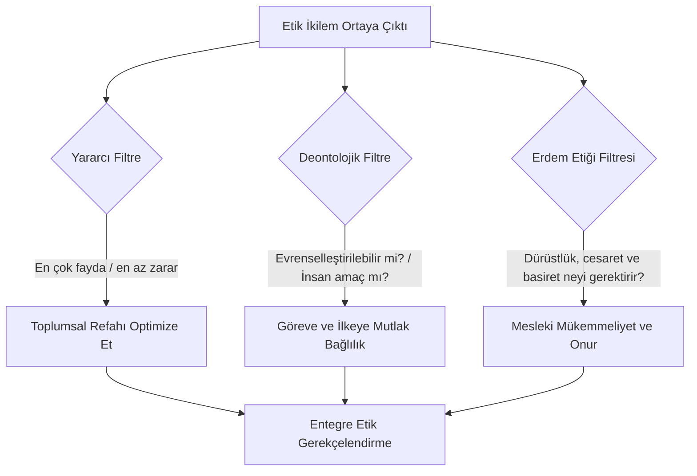
*Şekil 3.1: Farklı Normatif Sistemlerin Birbirini Dengeleyen Entegre Karar Modeli.*

### Sık Yapılan Hatalar ve Yanılgılar
- **"Yararcılık kâr-zarar hesabı yapıp kârı seçmektir":** Bu felsefi cehalettir. Yararcılıkta şirketin kârı değil, etkilenen tüm canlıların (özellikle toplumun) acı ve hazzı eşit ağırlıkla hesaba katılır. Çoğu mühendislik skandalı yararcılıktan değil, dar şirket bencilliğinden kaynaklanır.
- **"Deontoloji gerçek hayata uygulanamaz derecede katıdır":** Deontoloji, insan hayatının ve veri mahremiyetinin hiçbir finansal kâr uğruna takas edilemeyeceğini garanti altına alan en sağlam emniyet supabıdır.

### Aktif Hatırlama Soruları ve Çözümleri
1. *Soru:* Kant'ın "İnsanı asla salt bir araç olarak görme" buyruğu, bir yazılım şirketinin kullanıcı verilerini haber vermeden işlemesi durumunda nasıl ihlal edilir?

Çözüm ve Açıklama

Kullanıcı kendi rızası ve bilgisi dışında yalnızca şirketin kâr elde etmesi veya yapay zekâ modelini eğitmesi için bir 'veri kaynağı aracı' konumuna indirgenmiştir. İnsanın özerkliği ve hakları hiçe sayıldığı için Kantçı açıdan ağır bir etik ihlaldir.

2. *Soru:* Eylem yararcılığı ile kural yararcılığı arasındaki temel fark nedir?

Çözüm ve Açıklama

Eylem yararcılığı her münferit eylemin anlık net sonucunu hesaplarken; kural yararcılığı, genel olarak benimsendiğinde uzun vadede topluma en büyük faydayı getiren kurallara uymayı esas alır.

3. *Soru:* Aristoteles'in "Altın Orta" kavramı mesleki cesaret erdemine nasıl uygulanır?

Çözüm ve Açıklama

Cesaret; gereksiz yere her şeye körü körüne başkaldırıp işinden olan 'çılgınlık/patavatsızlık' ile tehlike karşısında susup görmezden gelen 'korkaklık' arasındaki rasyonel, basiretli ve ölçülü dengedir.

### Hafta Kaynak ve Video Kartı
- **Video:** University of Virginia Online Ethics Center, Michael Loui, *Professional Ethics in Engineering video series* ([UVA OEC Playlist](https://youtube.com/playlist?list=PLdHmP-EKPCRD3-mFYjOjapYPYSnbBpFRV)).
- **Web Kaynağı:** [UVA OEC Engineering Ethics](https://onlineethics.virginia.edu/cases/professional-ethics-engineering). Videoda teorilerin ezberlenmesi değil, mühendislik tasarım kararlarında birer analiz aracı olarak kullanılması öğretilmektedir.

---

## Hafta 4: Etik-Toplum İlişkisi

### Öğrenme Hedefleri
Bu bölümü tamamladığınızda:
- Mühendislik mesleğinin toplumla yaptığı zımni "Toplumsal Sözleşme"yi kavrayabileceksiniz.
- Kamu Sağlığı, Güvenliği ve Refahı (HSW) ilkesinin birincil önemini analiz edebileceksiniz.
- Citicorp Center Kulesi tarihi vakası üzerinden şeffaflık, etik cesaret ve kriz yönetimini öğreneceksiniz.

### Kavram Açıklaması: Mühendisliğin Toplumsal Sözleşmesi
Mühendislik, toplumdan bağımsız olarak icra edilen bir hobi veya salt teknik bir ticaret değildir. Toplum mühendislere şu hakları ve ayrıcalıkları tanır:
- Yüksek teknik eğitim alma, diploma ve mesleki unvan kullanma hakkı,
- Karmaşık, kamu güvenliğini doğrudan etkileyen sistemler tasarlama ve imzalama tekeli,
- Mesleki özerklik ve saygınlık.

Bu ayrıcalıkların karşılığında toplumun mühendislerden tek bir temel talebi vardır: **Kamu Sağlığı, Güvenliği ve Refahını (Health, Safety, and Welfare - HSW) her türlü kişisel, kurumsal ve finansal çıkarın üstünde tutmak.** Bu zımni mutabakat mühendisliğin toplumsal sözleşmesidir.

### Vaka İncelemesi: Citicorp Center Kulesi Vakası (1978)
*Tarihsel Arka Plan:* New York’taki 59 katlı Citicorp Center, altındaki kilise parselini koruyacak biçimde alışılmadık kolon konumlarıyla tasarlandı. Yapısal danışman **William LeMessurier** idi. UVA Online Ethics Center’ın vaka anlatımı bu örneği mesleki sorumluluk ve risk iletişimi açısından ele alır.

*Krizin Ortaya Çıkışı:*
1. UVA OEC vaka anlatımına göre, bir öğrencinin sorusundan sonra LeMessurier tasarım varsayımlarını yeniden inceledi ve çapraz (quartering) rüzgârların yapısal elemanlarda önemli ek talepler doğurabileceğini fark etti. Sayısal etkiler bu ders notunda kesin mühendislik verisi olarak sunulmuyor.
2. UVA OEC’nin aktardığı vaka anlatımı, detaylarda kaynaklı birleşim tasarımından cıvatalı birleşimlere geçişi ve bu birleşimlerin çapraz rüzgâr yükleri altındaki önemini tartışır. Değişikliğin nedeni ve onay süreci konusunda kesin, tek cümlelik bir açıklama yapmak yerine kaynak anlatımına başvurulmalıdır.
3. Vaka anlatımı, yeniden hesaplanan rüzgâr yüklerinin tasarım ve birleşim güvenliği bakımından ciddi bir risk doğurduğunu ve güçlendirme/iletişim gerektirdiğini aktarır. Burada belirli bir tekrar süresi veya can kaybı tahmini doğrulanmış nicel sonuç olarak verilmemektedir.

*LeMessurier'in Etik Kararı ve Eylemleri:*
- OEC vaka anlatımında LeMessurier, bulguyu ilgili paydaşlara iletip yapısal sorunu değerlendirme ve giderme sürecini başlatır. Yönetmelik uygunluğuyla ilgili iddialar dönemin kurallarına ve kaynak anlatımına göre ayrıca incelenmelidir.
- Vaka anlatımı, LeMessurier’in bina sahibiyle ve ilgili teknik paydaşlarla hızlıca iletişim kurup riskin değerlendirilmesi ve giderilmesi için çalıştığını aktarır.
- OEC vaka anlatımı, bina kullanımını sürdürürken güçlendirme çalışmalarının yürütüldüğünü bildirir. Bu çalışma, iletişim ve müdahale ayrıntıları için kaynak sayfadaki tam anlatıma dayanır.
- Vaka, tasarım sorununun saklanması yerine açıklanıp çözüme kavuşturulmasını mesleki sorumluluk örneği olarak tartışır.

*Sonuç:* UVA OEC’nin vaka anlatımına göre güçlendirme süreci tamamlandı. Bu örnek, riskin farkına varıldığında teknik yeniden değerlendirme, iletişim ve düzeltici eylemin önemini tartışmak için kullanılır.

### Gerekçeli Adım Adım Karar Analizi
1. **Olgular:** Yapısal bir hesap ve imalat hatası vardır; bina fırtınada yıkılma riski taşımaktadır; hata henüz dışarıdan bilinmemektedir.
2. **Paydaşlar:** Binada ve çevrede yaşayan yüz binlerce insan (yaşam hakkı), bina sahipleri (mali risk), mühendis (itibar ve hukuki sorumluluk).
3. **Değerler:** Kamu güvenliği ve insan hayatı vs kişisel prestij ve şirketin maliyet korkusu.
4. **Gerekçeli Karar:** Kamu güvenliği tartışmasız üstündür. Risk derhal şeffaflıkla yönetilmeli, tüm paydaşlar organize edilmeli ve güçlendirme ivedilikle yapılmalıdır.

### Görsel Analiz Şeması
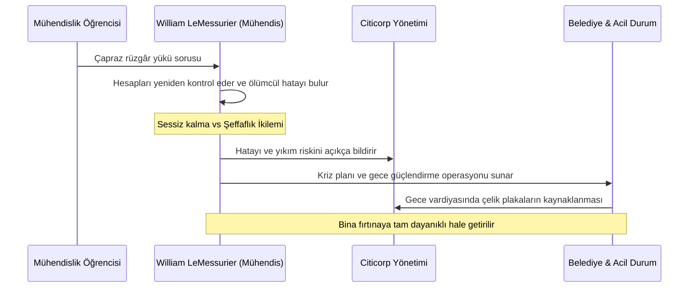
*Şekil 4.1: Citicorp Center Krizinde Etik Karar ve Paydaş İletişimi Akışı.*

### Sık Yapılan Hatalar ve Yanılgılar
- **"Bir tasarım yönetmeliğe uygunsa ek değerlendirme gerekmez":** Standartlara uygunluk önemlidir; ancak yeni bilgi veya öngörülebilir tehlike ortaya çıktığında mühendis ek teknik inceleme ve uygun bildirim ihtiyacını değerlendirmelidir. Citicorp vakasının ayrıntıları UVA OEC anlatımında yer alır.
- **"Bir sorunu bildirmek mesleki itibarı mutlaka yok eder":** Citicorp vakası, sorunun açıklanıp giderilmesinin ve risk iletişiminin etik önemini incelemek için kullanılabilir; tek başına her vakada aynı sonucun alınacağını kanıtlamaz.

### Aktif Hatırlama Soruları ve Çözümleri
1. *Soru:* Citicorp Center krizinde müteahhidin yaptığı hangi değişiklik binanın yıkılma riskini kritik seviyeye taşımıştır?

Çözüm ve Açıklama

Orijinal tasarımda yer alan kaynaklı birleşimler yerine, maliyet ve zamandan tasarruf amacıyla cıvatalı birleşimlerin kullanılması ve bu değişikliğin çapraz rüzgâr yükleri altındaki dayanımının zayıf olması.

2. *Soru:* Mühendisliğin toplumla yaptığı "Toplumsal Sözleşme"nin özü nedir?

Çözüm ve Açıklama

Toplumun mühendislere tanıdığı unvan, özerklik ve imza yetkisi ayrıcalığına karşılık, mühendislerin kamu sağlığı, güvenliği ve refahını her türlü ticari ve kişisel çıkarın üzerinde tutma taahhüdüdür.

3. *Soru:* LeMessurier kriz yönetiminde neden New York Belediyesi ve meteoroloji uzmanlarıyla birlikte çalışmıştır?

Çözüm ve Açıklama

Olası bir kasırga anında tahliye planlarını hazır tutmak, güçlendirme tamamlanana kadar kamu riskini gerçek zamanlı takip etmek ve şeffaf bir acil durum protokolü yürütmek için.

### Hafta Kaynak ve Video Kartı
- **Video:** University of Virginia Online Ethics Center, Michael Loui, *Professional Ethics in Engineering video series* ([UVA OEC Ders Sayfası](https://onlineethics.virginia.edu/cases/professional-ethics-engineering)).
- **Vaka Kaynağı:** [William LeMessurier — The Fifty-Nine-Story Crisis](https://onlineethics.virginia.edu/cases/william-lemessurier-fifty-nine-story-crisis-lesson-professional-behavior). UVA OEC’nin tarihsel vaka anlatımıdır; ayrıntılar için sayfaya bakın.

---

## Hafta 5: Etik Sorgulama ve Toplumsal Yozlaşma

### Öğrenme Hedefleri
Bu bölümü tamamladığınızda:
- Diane Vaughan'ın "Sapmanın Normalleşmesi" (Normalization of Deviance) kavramını açıklayabileceksiniz.
- Irving Janis'in "Grup Düşüncesi" (Groupthink) mekanizmasını ve mühendislikteki yıkıcı etkilerini kavrayabileceksiniz.
- Challenger Uzay Mekiği faciası üzerinden düdük çalma (whistleblowing) etiğini ve kurumsal baskı dinamiklerini analiz edebileceksiniz.

### Kavram Açıklaması: Kurumsal Körlük ve Sapmanın Normalleşmesi
Kurumsal ortamlarda etik felaketler genellikle bir gecede veya kötü niyetli bir canavarın kararıyla ortaya çıkmaz. Yavaş, sinsice ve bürokratik mekanizmalarla gelişir:

1. **Sapmanın Normalleşmesi (Diane Vaughan):** Bir sistemde teknik veya etik bir kural ihlal edildiğinde veya bir sapma meydana geldiğinde felaket yaşanmazsa, sistem bu sapmayı zamanla "kabul edilebilir yeni standart" olarak görmeye başlar. Güvenlik marjları adım adım aşınır.
2. **Grup Düşüncesi (Groupthink - Irving Janis):** Bir gruptaki üyelerin uyum, konsensüs ve yöneticiyi memnun etme arzusu nedeniyle eleştirel düşünmeyi, aykırı fikirleri ve risk uyarılarını bastırmasıdır.
3. **Düdük Çalma (Whistleblowing):** Bir kurum içindeki ciddi etik veya güvenlik kaygılarını uygun kanallara bildirmektir. İç bildirim, düzenleyici/mesleki kanallar ve kamuya açıklama arasındaki seçim; riskin aciliyeti, kanıt, kurum içi yolların işlerliği, gizlilik ve geçerli hukuk dikkate alınarak yapılmalıdır.

### Vaka İncelemesi: Space Shuttle Challenger Faciası (28 Ocak 1986)
*Olay:* Fırlatmadan 73 saniye sonra mekik infilak etmiş ve 7 astronot hayatını kaybetmiştir.

*Etik ve Teknik Kök Neden:*
- Rogers Komisyonu, kazanın sağ katı roket motoru bağlantı/joint arızasından kaynaklandığını; düşük sıcaklıkta O-ring sızdırmazlık işlevine ilişkin kaygıların karar sürecinde önemli olduğunu bildirdi.
- Komisyon raporuna göre Thiokol mühendisliği, beklenen O-ring sıcaklığı önceki uçuşların deneyim sınırının altındaysa fırlatmayı önermedi; yönetim daha sonra ilk tutumunu değiştirdi, mühendislerden gelen itirazlar sürdü.
- Rapor, kıdemli fırlatma karar vericilerinin ilk yazılı fırlatmama tavsiyesinden ve bazı önceki O-ring sorunlarının bağlamından habersiz kaldığını; kararın eksik ve yer yer yanıltıcı bilgiye dayandığını tespit etti. Burada TV yayını veya bütçe takvimi kaynaklı baskı iddiası ileri sürülmüyor.
- Mekik fırlatmadan 73 saniye sonra parçalandı; yedi mürettebat üyesi hayatını kaybetti. (Kaynak: [Rogers Komisyonu, Bölüm V](https://www.nasa.gov/history/rogersrep/v1ch5.htm).)

### Gerekçeli Adım Adım Karar Analizi
1. **Olgular:** Komisyon raporu, önceki O-ring sorunlarını ve düşük sıcaklık etkilerine ilişkin mühendislik kaygılarını; Thiokol’un 53°F altı beklenen O-ring sıcaklıklarında fırlatmama yönündeki ilk tavsiyesini kaydeder. Ölçüm ve karar ayrıntıları için NASA raporuna bakın.
2. **Paydaşlar:** 7 astronot ve aileleri, uzay programının geleceği, mühendisler, vergi mükellefi halk.
3. **Kavramsal Çatışma:** Teknik belirsizlik ve güvenlik kaygılarının, kurumsal karar sürecinde nasıl iletildiği ve değerlendirildiği.
4. **Gerekçeli Karar:** Güvenlik açısından anlamlı ve yeterince karakterize edilmemiş bir risk açıkça belgelenmeli, karar vericilere aktarılmalı ve gerekli uzman incelemesi tamamlanmadan kabul edilmiş gibi gösterilmemelidir. Karar süreci belirsizliği ve karşı görüşü görünür tutmalıdır.

### Görsel Analiz Şeması
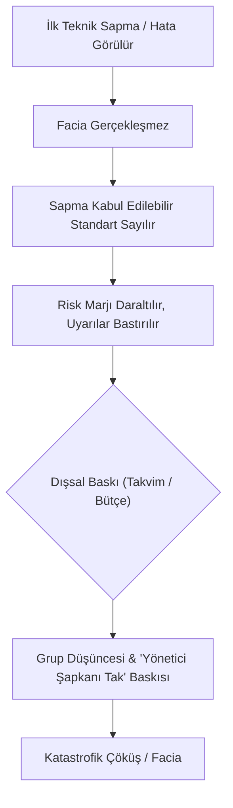
*Şekil 5.1: Sapmanın Normalleşmesi ve Kurumsal Çöküş Döngüsü.*

### Sık Yapılan Hatalar ve Yanılgılar
- **"Daha önce kaza olmadıysa sistem güvenlidir":** Önceki başarılı uçuşlar tek başına güvenlik kanıtı değildir; tasarım sınırları ve yeni risk verileri ayrıca değerlendirilmelidir.
- **"Mühendis her zaman yöneticisinin ticari kararına boyun eğmelidir":** Teknik kaygılar, karşı kanıtlar ve sorumluluklar karara eksiksiz taşınmalıdır; mesleki etik, güvenlik verisini gizlemeyi veya çarpıtmayı desteklemez.

### Aktif Hatırlama Soruları ve Çözümleri
1. *Soru:* Rogers Komisyonu Challenger fırlatma kararındaki hangi bilgi ve iletişim sorunlarını belirledi?

Çözüm ve Açıklama

Rogers Komisyonu’nun bulgusu yalnız bu sloganla özetlenemez. Esas sorun, karar vericilerin başlangıçtaki fırlatmama tavsiyesini ve devam eden mühendis itirazlarını tam olarak bilmemesi; kararın eksik/yanıltıcı bilgiyle alınmasıdır.

2. *Soru:* "Mühendis şapkanı çıkar, yönetici şapkanı tak" cümlesi etik açıdan neden gayrimeşrudur?

Çözüm ve Açıklama

Çünkü mühendislik şapkası kamu güvenliğini, bilimsel dürüstlüğü ve teknik gerçekleri temsil eder. Bu şapkayı çıkarmak, kamu güvenliğini ticari ve bürokratik hırslara kurban etmek anlamına gelir.

3. *Soru:* Düdük çalma (whistleblowing) hangi şartlar altında ahlaki bir zorunluluk haline gelir?

Çözüm ve Açıklama

Bildirim için her durumda bütün iç kanalların tüketilmesi veya mutlak kesinlik aranmaz. Aciliyet, kanıtların niteliği, iç kanalların güvenilirliği, uygun yetkili dış kanallar ve gizlilik/yasal yükümlülükler birlikte değerlendirilmelidir; kaynak: [UVA OEC Whistleblowing Subject Aid](https://onlineethics.virginia.edu/cases/oec-subject-aids/whistleblowing-subject-aid).

### Hafta Kaynak ve Video Kartı
- **Video:** University of Virginia Online Ethics Center, Michael Loui, *Professional Ethics in Engineering video series* ([UVA OEC Playlist](https://youtube.com/playlist?list=PLdHmP-EKPCRD3-mFYjOjapYPYSnbBpFRV)).
- **Web Kaynağı:** [Rogers Komisyonu Raporu, Bölüm V](https://www.nasa.gov/history/rogersrep/v1ch5.htm). Fırlatma karar sürecine ve Thiokol’un ilk tavsiyesiyle sonradan değişen yönetim pozisyonuna ilişkin resmî komisyon bulguları burada yer alır.

---

## Hafta 6: Etik İlkeler, Türler ve Yaklaşımlar

### Öğrenme Hedefleri
Bu bölümü tamamladığınızda:
- Uygulamalı etiğin altı temel evrensel ilkesini (Zarar Vermeme, Yararlılık, Özerklik, Adalet, Dürüstlük, Sadakat) tanımlayabileceksiniz.
- Mikro-etik ve makro-etik yaklaşımları arasındaki farkı açıklayabileceksiniz.
- Therac-25 analogu medikal yazılım vakası üzerinden bu ilkelerin yazılım mühendisliğindeki karşılığını analiz edebileceksiniz.

### Kavram Açıklaması: Temel Etik İlkeler ve Uygulama Türleri
Uygulamalı etik (özellikle biyomedikal ve mühendislik etiği), karmaşık durumları analiz etmek için altı temel ilke seti kullanır:

1. **Zarar Vermeme (Non-maleficence):** *Primum non nocere* (Öncelikle zarar verme). Başkalarına fiziksel, psikolojik, finansal veya mahremiyet açısından zarar vermekten kaçınma yükümlülüğüdür. Bu ilke negatif bir ödevdir ve önceliklidir.
2. **Yararlılık (Beneficence):** Başkalarının iyiliğini teşvik etme, fayda sağlama ve riskleri önleme pozitif yükümlülüğüdür.
3. **Özerklik / Otonomi (Autonomy):** Bireylerin kendi kararlarını verme, kendi verileri ve bedenleri üzerinde söz hakkına sahip olma hakkına saygı duymaktır (Aydınlatılmış onam / Bilgilendirilmiş rıza).
4. **Adalet (Justice):** Fayda, yük ve risklerin toplum kesimleri arasında adil, eşit ve tarafsız biçimde dağıtılmasıdır.
5. **Dürüstlük ve Doğruluk (Veracity):** Yalan söylememe, verileri tahrif etmeme, paydaşları yanıltmama yükümlülüğüdür.
6. **Sadakat ve Güvenilirlik (Fidelity):** Verilen sözleri tutma, sözleşmeye sadık kalma ve mesleki güveni koruma ilkesidir.

**Mikro-Etik vs Makro-Etik:**
- *Mikro-Etik:* Bireysel mühendisin iş yerindeki tekil kararları, iş arkadaşlarıyla ilişkileri ve müşteriye karşı sorumluluklarıdır (örneğin hediye kabul etmeme, test sonucunu doğru yazma).
- *Makro-Etik:* Mesleğin ve teknolojinin bir bütün olarak toplumsal, küresel ve çevresel etkileridir (örneğin yapay zekânın kitlesel işsizliğe etkisi, nükleer teknoloji, iklim krizi).

### Vaka İncelemesi (Öğrenme Amaçlı Senaryo 4 - Therac-25 Analog Analizi)
*Senaryo:* Bir kanser tedavi merkezinde kullanılan radyoterapi cihazının yazılımını geliştiren ekip, cihazın donanımsal güvenlik kilitlerini (hardware interlocks) maliyeti düşürmek amacıyla yazılımsal kontrollere devretmiştir. Ancak yazılımda belirli hızlı tuş kombinasyonlarında bir "yarış durumu" (race condition) hatası oluşmakta; operatör ekranda hata görse bile cihaz hastaya ölümcül dozda radyasyon vermektedir. Yazılım ekibi başlangıçta hastaların yanık şikayetlerini "Cihazımızda yazılımsal hata olması imkansızdır, operatör hatasıdır" diyerek reddeder.

### Gerekçeli Adım Adım Karar Analizi
1. **Olgular:** Hastalar aşırı radyasyona maruz kalmıştır; yazılımda yarış durumu riski vardır; donanımsal güvenlik kaldırılmıştır.
2. **İlke İhlalleri:**
   - *Zarar Vermeme İhlali:* Hastalara doğrudan telafisi imkansız bedensel zarar verilmiştir.
   - *Dürüstlük İhlali:* Yazılım ekibi kendi ürünlerindeki olası hataları araştırmayıp inkâr etmiştir.
   - *Özerklik İhlali:* Hastalar ve hekimler risk hakkında bilgilendirilmemiştir.
3. **Mühendislik Etiği Dersi:** Kritik güvenlik sistemlerinde yazılım ve donanım yedekliliği şarttır. Mühendis kendi koduna aşırı güvenemez (hubris); şikayet karşısında savunmacı olmak yerine alçakgönüllülük ve derinlemesine test sorumluluğu sergilemelidir.

### Görsel Analiz Şeması
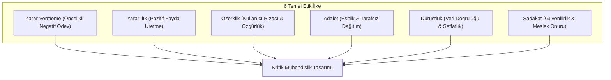
*Şekil 6.1: Altı Temel Etik İlkenin Mühendislik Tasarım Kararlarına Entegrasyonu.*

### Sık Yapılan Hatalar ve Yanılgılar
- **"Zarar vermemek ile yarar sağlamak aynı şeydir":** Değildir. Zarar vermemek (Non-maleficence) mutlak bir kırmızı çizgidir; yarar sağlamak (Beneficence) ise imkanlar dahilinde maksimize edilir. Birine fayda sağlamak için başka bir masuma zarar verilemez.
- **"Yazılım fiziksel olmadığı için kimseyi öldürmez":** Modern dünyada uçaklar, tıp cihazları, nükleer santraller ve otonom araçlar yazılımla yönetilir. Yazılım hatası doğrudan fiziksel ölüme yol açar.

### Aktif Hatırlama Soruları ve Çözümleri
1. *Soru:* Mikro-etik ile makro-etik arasındaki farkı birer örnekle açıklayınız.

Çözüm ve Açıklama

Mikro-etik bir mühendisin tedarikçiden gelen pahalı bir akşam yemeği teklifini rüşvet sayıp reddetmesidir. Makro-etik ise mühendisler odasının otomasyonun çalışanlar üzerindeki etkilerini inceleyip adil geçiş politikaları önermesidir.

2. *Soru:* Bir tıbbi yazılımda "Bilgilendirilmiş Rıza" (Informed Consent) hangi etik ilkenin doğrudan uygulamasıdır?

Çözüm ve Açıklama

Özerklik / Otonomi (Autonomy) ilkesinin doğrudan uygulamasıdır.

3. *Soru:* Therac-25 analogu vakalarda mühendislerin en büyük bilişsel hatası nedir?

Çözüm ve Açıklama

Kendi yazdıkları yazılımın hatasız olduğuna dair aşırı güven (hubris) ve donanımsal güvenlik bariyerlerini yazılıma güvenerek tamamen devreden çıkarmaktır.

### Hafta Kaynak ve Video Kartı
- **Video:** University of Virginia Online Ethics Center, Michael Loui, *Professional Ethics in Engineering video series* ([UVA OEC Playlist](https://youtube.com/playlist?list=PLdHmP-EKPCRD3-mFYjOjapYPYSnbBpFRV)).
- **Web Kaynağı:** [UVA OEC Research & Engineering Ethics](https://onlineethics.virginia.edu/cases/professional-ethics-engineering). Videoda dürüstlük, zarar vermeme ve araştırma etiğinin temel unsurları işlenmektedir.

---

## Hafta 7: Mesleki Etik ve Disiplinler Arası İlişkiler

### Öğrenme Hedefleri
Bu bölümü tamamladığınızda:
- Çok disiplinli ekiplerde (mühendislik, tıp, hukuk, pazarlama, yönetim) rol ve değer çatışmalarını yönetebileceksiniz.
- "Yetkinlik Sınırları" (Limits of Competence) ilkesini ve yetkisiz onay vermenin risklerini kavrayabileceksiniz.
- Bir projede sorumluluğun bulanıklaşması (Dağıtılmış Sorumluluk Problemi) ile mücadele yöntemlerini öğreneceksiniz.

### Kavram Açıklaması: Disiplinler Arası Çatışmalar ve Yetkinlik Sınırları
Modern projeler tek bir mühendisin veya tek bir disiplinin sınırlarını çoktan aşmıştır. Bir yapay zekâlı sağlık sistemi projesinde yazılımcılar, veri bilimciler, tıp hekimleri, hukuk danışmanları, kullanıcı deneyimi tasarımcıları ve finans yöneticileri bir arada çalışır. Bu birliktelik iki temel etik zorluk doğurur:

1. **Değer Çatışması:**
   - *Pazarlama:* "Ürünü hızla pazara sürmeliyiz."
   - *Finans:* "Birim maliyetleri %20 kısmalıyız."
   - *Hukuk:* "Yasal olarak tazminat riskini kullanıcıya yıkan bir sözleşme yazalım."
   - *Mühendis:* "Bu sistem yeterince test edilmedi, güvenlik açığı var."
2. **Yetkinlik Sınırı İlkesi (Limits of Competence):** Bir mühendis yalnızca eğitimini aldığı, deneyim sahibi olduğu ve yetkin olduğu alanlarda teknik görüş bildirmeli, tasarım yapmalı ve imza atmalıdır. Alanı dışındaki bir konuyu "nasılsa bir şey olmaz" diyerek onaylamak mesleki ihmaldir.
3. **Birçok El Sorunu (Problem of Many Hands):** Karmaşık projelerde hata ortaya çıktığında herkesin topu bir diğerine atması ("Ben sadece API yazdım", "Ben sadece arayüz çizdim") durumudur. Kolektif sorumluluk bireysel sorumluluğu yok etmez.

### Vaka İncelemesi (Öğrenme Amaçlı Senaryo 5)
*Senaryo:* Bir kamu hastanesinde yoğun bakım hastalarının yaşamsal parametrelerini takip ederek hekime erken uyarı gönderen yapay zekâ projesinde;
- Veri bilimci Kerem, modelin belirli etnik veya yaş gruplarında %15 daha düşük doğrulukla çalıştığını tespit eder.
- Proje yöneticisi, "Hastanenin hibe fonunu kaybetmemesi için bu ay teslim etmemiz şart, raporu genel doğruluk üzerinden yaz, alt grup detaylarını rapordan çıkar" der.
- Hukuk danışmanı, "Kullanıcı sözleşmesine 'Bu sistem sadece öneri niteliğindedir, tüm sorumluluk hekime aittir' maddesi koyarız, hukuki risk kalmaz" tavsiyesinde bulunur.

### Gerekçeli Adım Adım Karar Analizi
1. **Olgular:** Algoritmik yanlılık (bias) mevcuttur; belirli hasta gruplarında hayati risk yüksektir; teslim baskısı vardır.
2. **Paydaşlar:** Yoğun bakım hastaları, hekimler, veri bilimciler, hastane yönetimi.
3. **Disiplinler Arası Analiz:** Hukukçunun sorumluluktan feragat maddesi koyması etik sorunu çözmez; çünkü hekim yoğun bakım krizinde sisteme güvenecektir. Hukuki kalkan, hastanın hayatını korumaz.
4. **Gerekçeli Karar:** Kerem, yetkinlik ve dürüstlük ilkesi gereği modelin sınırlarını, hata oranlarını ve riskli grupları teknik raporda açıkça belirtmek zorundadır. Kusurlu bir medikal yapay zekâ gizlenerek teslim edilemez.

### Görsel Analiz Şeması
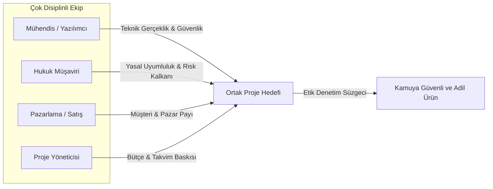
*Şekil 7.1: Çok Disiplinli Projelerde Değer Çatışması ve Etik Denetim Dengesi.*

### Sık Yapılan Hatalar ve Yanılgılar
- **"Sözleşmeye sorumluluk reddi (disclaimer) yazdıysak mühendislik sorumluluğumuz biter":** Sorumluluk reddi beyanı hukuki bir savunma taktiğidir; ancak kusurlu ve tehlikeli bir ürünü bilerek sahaya süren mühendisin mesleki ve etik sorumluluğunu ortadan kaldırmaz.
- **"Ben sadece yazılımcıyım, tıp veya inşaat beni ilgilendirmez":** Eğer yazdığın yazılım bir binanın statiğini veya bir hastanın ilacını kontrol ediyorsa, o alanın uzmanlarıyla tam bir işbirliği kurmak ve kendi yetkinlik sınırını bilmek zorundasın.

### Aktif Hatırlama Soruları ve Çözümleri
1. *Soru:* "Birçok El Sorunu" (Problem of Many Hands) neyi ifade eder?

Çözüm ve Açıklama

Karmaşık, çok paydaşlı projelerde bir hata veya facia meydana geldiğinde, herkesin sorumluluğu başkasına atması ve bireysel hesap verebilirliğin bürokrasi içinde kaybolması durumunu ifade eder.

2. *Soru:* Bir yazılım mühendisi, bir inşaat projesinin yapısal statik hesap modülünü tek başına onaylayabilir mi?

Çözüm ve Açıklama

Hayır. Yetkinlik Sınırları (Limits of Competence) ilkesi gereği, yapısal statik hesaplar lisanslı bir inşaat mühendisinin uzmanlığıdır; yazılımcı sadece kodun algoritmik doğruluğunu test edebilir, fiziksel onayı veremez.

3. *Soru:* Bir projede hukuk departmanının "sorun yok" demesi, kararın etik olduğunu garanti eder mi?

Çözüm ve Açıklama

Garanti etmez. Hukuk asgari yasal mevzuata bakar; ancak bir eylem yasalara uygun olduğu halde meslek etiğine, kamu adaletine ve insan sağlığına aykırı olabilir.

### Hafta Kaynak ve Video Kartı
- **Video:** University of Virginia Online Ethics Center, Michael Loui, *Professional Ethics in Engineering video series* ([OEC Playlist](https://youtube.com/playlist?list=PLdHmP-EKPCRD3-mFYjOjapYPYSnbBpFRV)).
- **Web Kaynağı:** [UVA OEC Professional Responsibility](https://onlineethics.virginia.edu/cases/professional-ethics-engineering). Videoda farklı meslek disiplinlerinin bir arada çalışırken kurmaları gereken etik diyalog zemini anlatılmaktadır.

---

## Hafta 8: Ara Sınav — İlk 7 Haftanın Vaka Analiz Seti (Önerilen Tekrar Etkinliği)

> [!NOTE]
> **Önerilen Tekrar Etkinliği Bildirimi**  
> Bu hafta akademik takvimde resmî ara sınav haftasıdır. Müfredatta yeni bir teorik konu bulunmamaktadır. Bu bölüm, ilk 7 haftada öğrenilen kavramları, teorileri ve etik modelleri pekiştirmek amacıyla hazırlanmış kapsamlı bir vaka analiz seti ve sınav hazırlık kılavuzudur.

### İlk 7 Haftanın Metodolojik Sentez Tablosu

| Hafta | Temel Konu | Anahtar Kavramlar | Kritik Analiz Sorusu |
| :--- | :--- | :--- | :--- |
| **H1** | Etik Kavramı & Dörtlü Ayrım | Meta/Normatif/Uygulamalı, Hukuk-Etik Ayrımı | "Yasal olan bu talep kamu güvenliğini tehdit ediyor mu?" |
| **H2** | Etik-Ahlak & Ahlaki Gelişim | Kohlberg Evreleri (1-6), Değerler | "Kararım ceza korkusundan mı evrensel ilkeden mi kaynaklanıyor?" |
| **H3** | Normatif Etik Sistemleri | Yararcılık, Kant Deontolojisi, Erdem | "Sonuç faydası mı yoksa ödev ve insan hakları mı gözetildi?" |
| **H4** | Etik-Toplum & HSW İlkesi | Toplumsal Sözleşme, Citicorp Center | "Mühendis hatasını itiraf edecek etik cesarete sahip mi?" |
| **H5** | Etik Sorgulama & Körlük | Normalization of Deviance, Groupthink | "Küçük bir güvenlik sapması zamanla kanıksandı mı?" |
| **H6** | Temel İlkeler | Zarar Vermeme, Özerklik, Adalet | "Kullanıcılar araçlaştırıldı mı, rızaları var mı?" |
| **H7** | Disiplinler Arası İlişkiler | Yetkinlik Sınırı, Birçok El Sorunu | "Mühendis uzmanı olmadığı alanda imza attı mı?" |

### Entegre Ara Sınav Vaka Senaryosu (Öğrenme Amaçlı Senaryo 6)
*Senaryo:* Bir metropol belediyesi için "Akıllı Baraj ve İçme Suyu SCADA Sistemi" geliştiren bir konsorsiyumda Kıdemli Sistem Mühendisi olarak çalışmaktasınız.
- Şirketinizin yazılım ekibi, maliyeti düşürmek için endüstriyel standarttaki şifreli haberleşme protokolü yerine açık kaynaklı ve şifrelemesiz bir MQTT protokolü entegre etmiştir.
- Bu zafiyet, baraj kapaklarının harici bir siber saldırıyla uzaktan manipüle edilmesine ve kente su basmasına yol açabilecek seviyededir.
- Durumu şirket yönetimine bildirdiğinizde aldığınız yanıt: "İhale şartnamesinde 'iletişim şifreli olmak zorundadır' diye açık bir madde yoktu, yasal olarak belediyeye karşı sorumluluğumuz yok. Teslim tarihi yarın, gecikirsek günlük 50.000 TL ceza öderiz. İmzayı at ve sistemi teslim et."

### Adım Adım Sınav Çözüm Metodolojisi
1. **Olgular:** Sistemde kritik siber zafiyet vardır; baraj kapakları manipülasyona açıktır; şartnamede açık madde olmasa da risk katastrofiktir.
2. **Normatif Sistemlerin Karşılaştırılması:**
   - *Yararcılık Açısından:* Şirketin günlük 50.000 TL ceza tasarrufu, olası bir baraj kapağı sabotajında binlerce insanın ölümü ve kentin susuz kalması felaketiyle karşılaştırılamaz. Net fayda kesinlikle teslimatın durdurulmasını gerektirir.
   - *Kantçı Deontoloji Açısından:* Bir mühendisin güvenli olmadığını bildiği bir su şebekesine imza atması evrenselleştirilemez. İnsan hayatı şirketin ceza ödememesi için bir araç yapılamaz.
   - *Kohlberg Düzeyi:* Yönetim Basamak 1 (ceza korkusu) ve Basamak 4 (yönetmelik lafzı) seviyesindedir. Mühendis Basamak 6 (evrensel yaşam hakkı) seviyesinde durmalıdır.
3. **Eylem Planı:**
   - İmzayı atmayı kesinlikle reddetmek (Zarar Vermeme ilkesi).
   - Zafiyeti ve simülasyon sonuçlarını resmi bir teknik memorandumla yönetim kuruluna sunmak.
   - Belediyeye teslimatı "güvenlik iyileştirmesi ve kritik yama" gerekçesiyle şeffaf biçimde bildirmek; şirket dinlemezse kamu güvenliğini korumak için yetkili mercilere başvurmak.

### Görsel Analiz Şeması
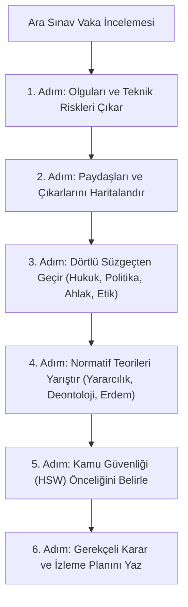
*Şekil 8.1: Ara Sınav ve Vaka Analizlerinde Kullanılacak 6 Aşamalı Çözüm Şablonu.*

### Aktif Hatırlama ve Sınav Hazırlık Soruları
1. *Soru:* Bir vaka analizinde "şartnamede açık kural yoktu" savunması neden etik bir meşruiyet sağlamaz?

Çözüm ve Açıklama

Şartname ve standartlar her olası teknik durumu öngörmeyebilir. Öngörülebilir ciddi bir risk ortaya çıktığında, mühendis bu riski uygun teknik ve kurumsal kanallarla değerlendirme ve bildirme sorumluluğunu göz önünde bulundurmalıdır; somut yükümlülükler bağlama ve geçerli kurallara bağlıdır.

2. *Soru:* Citicorp Center vakası ile Challenger faciası arasındaki temel liderlik ve karar farkı nedir?

Çözüm ve Açıklama

UVA OEC Citicorp anlatımı LeMessurier’in tasarım sorununu ele alışını; NASA Rogers Komisyonu raporu ise Challenger kararının eksik/yanıltıcı bilgi ve iletişim sorunlarını inceler. İki vakayı, teknik kaygıların fark edilmesi, iletilmesi ve karar vericilere ulaştırılması bakımından karşılaştırın; farklı koşulları tek bir basit nedene indirmeyin.

3. *Soru:* Bir mühendisin Kohlberg Basamak 6 düzeyinde karar alması ne anlama gelir?

Çözüm ve Açıklama

Kişisel menfaatlerin, şirket içi uyumun ve hatta dar yasa maddelerinin ötesine geçerek; evrensel insan hakları, adalet ve insan yaşamının kutsallığı ilkelerine dayanarak vicdani ve mesleki karar alması anlamına gelir.

### Hafta Kaynak ve Video Kartı
- **Video serisi:** [UVA OEC / Michael Loui, Professional Ethics in Engineering](https://youtube.com/playlist?list=PLdHmP-EKPCRD3-mFYjOjapYPYSnbBpFRV). OEC’nin resmî konu tanımında sorumluluk, etik karar verme ve mühendislik vakaları yer alır.
- **Birincil tarihsel kaynak:** [Rogers Komisyonu Raporu, Bölüm V](https://www.nasa.gov/history/rogersrep/v1ch5.htm).

---

## Hafta 9: Meslek Etik Kodları ve Standartlar

### Öğrenme Hedefleri
Bu bölümü tamamladığınızda:
- Meslek etik kodlarının doğasını, işlevlerini, hiyerarşisini ve sınırlarını açıklayabileceksiniz.
- Başlıca uluslararası mühendislik kodlarını (NSPE, IEEE, ACM) karşılaştırabileceksiniz.
- NSPE BER (Board of Ethical Review) içtihatları üzerinden gizlilik ve kamu güvenliği dengesini analiz edebileceksiniz.

### Kavram Açıklaması: Meslek Kodlarının Doğası ve İşlevleri
Meslek etik kodları, bir meslek topluluğunun üyelerine ve topluma karşı taahhüt ettiği asgari ve ideal davranış standartlarını yazılı hale getiren resmi belgelerdir.

**Meslek Kodlarının 4 Temel İşlevi:**
1. **İlham Verme ve Rehberlik:** Mesleğin toplumsal misyonunu yüceltir, genç mühendislere yol gösterir.
2. **Standart Koyma ve Meşruiyet:** Profesyonel uygulamanın asgari sınırlarını çizer; işverenin haksız taleplerine karşı mühendise kalkan olur ("Bu kodu çiğneyemem").
3. **Disiplin ve Koruma:** Mesleki davranışın değerlendirilmesine ve güvenin korunmasına yardımcı olabilir; üyelik ve disiplin süreçleri ilgili kuruluşun kurallarına bağlıdır.
4. **Kamusal Güven İnşası:** Topluma "Bu unvanı taşıyan herkese güvenebilirsiniz" mesajı verir.

**Kodların Sınırları:** Kodlar her teknik durumu ve ikilemi öngöremez. Bir yemek tarifi kitabı değildir; kodlar maddeler halinde yorumlama, basiret ve pratik bilgelik (phronesis) gerektirir.

### Başlıca Kodlar ve Karşılaştırma
- **NSPE (National Society of Professional Engineers) Kodu:**
  - ABD'de tüm mühendislik branşlarını kapsayan çatı profesyonel koddur.
  - *Madde I.1 (Paramountcy Clause):* "Mühendisler mesleki görevlerini yerine getirirken kamunun güvenliğini, sağlığını ve refahını her şeyin üstünde tutacaklardır (hold paramount the safety, health, and welfare of the public)."
- **IEEE (Institute of Electrical and Electronics Engineers) Kodu:** Elektrik, elektronik ve bilişim alanında kamu güvenliğini, mahremiyeti ve çıkar çatışmalarının açıklanmasını vurgular.
- **ACM (Association for Computing Machinery) Kodu:** Bilişim ve yazılım profesyonelleri için insan hakları, veri mahremiyeti, ayrımcılık yapmama ve kamu yararına katkı ilkelerini öne çıkarır.
- **Türkiye Bağlamı:** TMMOB ve ilgili meslek odalarının yayımladığı ilkeler, somut mesleğe/üyeliğe uygulanabilirlikleri resmî kaynaklardan kontrol edilerek ayrıca incelenebilir. NSPE kodu ise yalnız karşılaştırmalı vaka analizi için kullanılır.

### Vaka İncelemesi (NSPE Board of Ethical Review Uyarlandı - Case 89-7 Analog)
*Senaryo:* Çevre mühendisi Volkan, bir endüstriyel kimya tesisi tarafından atık su arıtma tesisini denetlemek üzere danışman olarak tutulmuştur. Sözleşmesinde çok katı bir "Gizlilik Maddesi" (Non-Disclosure Agreement) bulunmaktadır. Volkan denetim sırasında arıtma sisteminin gece yarısı gizli bir tahliye borusuyla kentin içme suyu havzasına ağır metal içeren kimyasal boşalttığını tespit eder. Durumu şirket genel müdürüne ilettiğinde genel müdür: "Bu bizim ticari sırrımızdır. Gizlilik sözleşmen var. Bunu belediyeye veya çevre bakanlığına bildirirsen seni dava eder, tazminatla mahvederiz" tehdidinde bulunur.

### Gerekçeli Adım Adım Karar Analizi
1. **Olgular:** Ağır metal sızıntısı vardır; içme suyu havzası doğrudan etkilenmektedir; gizlilik sözleşmesi mevcuttur.
2. **Meslek Kodu Hiyerarşisi (NSPE Analizi):**
   - *İşverene Sadakat ve Gizlilik:* Mesleki kodlar, gizlilik ve işverene karşı sorumluluğu değerlendirirken kapsamı ve istisnaları ayrı ele almayı gerektirir.
   - *Kamunun Güvenliği:* NSPE kodu kamu güvenliğini mühendislerin temel etik yükümlülüklerinden biri sayar. Bu etik öncelik, belirli bir sözleşmenin hukuken geçersiz olduğu veya her durumda dışarıya açıklama yapılabileceği anlamına gelmez.
   - *Gerekçeli Eylem:* Bulguları güvenli biçimde belgelemek, uygun kurum içi/mesleki kanalları değerlendirmek ve dış bildirimden önce somut tehlike, gizlilik yükümlülükleri ve uygulanabilir mevzuat için yetkin danışmanlık almak gerekir. Acil ve yakın tehlikede uygun yetkili kanala gecikmeden başvurulması ayrıca değerlendirilir.
3. **Kademeli Müdahale Protokolü:**
   - Adım 1: Raporu yazılı olarak şirket yönetim kuruluna sunmak ve acil düzeltme talep etmek.
   - Adım 2: Yönetim harekete geçmezse, uygun mesleki ve yetkili bildirim kanallarını belirlemek; sözleşme ve mevzuat yükümlülüklerini ilgili uzmanla kontrol ederek güvenli, belgeli ve orantılı bir bildirim planı hazırlamak.

### Görsel Analiz Şeması
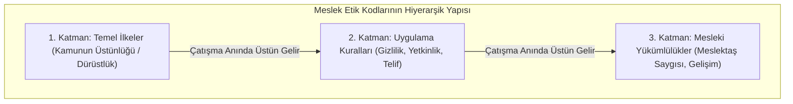
*Şekil 9.1: Meslek Etik Kodlarında Kurallar Hiyerarşisi ve Kamu Önceliği.*

### Sık Yapılan Hatalar ve Yanılgılar
- **"İmzaladığım gizlilik sözleşmesi (NDA) her şeyin üzerindedir, kamu zarar görse bile susmak zorundayım":** Etik kod, sözleşmenin hukuki geçerliliğini tek başına belirlemez. Gizlilik, kamu güvenliği ve bildirim yükümlülükleri gerçek olay ve geçerli hukuk çerçevesinde değerlendirilmelidir.
- **"Etik kodları ihlal etmek hapis cezası getirir":** Etik kodlar profesyonel davranış için yol gösterir; mesleki incelemelerde bağlama göre dikkate alınabilir. Bunların hukuki delil veya yaptırım üzerindeki etkisi yargı alanına ve somut olgulara göre değişir.

### Aktif Hatırlama Soruları ve Çözümleri
1. *Soru:* NSPE Mühendislik Kodu'ndaki "Paramountcy Clause" ne anlama gelir?

Çözüm ve Açıklama

Mühendisin mesleki görevlerinde kamunun güvenliğini, sağlığını ve refahını tüm diğer çıkarların (işveren, müşteri, kişisel menfaat) kesin olarak üstünde tutması zorunluluğunu ifade eder.

2. *Soru:* İşverenin ticari gizlilik talebi ile kamu güvenliği çatıştığında hangi yükümlülük üstün gelir?

Çözüm ve Açıklama

Etik değerlendirmede kamu güvenliği ağır basabilir; ancak hangi bilginin, kime ve ne zaman açıklanabileceği için sözleşme, kanun ve uygun bildirim kanalları ayrıca değerlendirilmelidir.

3. *Soru:* Türkiye’de mesleki disiplin kurallarının kim için geçerli olduğunu nasıl doğrularsınız?

Çözüm ve Açıklama

İlgili meslek kuruluşunun güncel resmî mevzuatını, üyelik ve yetki kapsamını, ayrıca kişinin mesleğini ve somut olguları kontrol ederek.

### Hafta Kaynak ve Video Kartı
- **Video:** University of Virginia Online Ethics Center, Michael Loui, *Professional Ethics in Engineering video series* ([UVA OEC Ders Sayfası](https://onlineethics.virginia.edu/cases/professional-ethics-engineering)).
- **Web Kaynağı:** [UVA OEC NSPE BER Cases Collection](https://onlineethics.virginia.edu/collection-detail/Professional%20Ethics%20in%20Engineering%20Practice%3A%20Discussion%20Cases%20Based%20on%20NSPE%20BER%20Cases). NSPE Etik İnceleme Kurulu'nun emsal kararları ve tartışma vakaları bu birincil veri tabanında yer almaktadır.

---

## Hafta 10: Etik Karar Alma Süreçleri ve Modelleri

### Öğrenme Hedefleri
Bu bölümü tamamladığınızda:
- Harris-Pritchard-Rabins ve Michael Davis gibi yapılandırılmış etik karar modellerini uygulayabileceksiniz.
- "Yaratıcı Orta Yol" (Creative Middle Way) arayışını kullanarak ikilemleri felaketsiz çözebileceksiniz.
- Gazete testi, zarar testi, tersine çevrilebilirlik testi gibi pratik etik denetim araçlarını kullanabileceksiniz.

### Kavram Açıklaması: Yapılandırılmış Etik Karar Verme Modelleri
Etik ikilemler anlık reflekslerle veya duygusal çıkışlarla çözülemez. Mühendislik metodolojisine uygun, adım adım çalışan algoritmik bir süreç gerektirir:

#### 7 Adımlı Etik Karar Algoritması
1. **Sorunu ve İkilemi Tanımla:** Etik çatışmanın tam odağı nedir? (Kim, neyi talep ediyor?)
2. **Olguları Netleştir:** Bilinen kesin gerçekler nelerdir? Hangi bilgiler eksiktir veya varsayımdır?
3. **Paydaşları ve Çıkarlarını Listele:** Karardan doğrudan ve dolaylı etkilenecek tüm aktörleri belirle.
4. **İlgili Standart ve Kodları Belirle:** Hangi meslek kodları, kanunlar ve ilkeler bu duruma temas ediyor?
5. **Seçenekleri Üret (Yaratıcı Orta Yol):** Sadece "Ya her şeyi ifşa et ya da tamamen boyun eğ" kutuplaşmasına sıkışma; hem teknik gereksinimi hem güvenliği kurtaran alternatif yollar ara.
6. **Seçenekleri Etik Testlere Tabi Tut:**
   - *Zarar Testi:* Bu seçenek en az zararı mı üretiyor?
   - *Gazete / Tanıtım Testi:* Bu kararın tüm detayları yarın sabah ana haber bülteninde veya sosyal medyada adım ve fotoğrafımla yayınlansa bunu gururla savunabilir miyim?
   - *Tersine Çevrilebilirlik (Altın Kural) Testi:* Bu karardan en olumsuz etkilenecek mağdurun yerinde ben olsaydım bu kararı adil bulur muydum?
   - *Evrenselleştirilebilirlik Testi:* Tüm mühendisler benzer durumlarda bunu yapsaydı sektör ne hale gelirdi?
7. **Kararı Uygula ve Sonuçları İzle:** Eylemi gerçekleştir ve doğurduğu etkileri sistematik olarak gözlemle.

### Vaka İncelemesi (Öğrenme Amaçlı Senaryo 7)
*Senaryo:* Hava trafik kontrol kuleleri için radar takip yazılımı geliştiren bir şirkette yazılımcı olan Deniz, sistemin stres testlerinde her 10.000 uçuş verisi eşzamanlı işlendiğinde ekranda 1.5 saniyelik bir gecikme ve titreme oluştuğunu fark eder. Normal şartlarda havalimanı bu yoğunluğa ulaşmamaktadır; ancak bayram günlerinde trafik bu sınıra yaklaşabilir. Proje teslimi yarındır ve gecikme durumunda şirket çok ağır bir tazminat ödeyecektir. Şirket yöneticisi, "Bunu şimdi teslim edelim, bir sonraki güncellemeye kadar bayram trafiği yok, o zamana kadar çözeriz" der.

### Gerekçeli Adım Adım Karar Analizi
1. **Olgular:** 1.5 saniyelik kör nokta mevcuttur; havacılıkta 1.5 saniye iki uçağın çarpışması için yeterli bir süredir; teslimat baskısı vardır.
2. **Yaratıcı Orta Yol (Creative Middle Way) Çözümü:**
   - *Kötü Uç 1:* Sessiz kalıp teslim etmek (ağır kamu riski).
   - *Kötü Uç 2:* Gece yarısı şirketi polise şikayet edip projeyi patlatmak (ölçüsüz eylem).
   - *Yaratıcı Orta Yol:* Deniz, radar yazılımına geçici bir "trafik yük sınırlayıcı ve yedekleme modülü" (fail-safe fallback) yazar. Bu modül sistem 8.000 uçuşa yaklaştığında ikincil sunucuyu otomatik devreye sokarak gecikmeyi sıfırlar. Durumu ve bu geçici güvenlik bariyerini müşteriye teknik bir "operasyonel sınır notu" ile şeffafça sunarlar. Böylece hem kamu güvenliği sıfır tavizle korunur hem de projenin teslimi sağlanır.
3. **Etik Testler:** Gazete testinde "Mühendisler sistemi yedekli güvenlik modülüyle teslim etti" başlığı gurur vericidir.

### Görsel Analiz Şeması
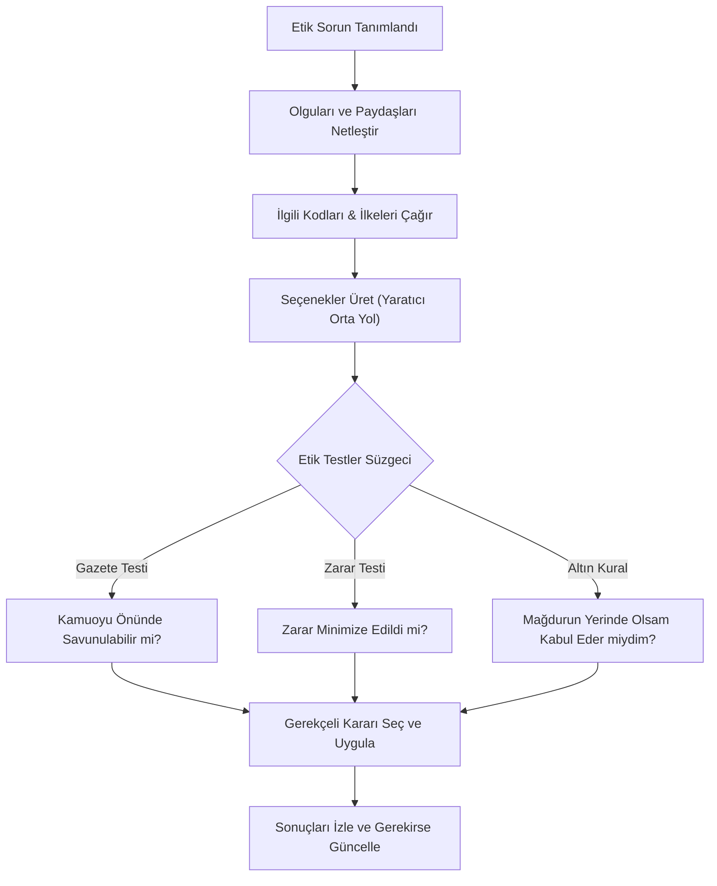
*Şekil 10.1: Yapılandırılmış Etik Karar Alma ve Test Algoritması.*

### Sık Yapılan Hatalar ve Yanılgılar
- **"Etik ikilemlerde sadece iki seçenek vardır (Ya istifa et ya sus)":** Bu "Yanlış İkilem" (False Dilemma) safsatasıdır. Profesyonel mühendislik zekası, teknik ve yönetsel inovasyonla üçüncü ve güvenli bir yol (Yaratıcı Orta Yol) üretme yeteneğidir.
- **"Hislerim bana doğru olduğunu söylüyorsa karar etiktir":** Sezgiler ve hisler önyargılarla doludur. Etik karar, başkalarına kanıt ve gerekçelerle savunulabilen mantıksal bir argümantasyon gerektirir.

### Aktif Hatırlama Soruları ve Çözümleri
1. *Soru:* Etik karar alma sürecinde "Gazete Testi" (Publicity Test) neyi hedefler?

Çözüm ve Açıklama

Kararın gizlilik kalkanı kalktığında kamuoyu, aile ve meslektaşlar önünde şeffafça savunulabilir olup olmadığını ölçerek bireyi etik dışı gizli uzlaşmalardan caydırmayı hedefler.

2. *Soru:* "Yaratıcı Orta Yol" (Creative Middle Way) yaklaşımı ne anlama gelir?

Çözüm ve Açıklama

Birbiriyle çatışan iki aşırı ve problemli seçenek arasında sıkışıp kalmak yerine, hem etik ilkeleri koruyan hem de pratik gereksinimleri karşılayan yeni ve yenilikçi bir çözüm geliştirmektir.

3. *Soru:* Michael Davis'in karar verme modelinde ilk aşama neden "Olguları Netleştirmek"tir?

Çözüm ve Açıklama

Çünkü birçok sözde etik tartışma aslında ahlaki bir anlaşmazlıktan değil, teknik verilerin eksik veya yanlış bilinmesinden kaynaklanır. Olgular netleşmeden etik hüküm verilemez.

### Hafta Kaynak ve Video Kartı
- **Video:** University of Virginia Online Ethics Center, Michael Loui, *Professional Ethics in Engineering video series* ([UVA OEC / Michael Loui, Professional Ethics in Engineering video series](https://youtube.com/playlist?list=PLdHmP-EKPCRD3-mFYjOjapYPYSnbBpFRV)).
- **Web Kaynağı:** [UVA OEC Professional Ethics in Engineering](https://onlineethics.virginia.edu/cases/professional-ethics-engineering). Sayfadaki açıklama video serisinin konu kapsamını listeler; her hafta ile birebir video eşleşmesi iddia edilmemektedir.

---

## Hafta 11: Sosyal Sorumluluk

### Öğrenme Hedefleri
Bu bölümü tamamladığınızda:
- Bireysel ve Kurumsal Sosyal Sorumluluk (KSS) kavramlarını açıklayabileceksiniz.
- Archie Carroll'ın Sosyal Sorumluluk Piramidi'ni mühendislik projelerine uygulayabileceksiniz.
- "Yeşil Aklama" (Greenwashing) ve "Etik Aklama" (Ethics Washing) mekanizmalarını tanıyıp eleştirebileceksiniz.

### Kavram Açıklaması: Kurumsal Sosyal Sorumluluk ve Carroll Piramidi
Sosyal sorumluluk, bireylerin ve şirketlerin yalnızca kendi dar ekonomik çıkarlarını değil, içinde yaşadıkları toplumun refahını, çevresel sürdürülebilirliği ve gelecek nesillerin yaşam hakkını gözetme yükümlülüğüdür.

#### Archie Carroll'ın KSS Piramidi (4 Boyut)
1. **Ekonomik Sorumluluk (Temel):** Şirketin kârlı olması, istihdam yaratması, mal ve hizmet üretmesi. Bu tabandır; ancak tek başına yeterli değildir.
2. **Yasal Sorumluluk:** Kanunlara, regülasyonlara ve yönetmeliklere harfiyen uymak. Oyunun kurallarına göre oynamak.
3. **Etik Sorumluluk:** Yasalarda açıkça yazmasa bile toplumun adalete, dürüstlüğe ve haklara ilişkin meşru beklentilerine uygun davranmak; zarardan kaçınmak.
4. **Hayırseverlik / Gönüllülük Sorumluluğu (Piramidin Zirvesi):** Toplumsal eğitime, sağlığa, kültüre ve çevreye gönüllü katkı sağlamak (iyi bir kurumsal vatandaş olmak).

#### Yozlaşmış Sorumluluk Pratikleri: Greenwashing ve Ethics Washing
- **Yeşil Aklama (Greenwashing):** Bir şirketin çevreye verdiği zararları gizlemek için göstermelik ve abartılı çevreci reklam kampanyaları yürütmesi (örneğin doğayı zehirleyen bir fabrikanın bahçesine üç ağaç dikip reklam yapması).
- **Etik Aklama (Ethics Washing):** Şirketlerin yapay zekâ veya veri ihlallerini örtbas etmek için yaptırım gücü olmayan göstermelik "etik danışma kurulları" kurup hiçbir tavsiyeye uymaması.

### Vaka İncelemesi (Öğrenme Amaçlı Senaryo 8)
*Senaryo:* Küresel bir akıllı telefon üreticisinde çalışan donanım mühendisi Selin, şirketin batarya ömrünü uzatmak bahanesiyle eski model telefonların işlemci hızını gizlice düşüren bir yazılım güncellemesi hazırladığını fark eder. Bu sayede kullanıcılar telefonlarının eskidiğini düşünerek yeni model almaya zorlanmaktadır (Planlı Eskitme - Planned Obsolescence). Aynı esnada şirket, "Geri dönüştürülmüş ambalaj kullanıyoruz, gezegeni kurtarıyoruz" temalı milyonlarca dolarlık bir reklam kampanyası başlatmıştır.

### Gerekçeli Adım Adım Karar Analizi
1. **Olgular:** Planlı eskitme yazılımsal olarak tetiklenmektedir; tüketici aldatılmaktadır; e-atık miktarı yapay olarak artırılmaktadır; yanıltıcı pazarlama vardır.
2. **Carroll Piramidi Açısından Analiz:** Şirket ekonomik sorumluluğunu haksız kazançla maksimize etmekte, etik sorumluluğu (tüketiciye dürüstlük ve çevreye saygı) tamamen çiğnemekte ve greenwashing yapmaktadır.
3. **Mühendisin Rolü:** Selin, bu yazılım fonksiyonunun tüketici haklarını ihlal ettiğini ve donanım ömrünü manipüle ettiğini teknik raporla ürün komitesine sunar. Sürdürülebilirlik ilkeleri gereği tüketiciye batarya değişim seçeneğinin şeffafça sunulmasını talep eder.

### Görsel Analiz Şeması
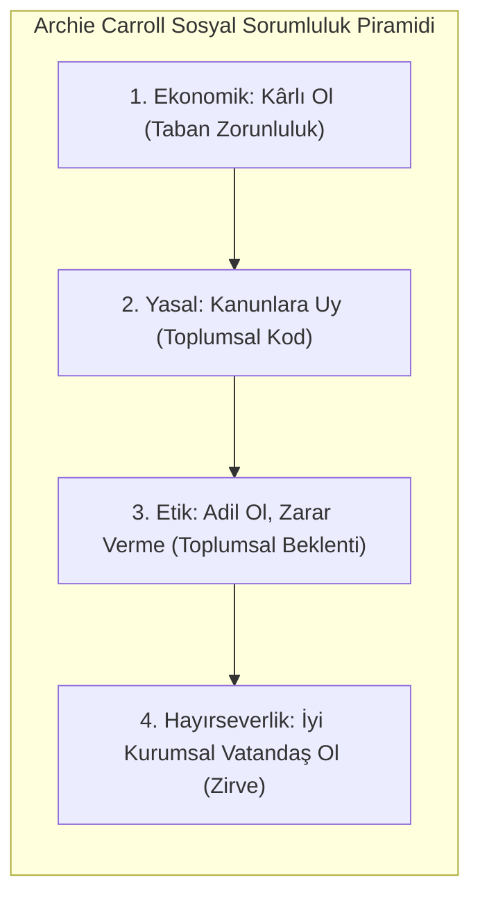
*Şekil 11.1: Archie Carroll'ın Dört Katmanlı Kurumsal Sosyal Sorumluluk Modeli.*

### Sık Yapılan Hatalar ve Yanılgılar
- **"Milton Friedman Doktrini: Şirketin tek sorumluluğu kâr etmektir":** 1970'lerin bu aşırı piyasacı yaklaşımı modern dünyada geçerliliğini yitirmiştir. Çevreyi yok ederek veya toplumu aldatarak elde edilen kâr, toplumsal çöküşe yol açtığı için modern etik anlayışında meşru değildir.
- **"Bir şirket bağış yapıyorsa sosyal sorumludur":** Bir şirket bir okula laboratuvar kurup (hayırseverlik) aynı anda çalışanlarının haklarını gasp ediyor veya nehirleri zehirliyorsa etik sorumluluğunu yerine getirmiyor demektir. Piramidin 3. basamağı atlanıp 4. basamağına geçilemez.

### Aktif Hatırlama Soruları ve Çözümleri
1. *Soru:* "Yeşil Aklama" (Greenwashing) kavramını tanımlayınız.

Çözüm ve Açıklama

Bir şirketin çevreye verdiği gerçek zararları perdelemek ve kamuoyunu yanıltmak amacıyla sahte, abartılı veya alakasız çevreci reklam ve halkla ilişkiler faaliyetleri yürütmesidir.

2. *Soru:* Carroll'ın piramidinde "Yasal Sorumluluk" ile "Etik Sorumluluk" arasındaki fark nedir?

Çözüm ve Açıklama

Yasal sorumluluk yazılı kanun ve regülasyonlara uymayı emrederken; etik sorumluluk kanunların henüz düzenlemediği alanlarda dahi toplumun adalet, dürüstlük ve zarar vermeme beklentilerini karşılamayı gerektirir.

3. *Soru:* Planlı eskitme (planned obsolescence) uygulaması hangi etik değerleri zedeler?

Çözüm ve Açıklama

Tüketiciye karşı dürüstlük (veracity) ilkesini zedeler, tüketiciyi aldatarak haksız maddi yüke sokar ve gereksiz e-atık üreterek çevresel adalete ve gelecek nesillere zarar verir.

### Hafta Kaynak ve Video Kartı
- **Video:** University of Virginia Online Ethics Center, Michael Loui, *Professional Ethics in Engineering video series* ([UVA OEC Playlist](https://youtube.com/playlist?list=PLdHmP-EKPCRD3-mFYjOjapYPYSnbBpFRV)).
- **Web Kaynağı:** [UVA OEC Social Responsibility](https://onlineethics.virginia.edu/cases/professional-ethics-engineering). Mühendisin teknolojik tasarım yaparken sürdürülebilirlik ve küresel adalet boyutlarını nasıl gözetmesi gerektiği tartışılmaktadır.

---

## Hafta 12: Meslek İlkeleri, Güven, Hak ve Adalet

### Öğrenme Hedefleri
Bu bölümü tamamladığınızda:
- Çıkar Çatışması (Conflict of Interest) kavramını ve üç türünü (Fiili, Potansiyel, Görünürdeki) ayırt edebileceksiniz.
- Fikri mülkiyet, telif hakları, ticari sırlar ve açık kaynak lisanslarının etik sınırlarını kavrayabileceksiniz.
- NSPE BER içtihatları doğrultusunda çıkar çatışmasından kaçınma ve şeffaflık protokollerini uygulayabileceksiniz.

### Kavram Açıklaması: Güven, Adalet ve Çıkar Çatışması (COI)
Mühendisler müşterilerinin, işverenlerinin ve kamunun "güvenilir vekilleri" (faithful agents or trustees) olarak görev yaparlar. Bu güven ilişkisini en derinden sarsan olgu **Çıkar Çatışmasıdır**.

**Çıkar Çatışması Nedir?**
Bir profesyonelin mesleki karar alma, yargılama ve görev yapma bağımsızlığını; kendi kişisel, ailevi veya ikincil finansal çıkarları nedeniyle tarafsızca kullanamaması veya tarafsızlığının sorgulanır hale gelmesidir.

**Çıkar Çatışmasının Üç Türü:**
1. **Fiili / Gerçek Çıkar Çatışması (Actual COI):** Mühendisin mevcut bir kararında kişisel çıkarının doğrudan devrede olması (örneğin ihale şartnamesini hazırlayan mühendisin ihaleyi kazanan şirkette gizli ortak olması).
2. **Potansiyel Çıkar Çatışması (Potential COI):** Gelecekte çıkarların çatışma ihtimalinin yüksek olması (örneğin mühendisin eşinin belediyenin denetim yapacağı taşeron şirkette genel müdür olması).
3. **Görünürdeki / Algılanan Çıkar Çatışması (Apparent / Perceived COI):** Fiilen bir rüşvet veya taraflılık olmasa bile dışarıdan bakıldığında makul bir gözlemcinin "Burada kayırma vardır" diyeceği durumlar (örneğin belediye mühendisinin denetlediği firmanın sahibinden piyasa değerinin çok altında ev kiralaması). Görünürdeki çatışma da mesleğe olan güveni yıktığı için yasaktır!

**Çıkar Çatışması Yönetimi:**
- *Beyan (Disclosure):* Durumu derhal ve tüm detaylarıyla yazılı olarak işverene ve ilgili taraflara açıklamak.
- *Çekilme (Recusal):* Karar alma sürecinden, komisyondan ve oylamadan tamamen çekilmek.

### Vaka İncelemesi (NSPE BER Vakalarından Uyarlama - UVA OEC Arşivi)
*Senaryo:* Bir ilçe belediyesinde fen işleri mühendisi olarak çalışan Hakan, ilçenin yeni köprülü kavşak projesinin teknik şartnamesini hazırlamakla görevlendirilmiştir. Hakan'ın kardeşi, köprü çelik kirişleri imalatı yapan bölgedeki en büyük firmanın sahibidir. Kardeşi Hakan'a: "Şartnameye kirişlerin özel bir alaşımla üretilmesi şartını koyarsan bölgede bunu sadece biz üretiyoruz, ihaleyi biz alırız; sana da şirketimizden pay veririz" teklifinde bulunur. Hakan teklifi reddeder ancak şartnameye yine de köprünün daha sağlam olacağını düşünerek kardeşinin firmasının tekelinde olan teknik parametreleri yazar.

### Gerekçeli Adım Adım Karar Analizi
1. **Olgular:** Şartnameyi hazırlayan mühendisin kardeşi ihaleye girecektir; şartname maddeleri kardeşin firmasını avantajlı kılmaktadır.
2. **Meslek Kodu İhlali (NSPE Madde II.4.a):** "Mühendisler işverenlerinin veya müşterilerinin çıkarlarını etkileyebilecek bilinen veya potansiyel tüm çıkar çatışmalarını derhal beyan edeceklerdir."
3. **Analiz:** Hakan teklif edilen rüşvet payını reddetse dahi kardeşinin şirketini öne çıkaran şartnameyi yazarak hem fiili hem de görünürdeki çıkar çatışmasına düşmüştür. Kamu kaynaklarının adil rekabetle harcanmasını engellemiştir.
4. **Gerekçeli Karar:** Hakan durumu belediye başkanlığına yazılı olarak bildirmeli, kavşak ihalesi şartname hazırlama komisyonundan derhal affını istemeli (recusal) ve görevi bağımsız bir mühendise devretmelidir.

### Görsel Analiz Şeması
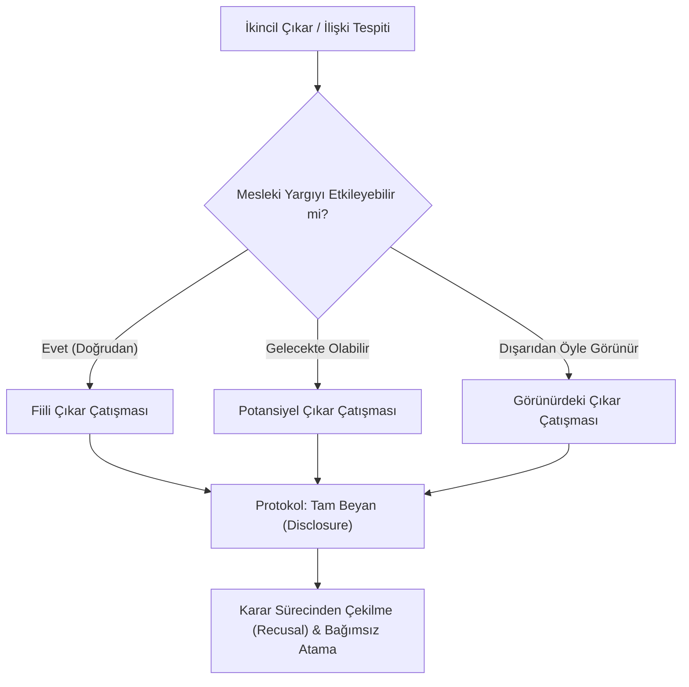
*Şekil 12.1: Çıkar Çatışması Türleri ve Yönetim Protokolü.*

### Sık Yapılan Hatalar ve Yanılgılar
- **"Ben son derece dürüst bir insanım, çıkar çatışması olsa bile tarafsız karar veririm, bildirmeme gerek yok":** Bu en yaygın bilişsel yanılgıdır. Etik kodlar senin dürüstlüğüne değil, çıkar çatışması durumunun varlığına bakar. Görünürdeki çıkar çatışması dahi sistemin meşruiyetini yok eder.
- **"Açık kaynak kodunu kopyalayıp şirket ürününe koymak ve telif uyarısını silmek hırsızlık sayılmaz":** Açık kaynak lisansları (GPL, MIT, Apache) birer hukuki ve etik sözleşmedir. Telif bildirimini silmek hem fikri mülkiyet ihlali (hukuki suç) hem de mesleki aşırma/intihaldir (etik ihlal).

### Aktif Hatırlama Soruları ve Çözümleri
1. *Soru:* "Görünürdeki Çıkar Çatışması" (Apparent COI) neden gerçek bir çıkar çatışması kadar tehlikelidir?

Çözüm ve Açıklama

Çünkü kamuoyu veya müşteriler kararın adil alındığına inanmaz. Kişi fiilen tarafsız davransa bile mesleğe, kuruma ve denetim mekanizmasına olan kamusal güven telafisi imkansız şekilde sarsılır.

2. *Soru:* Bir çıkar çatışmasıyla karşılaşan mühendisin atması gereken ilk iki zorunlu adım nedir?

Çözüm ve Açıklama

1. Durumu tüm paydaşlara ve üst yönetime yazılı olarak tam şeffaflıkla beyan etmek (Disclosure). 2. O işle ilgili karar alma, değerlendirme ve denetim sürecinden resmen çekilmek (Recusal).

3. *Soru:* Bir mühendisin eski çalıştığı şirketin gizli algoritmalarını yeni iş yerindeki projede doğrudan kullanması hangi kavramı ihlal eder?

Çözüm ve Açıklama

Ticari sırların korunması (trade secret) ve sadakat/gizlilik ilkesini ihlal eder; aynı zamanda haksız rekabet ve fikri mülkiyet hırsızlığıdır.

### Hafta Kaynak ve Video Kartı
- **Video:** University of Virginia Online Ethics Center, Michael Loui, *Professional Ethics in Engineering video series* ([UVA OEC Playlist](https://youtube.com/playlist?list=PLdHmP-EKPCRD3-mFYjOjapYPYSnbBpFRV)).
- **Web Kaynağı:** [UVA OEC Conflict of Interest Cases](https://onlineethics.virginia.edu/cases/professional-ethics-engineering). NSPE BER kararları ışığında çıkar çatışmasının gri alanları ve hediye kabul etme sınırları işlenmektedir.

---

## Hafta 13: Etik Davranışlar ve Sonuçları

### Öğrenme Hedefleri
Bu bölümü tamamladığınızda:
- Mühendislik hatalarında öngörülebilirlik (foreseeability), ihmal (negligence) ve kasıt ayrımını yapabileceksiniz.
- Etik ihlallerin hukuki (tazminat/ceza), mesleki (sicil/men) ve kurumsal (itibar/iflas) çok katmanlı sonuçlarını analiz edebileceksiniz.
- Bir yazılım hatasının doğuracağı zincirleme riskleri haritalandırabileceksiniz.

### Kavram Açıklaması: Kusur Dereceleri ve Sonuçların Katmanları
Bir mühendis teknik bir başarısızlık veya etik ihlal gerçekleştiğinde "Ben bunu bilerek yapmadım" diyerek sorumluluktan sıyrılamaz. Hukuk ve meslek etiği kusuru derecelendirir:

1. **Öngörülebilirlik (Foreseeability):** Yetkin bir mühendisin mevcut bilimsel ve teknik standartlar çerçevesinde öngörmesi gereken risklerdir ("Bu köprü bu rüzgârda rezonansa girer mi?").
2. **İhmal (Negligence):** Makul bir mühendisin göstermesi gereken asgari dikkat ve özeni göstermemek; standart testleri yapmamak, uyarıları dikkate almamak.
3. **Ağır İhmal (Gross Negligence):** Güvenlik kurallarını bariz biçimde hiçe saymak, riskin gerçekleşme ihtimalini bile bile tedbir almamak.
4. **Kasıt (Intent):** Bilerek ve isteyerek sistemi manipüle etmek, sahte veri üretmek veya zafiyeti gizlemek.

**Sonuçların Çok Boyutlu Mimarisi:**
- *Olası Bireysel Sonuç:* Olayın olgularına, nedenselliğe, yetki alanına ve yürürlükteki hukuka göre farklı hukuki süreçler doğabilir; bu not belirli bir suç, kusur veya tazminat sonucu tayin etmez.
- *Mesleki Sonuç:* Mesleki inceleme veya disiplin süreci doğabilir; kullanılabilecek yaptırımlar ilgili kuruluşun geçerli kurallarına bağlıdır.
- *Kurumsal Sonuç:* Milyarlarca dolarlık tazminatlar, ürün toplatma maliyeti, hisse senedi çöküşü, iflas.
- *Toplumsal Sonuç:* İnsan hayatı kaybı, çevre felaketi, kritik kamu altyapısının çökmesi.

### Vaka İncelemesi (Öğrenme Amaçlı Senaryo 10)
*Senaryo:* Bir finansal aracı kurumda çalışan kıdemli yazılım mimarı Can, döviz ve kripto arbitraj işlemlerini yöneten yüksek frekanslı ticaret (HFT) algoritmasında küçük bir küsurat yuvarlama hatası (salami slicing açığı) olduğunu keşfeder. Her işlemde kuruşun binde biri kadar bir artık bakiye tanımsız bir askı hesabında birikmektedir. Can, hatayı düzeltmek yerine bu askı hesabını kendi kontrolündeki bir offshore hesaba yönlendirir ve denetim loglarını temizleyen bir cron görevi ekler. 6 ayda 2 milyon TL haksız kazanç elde edilir; ancak sistemde bir bakiye tutarsızlığı denetçilerin dikkatini çeker.

### Gerekçeli Adım Adım Karar Analizi
1. **Olgular:** Yazılım zafiyeti bilinçli olarak suiistimal edilmiştir; denetim kayıtları tahrif edilmiştir; kasıtlı hırsızlık ve sahtecilik mevcuttur.
2. **Etik Değerlendirme:** Tasarlanan yarar sağlama ve kayıtları gizleme davranışı, senaryoda güven ve dürüstlüğü bilerek ihlal eder. Bunun hukuki suç türü ve yaptırımı bu ders notundan çıkarılamaz; somut delil ve yürürlükteki mevzuat yetkili kişilerce değerlendirilmelidir.
3. **Sonuçların Analizi:**
   - *Hukuki:* Soruşturma veya tazminat süreçlerinin bulunup bulunmadığı ve sonucu, olgular ile geçerli mevzuata göre yetkili mercilerce belirlenir.
   - *Mesleki:* Meslek etiği kodlarının dürüstlük, sadakat ve yasalara saygı maddelerinin ağır ihlali, meslekten ömür boyu ihraç.
   - *Kurumsal:* Şirketin finansal lisansının iptali ve müşteri kaybı.

### Görsel Analiz Şeması
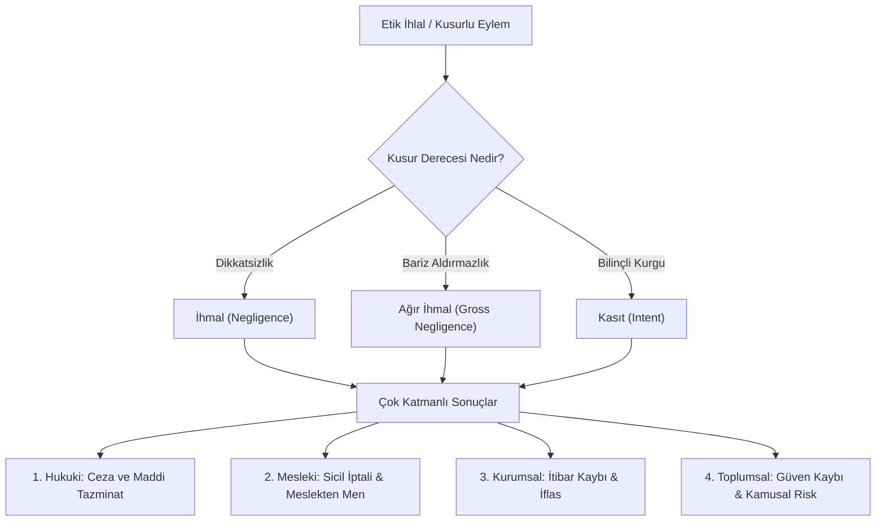
*Şekil 13.1: Kusur Dereceleri ve Etik İhlallerin Hiyerarşik Sonuç Dağılımı.*

### Sık Yapılan Hatalar ve Yanılgılar
- **"Kodun açık kaynak olmasından veya karmaşıklığından dolayı hatayı kimse bana yıkamaz":** Dijital adli bilişim (digital forensics) ve sürüm kontrol sistemleri (Git commit logları, code review kayıtları) kimin hangi satırı ne zaman yazdığını ve hangi testi ihmal ettiğini kesin olarak kanıtlar.
- **"Zarar oluşmadıysa etik ihlal sayılmaz":** Bir güvenlik açığını bilerek raporlamamak veya denetimi savsaklamak, facia tesadüfen engellense bile etik açıdan kusurdur. Etik niyet ve özen yükümlülüğünü sorgular.

### Aktif Hatırlama Soruları ve Çözümleri
1. *Soru:* Mühendislik hukukunda "Ağır İhmal" (Gross Negligence) ile "Basit İhmal" arasındaki temel fark nedir?

Çözüm ve Açıklama

Basit ihmal istemeden yapılan bir dikkatsizlik veya gözden kaçırma iken; ağır ihmal bilinen bir güvenlik standardını veya hayati riski bariz biçimde umursamamak, tedbir almayı bilinçli olarak savsaklamaktır.

2. *Soru:* Bir mühendisin etik ihlali nedeniyle karşılaşabileceği "Mesleki Yaptırım" ile "Hukuki Yaptırım"ı ayırt ediniz.

Çözüm ve Açıklama

Hukuki ve mesleki süreçler farklı kurum ve kurallara dayanır. Hangi yaptırımın uygulanabileceği somut olay ve güncel mevzuata bağlıdır; burada belirli bir yaptırım sonucu öngörülmez.

3. *Soru:* Öngörülebilirlik (foreseeability) kavramı bir yazılımcının sorumluluğunu nasıl belirler?

Çözüm ve Açıklama

Yazılımcı sadece kendi tasarladığı 'ideal kullanım senaryosundan' değil, kullanıcının veya saldırganın yapabileceği öngörülebilir hatalardan ve sınır durumlarından (edge cases) kaynaklanacak zararları da engellemekle sorumludur.

### Hafta Kaynak ve Video Kartı
- **Video:** University of Virginia Online Ethics Center, Michael Loui, *Professional Ethics in Engineering video series* ([UVA OEC Playlist](https://youtube.com/playlist?list=PLdHmP-EKPCRD3-mFYjOjapYPYSnbBpFRV)).
- **Web Kaynağı:** [UVA OEC Liability and Consequences](https://onlineethics.virginia.edu/cases/professional-ethics-engineering). Mühendislik kararlarının sorumluluk, tazminat ve hukuki sonuçları incelenmektedir.

---

## Hafta 14: Mesleki Yozlaşma, İhlaller ve Çözüm Yolları

### Öğrenme Hedefleri
Bu bölümü tamamladığınızda:
- Mesleki yozlaşmanın türlerini (rüşvet, irtikap, iltimas/nepotizm, intihal, sahtecilik) tanımlayabileceksiniz.
- Volkswagen Emisyon Skandalı ("Dieselgate") üzerinden kurumsal hile ve mühendislik suçlarını analiz edebileceksiniz.
- Yozlaşmayı önleyecek kurumsal bariyerleri (etik komiteleri, güvenli düdük çalma hatları, şeffaf denetim) kurgulayabileceksiniz.

### Kavram Açıklaması: Yozlaşma Biçimleri ve Kurumsal Çözümler
Mesleki yozlaşma (corruption), kamu veya kurum tarafından kişiye emanet edilen yetkinin, kurallara aykırı biçimde özel menfaat sağlamak amacıyla kötüye kullanılmasıdır.

**Başlıca Yozlaşma Türleri:**
1. **Rüşvet (Bribery) ve İrtikap (Extortion):** Bir kararı etkilemek için para veya menfaat teklif edilmesi ya da zorla talep edilmesi. Hediye ile rüşvet arasındaki sınır: Karar vericinin yargısını etkileyecek veya dışarıdan bakıldığında borçlu hissettirecek her türlü menfaat rüşvettir.
2. **İltimas / Kayırmacılık (Nepotizm ve Kronizm):** Liyakat ve teknik yetkinlik yerine akrabaların (nepotizm) veya siyasi/kişisel dostların (kronizm) işe alınması veya ihaleyle ödüllendirilmesi.
3. **Akademik ve Teknik Sahtecilik:**
   - *Uydurma (Fabrication):* Gerçekte yapılmamış test veya deney sonuçlarını yapılmış gibi uydurmak.
   - *Çarpıtma (Falsification):* İstenmeyen sonuçları veya hata veren veri noktalarını rapordan gizlice silmek.
   - *Aşırma / İntihal (Plagiarism):* Başkasının kodunu, tasarımını veya fikrini kaynak göstermeden kendine aitmiş gibi sunmak.

### Vaka İncelemesi: Volkswagen Emisyon Skandalı ("Dieselgate", 2015)
*Olay:* Dünyanın en büyük otomotiv üreticilerinden Volkswagen'in dizel araçlarında emisyon testlerini hileyle geçen bir yazılım bulunduğu ortaya çıktı.

*Teknik ve Etik Boyut:*
- Mühendisler, motoru hem düşük yakıt tüketimli, hem yüksek performanslı hem de yasal NOx emisyon sınırlarına uygun yapamıyordu (fiziksel ve kimyasal sınırlar).
- Yönetimin aşırı baskısı ve "Bu hedefe ne pahasına olursa olsun ulaşacaksınız" emri karşısında mühendislik ekibi bir **"Yenilgi Cihazı" (Defeat Device)** yazılımı geliştirdi.
- Yazılım direksiyon açısını, tekerlek hızını ve barometrik basıncı takip ederek aracın laboratuvarda testte olduğunu anlıyor; test esnasında emisyon filtrelerini tam kapasite çalıştırıp aracı temiz gösteriyordu. Yola çıktığında ise filtreler kapatılıyor ve yasal sınırın 40 katı zehirli gaz havaya salınıyordu.

*Sonuçları:*
- Şirketin hukuki ve kurumsal sonuçları farklı yargı bölgelerinde uzun süren süreçlere yol açtı. Tutar ve kişi sonuçları için ilgili birincil mahkeme ve düzenleyici kurum kayıtlarına başvurun.
- Binlerce insanın solunum yolu hastalıklarından erken ölümüne yol açtığı bilimsel raporlarla kanıtlandı.
- Mühendisler "Biz sadece yönetimin imkansız hedeflerine teknik bir çözüm bulduk" diyerek kurtulamadı; sahtecilik doğrudan mühendislerin eliyle kodlanmıştı.

### Gerekçeli Adım Adım Karar Analizi
1. **Olgular:** Fiziksel olarak imkansız bir hedef dayatılmıştır; mühendisler hile yazılımı yazmıştır; kamu sağlığı ağır biçimde zehirlenmiştir.
2. **Kök Neden:** Korku kültürü, şeffaf olmayan yönetim ve mühendislerin mesleki bağımsızlıklarını şirket kârına kurban etmesi.
3. **Kurumsal Çözüm Mekanizmaları:**
   - *Bağımsız Etik Ombudsmanlığı:* Çalışanların misilleme korkusu olmadan teknik hileleri bildirebileceği korumalı hatlar.
   - *Açık Kaynak ve Bağımsız Denetim:* Kritik emisyon ve güvenlik yazılımlarının bağımsız üçüncü taraf regülatörlerce rastgele saha testlerine tabi tutulması.

### Görsel Analiz Şeması
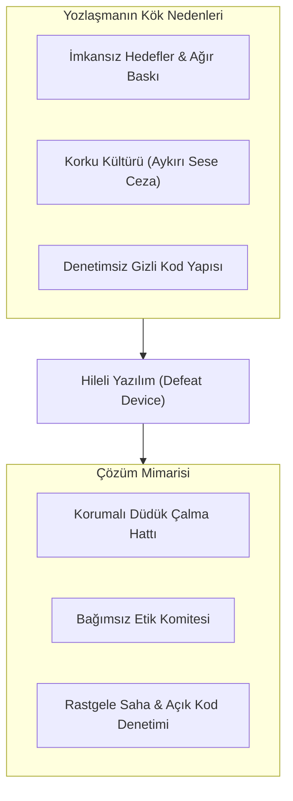
*Şekil 14.1: Dieselgate Vakası Kök Nedenleri ve Kurumsal Savunma Mekanizmaları.*

### Sık Yapılan Hatalar ve Yanılgılar
- **"Yöneticim bana yaz dedi, ben sadece kodladım, suç yöneticinindir":** Nuremberg ilkelerinden bu yana "Sadece bana verilen emri uyguladım" savunması etik ve hukuki bir mazeret değildir. Suç teşkil eden veya halkı zehirleyen bir algoritmayı kodlayan mühendis suça doğrudan iştirak etmiş sayılır.
- **"Şirkette etik el kitapçığının olması yozlaşmayı önler":** Bir şirket web sitesine en süslü etik ilkeleri yazabilir; ancak çalışanlar usulsüzlük bildirdiğinde kovuluyorsa o kitapçık sadece bir vitrindir (ethics washing).

### Aktif Hatırlama Soruları ve Çözümleri
1. *Soru:* Volkswagen skandalında kullanılan "Defeat Device" (Yenilgi Aygıtı) yazılımının etik ihlal niteliği nedir?

Çözüm ve Açıklama

Regülatörleri ve kamuoyunu aldatmak amacıyla tasarlanmış bilinçli ve sistematik bir sahteciliktir (falsification); kamu sağlığını doğrudan tehlikeye atan nitelikli bir hiledir.

2. *Soru:* Araştırma ve mühendislik etiğinde "Uydurma" (Fabrication) ile "Çarpıtma" (Falsification) arasındaki fark nedir?

Çözüm ve Açıklama

Uydurma hiç yapılmamış test veya veriyi tamamen hayal ürünü olarak rapora eklemektir; çarpıtma ise gerçek verileri manipüle etmek, kurala uymayan veya hata veren kısımları rapordan kasten çıkarmaktır.

3. *Soru:* Güvenli bir "Düdük Çalma Hattı"nın (Whistleblowing system) en kritik iki özelliği nedir?

Çözüm ve Açıklama

1. İhbarcının kimliğini kesin olarak gizli tutması (Anonimlik). 2. İhbarcıya yönelik işten çıkarma veya mobbing gibi kurumsal misillemelere karşı yasal ve kurumsal koruma sağlaması.

### Hafta Kaynak ve Video Kartı
- **Video serisi:** [UVA OEC / Michael Loui, Professional Ethics in Engineering](https://youtube.com/playlist?list=PLdHmP-EKPCRD3-mFYjOjapYPYSnbBpFRV).
- **Kavram kaynağı:** [UVA OEC Whistleblowing Subject Aid](https://onlineethics.virginia.edu/cases/oec-subject-aids/whistleblowing-subject-aid). Bildirim kanalları ve etik değerlendirme için başvuru kaynağıdır.

---

## Hafta 15: Final — Dönem Sonu Senaryo Tekrarı (Önerilen Tekrar Etkinliği)

> [!NOTE]
> **Önerilen Tekrar Etkinliği Bildirimi**  
> Bu hafta akademik takvimde resmî final sınav haftasıdır. Müfredatta yeni bir teorik konu bulunmamaktadır. Bu bölüm, 14 hafta boyunca inşa edilen tüm felsefi temelleri, meslek kodlarını, karar modellerini ve vaka analiz araçlarını sentezleyen büyük bir dönem sonu simülasyonu ve final hazırlık rehberidir.

### Dönem Boyu İnşa Edilen Kavramsal Sözlük

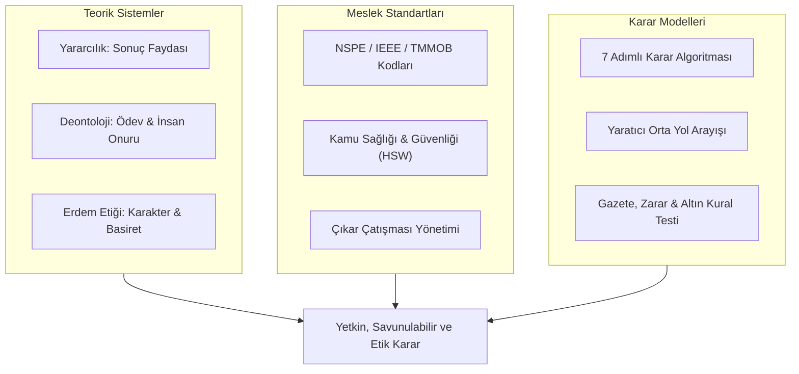
*Şekil 15.1: Dönem Boyu Edinilen Etik Yetkinliklerin Karar Mimarisi.*

### Büyük Final Simülasyon Senaryosu (Öğrenme Amaçlı Bütünleşik Vaka)
*Senaryo:* Küresel bir yapay zekâlı robotik cerrahi şirketinde "Kıdemli Güvenlik ve Doğrulama Mühendisi" olarak çalışmaktasınız.
- Şirket, beyin tümörü ameliyatlarında mikro-kesiler yapan yeni nesil otonom cerrahi robotu için haftaya Amerikan Gıda ve İlaç Dairesi (FDA) ve Avrupa Tıbbi Cihaz Kurumu'na (MDR) nihai onay başvurusunda bulunacaktır.
- Onay alındığı an şirket New York Borsası'nda halka arz (IPO) edilecek ve mevcut çalışanların hisse opsiyonları milyonlarca dolar değer kazanacaktır (siz dahil).
- Ancak son simülasyon testlerinde, robotun görme sisteminin düşük ışık koşullarında tümör dokusu ile sağlıklı kılcal damarları %0.8 oranında karıştırdığını ve bu durumun hastanın felç kalmasına veya ölümüne yol açabileceğini saptarsınız.
- Proje Direktörü (aynı zamanda eski üniversite hocanız): "Bu binde sekizlik bir risk, hekim ameliyatta zaten başında duruyor. Halka arzı tehlikeye atamayız. Bu logları ayıkla, onay dosyasını temiz haliyle imzala. Hepimiz zengin olacağız; halka arzdan sonra gelen parayla bu hatayı zaten ikinci versiyonda düzeltiriz" demektedir.

### 15 Haftalık Entegre Analiz ve Çözüm Raporu
1. **Olguların ve Risklerin Tespiti (Hafta 1 & 10):** Cihazda ölümcül doku karıştırma hatası vardır; risk %0.8'dir (tıbbi cihazda kabul edilemez boyuttadır); halka arz takvimi baskı yaratmaktadır.
2. **Dörtlü Katman Analizi (Hafta 1):**
   - *Hukuk:* Güvenlik verisini bilerek tahrif etmenin etik ve hukuki sonuçları olabilir; uygulanacak kurallar yetki alanı ve olgulara bağlıdır.
   - *Şirket Politikası:* Halka arzı kurtarmak.
   - *Meslek Etiği:* İnsan hayatını ve cerrahi güvenliği korumak. Meslek etiği ve hukuk şirket politikasını ezer.
3. **Kohlberg Ahlaki Gelişim Düzeyi (Hafta 2):** Direktörün teklifi Basamak 2 (kişisel maddi menfaat / zengin olma) düzeyindedir. Mühendis Basamak 6 (insan hayatının koşulsuz kutsallığı) düzeyinde durmalıdır.
4. **Normatif Teorilerin Muhakemesi (Hafta 3):**
   - *Kantçı Deontoloji:* Hastayı para kazanmak için "araç" konumuna indirmek kategorik olarak yanlıştır. Veriyi tahrif etmek evrenselleştirilemez.
   - *Yararcılık:* Halka arzdan kazanılacak para, sakat kalacak veya ölecek insanların acısı ve yaratacağı kamusal skandalla kıyaslanamaz.
5. **Citicorp & Challenger Dersleri (Hafta 4 & 5):** "Mühendis şapkanı çıkar" baskısına boyun eğilmez. Hata gizlenirse ileride yüzlerce hasta zarar görecek ve şirket tamamen batacaktır.
6. **Kodlar ve Çıkar Çatışması (Hafta 9 & 12):**
   - Hisselerden gelecek şahsi servet beklentisi büyük bir **Fiili Çıkar Çatışmasıdır**. Mühendis tarafsızlığını bu finansal çıkara kurban edemez.
   - NSPE Madde I.1 gereği kamunun güvenliği her şeyin üstündedir.
7. **Yaratıcı Orta Yol ve Nihai Eylem (Hafta 10):**
   - İmzalamayı kesinlikle reddetmek.
   - Görme sistemindeki hatayı ve sınırları detaylandıran teknik kanıt dosyasını derhal Yönetim Kurulu ve Bağımsız Denetim Komitesi'ne sunmak.
   - Halka arz başvurusunda cihazın kapsamını "otonom cerrahi" yerine, "cerrah kontrolünde yarı-otonom asistan modu" olarak revize etmeyi teklif etmek; tam otonom modu hata düzeltilene kadar yazılımsal kilitle devre dışı bırakmak.
   - Yönetim dinlemezse, düdük çalma protokolünü işletip başvurunun sahte veriyle yapılmasını engellemek.

### Final Hazırlık ve Kapsam Tekrar Soruları
1. *Soru:* Bir mühendisin kendi şirketinin hisse senedine sahip olması, ürünün güvenlik testlerini onaylarken nasıl bir etik ikilem yaratır?

Çözüm ve Açıklama

Ağır bir Fiili Çıkar Çatışması (Actual Conflict of Interest) yaratır. Mühendisin teknik güvenliği onaylamama kararı kendi şahsi servetinin azalmasına yol açacaktır. Mühendis çıkarını açıklamalı ve tarafsız bir gözden geçirme talep etmelidir; uygulanacak süreç kurum kurallarına göre belirlenir.

2. *Soru:* "İkinci versiyonda düzeltiriz, şimdi piyasaya sürelim" argümanı kritik güvenlik sistemlerinde neden kabul edilemez?

Çözüm ve Açıklama

Çünkü insan hayatı ve kamu güvenliği bir yazılım deneme tahtası değildir. İlk versiyonda oluşacak bir ölüm veya kaza telafi edilemez; bu yaklaşım Sapmanın Normalleşmesi ve ciddi etik kaygı doğurur; hukuki nitelendirme somut olay ve geçerli hukuka bağlıdır.

3. *Soru:* Dönem boyunca işlenen tüm teorilerin ve kodların tek bir cümlede özetlenen ortak nihai ilkesi nedir?

Çözüm ve Açıklama

Mühendislik uzmanlığı ve yetkisi; hiçbir kişisel, ticari veya bürokratik menfaatin kurbanı edilemez; daima kamu sağlığının, güvenliğinin, adaletin ve insan onurunun hizmetindedir.

### Dönem Sonu Kaynakça ve İleri Araştırma Rehberi
- **Birincil Video Arşivi:** University of Virginia Online Ethics Center, Michael Loui, *Professional Ethics in Engineering video series* ([OEC YouTube Playlist (PLdHmP-EKPCRD3-mFYjOjapYPYSnbBpFRV)](https://youtube.com/playlist?list=PLdHmP-EKPCRD3-mFYjOjapYPYSnbBpFRV)).
- **Açılış videosu:** [Michael Loui, Part 1: Engineering Ethics 101: Professionalism](https://www.youtube.com/watch?v=n9A8-FjhArE).
- **Vaka ve Emsal Karar Arşivi:** [UVA Online Ethics Center & NSPE BER Cases Collection](https://onlineethics.virginia.edu/collection-detail/Professional%20Ethics%20in%20Engineering%20Practice%3A%20Discussion%20Cases%20Based%20on%20NSPE%20BER%20Cases).
- **Ulusal bağlam için başlangıç noktası:** TMMOB ve ilgili meslek odalarının güncel resmî ilke ve düzenlemeleri; kişisel veriler, telif ve diğer hukuki konular için yürürlükteki resmî mevzuat metinleri. Bu notlar hukuki danışmanlık değildir.
