## Hafta 1: Kariyer Nedir? Beceri, yetenek, yetkinlik, kariyer/kariyer yönetimi; Kariyer Merkezi hizmetleri

### Öğrenme Hedefleri
Bu bölümü tamamladığınızda:
- İş, meslek, uğraş ve kariyer kavramları arasındaki kuramsal ve işlevsel ayrımları açıklayabileceksiniz.
- Beceri, yetenek ve yetkinlik kavramlarını Spencer and Spencer Yetkinlik Buzdağı Modeli çerçevesinde sınıflandırabileceksiniz.
- Bireysel kariyer yönetimi ile örgütsel kariyer yönetimi arasındaki etkileşim dinamiğini kavrayabileceksiniz.
- Üniversite Kariyer Merkezi hizmetlerini ve Yetenek Kapısı dijital platformunu profesyonel gelişim planınızda etkin biçimde kullanabileceksiniz.

### Kavram Açıklaması ve Teorik Çerçeve
Kariyer planlama, bireyin çalışma yaşamı boyunca üstlendiği rolleri, kazandığı deneyimleri ve geleceğe dönük hedeflerini bilinçli bir stratejiyle yönetmesidir.

1. **Temel Kavramsal Ayrım:**
   - **İş (Job):** Belirli bir organizasyonda, sınırları tanımlanmış görevlerin maddi bir karşılık (ücret) karşılığında yürütülmesidir. Belirli bir kurum ve zaman dilimiyle sınırlıdır.
   - **Meslek (Profession/Vocation):** Kapsamlı ve sistemli bir teorik eğitim, kurumsal etik kurallar ve yasal yetkilendirme gerektiren uzmanlık alanıdır (örneğin Bilgisayar Mühendisliği, Hukuk, Tıp).
   - **Kariyer (Career):** Bireyin yaşam boyu edindiği işle ilgili deneyimler, pozisyonlar, geçişler, unvanlar ve bunların bireye kazandırdığı psikolojik ve maddi tatminin bütünüdür. Kariyer tek bir işle veya şirketle sınırlı değildir.
   - **Uğraş (Occupation):** Bireyin zaman ayırdığı, ekonomik bir zorunluluk taşımayan veya profesyonel kariyer zincirinin parçası olmayan faaliyetlerdir.

2. **Beceri, Yetenek ve Yetkinlik Ayrımı:**
   - **Yetenek (Aptitude/Ability):** Bireyin doğuştan getirdiği veya erken yaşlarda şekillenen, belirli bir zihinsel veya fiziksel işi öğrenme ve yapabilme potansiyelidir (örneğin analitik düşünme, soyut muhakeme, uzamsal algı).
   - **Beceri (Skill):** Eğitilerek, tekrarlanarak ve pratik yapılarak geliştirilen, belirli bir görevi ustalıkla yerine getirme kapasitesidir (örneğin Python ile kod yazma, veritabanı sorgulama).
   - **Yetkinlik (Competency):** Bireyin bir işte üstün performans sergilemesini sağlayan bilgi, beceri, tutum, değer ve kişisel özelliklerin bütünleşik bütünüdür.
   - **Spencer and Spencer Yetkinlik Buzdağı Modeli:**
     - *Suyun Üstü (Görünür Kısım):* Bilgi ve Beceri. Ölçülmesi, test edilmesi ve eğitimle kazandırılması görece kolaydır.
     - *Suyun Altı (Görünmeyen Kısım):* Sosyal Rol, Öz İmaj, Kişilik Özellikleri ve Güdüler. Bireyin derin psikolojik yapısını oluşturur; performansı uzun vadede asıl belirleyen ve dönüştürülmesi en zor olan unsurlardır.

3. **Kariyer Yönetimi ve Kariyer Merkezi Hizmetleri:**
   - **Bireysel Kariyer Yönetimi:** Bireyin kendi güçlü ve zayıf yönlerini tanıması, mesleki hedefler koyması ve bu hedeflere ulaşmak için gerekli adımları proaktif olarak atmasıdır.
   - **Örgütsel Kariyer Yönetimi:** Kurumların insan kaynağı ihtiyacını karşılamak ve çalışanların potansiyelini maksimize etmek amacıyla kariyer yollarını ve gelişim programlarını tasarlamasıdır.
   - **Üniversite Kariyer Merkezleri ve Yetenek Kapısı:** Üniversite bünyesindeki kariyer merkezleri; öğrencilere bireysel kariyer danışmanlığı sunar, staj protokolleri koordine eder ve sektörel networking fırsatları sağlar. T.C. Cumhurbaşkanlığı İnsan Kaynakları Ofisi (CBİKO) tarafından yönetilen Yetenek Kapısı, öğrencilerin iş ve staj ilanlarına, fuarlara ve kariyer etkinliklerine tek merkezden erişmesini sağlayan resmî ulusal platformdur.

### Görsel Analiz Şeması
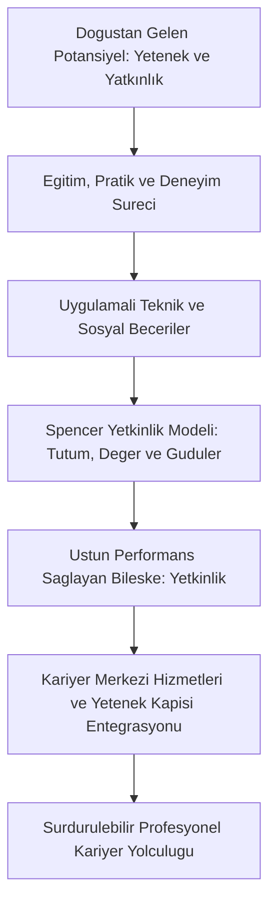
*Şekil 1.1: Bireysel yetenek ve becerilerden yetkinliğe geçiş ve kariyer merkezi destek mekanizması.*

### Bilgisayar Mühendisi İçin Uygulama
Bilgisayar mühendisliği öğrencisi için kariyer yönetimi, henüz 1. ve 2. sınıftayken kurumsal platformlara entegre olmak ve teknik profilini yapılandırmakla başlar:
- **Yetenek Kapısı Kaydı ve Profil Optimizasyonu:** CBİKO Yetenek Kapısı platformunda tam profil oluşturulmalı; programlama dilleri, yabancı dil puanları, algoritma yetkinlikleri ve ilgi alanları (Yapay Zekâ, Veri Bilimi, Siber Güvenlik) eksiksiz girilmelidir. Kamu kurumlarının ve teknopark firmalarının staj ilanları bu kanal üzerinden taranmalıdır.
- **T-Tipi Mühendislik Profili:** Yatay çubukta tüm mühendislerin bilmesi gereken temel yetkinlikler yer alır: Veri Yapıları ve Algoritmalar, İşletim Sistemleri, Bilgisayar Ağları, Temiz Kod prensipleri, Git ve nesne yönelimli programlama. Dikey çubukta ise öğrencinin uzmanlaştığı spesifik alan bulunur (örneğin PyTorch ile derin öğrenme ve Transformer mimarileri).
- **GitHub ve Dijital Vitrin:** Öğrencinin teknik yetkinliğini kanıtlayan birincil platform GitHub'dır. README dosyaları özenle hazırlanmış, canlı demo linki içeren ve modüler mimaride yazılmış repolar oluşturulmalıdır.

### Çözümlü Vaka İncelemesi
*Vaka:* Bilgisayar Mühendisliği 2. sınıf öğrencisi Mert, not ortalaması 3.65 olmasına rağmen teknoparkta yer alan bir yapay zekâ firmasının staj mülakatından elenmiştir. Mülakatçı, Mert'in teorik ders bilgilerinin tam olduğunu ancak hiçbir pratik proje üretmediğini ve ekip çalışması yetkinliğini gösteremediğini belirtmiştir.

*Teorik Çözümleme:*
1. **Buzdağı Modeli Açısından Değerlendirme:** Mert'in bilgi boyutu (suyun üstü) kusursuzdur; ancak sektörün aradığı uygulama becerisi ve suyun altındaki inisiyatif alma, problem çözme güdüsü ve takım çalışması tutumu eksiktir.
2. **Kariyer Merkezi ve Eylem Planı:** Mert üniversite kariyer merkezine başvurarak bireysel danışmanlık alır. Danışmanın yönlendirmesiyle Yetenek Kapısı üzerinden açılan bir açık kaynak hackathonuna katılır. Orada 3 kişilik bir ekiple görüntü işleme tabanlı bir atık sınıflandırma projesi geliştirir. Projeyi GitHub'da yayınlar ve dokümante eder. Bir sonraki staj başvurusunda bu yetkinlik kanıtını sunarak teknoparktaki Ar-Ge merkezine stajyer olarak kabul edilir.

### Sık Yapılan Hatalar ve Yanılgılar
- **"Yetenek ile yetkinlik aynı şeydir; yetenekliysen çalışmana gerek yoktur":** Yetenek yalnızca bir ham potansiyeldir. Sistemli çalışma, eğitim ve doğru tutumla desteklenmeyen yetenek iş dünyasında hiçbir somut çıktı üretmez.
- **"Kariyer merkezine yalnızca mezuniyet aşamasında iş bulmak için gidilir":** Kariyer merkezleri son sınıf acil servisleri değildir; 1. sınıftan itibaren yetkinlik analizi, sektör tanıma ve staj planlaması için düzenli ziyaret edilmesi gereken gelişim birimleridir.

### Aktif Hatırlama Soruları ve Çözümleri
1. *Soru:* Spencer and Spencer Yetkinlik Buzdağı Modelinde suyun altındaki faktörlerin geliştirilmesi neden suyun üstündeki bilgi ve beceriye göre çok daha zordur?

Çözüm ve Açıklama

Suyun üstündeki bilgi ve teknik beceriler kısa süreli eğitimler ve kodlama pratikleriyle hızla edinilebilir. Buna karşılık suyun altındaki güdüler, öz değerler, kişilik özellikleri ve sosyal roller bireyin çocukluktan itibaren şekillenen derin zihinsel kalıpları olduğundan köklü davranışsal ve zihniyet dönüşümü gerektirir.

2. *Soru:* İş, meslek ve kariyer kavramları arasındaki temel farkları bilgisayar mühendisliği bağlamında somutlaştırarak açıklayınız.

Çözüm ve Açıklama

Meslek, 4 yıllık lisans eğitimiyle kazanılan genel uzmanlık alanıdır (Bilgisayar Mühendisliği). İş, belirli bir şirkette maaş karşılığı yürütülen somut görevdir (X Teknoloji Şirketinde Backend Developer pozisyonu). Kariyer ise bireyin stajyerlikten başlayarak kıdemli mühendisliğe, mimarlığa veya yöneticiliğe uzanan ömür boyu mesleki deneyim ve roller zinciridir.

3. *Soru:* T.C. Cumhurbaşkanlığı İnsan Kaynakları Ofisi tarafından yürütülen Yetenek Kapısı platformunun üniversite öğrencilerine sağladığı temel kurumsal avantajlar nelerdir?

Çözüm ve Açıklama

Yetenek Kapısı; öğrencilerin ve mezunların kamu ve özel sektör iş ve staj ilanlarına tek noktadan erişmesini sağlar, kariyer fuarlarına ve etkinliklere katılım imkânı sunar, üniversite kariyer merkezleriyle entegre çalışarak fırsat eşitliği ve şeffaf istihdam süreçleri yaratır.

### Hafta Kaynak ve Video Kartı
- **Resmî İzlence ve Üniversite Portalı:** [İstanbul Nişantaşı Üniversitesi GET05011 İzlencesi](https://ebp.nisantasi.edu.tr/DereceProgramlari/Ders/1/0/16802/53713/1).
- **Ulusal Kariyer Platformu:** [T.C. Cumhurbaşkanlığı İnsan Kaynakları Ofisi Yetenek Kapısı](https://www.yetenekkapisi.org/).
- **Mesleki Standartlar Portalı:** [İŞKUR Meslek Bilgi Portalı](https://www.iskur.gov.tr/).
- **Ne İçin İncelenmeli:** Resmî ders izlencesi hedeflerini gözden geçirmek, Yetenek Kapısı öğrenci profilini aktif hale getirmek ve T-tipi yetkinlik envanterini doğrulamak için.

---

## Hafta 2: Örgütsel Kariyer Yönetimi: aşamalar, kariyer yolları, çalışana ve örgüte yararları

### Öğrenme Hedefleri
Bu bölümü tamamladığınızda:
- Örgütsel kariyer yönetimi (ÖKY) kavramını ve temel aşamalarını sıralayabileceksiniz.
- Örgütün insan kaynağı gereksinimleri ile çalışanın bireysel kariyer hedeflerinin bütünleştirilme mekanizmasını açıklayabileceksiniz.
- Geleneksel dikey kariyer yolları ile İkili Kariyer Merdiveni (Dual Career Ladder) modellerini karşılaştırabileceksiniz.
- Örgütsel kariyer yönetiminin çalışan bağlılığı, iş tatmini ve örgütsel performans üzerindeki somut yararlarını değerlendirebileceksiniz.

### Kavram Açıklaması ve Teorik Çerçeve
Örgütsel Kariyer Yönetimi (ÖKY); kurumların stratejik hedeflerine ulaşabilmek için ihtiyaç duyduğu nitelikli işgücünü planlaması, yetiştirmesi ve çalışanların bireysel kariyer beklentileriyle kurumun ihtiyaçlarını uyumlaştırması sürecidir.

1. **Örgütsel Kariyer Yönetiminin Temel Aşamaları:**
   - **1. Örgütsel İhtiyaçların Belirlenmesi:** Stratejik insan kaynakları planlaması yapılarak gelecekte hangi pozisyonlarda hangi yetkinliklere ihtiyaç duyulacağının analizi yapılır.
   - **2. Kariyer Yollarının Haritalandırılması:** Kurum içinde dikey, yatay veya çapraz ilerleme olanaklarını gösteren mantıksal kariyer patikalarının açıkça tanımlanmasıdır.
   - **3. Çalışanların Bilgilendirilmesi:** Kurum içi boş pozisyonlar, aranan terfi kriterleri ve potansiyel gelişim fırsatlarının açık ilanlarla (job posting) şeffaf biçimde duyurulmasıdır.
   - **4. Değerlendirme ve Potansiyel Tespiti:** Performans değerlendirme sonuçları, değerlendirme merkezleri (assessment centers) ve yetkinlik envanterleri kullanılarak çalışanların mevcut durumu ve potansiyeli ölçülür.
   - **5. Geliştirici Geri Bildirim Sunulması:** Çalışana güçlü yönleri ve geliştirmesi gereken alanlar hakkında yapıcı, yön gösterici geri bildirim sağlanmasıdır.
   - **6. İhtiyaçların Bütünleştirilmesi (Integration):** Örgütün hedefleri ile bireyin ilgi, yetenek ve değerlerinin örtüştürülmesi; kazan-kazan dengesinin kurulmasıdır.
   - **7. Geliştirme Faaliyetlerinin Sunulması:** Hizmet içi eğitimler, mentorluk, rotasyon ve kurumsal akademi programlarıyla çalışanın kariyer yolunda ilerlemesinin desteklenmesidir.

2. **Kariyer Yolları ve İkili Kariyer Merdiveni (Dual Career Ladder):**
   - **Geleneksel Dikey Kariyer Yolu:** İlerlemenin tek yolunun hiyerarşik olarak yönetim kademelerine yükselmek olduğu modeldir.
   - **İkili Kariyer Merdiveni:** Özellikle Ar-Ge, mühendislik ve bilgi yoğun sektörlerde uygulanan çağdaş modeldir. Çalışana belirli bir kıdemden sonra iki eşit prestij ve ücret seviyesinde patika sunar:
     - *Yönetim Yolu (Management Track):* İnsan yönetimi, bütçe, strateji ve koordinasyon odaklı pozisyonlar (Engineering Manager, Director, VP).
     - *Bireysel Katkı Sağlayıcı Yolu (Individual Contributor - IC Track):* Kodlama, mimari tasarım, algoritmik derinlik ve teknik liderlik odaklı pozisyonlar (Senior Engineer, Staff Engineer, Principal Engineer, Distinguished Fellow).

3. **Örgütsel Kariyer Yönetiminin Yararları:**
   - **Çalışana Yararları:** Geleceği öngörebilme, kişisel potansiyelini gerçekleştirebilme, adil terfi ve gelişim olanaklarına erişim, mesleki tükenmişliğin azalması.
   - **Örgüte Yararları:** Kritik yeteneklerin şirkette tutulması (retention), turnover (işgücü devir) oranının düşmesi, kurum içi yedekleme gücü, çalışan bağlılığı ve rekabet avantajı.

### Görsel Analiz Şeması
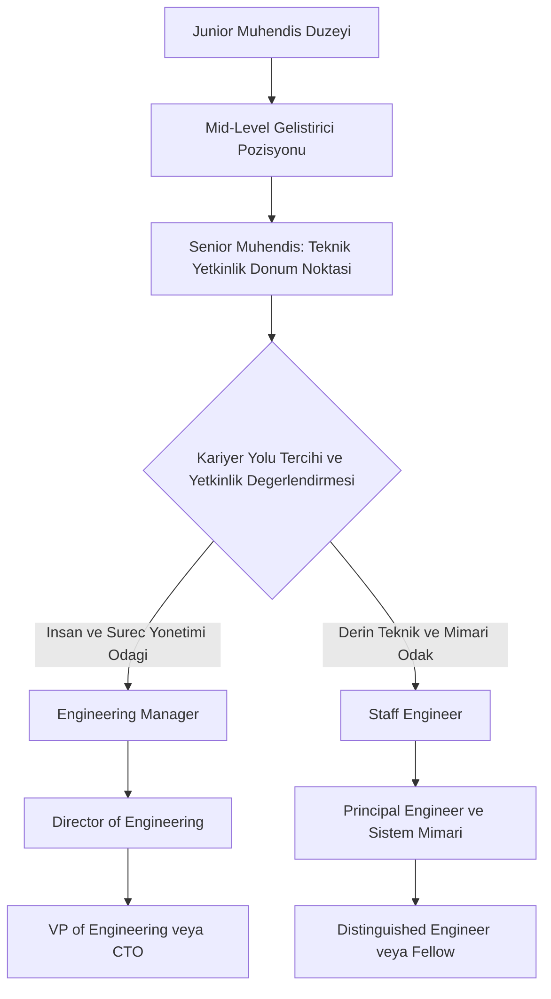
*Şekil 2.1: Yazılım şirketlerinde İkili Kariyer Merdiveni (Dual Career Ladder) teknik ve yönetsel ilerleme şeması.*

### Bilgisayar Mühendisi İçin Uygulama
Yazılım ve teknoloji sektöründe örgütsel kariyer yönetimi pratikleri küresel düzeyde standartlaşmıştır:
- **Teknoloji Şirketlerinde Kariyer Seviyeleri (Engineering Levels):** L3 (Junior), L4 (Mid-level), L5 (Senior), L6 (Staff), L7 (Principal). Mühendis, Senior seviyesine kadar temel yazılım mühendisliği yetkinliklerini kanıtlar; sonrasında yönetsel mi yoksa derin mimari yolda mı ilerleyeceğine karar verir.
- **Bireysel Katkı Sağlayıcı (IC) Rolünün Önemi:** Staff ve Principal seviyesindeki mühendisler doğrudan insan yönetmez; ancak birden fazla ekibin mimari standartlarını belirler, teknik borçları (technical debt) temizler ve kritik sistemlerin kesintisiz çalışmasını garanti eder.
- **Bire Bir (1-on-1) Kariyer Senkronizasyonu:** Yazılım mühendisi, yöneticisiyle 2-4 haftada bir düzenli 1-on-1 toplantılar yaparak bireysel kariyer hedeflerini şirketin teknik yol haritasıyla (tech roadmap) hizalamalıdır.

### Çözümlü Vaka İncelemesi
*Vaka:* Küresel bir e-ticaret platformunda 6 yıldır çalışan Baş Geliştirici Ali, şirketin en karmaşık ödeme sistemlerini sıfırdan yazmıştır. Şirket genel müdürü, Ali'yi ödüllendirmek amacıyla Yazılım Geliştirme Departman Müdürü olarak atamıştır. 4 ay sonra Ali, sürekli toplantılar, bütçe raporları ve performans görüşmeleri nedeniyle bunalmış, kod yazamadığı için mutsuz olmuş ve istifa etmeyi düşünmeye başlamıştır.

*Teorik Çözümleme:*
1. **Geleneksel Kariyer Yolu Tuzağı:** Şirket klasik tek yönlü dikey kariyer modelini uygulayarak başarılı bir teknik uzmanı yönetsel bir role zorlamıştır. Bu durum Laurence Peter'ın Peter İlkesi riskini tetiklemiş ve Ali'nin teknik gücünü etkisizleştirmiştir.
2. **İkili Kariyer Merdiveni Çözümü:** İK direktörü durumu fark ederek organizasyona İkili Kariyer Merdiveni yapısını entegre eder. Ali, yönetsel müdürlük pozisyonundan alınarak "Principal Systems Architect" unvanına geçirilir. Maaşı, yan hakları ve şirket içi statüsü departman müdürüyle tamamen eşit tutulur. Ali yeniden mimari tasarım, karmaşık algoritma optimizasyonu ve genç mühendislere teknik mentorluk yapmaya başlayarak şirket verimliliğini üst seviyeye taşır.

### Sık Yapılan Hatalar ve Yanılgılar
- **"Bir yazılımcının şirket içinde yükselebilmesinin tek yolu takım lideri veya yönetici olmasıdır":** İkili kariyer merdiveni uygulayan modern teknoloji kurumlarında Staff ve Principal mühendisler, yöneticilerle eşit yetki, maaş ve saygınlığa sahiptir.
- **"Örgütsel kariyer yönetimi tamamen İK departmanının görevidir":** Örgütsel kariyer yönetimi; İK, ilk kademe teknik yöneticiler ve çalışanın kendisinin ortaklaşa yürüttüğü üçlü bir sorumluluktur.

### Aktif Hatırlama Soruları ve Çözümleri
1. *Soru:* İkili Kariyer Merdiveni (Dual Career Ladder) sistemi yüksek teknoloji şirketlerinde neden kritik bir insan kaynakları stratejisidir?

Çözüm ve Açıklama

Derin teknik uzmanlığa sahip mühendislerin ve araştırmacıların kariyerlerinde yükselebilmek için istemedikleri yönetsel rollere geçmek zorunda kalmalarını önler. Teknik uzmanların kodlamadan ve inovasyondan kopmadan unvan, maaş ve prestij kazanmasını sağlayarak kurum içi kritik yetenek kaybını engeller.

2. *Soru:* Örgütsel kariyer yönetiminde "örgüt ihtiyaçları ile çalışan ihtiyaçlarının bütünleştirilmesi" ne anlama gelir?

Çözüm ve Açıklama

Kurumun gelecekteki stratejik hedefleri ve boşalacak pozisyonları için gereken yetkinlikler ile çalışanların kişisel ilgi, kariyer hedefleri ve potansiyellerinin örtüştürülmesidir. Bu sayede hem çalışan kariyer tatmini yaşar hem de örgüt ihtiyaç duyduğu yetkin işgücünü içeriden temin eder.

3. *Soru:* Örgütsel kariyer yönetiminin örgüte sağladığı turnover oranını düşürme etkisi nasıl gerçekleşir?

Çözüm ve Açıklama

Çalışanlar mevcut kurumlarında kendileri için açık ve adil bir kariyer yolu, gelişim fırsatları ve terfi olanakları gördüklerinde dış piyasadaki alternatiflere yönelme ihtiyacı duymazlar. Bu da işgücü devir oranını azaltır ve kurumsal hafızayı korur.

### Hafta Kaynak ve Video Kartı
- **Resmî İzlence ve Üniversite Portalı:** [İstanbul Nişantaşı Üniversitesi GET05011 İzlencesi](https://ebp.nisantasi.edu.tr/DereceProgramlari/Ders/1/0/16802/53713/1).
- **Yönetim Literatürü Kaynağı:** [Harvard Business Review — Dual Career Ladders in Tech](https://hbr.org/).
- **Mesleki Standartlar:** [U.S. Dept of Labor O*NET OnLine — Software Developers](https://www.onetonline.org/).
- **Ne İçin İncelenmeli:** Teknoloji firmalarında IC ve Management kariyer yolları ayrımını ve örgütsel kariyer aşamalarını kuramsal temelleriyle incelemek için.

---

## Hafta 3: Terfi ve Nakil: kararlar, kriterler, yararlar

### Öğrenme Hedefleri
Bu bölümü tamamladığınızda:
- Terfi (promotion) ve nakil (transfer) kavramlarını dikey ve yatay örgütsel hareketlilik ekseninde tanımlayabileceksiniz.
- Terfi kararlarında kullanılan liyakat, kıdem ve potansiyel kriterlerinin avantaj ve dezavantajlarını analiz edebileceksiniz.
- Peter İlkesi'nin (Peter Principle) mekanizmasını kavrayarak örgütsel terfi sistemlerindeki riskleri teşhis edebileceksiniz.
- Terfi ve nakil uygulamalarının çalışan motivasyonu, kurumsal esneklik ve yetenek dağılımı üzerindeki yararlarını açıklayabileceksiniz.

### Kavram Açıklaması ve Teorik Çerçeve
Örgüt içi hareketlilik; insan kaynaklarının verimli dağıtılması, motivasyonun yüksek tutulması ve organizasyonel dinamizmin sağlanması için kullanılan temel mekanizmalardır.

1. **Terfi (Promotion) Kavramı ve Boyutları:**
   - Terfi, bir çalışanın mevcut hiyerarşik kademesinden daha yüksek yetki, sorumluluk, statü ve genellikle daha yüksek ücret gerektiren bir üst pozisyona dikey hareketliliğidir.
   - **Temel Terfi Kriterleri:**
     - *Liyakat ve Performans (Merit):* Geçmiş dönemde sergilenen üstün iş başarısı, hedefleri aşma derecesi ve somut çıktılar.
     - *Kıdem (Seniority):* Çalışanın kurumda geçirdiği hizmet süresi. Sadakati ödüllendirir ve sübjektifliği azaltır; ancak dinamizmi ve genç yeteneklerin motivasyonunu törpüleyebilir.
     - *Potansiyel ve Yetkinlik:* Çalışanın bir üst pozisyonun gerektirdiği yeni becerileri sergileyebilme kapasitesi.
   - **Peter İlkesi (Laurence J. Peter & Raymond Hull):**
     - Bir hiyerarşide her çalışan, yetersiz olduğu düzeye kadar terfi etme eğilimindedir.
     - Bir rolde başarılı olan kişi terfi ettirilir; yeni rolde de başarılı olursa yine terfi ettirilir. Ancak en sonunda yeteneklerinin yetersiz kaldığı bir pozisyona ulaşır ve orada takılıp kalır. Bu durum örgütlerin üst kademelerinde yetersiz yöneticiler yığılmasına yol açabilir.

2. **Nakil (Transfer) Kavramı ve Türleri:**
   - Nakil; çalışanın hiyerarşik kademesi, statüsü ve ücret düzeyinde esaslı bir değişiklik olmaksızın, aynı organizasyon içinde bir görevden veya departmandan diğerine yatay hareketliliğidir.
   - **Nakil Türleri:**
     - *Üretim/Operasyonel Nakil:* Kurumun dönemsel işgücü açığı olan birimlerine personel kaydırılması.
     - *Düzeltici/Uyum Nakli:* Kişi-iş veya kişi-yönetici uyumsuzluğu yaşayan bir çalışanın daha verimli olabileceği başka bir birime transferi.
     - *Telafi Edici Nakil:* Sağlık, aile veya kişisel nedenlerle personelin talebi doğrultusunda yapılan yer değişiklikleri.
     - *Gelişim/Rotasyon Amaçlı Nakil:* Çalışanın kurumun farklı fonksiyonlarını öğrenerek çok yönlü yetkinlik kazanması için planlanan yatay geçişler.

3. **Terfi ve Naklin Örgüt ve Çalışana Yararları:**
   - **Çalışan Açısından:** Kariyer ilerlemesi, mesleki heyecan, rutin ve monotonluğun kırılması, yeni beceriler kazanma ve özsaygı artışı.
   - **Örgüt Açısından:** Dışarıdan eleman arama maliyetinin azalması, çalışan sadakati, departmanlar arası iletişim kanallarının güçlenmesi ve esnek işgücü havuzu.

### Görsel Analiz Şeması
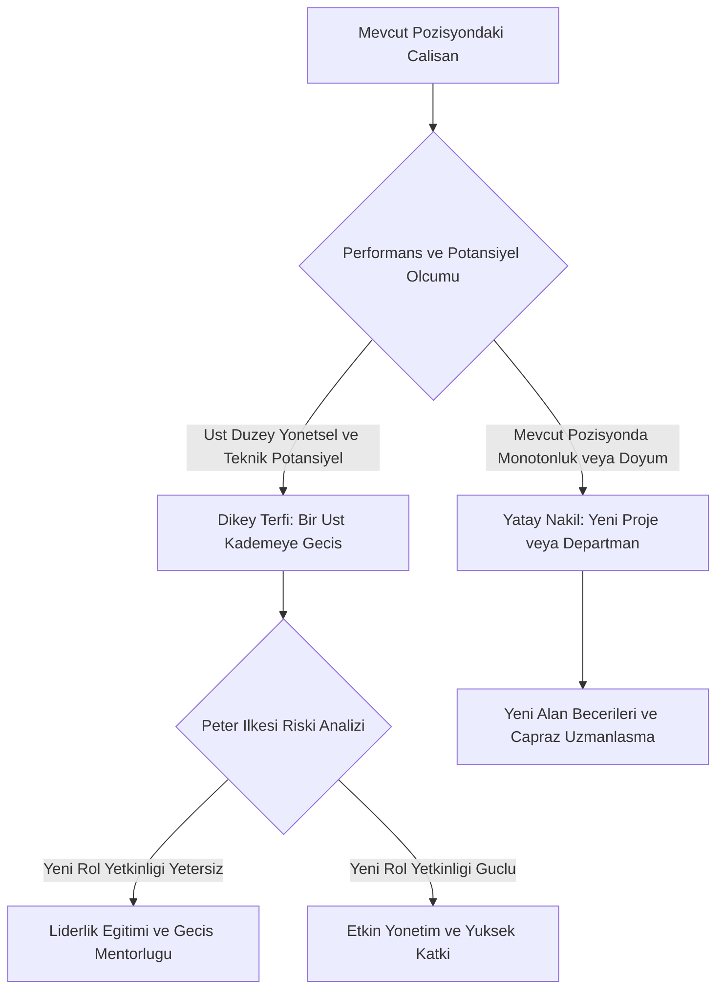
*Şekil 3.1: Terfi ve nakil karar mekanizması ve Peter İlkesi risk filtresi akış şeması.*

### Bilgisayar Mühendisi İçin Uygulama
Yazılım ekiplerinde terfi ve iç transfer mekanizmaları ölçülebilir mühendislik metriklerine dayanır:
- **Terfi Dosyası (Promotion Packet / Brag Document):** Mühendis, bir üst kademeye (örneğin Mid'den Senior'a) terfi edebilmek için son 6-12 aydaki katkılarını somutlaştırır: Çözülen mimari darboğazlar, optimize edilen API yanıt süreleri (örneğin p99 gecikmesinin 400ms'den 80ms'ye indirilmesi), kod inceleme (Code Review) oranları ve genç mühendislere sağlanan rehberlik.
- **Rolü Önceden Yaşamak:** Yazılım sektöründe altın kural şudur: "Terfi yeni görevi yapabildiğin için verilmez; o görevin sorumluluklarını zaten 6 aydır başarıyla yürüttüğün için tescillenir."
- **Departmanlar Arası İç Nakil (Internal Mobility):** Bir backend mühendisinin şirket içinde açılan Yapay Zekâ / Makine Öğrenimi ekibine yatay nakil ile geçmesi; şirketin dışarıdan pahalı bir ML mühendisi aramak yerine içerideki sistem mimarisini iyi bilen bir mühendisi dönüştürmesini sağlar.

### Çözümlü Vaka İncelemesi
*Vaka:* Bir oyun stüdyosunda çalışan Kıdemli Oyun Motoru Programcısı Emre, şirketin en hızlı ve hatasız C++ kodunu yazmaktadır. Şirket yönetimi Emre'yi Proje Direktörlüğü pozisyonuna terfi ettirmiştir. Yeni pozisyonda bütçe takibi, müşteri ilişkileri ve 40 kişilik ekibin idari izin süreçleriyle ilgilenmesi gereken Emre, bütçeyi yönetememiş, ekip içi iletişim krizlerine yol açmış ve oyunun teslim tarihi 3 ay gecikmiştir.

*Teorik Çözümleme:*
1. **Peter İlkesi Teşhisi:** Emre teknik uzmanlık seviyesinde harikadır; ancak yönetim yetkinlikleri gerektiren bir kademeye yükseltildiğinde kendi yetersizlik düzeyine ulaşmıştır. Mükemmel kod yazabilmek, mükemmel proje yönetebilmek anlamına gelmez.
2. **Yapıcı Çözüm:** Şirket Emre'yi idari yüklerden arındırarak "Lead Engine Architect" pozisyonuna getirir. Proje Direktörlüğü rolüne ise yönetim yetkinlikleri güçlü olan bir başka profesyonel atanır. Emre'nin teknik dehası kurtarılırken proje takvimi rayına oturtulur.

### Sık Yapılan Hatalar ve Yanılgılar
- **"Terfi yalnızca şirkette en uzun süre çalışan kişiye (kıdeme) verilmelidir":** Yalnızca kıdeme dayalı terfi, yüksek performanslı ve vizyoner genç yeteneklerin kurumdan ayrılmasına (brain drain) sebep olur. Liyakat ve potansiyel mutlaka dengelenmelidir.
- **"Yatay nakil alan kişi başarısız olduğu için sürülmüştür":** Modern organizasyonlarda yatay nakil; çalışanı geleceğin üst düzey rollerine hazırlamak ve çok boyutlu vizyon kazandırmak için uygulanan prestijli bir yetenek geliştirme aracıdır.

### Aktif Hatırlama Soruları ve Çözümleri
1. *Soru:* Laurence J. Peter tarafından formüle edilen "Peter İlkesi" nedir ve örgütlerde bu riski minimize etmek için hangi İK uygulaması yapılmalıdır?

Çözüm ve Açıklama

Peter İlkesi, hiyerarşik sistemlerde her çalışanın kendi yetersizlik düzeyine kadar terfi etme eğiliminde olduğunu savunur. Bu riski önlemek için terfi kararları yalnızca geçmiş performansa değil, hedef pozisyonun gerektirdiği yönetsel ve davranışsal potansiyelin değerlendirilmesine dayandırılmalı ve İkili Kariyer Merdiveni gibi alternatif teknik terfi yolları sunulmalıdır.

2. *Soru:* Terfi kriteri olarak "Liyakat" ile "Kıdem" karşılaştırıldığında, liyakate dayalı sistemin örgütsel avantajı nedir?

Çözüm ve Açıklama

Liyakate dayalı sistem yüksek performansı, üretkenliği ve somut başarıyı ödüllendirir. Bu durum yetenekli çalışanların motivasyonunu artırır, örgüt içi adalet algısını güçlendirir ve şirketin rekabetçi kalmasını sağlar.

3. *Soru:* Yatay nakil (transfer) uygulamasının bir yazılım mühendisinin kariyerine sağladığı en önemli gelişimsel katkı nedir?

Çözüm ve Açıklama

Mühendisin tek bir teknoloji veya sistem üzerinde monotonlaşmasını önler. Farklı iş alanlarını (örneğin frontend, backend, mobil, veri mühendisliği) deneyimleyerek sistemin bütününü görmesini, T-tipi geniş yetkinlikler kazanmasını ve geleceğin sistem mimarı rollerine hazırlanmasını sağlar.

### Hafta Kaynak ve Video Kartı
- **Resmî İzlence ve Üniversite Portalı:** [İstanbul Nişantaşı Üniversitesi GET05011 İzlencesi](https://ebp.nisantasi.edu.tr/DereceProgramlari/Ders/1/0/16802/53713/1).
- **Yönetim Kuramı İncelemesi:** [Harvard Business Review — The Peter Principle Revisited](https://hbr.org/).
- **İş Hukuku ve Mevzuat:** [4857 Sayılı İş Kanunu — Nakil ve Çalışma Koşulları](https://www.mevzuat.gov.tr/).
- **Ne İçin İncelenmeli:** Terfi ve nakil mekanizmalarının kuramsal risklerini ve iş hukuku çerçevesindeki esaslarını kavramak için.

---

## Hafta 4: Kariyer Evreleri: keşfetme, kurma, sürdürme, çözülme

### Öğrenme Hedefleri
Bu bölümü tamamladığınızda:
- Donald Super ve Douglas Hall'ın kariyer evreleri modellerinin kuramsal temellerini açıklayabileceksiniz.
- Keşfetme, Kurma, Sürdürme ve Çözülme evrelerinin psikolojik ve mesleki gelişimsel görevlerini ayırt edebileceksiniz.
- Sürdürme evresinde ortaya çıkabilen Kariyer Platosu (Career Plateau) riskini ve aşma stratejilerini analiz edebileceksiniz.
- Kariyer evreleri yaklaşımının örgütsel kariyer yönetimi ve insan kaynakları politikalarındaki rolünü değerlendirebileceksiniz.

### Kavram Açıklaması ve Teorik Çerçeve
Kariyer, bireyin yaşamı boyunca durağan kalan bir olgu değil; farklı yaş ve deneyim dönemlerinde değişen ihtiyaçlar, roller ve psikolojik dinamiklerle şekillenen evrimsel bir süreçtir.

1. **Donald Super'ın Yaşam Boyu / Yaşam Alanı Kuramı:**
   Donald Super, kariyeri bireyin benlik kavramını (self-concept) mesleki rollere yansıtması olarak açıklar ve yaşamı 5 temel evreye ayırır:
   - **Büyüme Evresi (0–14 yaş):** İhtiyaçlar, hayaller ve ilk ilgi alanlarının keşfi.
   - **1. Keşfetme Evresi (Exploration - 15–24 yaş):**
     - Birey kendi ilgi, yetenek ve değerlerini tanımaya çalışır.
     - Alt evreleri: *Deneme*, *Kristalleşme* (meslek alanının daralması) ve *Uygulama* (ilk işe/staja giriş).
     - Üniversite lisans eğitimi bu evrenin merkezindedir.
   - **2. Kurma / Yerleşme Evresi (Establishment - 25–44 yaş):**
     - Meslekte kalıcı bir yer edinme, uzmanlaşma ve hiyerarşide ilerleme dönemidir.
     - *Uyumlanma*, *Konsolidasyon* ve *Yukarı Doğru Hareket* evrelerini içerir.
     - 30'lu yaşların ortasında "Kariyer değerlendirmesi ve ara kriz" yaşanabilir.
   - **3. Sürdürme Evresi (Maintenance - 45–64 yaş):**
     - Kazanılan pozisyonu koruma, güncelliğini sürdürme ve birikimini genç nesillere aktarma (mentorluk) evresidir.
     - En kritik risk **Kariyer Platosu**dur: Bireyin hem hiyerarşik olarak daha fazla yükselemediği (yapısal plato) hem de iş içeriğinden yeni bir şey öğrenemediği (içerik platosu) durağanlaşma evresi.
   - **4. Çözülme / Ayrılma Evresi (Disengagement/Decline - 65+ yaş):**
     - İş gücünden kademeli olarak çekilme, emeklilik rolleri geliştirme ve kurumsal hafızayı devretme evresidir.

2. **Douglas Hall'ın Dinamik ve Mini-Döngü Modeli:**
   Geleneksel evre modelleri yaşa katı şekilde bağlıyken; çağdaş dünyada bireyler her yeni teknoloji, sektör veya rol değişiminde 3–5 yıllık **mini kariyer döngüleri** yaşar:
   Keşfetme $
ightarrow$ Kurma $
ightarrow$ Sürdürme $
ightarrow$ Yeni Alana Geçiş (Yeniden Keşfetme).

3. **Evrelerin Örgütsel Kariyer Yönetimindeki Rolü:**
   Örgütler tüm çalışanlara tek tip İK politikası uygulayamaz:
   - Keşfetme evresindeki genç yeteneklere staj, rotasyon ve oryantasyon sunulmalıdır.
   - Kurma evresindeki çalışanlara terfi fırsatları, liderlik eğitimleri ve sorumluluk verilmelidir.
   - Sürdürme evresindeki kıdemli çalışanlara mentorluk rolleri, teknolojik yenilenme programları ve özerklik sağlanmalıdır.

### Görsel Analiz Şeması
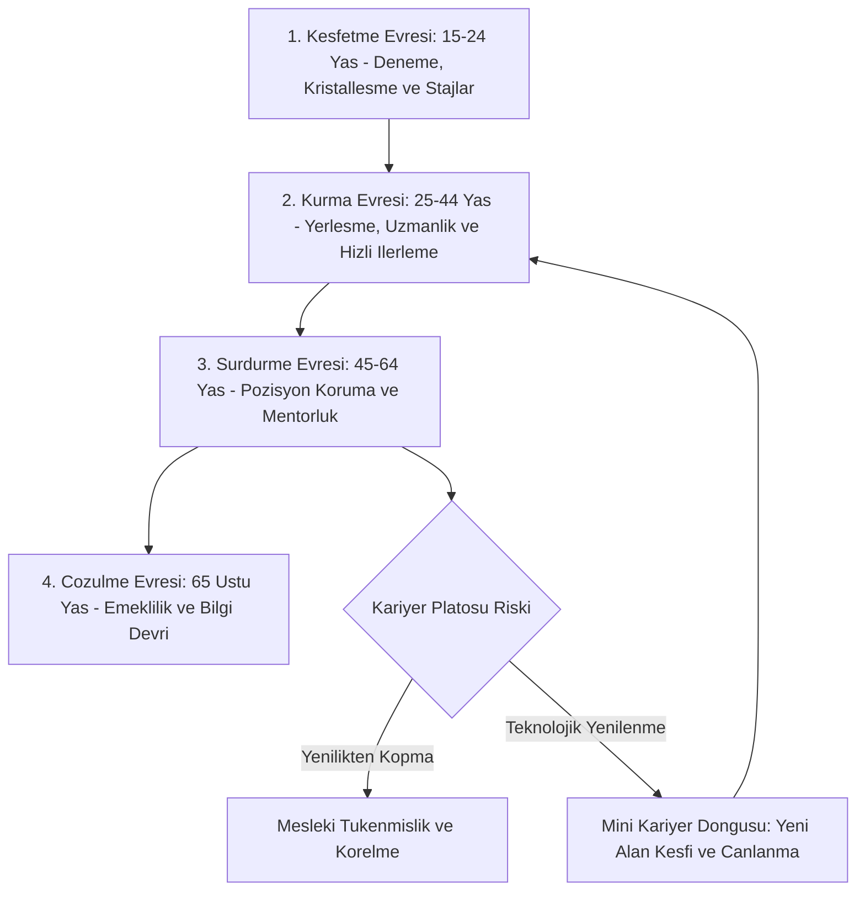
*Şekil 4.1: Donald Super kariyer evreleri yaşam döngüsü, kariyer platosu riski ve teknolojik mini-döngü modeli.*

### Bilgisayar Mühendisi İçin Uygulama
Bilgisayar mühendisliği dinamik ve hızla değişen bir sektör olduğundan kariyer evreleri geleneksel sektörlere göre çok daha hızlı yaşanır:
- **Keşfetme Evresinde Kristalleşme (3. ve 4. Sınıf):** Bilgisayar mühendisliği öğrencisi bu evrede yapay zekâ, gömülü sistemler, siber güvenlik veya bulut bilişim alanlarından birini bilinçli olarak seçmeli ve projelerini bu alana odaklamalıdır.
- **Yazılımda Teknoloji Eskimesi (Technological Obsolescence):** Bilişim sektöründe bilginin yarılanma ömrü 3-5 yıla inmiştir. Bir yazılımcı kurma evresinden sürdürme evresine geçtiğinde eski teknolojilerde (legacy frameworks) takılıp kalırsa içerik platosuna girer.
- **Yaşam Boyu Öğrenme ve Mini-Döngü Yönetimi:** 10 yıllık bir backend geliştiricisinin Üretken Yapay Zekâ ve LLM araçlarını öğrenerek yeni bir keşif-kurma mini-döngüsü başlatması, kariyer platosunu kırmanın en etkili mühendislik yoludur.

### Çözümlü Vaka İncelemesi
*Vaka:* 48 yaşındaki Kıdemli Yazılım Mühendisi Tarık Bey, 20 yıldır aynı telekom şirketinde C++ tabanlı geleneksel santral yazılımları geliştirmektedir. Şirket tüm altyapısını mikroservislere, bulut mimarisine (Kubernetes) ve yapay zekâ tabanlı trafik optimizasyonuna taşıma kararı almıştır. Tarık Bey kendini dışlanmış hissetmekte, yeni nesil teknolojileri gençlerin işi olarak görmekte ve motivasyon kaybı yaşamaktadır.

*Teorik Çözümleme:*
1. **Evre Teşhisi:** Tarık Bey tipik bir **Sürdürme Evresi / Kariyer Platosu** krizindedir. Yıllarca güvenle sürdürdüğü uzmanlık alanı teknolojik dönüşümle sarsılmıştır.
2. **Douglas Hall Mini-Döngü Müdahalesi:** Şirket İK'sı ve teknik liderlik, Tarık Bey'i işten çıkarmak yerine onun derin telekomünikasyon alan bilgisini (domain knowledge) bulut mimarileriyle birleştirecek bir gelişim planı hazırlar. Tarık Bey'e bulut sertifikasyon eğitimi verilir; karşılığında Tarık Bey genç mühendislere telekomünikasyon ağ güvenliği konusunda mentorluk yapar. Tarık Bey yeni bir keşfetme-kurma mini döngüsüne girerek platosunu aşar.

### Sık Yapılan Hatalar ve Yanılgılar
- **"Kariyer evreleri bir kez yaşanır ve geri dönülemez":** Modern yazılım dünyasında her köklü teknoloji değişiminde mühendisler yeniden keşfetme ve öğrenme evresine dönerler.
- **"Sürdürme evresindeki kıdemli çalışanlar yeni şey öğrenemez":** Doğru eğitim ve mentorluk mekanizmaları kurulduğunda kıdemli çalışanların alan bilgisi ile yeni teknolojilerin birleşimi en yüksek kurumsal değeri üretir.

### Aktif Hatırlama Soruları ve Çözümleri
1. *Soru:* Donald Super'ın kuramında üniversite öğrencilerinin içinde bulunduğu "Keşfetme" evresinin üç kritik alt aşaması hangileridir?

Çözüm ve Açıklama

Deneme (farklı ilgi ve alanları test etme), Kristalleşme (mesleki tercihleri daraltıp netleştirme) ve Uygulama (seçilen mesleki alana stajlar ve ilk profesyonel işlerle fiilen adım atma) aşamalarıdır.

2. *Soru:* Kariyer Platosu (Career Plateau) nedir ve "Yapısal Plato" ile "İçerik Platosu" arasındaki fark nedir?

Çözüm ve Açıklama

Kariyer platosu, çalışanın kariyerinde ilerlemenin durduğu durağanlık halidir. Yapısal plato; örgütte yükselebilecek daha üst bir basamağın kalmamasıdır (hiyerarşik sınır). İçerik platosu ise çalışanın yaptığı işin rutinleşmesi, işin çalışana yeni hiçbir beceri ve heyecan katmaması durumudur.

3. *Soru:* Douglas Hall'ın dinamik kariyer modelinde öne sürdüğü "Mini Kariyer Döngüsü" kavramı bilişim sektörü için neden özellikle geçerlidir?

Çözüm ve Açıklama

Bilişim sektöründe teknolojiler, diller ve metodolojiler hızla eskidiği için mühendisler 30-40 yıllık çalışma hayatı boyunca tek bir döngüde kalamazlar. Her 4-5 yılda bir yeni bir teknoloji veya paradigmada (örneğin mobil, bulut, yapay zekâ) yeniden keşfetme, öğrenme ve ustalaşma döngüsü yaşamak zorundadırlar.

### Hafta Kaynak ve Video Kartı
- **Resmî İzlence ve Üniversite Portalı:** [İstanbul Nişantaşı Üniversitesi GET05011 İzlencesi](https://ebp.nisantasi.edu.tr/DereceProgramlari/Ders/1/0/16802/53713/1).
- **Akademik Kariyer Kuramları:** [Donald Super Life-Span Life-Space Model](https://www.onetonline.org/).
- **Mesleki Gelişim:** [Coursera — Career Success and Lifelong Learning](https://www.coursera.org/).
- **Ne İçin İncelenmeli:** Donald Super'ın kariyer evreleri gelişimsel görevlerini ve bilişim sektöründeki yaşam boyu öğrenme modellerini analiz etmek için.

---

## Hafta 5: Kariyer Çıpaları ve Kariyer Kalıpları (Schein)

### Öğrenme Hedefleri
Bu bölümü tamamladığınızda:
- Edgar Schein'ın 8 Kariyer Çapası (Career Anchors) modelinin kavramsal dayanaklarını tanımlayabileceksiniz.
- Kendi baskın kariyer çıpanızı teşhis ederek mesleki tatmin kriterlerinizi sıralayabileceksiniz.
- Michael Driver'ın 4 Kariyer Kalıbı (Doğrusal, Uzmanlaşmış, Spiral, Geçici) modelini analiz edebileceksiniz.
- Kariyer çıpaları ile Kişi-Örgüt ve Kişi-İş uyumunun tükenmişliği önlemedeki rolünü açıklayabileceksiniz.

### Kavram Açıklaması ve Teorik Çerçeve
Edgar Schein'a göre kariyer çıpası (career anchor); bireyin iş deneyimleri kazandıkça şekillenen, öz-algısını oluşturan ve bir kariyer krizinde veya zor bir tercih anında asla vazgeçmeyeceği temel değerler, yetenekler ve güdüler bütünüdür.

1. **Edgar Schein'ın 8 Kariyer Çapası:**
   - **1. Teknik ve Fonksiyonel Yetkinlik (Technical/Functional):** Temel motivasyon belirli bir uzmanlık alanında derinleşmek ve en iyisi olmaktır. Genel yönetici olmak istemezler; teknik problem çözmekten beslenirler.
   - **2. Genel Yönetim Yetkinliği (General Managerial):** İnsanları koordine etme, strateji belirleme, bütçe yönetme ve kurumun tepe noktasına yükselme arzusudur. Analitik, kişilerarası ve duygusal yetkinlikleri birleştirirler.
   - **3. Özerklik ve Bağımsızlık (Autonomy/Independence):** Kendi kurallarıyla, esnek saatlerde, bürokratik denetimden uzak çalışma isteğidir. Danışmanlık ve serbest çalışma bu profile uygundur.
   - **4. Güvenlik ve İstikrar (Security/Stability):** İş güvencesi, düzenli gelir, kurumsal garantiler ve öngörülebilirlik ön plandadır. Kamu veya köklü büyük holdingleri tercih ederler.
   - **5. Girişimci Yaratıcılık (Entrepreneurial Creativity):** Sıfırdan yeni bir ürün, hizmet veya şirket inşa etme dürtüsüdür. Finansal risk almaktan çekinmezler.
   - **6. Hizmete Adanmışlık (Service/Dedication to a Cause):** Topluma, insanlığa veya belirli bir davaya fayda sağlama amacı taşır. Sosyal sorumluluk ve anlam arayışı merkezdedir.
   - **7. Saf Mücadele (Pure Challenge):** Çözülmesi imkânsız gibi görünen en karmaşık problemleri çözme, zorlu rakipleri alt etme motivasyonudur. Rutin işler onları sıkar.
   - **8. Yaşam Tarzı Entegrasyonu (Lifestyle):** Bireysel yaşam, aile ve kariyer dengesinin kusursuz kurulmasıdır. Kariyeri hayatın tek odağı yapmazlar; esneklik ararlar.

2. **Michael Driver'ın Kariyer Kalıpları (Career Patterns):**
   - **Doğrusal Kalıp (Linear):** Hiyerarşik piramitte sürekli yukarı tırmanmayı amaçlayan geleneksel başarı kalıbı.
   - **Uzmanlaşmış Kalıp (Expert):** Belirli bir mesleğe ömür boyu bağlı kalarak dikey değil yatay derinlik kazanan kalıp.
   - **Spiral Kalıp (Spiral):** Bireyin 5-10 yıllık periyotlarla birbiriyle ilişkili yeni alanlara geçerek birikimini zenginleştirdiği kalıp.
   - **Geçici Kalıp (Transitory):** Sürekli farklı sektör ve işler arasında kısa süreli (1-2 yıllık) geçişler yapan değişken kalıp.

### Görsel Analiz Şeması
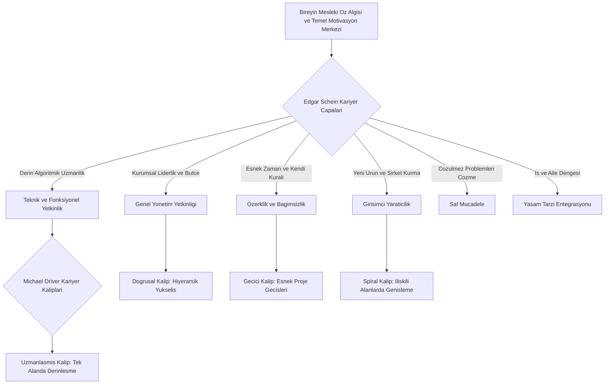
*Şekil 5.1: Edgar Schein kariyer çapaları ve Michael Driver kariyer kalıpları eşleşme şeması.*

### Bilgisayar Mühendisi İçin Uygulama
Yazılım mühendisliği adayının kariyer çıpasını keşfetmesi, mezuniyet sonrası iş tercihlerinde hayati rol oynar:
- **Teknik/Fonksiyonel Çıpa:** Bu çıpaya sahip bir bilgisayar mühendisi Ar-Ge laboratuvarlarında, çekirdek altyapı ekiplerinde veya yapay zekâ model geliştiriciliğinde çalışmalı; insan kaynakları yöneticiliği gibi yönetsel tuzaklardan uzak durmalıdır.
- **Özerklik Çıpası:** Bu profildeki bir mühendis küresel remote firmalarda sözleşmeli (contractor) çalışmayı veya bağımsız danışmanlığı tercih etmelidir; katı mesai saatleri olan bürokratik kurumlarda mutsuz olur.
- **İkigai Modeliyle Entegrasyon:** Mühendisin sevdiği alan (Yapay Zekâ), iyi olduğu alan (Matematiksel Algoritmalar), dünyanın ihtiyacı (Sağlıkta Erken Teşhis) ve para kazandıran alan (Kurumsal ML Mühendisliği) kesişimi; kariyer çıpasıyla tam örtüştüğünde sürdürülebilir başarı ortaya çıkar.

### Çözümlü Vaka İncelemesi
*Vaka:* Bilgisayar Mühendisliği mezunu Selim, Türkiye'nin en büyük kamu bankalarından birinin BT departmanında işe başlamıştır. Şirket son derece güvenli, yüksek maaşlı ve garantili bir iş ortamı sunmaktadır. Ancak Selim 1 yıl sonra ağır bir depresyon ve motivasyonsuzluk yaşamaya başlamıştır; çünkü her kod değişikliği için 4 farklı komiteden onay alınması gerekmekte ve Selim kendi fikirlerini hayata geçirememektedir.

*Teorik Çözümleme:*
1. **Çıpa Uyuşmazlığı:** Selim'e Schein Kariyer Çapaları Envanteri uygulandığında birincil çıpasının "Özerklik/Bağımsızlık" ve "Girişimci Yaratıcılık" olduğu; "Güvenlik/İstikrar" çıpasının ise son sırada yer aldığı tespit edilir.
2. **Uyumlu Eylem:** Selim kurumsal garantileri feda etmeyi göze alarak erken aşama bir yapay zekâ girişimine (start-up) çekirdek yazılımcı olarak katılır. Burada kendi çalışma saatlerini belirler, haftalık sürümler çıkarır ve ürün mimarisine doğrudan yön verir. Selim'in mesleki doyumu ve üretkenliği en üst seviyeye çıkar.

### Sık Yapılan Hatalar ve Yanılgılar
- **"Kariyer çıpası her işte değişen geçici bir hevestir":** Schein'a göre çıpalar bireyin kimliğinin temel direkleridir; ilk 5-10 yıllık iş deneyimiyle kristalleşir ve yaşam boyu büyük ölçüde istikrarlı kalır.
- **"Genel Yönetim çıpası en üstün ve prestijli çıpadır":** Teknik uzmanlık veya özerklik çıpasına sahip bir profesyonel için yöneticilik bir başarı değil, bir eziyet ve yabancılaşma kaynağıdır.

### Aktif Hatırlama Soruları ve Çözümleri
1. *Soru:* Edgar Schein'ın modelinde "Teknik ve Fonksiyonel Yetkinlik" çıpasına sahip bir bilgisayar mühendisini genel müdür yardımcısı yapmak neden kurumsal bir hata olabilir?

Çözüm ve Açıklama

Bu çapaya sahip bireyin temel motivasyon kaynağı teknik uzmanlaşma ve somut mühendislik problemleri çözmektir. Genel yönetim pozisyonuna geçtiğinde kodlamadan ve teknik üretimden kopacağı için iş tatminini kaybeder, yönetsel görevlerde yetersizlik hissedebilir ve şirketten istifa edebilir.

2. *Soru:* Michael Driver'ın kariyer kalıpları sınıflamasında "Spiral Kalıp" ile "Uzmanlaşmış Kalıp" arasındaki temel fark nedir?

Çözüm ve Açıklama

Uzmanlaşmış kalıpta birey yaşam boyu tek bir spesifik alanda (örneğin yalnızca veritabanı optimizasyonu) kalarak derinleşir. Spiral kalıpta ise birey 5-7 yıllık periyotlarla birbiriyle ilişkili farklı alanlara (örneğin backend geliştirmeden veri mühendisliğine, oradan MLOps mimarlığına) geçerek çok yönlü birikim kazanır.

3. *Soru:* Kişi-Örgüt Uyumu (Person-Organization Fit) kuramı açısından Edgar Schein'ın "Güvenlik ve İstikrar" çıpası hangi kurumsal kültürlerle en yüksek uyumu gösterir?

Çözüm ve Açıklama

Öngörülebilirliğin yüksek olduğu, iş güvencesinin kanunlarla korunduğu, kurumsal prosedürlerin net olduğu kamu kurumları, köklü savunma sanayii kuruluşları ve büyük geleneksel kurumsal holdinglerle en yüksek uyumu gösterir.

### Hafta Kaynak ve Video Kartı
- **Resmî İzlence ve Üniversite Portalı:** [İstanbul Nişantaşı Üniversitesi GET05011 İzlencesi](https://ebp.nisantasi.edu.tr/DereceProgramlari/Ders/1/0/16802/53713/1).
- **Kariyer Kuramları Kaynağı:** [MIT Sloan — Edgar Schein Career Anchors](https://hbr.org/).
- **Mesleki Değerlendirme:** [U.S. Dept of Labor O*NET Work Values](https://www.onetonline.org/).
- **Ne İçin İncelenmeli:** Edgar Schein'ın kariyer çıpaları testini incelemek ve Michael Driver kariyer kalıplarının iş dünyasındaki karşılıklarını kavramak için.

---

## Hafta 6: Kariyer Yönetimi ve İnsan Kaynakları işlevleri: İK planlaması, temin-seçim, performans, eğitim-geliştirme

### Öğrenme Hedefleri
Bu bölümü tamamladığınızda:
- Örgütsel kariyer yönetimi ile insan kaynakları yönetimi (İKY) işlevleri arasındaki organik bağı açıklayabileceksiniz.
- İnsan kaynakları planlaması, personel temin ve seçimi süreçlerinin adımlarını analiz edebileceksiniz.
- Performans yönetim sistemi sonuçlarının terfi, yedekleme ve kariyer geliştirme kararlarına etkisini kavrayabileceksiniz.
- Temin-seçim aşamalarında kullanılan ATS (Aday Takip Sistemi) filtreleri ve STAR mülakat metodolojisini uygulayabileceksiniz.

### Kavram Açıklaması ve Teorik Çerçeve
Örgütsel kariyer yönetimi soyut bir niyet bildirimi değildir; insan kaynakları yönetiminin dört temel işleviyle doğrudan entegre çalışan operasyonel bir sistemdir.

1. **İnsan Kaynakları Planlaması (İKP) ve Kariyer Bağı:**
   - İKP; kurumun gelecekteki stratejik hedeflerine uygun işgücü arz ve talebini tahmin etme sürecidir.
   - Norm kadro çalışmaları, yetkinlik açığı analizi (Gap Analysis) ve emeklilik/ayrılma projeksiyonları yapılarak kurum içi kariyer yollarında kaç kişinin ilerletileceği belirlenir.

2. **Personel Temin ve Seçimi (Recruitment and Selection):**
   - **İç Kaynaklardan Temin:** Açık pozisyonların öncelikle mevcut çalışanlara ilan edilmesi (Job Posting). Motivasyonu ve aidiyeti artırır.
   - **Dış Kaynaklardan Temin:** Üniversite etkinlikleri, kariyer portalları ve profesyonel ağlar üzerinden yeni mezun veya deneyimli yetenek çekme.
   - **Seçim Süreci:** Başvuruların taranması (ATS filtreleri), genel yetenek ve teknik yeterlilik sınavları, değerlendirme merkezi (assessment center) uygulamaları ve yetkinlik bazlı yapılandırılmış mülakatlar.

3. **Performans Yönetim Sistemi (PYS):**
   - Çalışanların kurumsal hedeflere katkısının objektif metriklerle (KPI - Key Performance Indicators ve OKR - Objectives and Key Results) periyodik olarak ölçülmesidir.
   - 360 Derece Performans Değerlendirme: Yöneticiler, çalışma arkadaşları, astlar ve müşterilerden çok yönlü geri bildirim toplanmasıdır.
   - Performans sonuçları; kariyer yönetimi için terfi, nakil, ücret artışı ve yedekleme listelerinin ana dayanağını oluşturur.

4. **Eğitim ve Geliştirme (Training and Development):**
   - Oryantasyon eğitimiyle başlayan ve çalışanın kariyer yolu boyunca ihtiyaç duyacağı yeni yetkinlikleri kazandıran kurumsal akademiler, teknik sertifikasyonlar ve Bireysel Gelişim Planları (IDP).

### Görsel Analiz Şeması
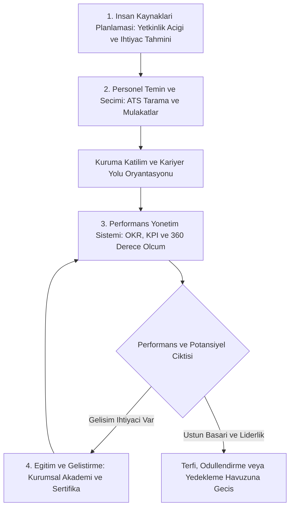
*Şekil 6.1: İnsan Kaynakları işlevleri ile örgütsel kariyer yönetimi entegrasyon döngüsü.*

### Bilgisayar Mühendisi İçin Uygulama
Yazılım mühendisliği adayının İK temin-seçim ve performans aşamalarındaki pratik hazırlığı:
- **ATS (Applicant Tracking System) Uyumlu Teknik CV:**
  - Tek sütunlu, sade, taranabilir format (Word veya yalın PDF).
  - İlan metnindeki anahtar kelimelerin (Python, Docker, REST API, Kubernetes) doğrudan projelerde geçirilmesi.
  - X-Y-Z Başarı Formülü: "Google standardı formülü: Accomplished [X], as measured by [Y], by doing [Z]" (Örn: "Derin öğrenme model çıkarım gecikmesini TensorRT optimizasyonu ile yüzde 40 düşürerek günlük 1 milyon isteği başarıyla karşıladı").
- **Teknik Mülakat Zinciri:**
  - 1. Aşama: İK ön eleme ve kültür uyumu.
  - 2. Aşama: Kodlama testi (LeetCode / HackerRank üzerinde veri yapıları ve algoritmalar).
  - 3. Aşama: Canlı eşli programlama (Pair Programming) ve Sistem Tasarımı (System Design).
- **STAR Metodolojisi ile Davranışsal Mülakat:**
  - **S (Situation):** Karşılaşılan teknik veya organizasyonel durum.
  - **T (Task):** Üstlenilen sorumluluk ve hedef.
  - **A (Action):** Problemi çözmek için atılan somut adımlar ve yazılan kod.
  - **R (Result):** Ölçülebilir mühendislik sonucu ve öğrenilen ders.

### Çözümlü Vaka İncelemesi
*Vaka:* Bilgisayar Mühendisliği öğrencisi Damla, 50 farklı şirkete renkli grafikli ve iki sütunlu bir şablonla hazırladığı CV ile başvurmuş fakat hiçbir geri dönüş alamamıştır. Damla yetersiz olduğunu düşünerek özgüven kaybı yaşamaktadır.

*Teorik Çözümleme:*
1. **ATS Filtresi Tespiti:** Kurumsal firmaların kullandığı ATS yazılımları (Taleo, Workday vb.) grafikli, tablolı ve iki sütunlu CV'leri metin olarak ayrıştıramamakta ve Damla'nın başvurularını otomatik olarak reddetmektedir.
2. **Optimizasyon Eylemi:** Damla CV'sini ATS uyumlu tek sütunlu şablona dönüştürür. "Bildiğim Diller" listesi yerine her projede hangi kütüphaneyle ne ölçülebilir başarı elde ettiğini X-Y-Z formülüyle yazar. Damla'nın revize CV'si ilk 10 başvuruda 3 şirketten teknik mülakat daveti almasını sağlar.

### Sık Yapılan Hatalar ve Yanılgılar
- **"CV'de sadece derslerde aldığım notları ve programlama dillerini listelemek yeterlidir":** İK yöneticileri ve teknik liderler dillerin isimlerini değil, o dillerle üretilen somut projeleri, çözülen problemleri ve metrikleri arar.
- **"Performans yönetimi yalnızca yıl sonunda yöneticinin verdiği sübjektif bir nottur":** Çağdaş kurumlarda performans; şeffaf OKR hedefleri ve 360 derece geri bildirimlerle sürekli takip edilen bir kariyer gelişim pusulasıdır.

### Aktif Hatırlama Soruları ve Çözümleri
1. *Soru:* İnsan Kaynakları yönetiminde "Personel Temin ve Seçimi" sürecinde kullanılan ATS (Applicant Tracking System) yazılımlarının temel işlevi nedir ve adaylar CV'lerini bu sisteme nasıl uyarlamalıdır?

Çözüm ve Açıklama

ATS, binlerce iş başvurusunu otomatik tarayarak ilan metnindeki anahtar kelimelere, deneyim yıllarına ve yetkinliklere göre filtreleyen bir yazılımdır. Adaylar CV'lerini karmaşık tablolardan arındırılmış sade formatta hazırlamalı, ilandaki teknik anahtar kelimeleri doğal biçimde projelere entegre etmeli ve başarılarını ölçülebilir metriklerle ifade etmelidir.

2. *Soru:* Yetkinlik bazlı mülakatlarda kullanılan STAR (Situation, Task, Action, Result) tekniğinin amacı nedir?

Çözüm ve Açıklama

Adayın geçmişteki gerçek davranışlarının gelecekteki performansın en güvenilir göstergesi olduğu varsayımına dayanır. Adayın karşılaştığı somut bir Durumu (S), üstlendiği Görevi (T), attığı Eylemleri (A) ve elde ettiği ölçülebilir Sonucu (R) yapılandırılmış bir hikaye akışıyla sunmasını sağlar.

3. *Soru:* 360 Derece Performans Değerlendirme modelinin geleneksel tek taraflı yönetici değerlendirmesine göre örgütsel üstünlüğü nedir?

Çözüm ve Açıklama

Yalnızca üst yöneticinin dar bakış açısına bağımlı kalmaz. Çalışanın ekip arkadaşları, astları, müşterileri ve kendi öz değerlendirmesini de kapsayarak Johari penceresindeki kör alanları aydınlatır, daha objektif ve adil bir kariyer gelişim geri bildirimi sunar.

### Hafta Kaynak ve Video Kartı
- **Resmî İzlence ve Üniversite Portalı:** [İstanbul Nişantaşı Üniversitesi GET05011 İzlencesi](https://ebp.nisantasi.edu.tr/DereceProgramlari/Ders/1/0/16802/53713/1).
- **Mesleki Başvuru Standartları:** [Harvard FAS — Resume and Cover Letter Guide](https://hbr.org/).
- **Mülakat Hazırlık Platformu:** [LeetCode Technical Interview Preparation](https://leetcode.com/).
- **Ne İçin İncelenmeli:** ATS uyumlu özgeçmiş tasarım ilkelerini, STAR tekniğiyle teknik mülakat hazırlığını ve performans değerlendirme modellerini kavramak için.

---

## Hafta 7: Kariyer geliştirme faaliyetleri: danışmanlık, iş rotasyonu, Mentorluk

### Öğrenme Hedefleri
Bu bölümü tamamladığınızda:
- Kariyer geliştirme kavramını ve temel kurumsal faaliyet alanlarını sıralayabileceksiniz.
- Kariyer danışmanlığı, iş rotasyonu ve mentorluk uygulamalarının amaç ve işleyişlerini karşılaştırabileceksiniz.
- Mentorluk (mentoring) ile koçluk (coaching) arasındaki kuramsal ve pratik ayrımları açıklayabileceksiniz.
- Tersine Mentorluk (Reverse Mentoring) kavramının teknoloji odaklı kurumlardaki dönüştürücü rolünü değerlendirebileceksiniz.

### Kavram Açıklaması ve Teorik Çerçeve
Kariyer geliştirme; bireyin mesleki becerilerini zenginleştirmek, potansiyelini performansa dönüştürmek ve örgütün dinamik yetkinlik havuzunu beslemek için uygulanan sürekli faaliyetler bütünüdür.

1. **Kariyer Danışmanlığı (Career Counseling):**
   - Bireyin kariyer farkındalığı kazanmasına, yetkinlik krizlerini aşmasına ve doğru mesleki hedefler belirlemesine uzman rehberliğiyle destek olma sürecidir.
   - İlgi ve kişilik envanterleri, kariyer engelleri analizi ve kariyer planlama atölyelerini kapsar.

2. **İş Rotasyonu (Job Rotation):**
   - Çalışanın önceden planlanmış bir takvim dahilinde kurum içindeki farklı departman, görev veya projelerde geçici sürelerle çalıştırılmasıdır.
   - **Yararları:**
     - Çalışan açısından: İş monotonluğunu ve tükenmişliği önler, kurumu bütünsel olarak tanımayı sağlar, çok yönlü (T-tipi) beceriler kazandırır.
     - Örgüt açısından: Departmanlar arasındaki kopuklukları ve siloları (silo mentality) kırar, işgücü esnekliği sağlar ve geleceğin üst düzey liderlerini hazırlar.

3. **Mentorluk (Mentoring) ve Koçluk (Coaching) Ayrımı:**
   - **Mentorluk:** Deneyimli ve kıdemli bir profesyonelin (mentor), daha az deneyimli bir çalışana (mentee) kariyer gelişimi, profesyonel vizyon, kurumsal kültür ve psikososyal destek alanlarında uzun vadeli rehberlik yapmasıdır. Gayriresmî usta-çırak ilişkisinden kurumsal mentorluk programlarına kadar uzanır.
   - **Koçluk:** Belirli bir teknik veya davranışsal beceriyi (örneğin sunum yapma, kod kalitesi, zaman yönetimi) geliştirmek amacıyla yapılandırılmış, kısa ve orta vadeli, performans odaklı bir süreçtir.
   - **Tersine Mentorluk (Reverse Mentoring):** Jack Welch tarafından GE'de başlatılan; genç nesil çalışanların kıdemli tepe yöneticilerine yeni nesil dijital teknolojiler, yapay zekâ araçları, sosyal trendler ve Z kuşağı tüketici alışkanlıkları konusunda mentorluk yaptığı yenilikçi modeldir.

### Görsel Analiz Şeması
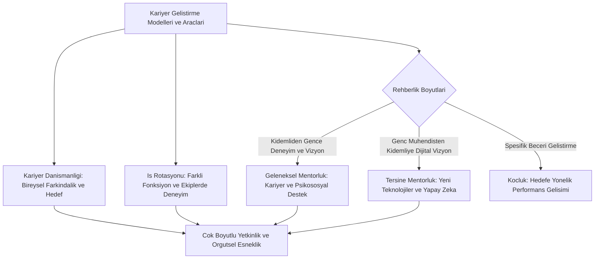
*Şekil 7.1: Kariyer geliştirme araçları, mentorluk türleri ve koçluk etkileşim şeması.*

### Bilgisayar Mühendisi İçin Uygulama
Bilişim ve mühendislik dünyasında kariyer geliştirme mekanizmaları hızlı teknik olgunlaşmayı sağlar:
- **Yazılım Mühendisliği Rotasyon Programları (SWE Rotation):** Büyük teknoloji şirketleri yeni mezun mühendisleri 18 ay boyunca 6'şar aylık periyotlarla 3 farklı ekibe sokar: 1. Dönem: Backend API geliştirme, 2. Dönem: Veri Mühendisliği ve ETL boru hatları, 3. Dönem: MLOps ve Bulut Dağıtımı. Bu rotasyon sonunda mühendis sistemin tüm katmanlarını kavrar.
- **Sektörel Mentorluk Ağları:** Mühendis adayları açık kaynak topluluklarında (GitHub, Linux Vakfı), platformlarda (ADPList, MentorCruise) ve üniversite mezun ağlarında kıdemli mühendislerle eşleşmeli; ayda bir teknik kod inceleme ve kariyer yönü toplantıları yapmalıdır.
- **Tersine Mentorlukla Değer Üretme:** 3. sınıf bir bilgisayar mühendisliği stajyeri, şirket direktörüne Prompt Engineering, GitHub Copilot veya yerel LLM modellerinin yazılım geliştirme süreçlerine nasıl entegre edileceğini anlatarak şirkette stratejik bir görünürlük elde edebilir.

### Çözümlü Vaka İncelemesi
*Vaka:* Bir yazılım evinde 3 yıldır sadece frontend (React) geliştiren Barış, işinde monotonluk hissetmekte ve backend sistemlerini öğrenmek istemektedir. Ancak işten ayrılmadan bunu nasıl yapacağını bilememektedir.

*Teorik Çözümleme:*
1. **İş Rotasyonu Uygulaması:** Barış durumunu yöneticisine açar. Şirket içi kariyer geliştirme faaliyeti kapsamında Barış 6 aylığına Veri Altyapısı ekibine geçici rotasyona alınır.
2. **Mentorluk Eşleşmesi:** Veri ekibinin kıdemli mühendisi Barış'a mentor olarak atanır. Barış bu 6 ayda Python, Kafka ve PostgreSQL kullanarak veri boru hatları kurmayı öğrenir. Rotasyon sonunda Barış, şirketin en güçlü Full-Stack ve Veri Görselleştirme mühendislerinden birine dönüşür.

### Sık Yapılan Hatalar ve Yanılgılar
- **"Mentorluk mentordan hazır iş istemektir":** Mentor iş bulucu bir istihdam bürosu değildir; düşünce ortağı, yol gösterici ve mesleki pusuladır.
- **"İş rotasyonu personeli cezalandırmak veya yerinden etmek için uygulanır":** İş rotasyonu cezalandırma değil; çalışanı kurumun gelecekteki stratejik rollerine hazırlayan bir gelişim yatırımıdır.

### Aktif Hatırlama Soruları ve Çözümleri
1. *Soru:* Mentorluk (Mentoring) ile Koçluk (Coaching) arasındaki iki temel fark nedir?

Çözüm ve Açıklama

1. Kapsam ve Zaman: Mentorluk uzun vadeli, bütünsel kariyer vizyonu ve psikososyal gelişimi hedeflerken; koçluk daha kısa vadeli ve belirli bir somut performans becerisine odaklanır. 2. İlişki Niteliği: Mentorlukta kıdemli profesyonelin deneyim ve bilgeliğini aktarması esasken; koçlukta koç yönlendirme yapmaktan ziyade doğru sorularla danışanın kendi potansiyelini keşfetmesini sağlar.

2. *Soru:* Teknoloji ve yapay zekâ çağında "Tersine Mentorluk" (Reverse Mentoring) neden kurumlar için stratejik bir zorunluluk haline gelmiştir?

Çözüm ve Açıklama

Teknolojinin gelişim hızı geleneksel hiyerarşik bilgi aktarımını tersine çevirmiştir. Genç nesil çalışanlar yeni nesil üretken yapay zekâ, dijital iletişim araçları ve açık kaynak trendlerini tepe yöneticilerden çok daha hızlı içselleştirdiğinden; tersine mentorluk tepe yönetimin dijital körlüğe girmesini engeller ve şirketin çevikliğini korur.

3. *Soru:* Bir yazılım organizasyonunda iş rotasyonu uygulanması "silo mentalitesi" (silo mentality) sorununu nasıl çözer?

Çözüm ve Açıklama

Silo mentalitesi, farklı ekiplerin (örneğin frontend, backend, test ve siber güvenlik) birbirini anlamaması ve yalnızca kendi birimini düşünmesidir. İş rotasyonu sayesinde çalışanlar diğer ekiplerin kısıtlarını, teknik zorluklarını ve iş akışlarını bizzat yaşayarak öğrenir; bu da ekipler arası empatiyi, iş birliğini ve kod kalitesini artırır.

### Hafta Kaynak ve Video Kartı
- **Resmî İzlence ve Üniversite Portalı:** [İstanbul Nişantaşı Üniversitesi GET05011 İzlencesi](https://ebp.nisantasi.edu.tr/DereceProgramlari/Ders/1/0/16802/53713/1).
- **Yönetim Literatürü:** [Harvard Business Review — Why Reverse Mentoring Works](https://hbr.org/).
- **Açık Kaynak Mentorluk:** [ADPList Global Mentorship Network](https://adplist.org/).
- **Ne İçin İncelenmeli:** İş rotasyonu modellerini, tersine mentorluk uygulamalarını ve kurumsal mentorluk sistemlerinin tasarımını incelemek için.

---

## Hafta 8: Vize (Ara Sınav) Tekrarı: 1-7 haftaların özeti, karma vaka ve sınav tipi sorular

### Öğrenme Hedefleri
Bu bölümü tamamladığınızda:
- GET05011 Kariyer Planlaması dersinin ilk 7 haftasında işlenen tüm kuramsal kavramları bütünleşik biçimde özetleyebileceksiniz.
- Örgütsel kariyer yönetimi, terfi/nakil, evreler, çapalar ve İK işlevleri arasındaki neden-sonuç ilişkilerini analiz edebileceksiniz.
- Çok boyutlu karma vaka senaryolarını kuramlarla ilişkilendirerek analitik çözümler üretebileceksiniz.
- Ara sınavda (Vize) karşılaşabileceğiniz kavramsal, karşılaştırmalı ve senaryo tipi sorulara eksiksiz yanıt verebileceksiniz.

### Kavram Açıklaması ve Teorik Çerçeve
Dönemin ilk yarısı, kariyer planlamanın hem bireysel psikolojik temellerini hem de örgütsel yönetim mekanizmalarını kapsamaktadır. Vize sınavına hazırlık amacıyla 1-7. haftaların kavramsal özeti aşağıda yapılandırılmıştır:

1. **İlk 7 Haftanın Kavramsal Sentez Matrisi:**
   - **Hafta 1:** Kariyer, iş, meslek ayrımı; yetenek ve beceriden yetkinliğe geçiş; Spencer and Spencer Yetkinlik Buzdağı Modeli (su üstü bilgi-beceri, su altı öz-imaj, güdü); Üniversite Kariyer Merkezi ve Yetenek Kapısı entegrasyonu.
   - **Hafta 2:** Örgütsel Kariyer Yönetimi (ÖKY) aşamaları; örgüt ve çalışan ihtiyaçlarının bütünleştirilmesi; kariyer yolları; İkili Kariyer Merdiveni (Dual Career Ladder: Teknik IC vs Yönetim yolu).
   - **Hafta 3:** Terfi (dikey) ve Nakil (yatay); liyakat, kıdem ve potansiyel kriterleri; Laurence Peter'ın Peter İlkesi (yetersizlik düzeyine kadar yükselme riski); nakil türleri ve yararları.
   - **Hafta 4:** Donald Super'ın Yaşam Boyu kuramı (Keşfetme, Kurma, Sürdürme, Çözülme); kariyer platosu (yapısal ve içerik platosu); Douglas Hall'ın dinamik teknolojik mini-döngüleri.
   - **Hafta 5:** Edgar Schein'ın 8 Kariyer Çapası (Teknik, Yönetim, Özerklik, Güvenlik, Girişimcilik, Hizmet, Mücadele, Yaşam Tarzı); Michael Driver'ın 4 Kariyer Kalıbı (Doğrusal, Uzmanlaşmış, Spiral, Geçici); İkigai uyumu.
   - **Hafta 6:** İK İşlevleri entegrasyonu (İKP, Personel Temin-Seçim, Performans Yönetim Sistemi, Eğitim-Geliştirme); ATS uyumlu teknik CV; STAR mülakat tekniği.
   - **Hafta 7:** Kariyer geliştirme faaliyetleri; kariyer danışmanlığı, iş rotasyonu (silo mentalitesini kırma); Mentorluk, Koçluk ve Tersine Mentorluk.

2. **Kavramsal Karşılaştırma Tablosu:**
   | Kuramcı / Model | Temel Odak Noktası | Örgütsel Yansıması | Bilgisayar Mühendisliği Karşılığı |
   | :--- | :--- | :--- | :--- |
   | **Spencer Buzdağı** | Görünür ve görünmeyen yetkinlikler | Mülakat ve seçim kriterleri | Kodlama bilgisi (su üstü) vs Hata sebatı (su altı) |
   | **Dual Career Ladder** | Teknik ve yönetsel eşit kariyer yolları | Yetenek tutundurma (retention) | Staff/Principal Engineer vs Engineering Manager |
   | **Peter İlkesi** | Yetersizlik düzeyine terfi etme riski | Terfi kriterlerinde potansiyel denetimi | Mükemmel kod yazanın kötü yönetici olması |
   | **Donald Super** | Yaşam boyu gelişimsel evreler | Yaşa ve evreye özgü İK politikaları | Lisans keşfi, teknoloji eskimesi ve mini-döngüler |
   | **Edgar Schein** | Asla vazgeçilmeyen kariyer çapaları | Kişi-iş ve kişi-örgüt uyumu | Teknik uzmanlık Ar-Ge vs Özerk freelance çalışma |
   | **Tersine Mentorluk** | Kuşaklararası karşılıklı öğrenme | Dijitalleşme ve çevik dönüşüm | Genç mühendisin CTO'ya GenAI eğitimi vermesi |

### Görsel Analiz Şeması
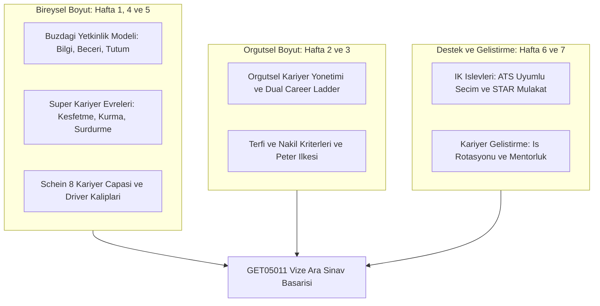
*Şekil 8.1: İlk 7 haftanın bütünleşik kavramsal haritası ve ara sınav sentez şeması.*

### Bilgisayar Mühendisi İçin Uygulama
Ara sınavda bilgisayar mühendisliği öğrencisinden beklenen, teorik tanımları sektör dinamikleriyle harmanlayarak gerekçelendirmesidir:
- **Açık Uçlu Soru Yanıtlama Disiplini:**
  - 1. Adım: Kuramı ve kuramcıyı net tanımla (Örn: "Edgar Schein'ın Kariyer Çapaları modeline göre...").
  - 2. Adım: Örgütsel mekanizmayı ve riski açıkla (Örn: "Peter ilkesi gereği yalnızca geçmiş kodlama başarısına bakarak terfi vermek...").
  - 3. Adım: Somut mühendislik çözümünü belirt (Örn: "Şirket İkili Kariyer Merdiveni kurarak mühendisi Staff Engineer pozisyonuna taşımalıdır").
- **Vizeye Yönelik Kontrol Listesi:**
  - Buzdağının su altı katmanları nelerdir?
  - Dual Career Ladder'da IC ve Manager unvan basamakları hangileridir?
  - Peter ilkesi hangi şartlarda ortaya çıkar?
  - Kariyer platosunu aşmak için Douglas Hall hangi modeli önerir?
  - Schein'ın 8 çapası bilişim rollerine nasıl uyarlanır?
  - ATS ve STAR yönteminin İK temin-seçimindeki işlevi nedir?
  - Mentorluk ile tersine mentorluk arasındaki yön ve amaç farkı nedir?

### Çözümlü Vaka İncelemesi (Karma Vize Vakası)
*Vaka:* Hızlı büyüyen bir yapay zekâ şirketi olan "NovaAI", 2 yıl içinde çalışan sayısını 20'den 150'ye çıkarmıştır. Şirkette şu krizler baş göstermiştir:
1. Şirketin en yetenekli derin öğrenme araştırmacısı Murat, yönetim kurulu tarafından "Yazılım Direktörü" yapılmış; ancak Murat toplantılardan bunalarak istifa eşiğine gelmiştir.
2. Şirkette 45 yaşındaki kıdemli sistem mimarı Aylin Hanım, yeni nesil bulut teknolojilerine yabancılaşmış ve kariyer platosuna girmiştir.
3. Üniversite mezunu genç geliştiriciler ile 15 yıllık geleneksel mühendisler arasında iletişim kopukluğu (silo) yaşanmaktadır.

*Teorik Çözümleme ve Sınav Tipi Yanıt:*
1. **Murat Vakası İçin:** Hafta 2 ve Hafta 3 kuramları uygulanır. Murat'a Peter İlkesi riski yaşatılmıştır. Çözüm: Şirkette **İkili Kariyer Merdiveni (Dual Career Ladder)** kurulmalı, Murat yönetsel hattan çekilerek "Principal AI Scientist" unvanıyla teknik Bireysel Katkı Sağlayıcı (IC) yolunda tutulmalıdır.
2. **Aylin Hanım Vakası İçin:** Hafta 4 kuramları uygulanır. Aylin Hanım **Sürdürme Evresi / İçerik Platosu** yaşamaktadır. Çözüm: Douglas Hall'ın **mini kariyer döngüsü** prensibiyle Aylin Hanım'a bulut bilişim sertifikasyon eğitimi verilmeli ve şirketin kritik mimari modernizasyon projesinin başına geçirilmelidir.
3. **Kuşaklararası İletişim Krizi İçin:** Hafta 7 kuramları uygulanır. Çözüm: Departmanlar arası **iş rotasyonu** uygulanarak silolar kırılmalı ve genç mühendisler ile kıdemli mühendisler arasında **Tersine Mentorluk** programı başlatılarak çift yönlü bilgi aktarımı sağlanmalıdır.

### Sık Yapılan Hatalar ve Yanılgılar
- **"Vizede sadece terim ezberlemek yüksek not almak için yeterlidir":** Vize sınavlarında öğretim elemanları kavramın tanımının ötesinde, o kuramın örgütsel sorunlara nasıl çözüm ürettiğini analiz etmenizi bekler.
- **"Dual Career Ladder ile iş rotasyonunu aynı kavram sanmak":** Dual career ladder dikey bir kariyer yolu ayrımıdır (IC vs Yönetim); iş rotasyonu ise geçici yatay görev değişimidir.

### Aktif Hatırlama Soruları ve Çözümleri
1. *Soru:* Bir teknoloji firmasında "Peter İlkesi"nin ortaya çıkmasını engellemek için İnsan Kaynakları departmanı terfi ve kariyer sisteminde hangi iki temel yapısal önlemi almalıdır?

Çözüm ve Açıklama

1. İkili Kariyer Merdiveni (Dual Career Ladder) kurarak teknik personelin yükselmek için zorunlu olarak yönetsel rollere geçmesini önlemelidir. 2. Terfi kararlarını yalnızca geçmiş teknik başarıya göre değil; adayların bir üst rolün gerektirdiği liderlik ve yönetsel yetkinlik potansiyelini değerlendirme merkezleri (assessment centers) ile ölçerek vermelidir.

2. *Soru:* Donald Super'ın "Sürdürme" evresindeki bir mühendisin yaşadığı "Kariyer Platosu" ile Edgar Schein'ın "Güvenlik/İstikrar" çapasına sahip bir çalışanın durumu nasıl ayırt edilir?

Çözüm ve Açıklama

Kariyer platosu, çalışanın kendi isteği dışında iş içeriğinin monotonlaşması veya hiyerarşik yükselmenin durması sonucu yaşanan bir mesleki tıkanıklıktır. Schein'ın güvenlik çıpasına sahip çalışanı ise öngörülebilir, risksiz ve sakin bir iş ortamını bilinçli olarak tercih eder; bu durum onun için bir kriz değil, içsel tatmin kaynağıdır.

3. *Soru:* İnsan Kaynakları seçim sürecinde kullanılan STAR tekniğinin 4 bileşenini yazarak bir bilgisayar mühendisi adayının bu tekniği teknik mülakatta nasıl kullanması gerektiğini açıklayınız.

Çözüm ve Açıklama

STAR bileşenleri: Situation (Durum), Task (Görev), Action (Eylem) ve Result (Sonuç)'tur. Mühendis adayı; karşılaştığı sistemsel darboğazı (S), çözmesi gereken optimizasyon hedefini (T), yazdığı modüler kodu veya uyguladığı mimari tasarımı (A) ve elde ettiği somut performans artışını (R, örneğin gecikmenin yüzde 30 azaltılması) adım adım anlatarak yetkinliğini kanıtlar.

### Hafta Kaynak ve Video Kartı
- **Resmî İzlence ve Üniversite Portalı:** [İstanbul Nişantaşı Üniversitesi GET05011 İzlencesi](https://ebp.nisantasi.edu.tr/DereceProgramlari/Ders/1/0/16802/53713/1).
- **Akademik Yönetim İncelemeleri:** [Harvard Business Review — Strategic Career Management](https://hbr.org/).
- **Ulusal Platform:** [T.C. Cumhurbaşkanlığı İnsan Kaynakları Ofisi](https://www.cbiko.gov.tr/).
- **Ne İçin İncelenmeli:** İlk 7 haftanın resmî ders izlencesi öğrenme çıktılarını gözden geçirmek ve ara sınav hazırlık senaryolarını test etmek için.

---

## Hafta 9: Yedekleme (Succession) Yönetimi: aşamalar, yararlar

### Öğrenme Hedefleri
Bu bölümü tamamladığınızda:
- Yedekleme yönetimi (succession management) kavramını ve geleneksel yerine koyma (replacement) planlamasından farkını tanımlayabileceksiniz.
- Yedekleme planlamasının kritik aşamalarını (kilit roller, yetkinlik profili, yetenek havuzu, gelişim planı) sıralayabileceksiniz.
- 9-Kutu (9-Box) Performans ve Potansiyel Matrisi üzerinde çalışanları sınıflandırarak yedekleme stratejileri üretebileceksiniz.
- Yedekleme yönetiminin iş sürekliliği, risk yönetimi ve çalışan motivasyonu üzerindeki somut yararlarını analiz edebileceksiniz.

### Kavram Açıklaması ve Teorik Çerçeve
Yedekleme Yönetimi; bir organizasyonda kurumsal süreklilik ve rekabet gücü açısından hayati önem taşıyan kritik pozisyonların boşalması durumunda, bu rolleri dolduracak yetkin adayların önceden belirlenmesi, yetiştirilmesi ve hazır tutulması sürecidir.

1. **Geleneksel Yerine Koyma vs Stratejik Yedekleme Yönetimi:**
   - **Geleneksel Yerine Koyma (Replacement Planning):** Yalnızca tepe yöneticiler (CEO, Genel Müdür) için yapılan, anlık kriz odaklı, dar kapsamlı ve gizli listelerden ibaret reaktif bir süreçtir.
   - **Stratejik Yedekleme Yönetimi:** Kurumun tüm kritik teknik ve operasyonel pozisyonlarını kapsayan, yetenek havuzları (talent pools) oluşturan, şeffaf, çalışanların uzun vadeli gelişimini önceleyen proaktif bir sistemdir.

2. **Yedekleme Yönetiminin Temel Aşamaları:**
   - **1. Kritik Pozisyonların Belirlenmesi:** Şirketin stratejik hedeflerine ulaşmasında alternatifi zor olan, boş kalması durumunda operasyonu felç edebilecek anahtar rollerin tespiti.
   - **2. Liderlik ve Yetkinlik Profilinin Çıkarılması:** Kritik pozisyonların gerektirdiği teknik, yönetsel ve davranışsal yetkinlik standartlarının netleştirilmesi.
   - **3. Yetenek Havuzunun Oluşturulması ve Değerlendirme:** Mevcut çalışanların performans verileri, değerlendirme merkezi sonuçları ve potansiyelleri incelenerek potansiyel yedek adayların havuzlara atanması.
   - **4. 9-Kutu (9-Box) Matrisi Analizi:** Çalışanların geçmiş performansları (X ekseni) ile gelecekteki büyüme potansiyellerinin (Y ekseni) 3x3 matriste eşleştirilmesi.
   - **5. Bireysel Gelişim Planları (IDP) ve İzleme:** Belirlenen yedek adaylara mentorluk, yönetici gölgeleme (job shadowing), rotasyon ve liderlik eğitimleri verilerek hazırlık derecelerinin (hazır, 1-2 yıla hazır) takip edilmesi.

3. **Yedekleme Yönetiminin Yararları:**
   - **Örgüte Yararları:** İş sürekliliği ve operasyonel dayanıklılık, kritik pozisyonun boş kalma süresinin ve maliyetinin azalması, dışarıdan pahalı yönetici transferi ihtiyacının düşmesi, kurumsal hafızanın korunması.
   - **Çalışana Yararları:** Geleceğe güvenle bakma, kariyer yolunun açık olduğunu görme, özel gelişim fırsatlarına erişim ve kurumsal aidiyet artışı.

### Görsel Analiz Şeması
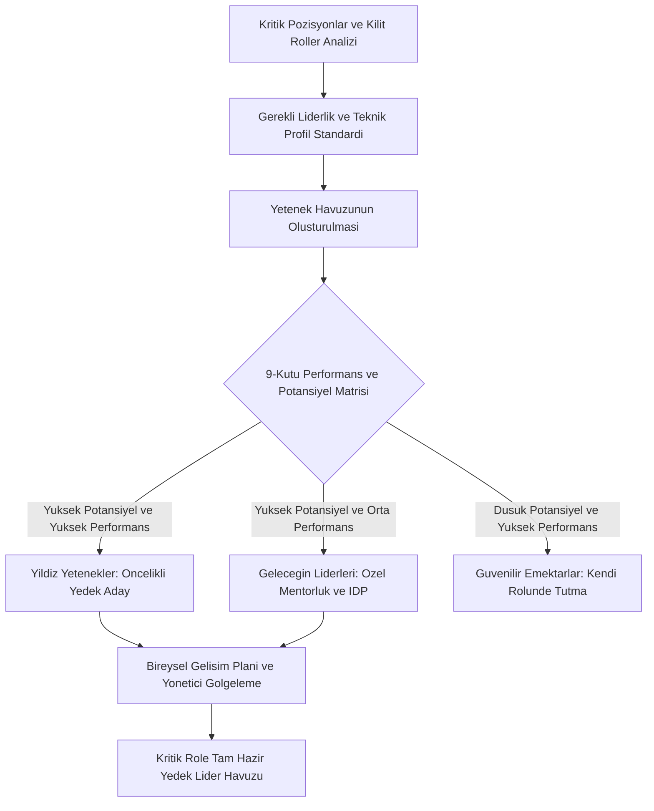
*Şekil 9.1: Yedekleme yönetimi aşamaları ve 9-Kutu Performans-Potansiyel Matrisi akış şeması.*

### Bilgisayar Mühendisi İçin Uygulama
Yazılım mühendisliği organizasyonlarında yedekleme yönetimi "sistem sürekliliği" ile doğrudan bağlantılıdır:
- **Otobüs Faktörü (Bus Factor) Kavramı:** Bir yazılım projesinde, projenin çökmesi veya ilerleyememesi için "bir otobüsün çarpması" (işten ayrılması, hastalanması) gereken kilit mühendis sayısıdır. Bus Factor 1 ise proje felaketin eşiğindedir. Yedekleme yönetimi Bus Factor değerini artırmayı hedefler.
- **Teknik Liderlerin (Staff/Principal) ve Sistem Mimarlarının Yedeklenmesi:** Bir şirkette tüm veritabanı şifrelerini veya ödeme altyapısının çekirdek mantığını tek bir kıdemli mühendis biliyorsa bu devasa bir kurumsal risktir.
- **Yedekleme İçin Mühendislik Pratikleri:**
  - Eşli Programlama (Pair Programming) ile bilgi paylaşımı.
  - Kapsamlı mimari dokümantasyon (Architecture Decision Records - ADR).
  - Junior ve Mid mühendislerin "Shadow Lead" (Gölge Lider) olarak mimari toplantılara dahil edilmesi.

### Çözümlü Vaka İncelemesi
*Vaka:* 100 mühendisin çalıştığı bir fintech şirketinde, tüm para transferi mikroservislerini tek başına tasarlayan ve yöneten Baş Mimar Kerem Bey, rakip bir yabancı şirketten aldığı teklifle 2 hafta içinde istifa etmiştir. Şirkette Kerem Bey'in kodladığı sistemin detaylarını bilen başka hiçbir mühendis bulunmamaktadır. Kerem Bey ayrıldıktan 3 gün sonra sistemde kritik bir bellek sızıntısı (memory leak) oluşmuş ve sistem 14 saat boyunca hizmet dışı kalarak şirketi milyonlarca lira zarara uğratmıştır.

*Teorik Çözümleme:*
1. **Yedekleme ve Bus Factor İflası:** Şirket Kerem Bey'e bağımlı kalarak Bus Factor değerini 1'de tutmuş; hiçbir yedekleme yönetimi ve yetenek havuzu oluşturmamıştır.
2. **Yapıcı Çözüm:** Şirket kriz sonrasında kurumsal bir Yedekleme Yönetimi Sistemi kurar. Tüm kritik sistemler için en az ikişer yedek mühendis belirlenir (Kıdemli ve Orta seviye). 9-Kutu matrisinde "Yıldız" kategorisindeki iki genç mühendis Kerem Bey'in yerine gelen yeni mimara "Gölge Mimar" olarak atanır. Tüm mimari kararlar dokümante edilerek kurumsal hafıza güvenceye alınır.

### Sık Yapılan Hatalar ve Yanılgılar
- **"Yedekleme planlaması sadece CEO veya Genel Müdür için yapılır":** Yazılım dünyasında kritik bir sistem mimarı veya siber güvenlik uzmanı, şirketin sürekliliği açısından en az bir üst düzey yönetici kadar hayati ve yedeklenmesi zorunlu bir kilit roldür.
- **"Yedekleme listelerini gizli tutarak çalışanları karanlıkta bırakmak":** Şeffaf olmayan yedekleme planları çalışanlarda adam kayırma (nepotizm) şüphesi doğurur; açık yetenek havuzları ise motivasyonu artırır.

### Aktif Hatırlama Soruları ve Çözümleri
1. *Soru:* Yazılım mühendisliği takımlarında "Otobüs Faktörü" (Bus Factor) metriği neyi ifade eder ve kurumsal yedekleme yönetimiyle bu faktör nasıl iyileştirilir?

Çözüm ve Açıklama

Bus Factor, bir yazılım projesinde projenin kilitlenmesi veya sürdürülemez hale gelmesi için ekipten ayrılması gereken asgari anahtar insan sayısını ifade eder. Yedekleme yönetimi; kritik kod sahipliğini dağıtarak, dokümantasyon zorunluluğu getirerek ve genç mühendisleri kilit rollere gölge yedek olarak yetiştirerek Bus Factor değerini yükseltir ve kurumsal riski düşürür.

2. *Soru:* 9-Kutu (9-Box) Performans ve Potansiyel Matrisinde "Yüksek Potansiyel - Düşük Performans" hücresinde yer alan bir çalışan için hangi kariyer kararı alınmalıdır?

Çözüm ve Açıklama

Bu çalışanlar genellikle kuruma yeni katılmış yetenekli kişilerdir ya da kişi-iş uyumsuzluğu yaşamaktadırlar. Doğrudan işten çıkarılmaz veya terfi ettirilmezler; performans düşüklüğünün kök nedeni araştırılır (oryantasyon eksikliği, yanlış görevlendirme), gelişim planı ve mentorluk desteğiyle potansiyellerini performansa dönüştürmeleri sağlanır.

3. *Soru:* Geleneksel yerine koyma (replacement) planlaması ile çağdaş yedekleme yönetimi (succession management) arasındaki en belirgin fark nedir?

Çözüm ve Açıklama

Geleneksel yerine koyma planlaması dar kapsamlıdır, yalnızca tepedeki birkaç koltuğa odaklanır ve reaktif bir kriz refleksidir. Çağdaş yedekleme yönetimi ise tüm organizasyondaki kritik teknik ve yönetsel rolleri kapsar, geniş yetenek havuzları oluşturur ve çalışanların sürekli gelişimini hedefleyen proaktif bir sistemdir.

### Hafta Kaynak ve Video Kartı
- **Resmî İzlence ve Üniversite Portalı:** [İstanbul Nişantaşı Üniversitesi GET05011 İzlencesi](https://ebp.nisantasi.edu.tr/DereceProgramlari/Ders/1/0/16802/53713/1).
- **Yönetim Literatürü:** [Harvard Business Review — The High-Potential Trap](https://hbr.org/).
- **Yetenek Yönetimi Kaynağı:** [SHRM — Succession Planning Framework](https://www.onetonline.org/).
- **Ne İçin İncelenmeli:** 9-Kutu matrisinin kurumsal uygulama ilkelerini ve teknoloji organizasyonlarında Bus Factor analizini öğrenmek için.

---

## Hafta 10: Özel Kariyer Grupları: kadın çalışanlar, çift kariyerli eşler, umut vaat eden çalışanlar, engelli çalışanlar

### Öğrenme Hedefleri
Bu bölümü tamamladığınızda:
- İşgücü çeşitliliği kapsamında özel kariyer gruplarının benzersiz ihtiyaç ve zorluklarını tanımlayabileceksiniz.
- Kadın çalışanların karşılaştığı Cam Tavan (Glass Ceiling), Cam Uçurum (Glass Cliff) ve Kraliçe Arı Sendromu engellerini açıklayabileceksiniz.
- Çift kariyerli eşlerin (Dual-Career Couples) iş-yaşam dengesi ve yer değiştirme çatışmalarını analiz edebileceksiniz.
- Umut vaat eden çalışanlar (HiPo) ile engelli ve nöroçeşitli çalışanlar için kapsayıcı kariyer yönetimi stratejileri geliştirebileceksiniz.

### Kavram Açıklaması ve Teorik Çerçeve
Çağdaş organizasyonlar homojen yapılardan oluşmaz; farklı demografik, fiziksel ve psikolojik özelliklere sahip grupların adil kariyer fırsatlarına erişebilmesi kapsayıcı insan kaynakları yönetiminin temelidir.

1. **Kadın Çalışanlar ve Karşılaşılan Yapısal Engeller:**
   - **Cam Tavan (Glass Ceiling):** Kadınların örgüt hiyerarşisinde üst düzey yönetim basamaklarına tırmanmasını engelleyen, yazılı olmayan, görünmez yapay kurumsal ve toplumsal engellerdir.
   - **Cam Uçurum (Glass Cliff):** Kadın yöneticilerin krizdeki, batmak üzere olan veya başarısızlık ihtimali çok yüksek riskli şirketlerin/projelerin başına getirilmesi durumudur.
   - **Kraliçe Arı Sendromu (Queen Bee Syndrome):** Erkek egemen sektörlerde üst düzey konuma gelmiş bazı kadın yöneticilerin, diğer hemcinslerine destek olmak yerine onların yükselmesini engelleme davranışıdır.
   - **Anne Cezası (Motherhood Penalty) vs Baba Primi (Fatherhood Bonus):** Çocuk sahibi olmanın kadınların kariyerinde terfi ve ücret düşüşü yaratırken, erkeklerde güvenilirlik ve ücret artışı sağlaması ön yargısıdır.

2. **Çift Kariyerli Eşler (Dual-Career Couples):**
   - Her iki eşin de aktif, iddialı ve yüksek bağlılık gerektiren profesyonel kariyerlere sahip olduğu aile yapısıdır.
   - Karşılaşılan Temel Krizler: İş-yaşam çatışması, çocuk bakımı sorumluluğunun paylaşımı, eşlerden birine başka bir şehir veya ülkeden terfi/nakil teklifi geldiğinde yaşanan "Yer Değiştirme Çatışması" (Relocation Crisis).

3. **Umut Vaat Eden Çalışanlar (High Potentials - HiPo):**
   - Kurumun gelecekteki liderleri olarak görülen, öğrenme çevikliği (learning agility), stratejik zekâ ve motivasyonu yüksek yeteneklerdir.
   - Karşılaşılan Riskler: Aşırı iş yükü altında erken tükenmişlik (burnout), akran kıskançlığı ve şirketin aşırı beklentileri altında ezilme.

4. **Engelli Çalışanlar ve Nöroçeşitlilik (Neurodiversity):**
   - Fiziksel, duyusal veya ortopedik engelleri olan bireyler için erişilebilir iş ortamlarının (Makul Uyumlaştırma - Reasonable Accommodation) sağlanması.
   - **Nöroçeşitlilik Hareketi:** Otizm spektrumu, DEHB (Dikkat Eksikliği ve Hiperaktivite Bozukluğu) veya disleksi gibi nörogelişimsel farklılıkların bir eksiklik değil; üstün örüntü tanıma, detay odaklılık, derin odaklanma ve yenilikçi düşünce sağlayan benzersiz yetenekler olarak işgücüne entegre edilmesidir.

### Görsel Analiz Şeması
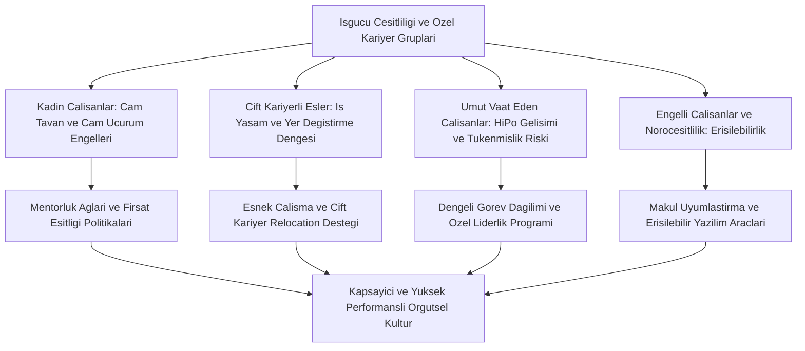
*Şekil 10.1: Özel kariyer grupları, karşılaşılan yapısal engeller ve kapsayıcı İK çözüm mekanizmaları.*

### Bilgisayar Mühendisi İçin Uygulama
Teknoloji ve yazılım sektörü, özel kariyer grupları için en dönüştürücü potansiyele sahip ekosistemdir:
- **Bilişimde Kadın Varlığı (Women in Tech):** Kadın mühendislerin sektörde tutunabilmesi için şirket içi mentorluk programları, eşit işe eşit ücret denetimleri ve kadın yazılımcı toplulukları (PyLadies, Women Who Code) desteklenmelidir.
- **Nöroçeşitlilik ve Yazılım Mühendisliği:**
  - SAP, Microsoft ve EY gibi teknoloji devleri "Autism at Work" programları yürütmektedir.
  - Otizm spektrumundaki yazılımcılar; karmaşık kod tabanlarında anomali tespiti, siber güvenlik tehdit analizi, yazılım test otomasyonu (QA) ve veri temizleme süreçlerinde olağanüstü yüksek doğruluk oranlarına ulaşmaktadır.
  - Mühendislik yönetimi bu çalışanlar için sessiz çalışma odaları, yazılı ve net yönergeler ile duyusal uyaranları azaltılmış ortamlar sağlamalıdır.
- **Erişilebilir Yazılım Geliştirme (Accessibility - a11y):** Engelli bilgisayar mühendisleri, görme engelliler için ekran okuyucu uyumlu IDE'ler (VS Code erişilebilirlik modları) ve sesli kodlama araçlarıyla üretim yaparken; aynı zamanda geliştirilen yazılımların WCAG standartlarına uygun olmasını denetler.

### Çözümlü Vaka İncelemesi
*Vaka:* Küresel bir siber güvenlik şirketinde çalışan ve Asperger sendromu (otizm spektrumu) bulunan Yazılım Test Mühendisi Sinan, kalabalık ve gürültülü açık ofis ortamında sürekli strese girmekte, göz teması kuramadığı için haftalık sözlü durum toplantılarında yetersiz görünmekte ve yöneticisi tarafından düşük performansla etiketlenmektedir. Oysa Sinan tek başına şirketin son 1 yılda ürettiği en karmaşık sıfırıncı gün (zero-day) güvenlik açıklarını tespit etmiştir.

*Teorik Çözümleme:*
1. **Nöroçeşitlilik Ön Yargısı Teşhisi:** Şirket Sinan'ın nörolojik farklılığını ve duyusal hassasiyetlerini görmezden gelmiş; geleneksel sosyal iletişim beklentilerini dayatarak üstün teknik dehasını köreltme tehlikesi yaratmıştır.
2. **Kapsayıcı İK Müdahalesi:** Şirketin çeşitlilik ve kapsayıcılık danışmanı duruma müdahale eder. Sinan'a gürültü önleyici kulaklık, özel sessiz bir çalışma alanı ve haftada 4 gün evden çalışma esnekliği (Makul Uyumlaştırma) sağlanır. Sözlü toplantılar yerine Slack ve Jira üzerinden asenkron yazılı raporlama modeline geçilir. Sinan'ın stres düzeyi sıfırlanır ve şirketin güvenlik açıklarını yakalama performansı yüzde 60 artış gösterir.

### Sık Yapılan Hatalar ve Yanılgılar
- **"Çeşitlilik ve kapsayıcılık yalnızca yasal bir kota zorunluluğudur":** Nöroçeşitli ve farklı arka planlardan gelen çalışanlar, problemleri kalıpların dışında çözerek kuruma muazzam bir inovasyon gücü ve ticari avantaj sağlar.
- **"Engelli bireyler teknoloji dünyasında sadece basit veri girişi işleri yapabilir":** Doğru erişilebilir araçlar sağlandığında engelli ve nöroçeşitli mühendisler en karmaşık algoritmaları ve sistem mimarilerini başarıyla tasarlayabilir.

### Aktif Hatırlama Soruları ve Çözümleri
1. *Soru:* Kadın çalışanların kariyer engelleri bağlamında "Cam Tavan" (Glass Ceiling) ile "Cam Uçurum" (Glass Cliff) arasındaki kavramsal fark nedir?

Çözüm ve Açıklama

Cam tavan, kadınların üst yönetim kademelerine çıkmasını engelleyen görünmez kurumsal bariyerleri ifade eder. Cam uçurum ise kadın yöneticilerin kurumun krizde olduğu, başarısızlık ihtimalinin ve riskin aşırı yüksek olduğu kritik dönemlerde vitrine sürülerek liderliğe getirilmesi durumudur.

2. *Soru:* Teknoloji sektöründe "Nöroçeşitlilik" (Neurodiversity) kavramı neden bir engel veya hastalık olarak değil, bir yetenek havuzu olarak görülmektedir?

Çözüm ve Açıklama

Otizm spektrumu veya DEHB gibi nörolojik farklılıklar; bireylerde olağanüstü yüksek örüntü tanıma, detaylara odaklanma, sistemli mantıksal düşünme ve saatlerce kesintisiz kod veya veri analizi yapabilme yeteneği sağlar. Bu özellikler yazılım testi, veri bilimi ve siber güvenlikte üstün katma değer üretir.

3. *Soru:* Çift kariyerli eşler (Dual-Career Couples) için insan kaynakları yönetiminin sunabileceği "Yer Değiştirme" (Relocation) çözümü nasıl olmalıdır?

Çözüm ve Açıklama

Şirket eşlerden birine başka bir şehir veya ülkede terfi/nakil teklif ettiğinde; diğer eşe de aynı bölgedeki şirket içi açık pozisyonları önermeli, uzaktan (remote) çalışma imkânı sağlamalı veya dış piyasada kariyer danışmanlığı desteği sunarak ailenin kariyer senkronizasyonunu korumalıdır.

### Hafta Kaynak ve Video Kartı
- **Resmî İzlence ve Üniversite Portalı:** [İstanbul Nişantaşı Üniversitesi GET05011 İzlencesi](https://ebp.nisantasi.edu.tr/DereceProgramlari/Ders/1/0/16802/53713/1).
- **Çeşitlilik ve Yönetim:** [Harvard Business Review — Neurodiversity as a Competitive Advantage](https://hbr.org/).
- **Uluslararası Çalışma Örgütü:** [ILO Disability and Inclusion at Work](https://www.ilo.org/).
- **Ne İçin İncelenmeli:** Cam tavan modellerini, nöroçeşitlilik programlarının kurumsal çerçevesini ve engelli çalışanlar için makul uyumlaştırma ilkelerini kavramak için.

---

## Hafta 11: Kariyerin Doğasını etkileyen gelişmeler: örgüt yapısı değişimi, iş güvencesinin azalması, esnek çalışma, küçük işletmeler

### Öğrenme Hedefleri
Bu bölümü tamamladığınızda:
- Modern dünyada kariyerin doğasını kökten dönüştüren makroekonomik ve teknolojik faktörleri sıralayabileceksiniz.
- Hiyerarşik bürokratik örgütlerden yatay, ağ (network) ve çevik (agile) yapılara geçişin kariyer basamakları üzerindeki etkisini analiz edebileceksiniz.
- Eski ve yeni "Psikolojik Sözleşme" arasındaki farkı iş güvencesi ve istihdam edilebilirlik ekseninde açıklayabileceksiniz.
- Uzaktan çalışma (remote), hibrit modeller, Gig ekonomisi ve küçük teknoloji işletmelerinin sunduğu kariyer fırsatlarını değerlendirebileceksiniz.

### Kavram Açıklaması ve Teorik Çerçeve
20. yüzyılın sanayi toplumunda kurulan "ömür boyu tek şirkette çalışma ve emekli olma" paradigması, 21. yüzyılın dinamik küresel rekabet ortamında tamamen yıkılmıştır. Kariyerin doğasını dönüştüren 4 temel gelişme bulunmaktadır:

1. **Örgüt Yapılarındaki Radikal Değişimler:**
   - **Geleneksel Hiyerarşik Yapı:** Çok katmanlı piramit, dikey terfi basamakları, katı unvanlar ve emir-komuta zinciri.
   - **Yatay ve Ağ (Network) Yapıları:** Katmanların azaltılması (delayering), orta kademe yöneticiliğin erimesi, çapraz fonksiyonlu takımlar, otonom ve çevik (Agile/Scrum) çalışma hücreleri. Hiyerarşik basamak sayısı azaldığı için dikey terfi zorlaşmış, yatay kariyer zenginleşmesi zorunlu hale gelmiştir.

2. **İş Güvencesinin Azalması ve Psikolojik Sözleşmenin Dönüşümü:**
   - **Geleneksel Psikolojik Sözleşme:** "Çalışan şirkete sadakat ve itaat sunar; şirket karşılığında çalışana ömür boyu iş güvencesi ve düzenli terfi sağlar."
   - **Yeni (Çağdaş) Psikolojik Sözleşme:** "Şirket çalışana iş güvencesi taahhüt edemez; ancak çalışana piyasada her zaman değer görecek yeni yetkinlikler öğrenme ortamı ve 'İstihdam Edilebilirlik' (Employability) sunar. Çalışan ise şirkete çalıştığı süre boyunca yüksek performans ve değer üretimi sunar."

3. **Esnek Çalışma Biçimlerinin Yaygınlaşması:**
   - **Uzaktan Çalışma (Remote Work) ve Hibrit Model:** Coğrafi sınırların kalkması, asenkron iletişim, ofis bağımlılığının sona ermesi.
   - **Gig Ekonomisi ve Sözleşmeli Çalışma:** Tam zamanlı kadrolu istihdam yerine proje bazlı serbest çalışan (freelancer) veya sözleşmeli (contractor) uzman kullanımı.

4. **Küçük İşletmelerin ve Start-Up'ların Yükselişi:**
   - Büyük hantal şirketler yerine esnek, yenilikçi ve hızlı hareket eden küçük teknoloji start-up'larının istihdam payının büyümesi.
   - Küçük işletmelerde çalışmanın getirdiği "çoklu şapka takma" (multi-tasking), inisiyatif alma ve hızlı öğrenme eğrisi.

### Görsel Analiz Şeması
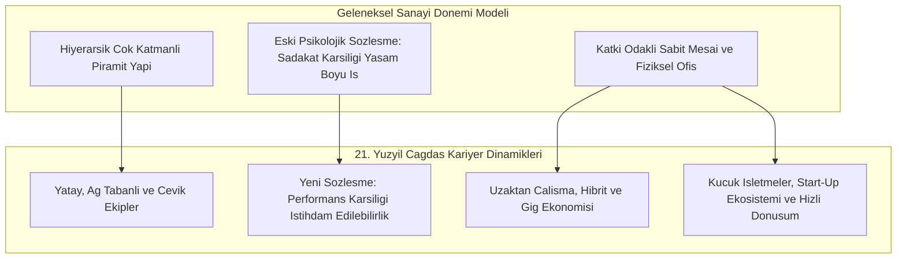
*Şekil 11.1: Geleneksel ve çağdaş kariyer dinamikleri, örgüt yapısı ve psikolojik sözleşme dönüşümü.*

### Bilgisayar Mühendisi İçin Uygulama
Bilgisayar mühendisliği bu makro dönüşümün merkez üssüdür:
- **Uzaktan Çalışma Disiplini ve Küresel İstihdam:** Türkiye'de yaşayan bir yazılım mühendisi Silikon Vadisi, Londra veya Berlin merkezli bir teknoloji şirketinde tam zamanlı remote çalışabilir. Bunun için gereken:
  - Üst düzey İngilizce teknik iletişim.
  - Asenkron çalışma kültürü: Slack, Jira, Loom ve GitHub pull request dokümantasyonu üzerinden iz bırakarak çalışma.
- **Start-Up vs Kurumsal Şirket Tercihi:**
  - *Start-Up:* Yüksek belirsizlik, düşük unvan hiyerarşisi; ancak sıfırdan sistem tasarlama, doğrudan ürün geliştirme ve çok hızlı teknik olgunlaşma.
  - *Büyük Kurumsal Şirket:* Yüksek süreç güvencesi, düzenli mentorluk; ancak dar uzmanlaşma alanı ve bürokratik onay süreçleri.
- **İş Güvencesi Yerine Piyasa Değeri İnşa Etme:** Yazılımcının güvencesi çalıştığı şirketin sözleşmesi değil; GitHub portföyü, çözebildiği algoritmik problemler ve sürekli güncel tuttuğu teknoloji yığınıdır.

### Çözümlü Vaka İncelemesi
*Vaka:* 35 yaşındaki Kıdemli Veritabanı Yöneticisi Hakan, 10 yıldır çalıştığı kurumsal telekom şirketinin "küçülme ve buluta geçiş" stratejisi kapsamında tek bir e-posta ile işten çıkarılmıştır. Hakan şok içindedir; çünkü 10 yıl boyunca şirketine sadakatle hizmet etmiş ve şirketin asla batmayacağına inanmıştır. Hakan iş aramaya başladığında kullandığı eski SQL araçlarının piyasada aranmadığını, bulut veri ambarlarının (Snowflake, BigQuery) talep edildiğini görerek derin bir işsizlik kaygısına kapılmıştır.

*Teorik Çözümleme:*
1. **Eski Psikolojik Sözleşme Çöküşü:** Hakan eski sanayi paradigmasına inanmış, kurumun sadakat karşılığı ömür boyu güvence vereceğini varsaymıştır. Şirket içi yatay katmanlaşma ve bulut dönüşümü bu bağı koparmıştır.
2. **Kariyer Öz Yönetimi ile Dönüşüm:** Hakan yeni psikolojik sözleşmeyi benimser: "Güvence şirkette değil, benim piyasa değerimdedir." 6 ay boyunca yoğun biçimde bulut veri mühendisliği sertifikasyonlarını tamamlar, açık kaynak projelerde yer alır. Ardından küresel bir fintech start-up'ında uzaktan çalışan bir "Cloud Data Architect" olarak işe başlar ve gelirini iki katına çıkarır.

### Sık Yapılan Hatalar ve Yanılgılar
- **"Kurumsal bir holdinge kapağı atarsam emekli olana kadar güvendeyim":** Küresel ekonomide hiçbir şirket mutlak iş güvencesi sağlayamaz; en köklü devler dahi ekonomik daralmalarda binlerce çalışanı işten çıkarabilmektedir.
- **"Start-up'larda çalışmak zaman kaybıdır ve aşırı risklidir":** Bir start-up'ta geçirilen 2 yıl, genç bir mühendise kurumsal şirkette 6 yılda edinemeyeceği sistem kurma, inisiyatif alma ve ürün çıkarma yetkinliği kazandırır.

### Aktif Hatırlama Soruları ve Çözümleri
1. *Soru:* Hiyerarşik örgüt yapılarından yatay ve ağ (network) tabanlı yapılara geçiş çalışanların "dikey terfi" olanaklarını nasıl etkilemiştir ve bunun yerine hangi kariyer mekanizması öne çıkmıştır?

Çözüm ve Açıklama

Orta kademe yöneticilik basamakları eridiği ve katmanlar azaldığı için geleneksel dikey terfi imkânları daralmıştır. Bunun yerine çalışanların farklı projelerde, çapraz fonksiyonlu ekiplerde ve yeni yetkinlik alanlarında yatay olarak geliştiği "yatay kariyer zenginleşmesi" ve rol bazlı uzmanlaşma öne çıkmıştır.

2. *Soru:* "Eski Psikolojik Sözleşme" ile "Yeni Psikolojik Sözleşme" arasındaki temel felsefe farkını açıklayınız.

Çözüm ve Açıklama

Eski sözleşme "sadakat ve itaat karşılığında ömür boyu iş güvencesi" vaat ederken; yeni psikolojik sözleşme iş güvencesi vaat etmez, bunun yerine çalışana yüksek performans ve değer üretimi karşılığında "sürekli öğrenme ve dış piyasada istihdam edilebilir kalma güvencesi" (employability) sunar.

3. *Soru:* Bilişim sektöründe uzaktan (remote) çalışan bir yazılım mühendisinin başarılı olabilmesi için hangi temel çalışma kültürü ve iletişim disiplinine sahip olması gerekir?

Çözüm ve Açıklama

Asenkron iletişim disiplinine sahip olmalıdır. Farklı zaman dilimlerindeki ekiplerle anlık toplantı bağımlılığı olmadan çalışabilmeli; kodlarını, mimari kararlarını ve görev durumlarını (Git, PR açıklamaları, Jira, Slack dokümantasyonu) şeffaf ve eksiksiz yazılı olarak aktarabilmelidir.

### Hafta Kaynak ve Video Kartı
- **Resmî İzlence ve Üniversite Portalı:** [İstanbul Nişantaşı Üniversitesi GET05011 İzlencesi](https://ebp.nisantasi.edu.tr/DereceProgramlari/Ders/1/0/16802/53713/1).
- **Çalışma Sosyolojisi Kaynağı:** [ILO — The Future of Work and Flexible Employment](https://www.ilo.org/).
- **Yönetim İncelemesi:** [Harvard Business Review — The New Psychological Contract](https://hbr.org/).
- **Ne İçin İncelenmeli:** Örgüt yapılarındaki dönüşümün kariyer yollarına etkisini ve yeni psikolojik sözleşmenin çalışma yaşamındaki pratik karşılıklarını analiz etmek için.

---

## Hafta 12: Yeni Kariyer Yaklaşımları: sınırsız, değişken (protean), portföy kariyer

### Öğrenme Hedefleri
Bu bölümü tamamladığınızda:
- 21. yüzyılın çağdaş kariyer kuramları olan Sınırsız Kariyer, Değişken (Protean) Kariyer ve Portföy Kariyer modellerini açıklayabileceksiniz.
- Michael Arthur ve Denise Rousseau'nun Sınırsız Kariyer (Boundaryless Career) modelinde fiziksel ve psikolojik hareketliliği ayırt edebileceksiniz.
- Douglas T. Hall'ın Değişken (Protean) Kariyer kuramında değer odaklı yönelim ve psikolojik başarı kavramlarını analiz edebileceksiniz.
- Charles Handy'nin Portföy Kariyer (Portfolio Career) modelini bir yazılım mühendisinin çoklu gelir ve beceri sepetine uygulayabileceksiniz.

### Kavram Açıklaması ve Teorik Çerçeve
Tek bir organizasyonun sınırları içine hapsolmuş geleneksel kariyer anlayışının yerini; bireyin merkezde olduğu, çoklu sınırları aşan ve esnek çağdaş kariyer modelleri almıştır.

1. **Sınırsız Kariyer (Boundaryless Career - Michael Arthur & Denise Rousseau):**
   - Kariyerin tek bir işverene veya örgütün sınırlarına bağlı kalmadan, örgütler, sektörler, meslekler ve coğrafyalar arasında akmasıdır.
   - **Fiziksel Hareketlilik (Physical Mobility):** Fiilen şirket, sektör veya ülke değiştirerek farklı kurumlarda çalışabilme kapasitesidir.
   - **Psikolojik Hareketlilik (Psychological Mobility):** Bireyin mevcut örgütün sınırlarını zihinsel olarak aşabilmesi, kurum dışı profesyonel ağlara açık olması, yeni fikirleri ve kimlikleri kolayca benimseyebilmesidir.

2. **Değişken / Dönüşebilen Kariyer (Protean Career - Douglas T. Hall):**
   - İsmini Yunan mitolojisinde istediği şekle girebilen deniz tanrısı Proteus'tan alır.
   - **İki Temel Bileşeni:**
     - *Değer Odaklı Yönelim (Values-Driven):* Kariyer kararlarını şirketin beklentileri veya toplumun dayattığı statüye göre değil; bireyin kendi içsel değerlerine, etik ilkelerine ve kişisel önceliklerine göre almasıdır.
     - *Öz Yönelim / Kendi Kendini Yönetme (Self-Directed):* Kariyerin dümeninde şirketin İK'sı değil, bireyin kendisinin oturmasıdır.
   - **Başarı Tanımı:** Başarı dışsal unvan veya maaşla değil; bireyin içsel doyumunu ifade eden **Psikolojik Başarı** (Psychological Success) ile ölçülür.

3. **Portföy Kariyer (Portfolio Career - Charles Handy):**
   - Charles Handy'nin "The Empty Raincoat" eserinde kuramsallaştırdığı modeldir.
   - Bireyin tek bir tam zamanlı işverene bağımlı olmak yerine, farklı müşterilere farklı beceri setlerini sunarak bir "portföy" oluşturmasıdır.
   - Bir hisse senedi portföyü gibi gelir ve risk çeşitlendirilir: Ücretli danışmanlık + proje bazlı yazılımcılık + eğitim ve içerik üretimi + açık kaynak bağışları/telifleri.

### Görsel Analiz Şeması
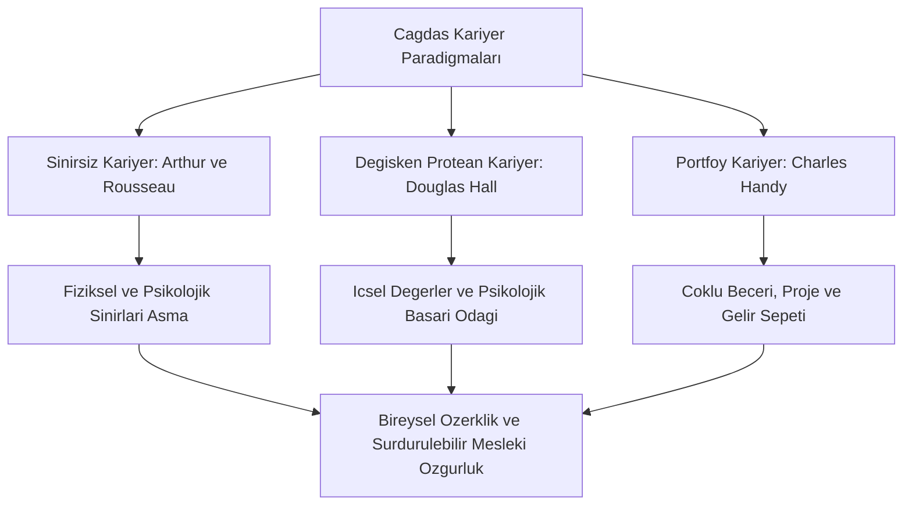
*Şekil 12.1: Çağdaş kariyer modelleri (Sınırsız, Değişken ve Portföy) kuramsal sentez şeması.*

### Bilgisayar Mühendisi İçin Uygulama
Yazılım mühendisliği alanı, bu üç yeni kariyer modelinin dünyada en kusursuz uygulandığı alandır:
- **Yazılımcının Portföy Kariyeri:**
  - Ana Bacak (%50 zaman): Bir teknoloji şirketine uzaktan kıdemli backend mimarisi danışmanlığı.
  - İkinci Bacak (%25 zaman): Kendi geliştirdiği ve bulutta çalışan mikro-SaaS aracının abonelik gelirleri.
  - Üçüncü Bacak (%15 zaman): Teknik blog yazarlığı, teknik bülten ve online video eğitim serisi.
  - Dördüncü Bacak (%10 zaman): Küresel açık kaynak repolarına katkı ve topluluk konuşmacılığı.
- **Yazılımda Protean Kariyer ve Değerler:** Yapay zekâ mühendisinin silah sanayiinde yüksek maaşlı bir teklifi reddederek, kişisel etik değerleriyle örtüşen yenilenebilir enerji optimizasyonu yapan bir yapay zekâ laboratuvarını tercih etmesi; tipik bir protean "değer odaklı yönelim" örneğidir.
- **Sınırsız Kariyerle Küresel Entegrasyon:** İstanbul'da yaşayan bir mühendisin GitHub üzerinden tanıştığı San Francisco'daki bir açık kaynak ekibine katılması, fiziksel ve psikolojik sınırların tamamen aşılmasıdır.

### Çözümlü Vaka İncelemesi
*Vaka:* 32 yaşındaki Yazılım Mimarı Ozan, 8 yıldır büyük bir kurumsal holdingde Genel Müdür Yardımcısı olmak için gece gündüz çalışmış, ancak son terfide patronun akrabası tercih edilmiştir. Ozan derin bir boşluğa düşmüş, "Bütün hayatımı bu şirkete adadım, şimdi ne yapacağım?" demiştir.

*Teorik Çözümleme:*
1. **Geleneksel Bağımlılık Yanılgısı:** Ozan kariyerinin kontrolünü kuruma devretmiş ve başarısını şirketin vereceği bir unvana bağlamıştır.
2. **Protean ve Portföy Dönüşümü:** Ozan bir kariyer danışmanının rehberliğinde Değişken (Protean) kariyer felsefesini benimser: "Benim değerim bu şirketin bana verdiği unvanla değil, ürettiğim teknik çözümlerle ölçülür." Şirketten ayrılarak portföy kariyer kurar: İki start-up'a yarı zamanlı sistem mimarlığı yapar, bir üniversitede konuk eğitmen olarak yapay zekâ dersi verir ve geliştirdiği açık kaynak geliştirici aracını ücretli destek modeliyle sunar. Ozan 1 yıl sonra eskisinden daha çok kazandığını ve hayatında ilk kez gerçek psikolojik başarıya ulaştığını belirtir.

### Sık Yapılan Hatalar ve Yanılgılar
- **"Sınırsız kariyer sık sık iş değiştirmekten (job hopping) ibarettir":** Sınırsız kariyer sorumsuzca iş değiştirmek değil; zihinsel olarak şirket sınırlarına hapsolmamak, öğrenme ağlarını kurum dışına yaymak ve sosyal sermayeyi genişletmektir.
- **"Portföy kariyer düzenli bir tam zamanlı iş bulamayanların çaresizlik tercihidir":** Tam tersine portföy kariyer, üst düzey uzmanlığa ve pazar talebine sahip nitelikli profesyonellerin bağımsızlık ve yüksek hayat kalitesi için bilinçli olarak seçtiği elit bir modeldir.

### Aktif Hatırlama Soruları ve Çözümleri
1. *Soru:* Michael Arthur ve Denise Rousseau'nun "Sınırsız Kariyer" (Boundaryless Career) modelinde "Fiziksel Hareketlilik" ile "Psikolojik Hareketlilik" arasındaki fark nedir?

Çözüm ve Açıklama

Fiziksel hareketlilik, çalışanın fiilen işveren, sektör, coğrafya veya ülke değiştirebilme yeteneğini ifade eder. Psikolojik hareketlilik ise bireyin mevcut çalıştığı kurumun duvarlarını zihinsel olarak aşabilmesi, kurum dışı mesleki topluluklarla bağ kurabilmesi, yeni kimliklere ve farklı bakış açılarına açık olabilmesidir.

2. *Soru:* Douglas T. Hall'ın "Değişken (Protean) Kariyer" modelinde kariyer başarısı nasıl tanımlanır ve geleneksel başarı tanımından farkı nedir?

Çözüm ve Açıklama

Geleneksel kariyerde başarı dışsal göstergelerle (maaş düzeyi, hiyerarşik unvan basamağı, makam büyüklüğü) ölçülür. Protean kariyerde ise başarı bireyin kendi içsel değerleriyle uyumlu yaşaması, kişisel hedeflerine ulaşması ve işinden duyduğu içsel tatmin olan "Psikolojik Başarı" (Psychological Success) ile ölçülür.

3. *Soru:* Charles Handy'nin "Portföy Kariyer" (Portfolio Career) modeli bir bilgisayar mühendisine gelir ve iş güvenliği açısından nasıl bir avantaj sağlar?

Çözüm ve Açıklama

Tek bir işverene bağımlılığı ortadan kaldırır. Geliri tek bir maaşa bağlamak yerine danışmanlık, freelance projeler, SaaS ürünleri ve eğitim gibi farklı kaynaklara yayarak risk çeşitlendirmesi (risk diversification) sağlar. Müşterilerden biriyle ilişki kopsa dahi mühendis finansal krize girmez.

### Hafta Kaynak ve Video Kartı
- **Resmî İzlence ve Üniversite Portalı:** [İstanbul Nişantaşı Üniversitesi GET05011 İzlencesi](https://ebp.nisantasi.edu.tr/DereceProgramlari/Ders/1/0/16802/53713/1).
- **Kariyer Kuramı Kaynağı:** [Harvard Business Review — The Protean Career Concept](https://hbr.org/).
- **Akademik İnceleme:** [Journal of Vocational Behavior — Boundaryless Career](https://www.onetonline.org/).
- **Ne İçin İncelenmeli:** Sınırsız kariyer hareketliliği boyutlarını, protean kariyer tutum ölçeklerini ve portföy kariyer yapılandırma prensiplerini derinlemesine öğrenmek için.

---

## Hafta 13: Günümüz konuları: örgütler arası hareketlilik, İstihdam Edilebilirlik, kariyer öz yönetimi, sübjektif kariyer başarısı

### Öğrenme Hedefleri
Bu bölümü tamamladığınızda:
- Örgütler arası hareketlilik (inter-organizational mobility) kavramını ve sosyal sermaye aktarımındaki rolünü açıklayabileceksiniz.
- İstihdam Edilebilirlik (Employability) kavramını içsel ve dışsal boyutlarıyla analiz edebileceksiniz.
- Kariyer Öz Yönetimi (Career Self-Management) stratejilerini proaktif davranışlar ekseninde uygulayabileceksiniz.
- Objektif kariyer başarısı ile Sübjektif kariyer başarısı arasındaki farkı kavrayarak dengeli bir kariyer değerlendirmesi yapabileceksiniz.

### Kavram Açıklaması ve Teorik Çerçeve
Günümüz çalışma ekosistemi, çalışanların pasif birer görev icracısı değil; kendi kariyerlerinin stratejik girişimcisi olmalarını şart koşmaktadır.

1. **Örgütler Arası Hareketlilik (Inter-Organizational Mobility):**
   - Çalışanların kariyerleri boyunca birden fazla organizasyon, sektör ve ekosistem arasında bilgi, deneyim ve sosyal ağ taşımasıdır.
   - Örgütler arası hareketlilik; kapalı kurumsal yapıların körleşmesini önler, inovasyonun ve en iyi uygulamaların (best practices) sektör içinde yayılmasını sağlar.

2. **İstihdam Edilebilirlik (Employability):**
   - Bireyin işgücü piyasasında ihtiyaç duyulan güncel yetkinliklere sahip olması; iş bulabilme, mevcut işini sürdürebilme ve gerektiğinde hızla yeni bir nitelikli işe geçebilme kapasitesidir.
   - **İçsel İstihdam Edilebilirlik:** Mevcut organizasyon içindeki vazgeçilmezlik, kurumun farklı projelerinde talep görme potansiyeli.
   - **Dışsal İstihdam Edilebilirlik:** Açık işgücü piyasasında, rakip şirketler nezdinde her an yüksek talep gören bir uzman olma gücü.

3. **Kariyer Öz Yönetimi (Career Self-Management):**
   - Bireyin kariyer gelişiminin sorumluluğunu şirketlere veya yöneticilere bırakmayıp bizzat üstlenmesidir.
   - **Proaktif Davranışlar:**
     - Kariyer hedeflerini netleştirme ve güncelleme.
     - Sürekli yetkinlik geliştirme (Up-skilling ve Re-skilling).
     - Geri bildirim arama (Feedback Seeking) ve kör alanları aydınlatma.
     - Profesyonel ağ kurma (Networking) ve görünürlük sağlama.

4. **Sübjektif vs Objektif Kariyer Başarısı:**
   - **Objektif Kariyer Başarısı:** Toplum ve kurumlar tarafından dışarıdan gözlemlenebilen, ölçülebilir ve somut metriklerdir: Maaş düzeyi, hiyerarşik unvan, alınan ödüller ve terfi sayısı.
   - **Sübjektif Kariyer Başarısı:** Bireyin kendi kariyer yolculuğunu kişisel değerleri, hedefleri ve yaşam tatmini açısından içsel olarak nasıl değerlendirdiğidir: İş doyumu, mesleki anlam, gurur, iş-yaşam dengesi ve psikolojik esenlik.

### Görsel Analiz Şeması
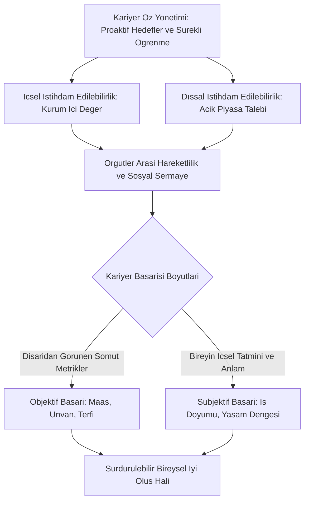
*Şekil 13.1: Kariyer öz yönetimi, istihdam edilebilirlik boyutları ve kariyer başarısı dengesi.*

### Bilgisayar Mühendisi İçin Uygulama
Yapay zekâ ve otomasyon çağında bilgisayar mühendisinin kariyer dinamikleri:
- **Yapay Zekâ Çağında Dışsal İstihdam Edilebilirliği Korumak:**
  - Kod yazma araçları (GitHub Copilot, Cursor vb.) rutin kodlamayı otomatikleştirirken, mühendisin değeri "Sistem Tasarımı", "Veri Güvenliği", "İş Alanı Modellemesi" ve "Etik Algoritma Denetimi" alanlarına kaymıştır.
  - Mühendis sürekli "Up-skilling" (mevcut beceriyi derinleştirme) ve "Re-skilling" (yeni beceri kazanma) döngüsünde kalmalıdır.
- **Kariyer Öz Yönetimi Araç Seti:**
  - Kişisel Teknik Web Sitesi ve Blog (teknik yazılar yayınlama).
  - Aktif GitHub Profili (açık kaynak katkılarıyla kodlama disiplinini kanıtlama).
  - LinkedIn Düşünce Liderliği (sektörel tartışmalara yapıcı mühendislik yorumlarıyla katılma).
- **Sübjektif Başarıyı Tanımlamak:** Yazılım sektöründe yüksek maaş uğruna haftada 80 saat çalışıp tükenmişlik (burnout) yaşayan bir mühendis, objektif olarak başarılı görünse de sübjektif olarak derin bir başarısızlık yaşar. Mühendis kendi başarı metriğini (örneğin esnek çalışma saatleri, aileye zaman ayırma ve açık kaynak katkısı) kendisi belirlemelidir.

### Çözümlü Vaka İncelemesi
*Vaka:* 29 yaşındaki Yapay Zekâ Mühendisi Sinem, Türkiye'nin önde gelen bir savunma şirketinde yüksek maaş ve "Kıdemli Uzman" unvanıyla çalışmaktadır (Yüksek Objektif Başarı). Ancak Sinem geliştirdiği algoritmaların sivil hayata doğrudan dokunmadığını düşünmekte, çalışma ortamının katı gizlilik kuralları nedeniyle açık kaynak dünyasından koptuğunu hissetmekte ve mesleki tatminsizlik yaşamaktadır (Düşük Sübjektif Başarı).

*Teorik Çözümleme:*
1. **Başarı Dengesizliği Teşhisi:** Sinem objektif başarıya sahiptir ancak sübjektif başarı kriterleri olan "toplumsal fayda", "özerklik" ve "açık kaynak üretimi" karşılanmamaktadır.
2. **Kariyer Öz Yönetimi Müdahalesi:** Sinem proaktif olarak kariyer öz yönetimi adımlarını işletir. Dışsal istihdam edilebilirliğini test etmek amacıyla medikal görüntüleme üzerine çalışan açık kaynaklı küresel bir sağlık yapay zekâsı projesine akşamları katkı vermeye başlar. 4 ay sonra bu alanda küresel bir sağlık teknolojileri firmasından uzaktan çalışma teklifi alır. Maaşı öncekiyle benzerdir ancak Sinem kanser teşhisi algoritmaları geliştirerek hayal ettiği sübjektif tatmine ve anlam duygusuna kavuşur.

### Sık Yapılan Hatalar ve Yanılgılar
- **"İstihdam edilebilirlik üniversite diplomasını alınca ömür boyu garantiye alınır":** Bilişim sektöründe diploma sadece ilk kapıyı aralar; diplomanın arkasındaki bilgi her yıl güncellenmezse istihdam edilebilirlik birkaç yılda sıfırlanır.
- **"Objektif başarı yüksekse sübjektif başarı kendiliğinden gelir":** Milyon dolarlık bütçeleri yöneten ancak kronik uykusuzluk, stres ve anlamsızlık yaşayan binlerce profesyonel; unvan ve paranın tek başına içsel tatmin getirmediğinin kanıtıdır.

### Aktif Hatırlama Soruları ve Çözümleri
1. *Soru:* Bir bilgisayar mühendisi için "İçsel İstihdam Edilebilirlik" ile "Dışsal İstihdam Edilebilirlik" arasındaki farkı açıklayınız.

Çözüm ve Açıklama

İçsel istihdam edilebilirlik, mühendisin mevcut çalıştığı şirketin sistemlerini, iş süreçlerini ve kültürünü çok iyi bilerek şirket içindeki farklı projelerde vazgeçilmez olmasıdır. Dışsal istihdam edilebilirlik ise mühendisin güncel teknolojilere (örneğin PyTorch, Docker, Kubernetes) ve evrensel yazılım mimarisi yetkinliklerine sahip olarak açık işgücü piyasasında her an başka bir şirket tarafından talep edilebilir olmasıdır.

2. *Soru:* "Objektif Kariyer Başarısı" ile "Sübjektif Kariyer Başarısı" arasındaki temel fark nedir?

Çözüm ve Açıklama

Objektif kariyer başarısı maaş, unvan, terfi sayısı ve ödüller gibi dışarıdan gözlemlenebilen somut kriterlere dayanır. Sübjektif kariyer başarısı ise bireyin kendi mesleki serüveninden duyduğu içsel tatmin, psikolojik doyum, iş-yaşam dengesi ve yaptığı işin kişisel değerleriyle örtüşme derecesidir.

3. *Soru:* "Kariyer Öz Yönetimi" (Career Self-Management) yaklaşımını benimseyen bir profesyonelin sergileyeceği temel proaktif davranışlar nelerdir?

Çözüm ve Açıklama

Kendi kariyer hedeflerini bilinçli olarak belirlemek, şirket eğitimlerini beklemeden kendi öğrenme bütçesini ve planını yönetmek (up-skilling), yöneticilerinden ve akranlarından proaktif geri bildirim istemek ve sektör profesyonelleriyle sürekli mesleki ağlar (networking) kurmaktır.

### Hafta Kaynak ve Video Kartı
- **Resmî İzlence ve Üniversite Portalı:** [İstanbul Nişantaşı Üniversitesi GET05011 İzlencesi](https://ebp.nisantasi.edu.tr/DereceProgramlari/Ders/1/0/16802/53713/1).
- **İstihdam Politikaları:** [OECD Employment Outlook and Skills Studies](https://www.oecd.org/).
- **Akademik Yönetim Literatürü:** [Harvard Business Review — Managing Yourself](https://hbr.org/).
- **Ne İçin İncelenmeli:** İstihdam edilebilirlik modellerini, sübjektif kariyer başarısı ölçeklerini ve bireysel kariyer öz yönetimi stratejilerini kuramsal kaynaklarından incelemek için.

---

## Hafta 14: Genel Tekrar ve final hazırlığı

### Öğrenme Hedefleri
Bu bölümü tamamladığınızda:
- GET05011 Kariyer Planlaması dersinin 14 haftalık tüm resmî müfredatını bütünleşik bir zihin haritası üzerinde sentezleyebileceksiniz.
- Bireysel kariyer dinamikleri (yetenek, çıpalar, evreler), örgütsel mekanizmalar (terfi, nakil, yedekleme) ve çağdaş paradigmalar (sınırsız, protean, esnek çalışma) arasındaki teorik köprüleri kurabileceksiniz.
- Kapsamlı karma final vakalarını çok boyutlu olarak analiz edip gerekçeli yönetim ve mühendislik stratejileri üretebileceksiniz.
- Final sınavında yer alacak açık uçlu, analitik ve sentez düzeyindeki soruları akademik başarıyla yanıtlayabileceksiniz.

### Kavram Açıklaması ve Teorik Çerçeve
Kariyer Planlaması dersi, bireyin kendini keşfetmesinden başlayarak kurumların karmaşık yetenek sistemlerine ve 21. yüzyılın küresel istihdam gerçeklerine uzanan 4 ana ekseni kapsar:

1. **Dönemin Dört Ana Ekseninin Makro Sentezi:**
   - **Eksen 1: Bireysel Temeller ve Öz Farkındalık (Hafta 1, 4, 5):**
     - Kariyer, iş ve meslek ayrımı.
     - Spencer and Spencer Yetkinlik Buzdağı (su üstü bilgi-beceri, su altı güdüler ve öz-imaj).
     - Donald Super'ın Yaşam Boyu evreleri (Keşfetme, Kurma, Sürdürme, Çözülme) ve Douglas Hall'ın teknolojik mini-döngüleri.
     - Edgar Schein'ın 8 Kariyer Çapası ve Michael Driver'ın 4 Kariyer Kalıbı.
   - **Eksen 2: Örgütsel Kariyer Sistemleri ve İK Entegrasyonu (Hafta 2, 3, 6, 7):**
     - Örgütsel Kariyer Yönetimi aşamaları ve İkili Kariyer Merdiveni (Dual Career Ladder).
     - Terfi ve nakil kriterleri, Peter İlkesi risk mekanizması.
     - İnsan Kaynakları işlevleri (Planlama, Temin-Seçim, ATS, Performans, STAR mülakatı).
     - Kariyer geliştirme: İş rotasyonu, mentorluk, koçluk ve tersine mentorluk.
   - **Eksen 3: Çeşitlilik ve Kurumsal Dayanıklılık (Hafta 9, 10):**
     - Yedekleme Yönetimi, Bus Factor riski, 9-Kutu (9-Box) Performans-Potansiyel Matrisi.
     - Özel kariyer grupları: Cam tavan, cam uçurum, çift kariyerli eşler, HiPo çalışanlar, engelli çalışanlar ve teknoloji sektöründe nöroçeşitlilik.
   - **Eksen 4: Makro Dönüşüm ve Çağdaş Kariyer Modelleri (Hafta 11, 12, 13):**
     - Yatay örgütler, yeni psikolojik sözleşme, uzaktan çalışma ve start-up dinamikleri.
     - Sınırsız Kariyer (fiziksel ve psikolojik hareketlilik), Değişken Protean Kariyer (içsel değerler ve psikolojik başarı), Portföy Kariyer (Handy).
     - Örgütler arası hareketlilik, istihdam edilebilirlik, kariyer öz yönetimi, objektif ve sübjektif kariyer başarısı.

2. **Dönem Sonu Büyük Kavramsal Karşılaştırma Matrisi:**
   | Boyut | Geleneksel Kariyer Yaklaşımı | Çağdaş (Modern) Kariyer Yaklaşımı |
   | :--- | :--- | :--- |
   | **Sorumluluk Sahibi** | Kurum ve İK Departmanı | Bireyin Kendisi (Kariyer Öz Yönetimi) |
   | **Temel Güvence** | İş Güvencesi (Kuruma Sadakat) | İstihdam Edilebilirlik (Piyasa Değeri) |
   | **İlerleme Yolu** | Dikey Hiyerarşik Terfi | Yatay Zenginleşme, Ağ ve Portföy |
   | **Başarı Ölçütü** | Objektif Başarı (Maaş, Unvan, Makam) | Sübjektif Başarı (Psikolojik Doyum, Anlam) |
   | **Örgütsel Sınırlar** | Tek Şirkete Bağlılık (Sınır İçi) | Sınırsız ve Protean Hareketlilik |
   | **Kritik Risk** | Peter İlkesi ve Kariyer Platosu | Hızlı Teknoloji Eskimesi ve Tükenmişlik |

### Görsel Analiz Şeması
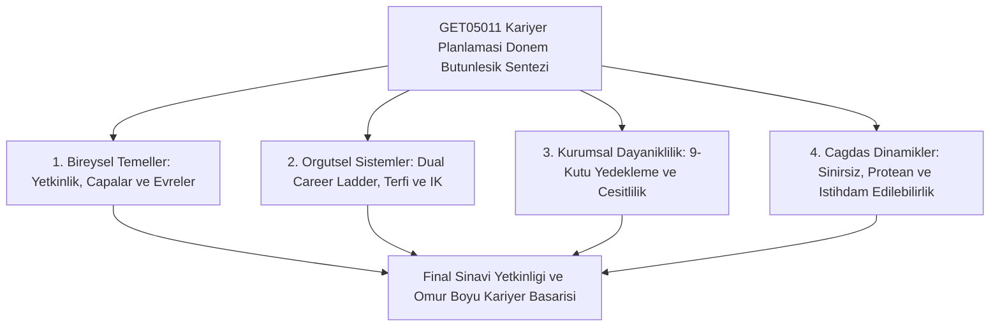
*Şekil 14.1: 14 haftalık GET05011 Kariyer Planlaması müfredatının makro sentez ve final entegrasyon modeli.*

### Bilgisayar Mühendisi İçin Uygulama
Dönem sonu itibarıyla bir bilgisayar mühendisliği öğrencisinin profesyonel hayata geçiş audit (denetim) ve eylem planı:
- **1. Yıl (Hazırlık ve Keşif):**
  - Kariyer Merkezi etkinliklerine ve Yetenek Kapısı platformuna kayıt.
  - Temel programlama ve algoritma disiplini kazanma, GitHub hesabı açma.
- **2. Yıl (Temel Yetkinlik İnşası):**
  - T-tipi mühendisliğin yatay çubuğunu tamamlama (Veri Yapıları, İşletim Sistemleri, Bilgisayar Ağları).
  - Açık kaynak kod depolarını inceleme ve ilk küçük katkıları verme.
- **3. Yıl (Uzmanlaşma ve Kristalleşme):**
  - Dikey uzmanlık alanını belirleme (örneğin Derin Öğrenme, MLOps, Bulut Mimarileri).
  - ATS uyumlu teknik CV hazırlama, STAR metodolojisiyle mülakat simülasyonları yapma.
  - Zorunlu kurumsal stajı tamamlama, sektörden mentor edinme.
- **4. Yıl (Profesyonel Geçiş ve Portföy):**
  - Bitirme projesini canlı demolu, Docker konteynerli ve API servisli bir ürüne dönüştürme.
  - Mezuniyet öncesi 20-30 hedefli şirkete kişiselleştirilmiş başvuru yapma.
  - Kendi kariyer çıpasına ve değerlerine uygun ilk tam zamanlı iş teklifini kabul etme.

### Çözümlü Vaka İncelemesi (Büyük Final Sınavı Vakası)
*Vaka:* 500 çalışanı olan küresel bir yazılım geliştirme şirketi olan "AtlasTech", hızla gelişen üretken yapay zekâ (GenAI) dalgası karşısında ciddi bir dönüşüm krizine girmiştir. Şirkette şu dört temel problem eş zamanlı yaşanmaktadır:
1. Şirketin en parlak mühendisleri, dikey terfi edebilmek için yöneticilik kadrolarına geçmekte, ancak yönetsel işlerde başarısız olup şirketin teknik inovasyonunu baltalamaktadır.
2. 50 yaşındaki kıdemli yazılım mimarları yeni nesil bulut ve yapay zekâ teknolojilerine direnmekte ve ekipler arasında şiddetli çatışmalar yaşanmaktadır.
3. Kritik sistemlerin tüm mimarisini bilen iki Baş Mimarın istifa etmesiyle şirket operasyonları kilitlenme noktasına gelmiştir.
4. Genç mühendisler yüksek maaşa rağmen şirketin esnek çalışma sunmamasından ve katı unvan hiyerarşisinden şikâyet ederek 1 yıl içinde istifa etmektedir.

*Final Sınavı Formatında Bütünleşik Çözüm Raporu:*
1. **Yönetsel Tıkanıklık ve Peter İlkesi İçin (Hafta 2 ve 3):** Şirkette derhal **İkili Kariyer Merdiveni (Dual Career Ladder)** kurulmalıdır. Mühendislere Bireysel Katkı Sağlayıcı (IC) patikası açılarak Staff ve Principal Engineer pozisyonları ihdas edilmeli; teknik uzmanlar yöneticilik yapmadan terfi ettirilmelidir.
2. **Kıdemli Mühendislerin Direnci ve Plato Krizi İçin (Hafta 4 ve 7):** Sürdürme evresindeki mimarlar için Douglas Hall'ın **mini kariyer döngüleri** kapsamında yapay zekâ modernizasyon kampları düzenlenmelidir. Ayrıca genç mühendislerle kıdemli mimarlar arasında **Tersine Mentorluk** mekanizması kurularak kuşaklararası köprü inşa edilmelidir.
3. **Sistem Kilitlenmesi ve Otobüs Faktörü İçin (Hafta 9):** Kurumsal bir **Yedekleme Yönetimi** sistemi kurulmalı, 9-Kutu matrisinde "Yıldız" kategorisindeki genç mühendisler kritik mimari rollere yedek olarak yetiştirilmeli ve kod sahipliği dokümantasyonla güvenceye alınmalıdır.
4. **Genç Mühendislerin Ayrılması İçin (Hafta 11, 12, 13):** Yeni nesil çalışanların **Protean ve Sınırsız Kariyer** beklentilerine yanıt verilmelidir. Hibrit ve uzaktan çalışma esnekliği sağlanmalı, psikolojik başarıyı destekleyen otonom proje zamanları (Google'ın yüzde 20 zamanı gibi) tanınmalı ve kurum içi istihdam edilebilirlik fırsatları sunulmalıdır.

### Sık Yapılan Hatalar ve Yanılgılar
- **"Final sınavında vaka sorusuna sadece kişisel fikirlerle yanıt vermek":** Vaka analizinde tam not almak için her çözüm mutlaka derste işlenen kuramcıların isimleriyle (Schein, Super, Hall, Peter, Handy, Arthur) ve kavramsal modelleriyle temellendirilmelidir.
- **"Kariyer planlamasını üniversite bitince sona eren bir süreç sanmak":** Kariyer planlama yaşam boyu süren, teknolojik ve kişisel değişimlerle sürekli güncellenen dinamik bir öz yönetim sürecidir.

### Aktif Hatırlama Soruları ve Çözümleri
1. *Soru:* GET05011 Kariyer Planlaması dersinde işlenen kuramlar ışığında "Geleneksel Kariyer" ile "Çağdaş Kariyer" paradigmalarını; kariyerin sahipliği, temel güvence kaynağı ve başarı ölçütü olmak üzere üç boyutta karşılaştırınız.

Çözüm ve Açıklama

1. Sahiplik: Geleneksel kariyerde sorumluluk kuruma ve İK'ya aitken, çağdaş kariyerde bireyin kendisine (Kariyer Öz Yönetimi) aittir. 2. Güvence: Geleneksel kariyerde sadakat karşılığı "iş güvencesi" varken, çağdaş kariyerde kurum içi veya dışı piyasa değeri olan "istihdam edilebilirlik" esastır. 3. Başarı Ölçütü: Geleneksel kariyerde dışsal maaş ve hiyerarşik unvan basamağı (Objektif Başarı) ölçütken, çağdaş kariyerde bireyin içsel değerleriyle uyumlu iş doyumu ve anlam (Sübjektif Başarı) esastır.

2. *Soru:* Bir yazılım Ar-Ge merkezinde hem teknik yetenek kaybını (turnover) önlemek hem de operasyonel sürekliliği sağlamak için "İkili Kariyer Merdiveni" ile "Yedekleme Yönetimi" nasıl entegre çalıştırılmalıdır?

Çözüm ve Açıklama

İkili kariyer merdiveni derin teknik uzmanlığa sahip mühendislerin yönetsel rollere geçmeden Staff/Principal seviyelerine yükselmesini sağlar. Yedekleme yönetimi ise bu kritik IC (bireysel katkı sağlayıcı) rollerini 9-Kutu matrisiyle haritalandırarak her kritik pozisyon için yetenek havuzundan yedek mühendisler yetiştirir. Böylece mühendisler hem teknik tatmin yaşar hem de şirket Bus Factor krizinden korunur.

3. *Soru:* Donald Super'ın kariyer evreleri modeli ile Douglas Hall'ın değişken (protean) kariyer yaklaşımı yapay zekâ çağında nasıl uzlaştırılabilir?

Çözüm ve Açıklama

Super'ın modeli bireyin biyolojik ve gelişimsel olgunlaşmasını (özellikle keşfetme ve kurma evrelerinin temel görevlerini) açıklarken; Hall'ın protean yaklaşımı bu evrelerin teknolojik kırılımlar karşısında sabit kalmayıp yaşam boyu çoklu "mini kariyer döngüleri" ile tekrarlanacağını gösterir. Mühendis Super'ın ana evrelerini yaşarken, yapay zekâ gibi her yeni teknolojik çağda Hall'ın protean değer odaklı öğrenme döngüsünü işleterek güncel kalır.

### Hafta Kaynak ve Video Kartı
- **Resmî İzlence ve Üniversite Portalı:** [İstanbul Nişantaşı Üniversitesi GET05011 İzlencesi](https://ebp.nisantasi.edu.tr/DereceProgramlari/Ders/1/0/16802/53713/1).
- **Bilgi Paketi ve Ders Kataloğu:** [İstanbul Nişantaşı Üniversitesi EBP Portalı](https://ebp.nisantasi.edu.tr/).
- **Ulusal Kariyer Platformu:** [T.C. Cumhurbaşkanlığı İnsan Kaynakları Ofisi Yetenek Kapısı](https://www.yetenekkapisi.org/).
- **Ne İçin İncelenmeli:** Resmî 14 haftalık GET05011 ders öğrenme çıktılarını (DÖÇ) kontrol etmek ve dönem sonu final sınavı hazırlık matrislerini doğrulamak için.

---
